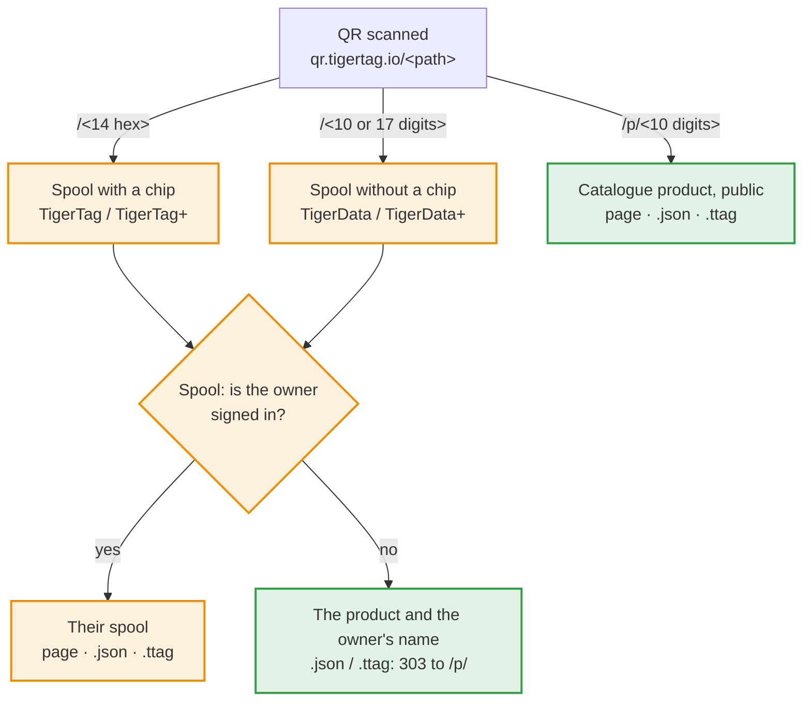

# Spool ids and QR links

> **Ratified 2026-11-05 — not implemented yet.** Apps build on this contract.
> The points still open are listed at the end; settling one changes only what
> it names. Sections marked **Proposed** are not ratified yet: do not build on
> them before they are.

## Quick explanation

A TigerTag QR code holds one short link, `https://qr.tigertag.io/<path>`. The
path says what it opens:



Orange is private to the spool's owner; green is public.

| QR code on | Path | Example |
|---|---|---|
| a spool with a chip (TigerTag / TigerTag+) | the chip UID in hex, 14 characters, printed lowercase; the twin chip's UID opens the same spool | [qr.tigertag.io/1d33dbda0d1080](https://qr.tigertag.io/1d33dbda0d1080) |
| a spool without a chip (TigerData / TigerData+) | the id without its `TigerData_` prefix: 10 or 17 digits; the long form (`TigerData_6130922252`, `tigerdata-…`) works too | [qr.tigertag.io/6130922252](https://qr.tigertag.io/6130922252) |
| a product (TigerQR+) | `p/` + the `id_product` in decimal, always 10 digits, zero-padded (`p/0010303748`); older labels with 8 hex characters (`p/9f5e0644`) still open | [qr.tigertag.io/p/2673739332](https://qr.tigertag.io/p/2673739332) |

- **A spool link:** the owner, signed in, sees their spool; anyone else sees
  the product and the owner's name. `.json` and `.ttag` give the spool to its
  owner only; anyone else gets a `303` to the product's `.json` / `.ttag`.
- **A product link** is public, no sign-in: the catalogue page, its data
  ([`p/2673739332.json`](https://qr.tigertag.io/p/2673739332.json)) and its file ([`p/2673739332.ttag`](https://qr.tigertag.io/p/2673739332.ttag)).
- Links are read in any case.
- To share a spool or a product, share this short link: it is the one printed
  on labels, and every app reads it. A shared link may start with a language (`qr.tigertag.io/fr/p/2673739332`): the page then opens in that language for everyone. Printed labels never carry one.

The rest of this page is the contract itself.

The rules every TigerSystem app follows:

1. how a **chipless spool** (TigerData / TigerData+) gets its id;
2. how a spool **keeps its link** when it gets a chip;
3. how a spool's id is written into the **QR code** of a printed label, and
   read back;
4. how an app **calls a spool with values** (a weight, a note) through a link;
5. how a **product** gets its own link;
6. how a link answers in **JSON** or as a **`.ttag` file**.
7. what a **printed label** carries, and its templates.

## 1. Spool ids

A spool is a document of the account's inventory,
`users/{uid}/inventory/{spoolId}`. The document id **is** the spool id: one
account cannot hold two spools with the same id.

| Spool | Id | Example |
|---|---|---|
| Chip (TigerTag / TigerTag+) | the chip's NFC UID, uppercase hex, 14 characters (an NTAG's 7-byte UID) | `04AB12CD3E4F80` |
| Chipless, minted from now on | `TigerData_` + epoch **milliseconds** (13 digits) + a random number **0000–9999** (always 4 digits) | `TigerData_17623456789014213` |
| Chipless, minted before this contract | `TigerData_` + 10 random digits | `TigerData_4480517985` |
| Chipless, legacy prefix | `CLOUD_` + 10 random digits | `CLOUD_4480517985` |
| Legacy decimal (old Android app) | the UID written in decimal, being migrated to hex | `1234567890123456` |

Ids already minted are **never rewritten** by this contract. Readers only test
the prefix (`TigerData_` / `CLOUD_` → chipless); none of them depends on the
number of digits. The id is an identifier, nothing else: never derive a
creation date from it. A 4-byte UID (a proprietary chip linked to a spool) is
never the name of an inventory document, so it never appears in a link.

### Minting a chipless id

Every app that creates chipless spools (Tiger Studio today, the mobile app
later) mints the id the same way:

1. **Compose** `TigerData_<Date.now()><four random digits>`.
2. **Local check** — if the id is already in the inventory the app holds (the
   live listener's copy, offline cache included) or in its `uidMigrationMap`,
   compose another one. This works offline.
3. **Write**
   - **online:** in a transaction that reads the document first and fails if
     it exists; on failure go back to step 1;
   - **offline:** a plain write, queued by Firestore until the network
     returns. Steps 1 and 2 are the only guard.

A plain `set()` on an id that already exists **overwrites** the spool already
there, silently. That is what step 3 prevents.

The four random digits also make a new chipless id practically unique
**across all accounts** (about one collision every 600 years at a million
chipless spools a year), so a server can later resolve a link for someone
other than the owner without changing any printed label.

## 2. Keeping the link when a spool gets a chip

Programming a chip on a chipless spool moves the spool to the chip's UID. In
**one batch**:

1. write the spool under the chip UID (and the twin UID, for a twin pair);
2. delete the `TigerData_…` document;
3. write the redirect `users/{uid}/uidMigrationMap/{old id}` →
   `{ hex_uid, migrated_at }`.

The batch makes the three happen together or not at all. The redirect lives in
`uidMigrationMap` (the collection that already maps legacy decimal ids to hex),
never as a stub document in the inventory: everything that reads the inventory
counts one document as one spool.

## 3. QR links

A printed spool label carries a QR code holding a link to the spool, **and
nothing else** (no weight, no note — printed values go stale):

```
https://qr.tigertag.io/<id>
```

Nothing is printed in clear next to the code: no id, no link. The QR code is
the way back to the spool.

`<id>` is the spool id **without its prefix**:

| Spool | Link |
|---|---|
| Chip | `https://qr.tigertag.io/04ab12cd3e4f80` |
| Chipless (new) | `https://qr.tigertag.io/17623456789014213` |
| Chipless (before this contract) | `https://qr.tigertag.io/4480517985` |
| `CLOUD_` | **no QR link** — the label is printed without a QR code |
| Legacy decimal | **no QR link** — migrate the spool to hex first |

### Encoding

- The whole link is **lowercase**, the id included: `https://qr.tigertag.io/04ab12cd3e4f80`.
  Tested 2026-11-07: the iPhone camera opens a link in either case, but the
  Samsung camera (Galaxy S24) shows an uppercase `HTTPS://` link as plain text
  and opens only a lowercase one.
- One **byte**-mode segment. A lowercase scheme cannot use the alphanumeric
  mode, and splitting the link into segments saves nothing (measured: every
  variant is 29 × 29).
- Error correction **M** (15 %): labels get scratched and folded.
- Result: **29 × 29 modules** for every spool and product link. Draw each
  module on a whole number of printer dots, with the standard 4-module quiet
  zone.

### Reading a link back

Readers parse the id from the link **offline**: an app scanning a label never
needs the website. They read the path case-insensitively, ignore a trailing
`/`, and resolve it by its shape:

| Path | Spool id |
|---|---|
| 17 digits | `TigerData_<17 digits>` |
| 10 digits | `TigerData_<10 digits>` |
| 14 hex characters | the UID, uppercased |
| 13 hex characters starting with `4` | a truncated NTAG UID: `0` + the 13 characters ([repair rule](https://github.com/TigerTag-Project/TigerTag-Studio-Manager/issues/146)) |
| `p/` + the `id_product`: 10 decimal digits (as printed) or 8 hex characters (older labels) | a product — [section 5](#5-product-links) |

A `.JSON` or `.TTAG` ending asks for the answer for tools — [section 6](#6-json-and-ttag-answers).

Apps **write** the short form above, but readers also **accept the long form**:
the `TigerData` prefix in any case, followed by `_` or `-`, then the 17 or 10
digits — `TigerData_17623456789014213`, `TigerData-17623456789014213`,
`TIGERDATA-17623456789014213`, `tigerdata_4480517985` all resolve to the same
spool. A link typed or shared by hand keeps working. The `CLOUD` prefix is not
accepted in either form.

A UID may be all digits, but it is 14 characters long, never 17 or 10, so the
length always decides. No legacy decimal id reaches a reader, since none is ever
printed. Any **other shape** is a label from a newer version: the reader says so
("update the app") instead of failing. Every other kind of thing gets its own
folder, a letter and a `/` (`p/` for a product, later `r/` for a rack), so it can
never clash with spool links already printed.

### Language prefix

A shared link may carry the sharer's language before the path. *(2026-11-11.)*

```
https://qr.tigertag.io/<lang>/<spool id>
https://qr.tigertag.io/<lang>/p/<id_product>
```

`<lang>` is one of `en`, `fr`, `de`, `es`, `it`, `zh`, `pt`, `pt-pt`, `pl`,
`ru`, `nl`, written lowercase and read in any case.

- The page then opens in that language for everyone, link-preview crawlers
  included: `/fr/p/2673739332` → `tigersystem.io/fr/catalog/2673739332`.
- Without a prefix, the visitor's browser language decides.
- An unknown prefix is a `404`.
- **Printed labels never carry a prefix**: they stay language-neutral. Only
  Share buttons add one (tigersystem.io today, Tiger Studio with its next
  release).

### Resolving the spool

1. Look the id up **in the signed-in viewer's own inventory**.
2. Not there → look it up in the viewer's `uidMigrationMap` and follow the
   redirect.
3. A twin pair has one label, with the main UID; either UID opens the spool.
4. A deleted spool (`deleted: true`) opens as "deleted", not as an error.

   **The owner sees the spool on the page itself**, read in the browser from
   their own inventory document (the rules scope it to them): the product
   (photo on its colour), brand, material, tier, weight left out of capacity,
   nozzle, bed and drying temperatures, diameter, rack and slot, empty-spool
   weight. Two buttons: "Open in Tiger Studio"
   (`https://studio.tigersystem.io/?spool=<docId>`, with the link's values) and
   "See the product page". An owner signed in to Studio Web on the device but
   not to the site is sent to Studio Web: the site cannot read the document
   without its own session. *(2026-11-07.)* The owner can change the weight
   and the note there, with the same write as Studio: `weight_available` or
   `message` (at most 28 bytes UTF-8), `updatedAt` (server time),
   `needUpdateAt` (server time) on a chip format, the twin in the same batch.
   The container (empty spool) can be changed there too, as Studio writes it:
   `container_id`, `container_weight` (with the account's own correction),
   `updatedAt`, the twin in the same batch. The page has a sign-out button.
   *(2026-11-08.)*

5. Anyone who is **not the owner** — not signed in, another account, an
   accepted friend included — is **sent to the product** of the spool, never
   shown the spool: the server finds the spool by its id across accounts (an
   index on the spool id), reads its `id_product` and redirects to the product
   link of [section 5](#5-product-links). The same id in two accounts with
   different products (a rewritten chip whose old doc another account kept) →
   the product of the doc updated last (`updatedAt`), right in practically
   every case. No product or no match → a page saying the spool is private,
   with "Start my inventory". The lookup runs only for those scans, so its cost
   follows them, not the number of accounts. *(Ratified 2026-11-06; the
   conflict rule 2026-11-07.)*

   A visitor **with no session** (no sign-in found on the device) is not
   redirected: the page lets them choose. It shows a card of the spool's
   product (the public product only, never for a private spool), signs in on
   the spot (once signed in, the owner check runs again and the owner lands on
   the spool), or goes on to the product page. Someone signed in who is not
   the owner is sent to the product as above. *(2026-11-07.)*

   **Whose spool it is.** Anyone who scans a spool, signed in or not, sees its
   owner: the display name and photo from `userProfiles` of the account whose
   doc was updated last, even when the profile is not public and even for a
   spool with no product, so whoever finds a spool knows whom it belongs to.
   Never the uid or the e-mail. *(2026-11-08.)*

**Privacy:** knowing an id never shows a spool. A scanned link opens a spool
for its owner only; inside the apps, a spool is shown only to someone the
Firestore rules already let read it (the owner, an accepted
friend, a public inventory). Ids contain a timestamp and can be guessed; that
must never matter. The product of a spool is not private: it is printed on the
label, and a TigerTag+ chip carries it in clear for any NFC phone. The weight,
the note and the rack never leave; the owner shows only as a display name and
photo (above). A scan is counted once per browser tab and spool (a reload is
not a new scan), with its product, brand, material and a city-level place, never the spool id.
The scan report also carries the visitor's IP address, kept against floods
and for analysis: it is shown only in the admin history, never to brands, and
is used to check the city the edge reported. It is kept for one year, for security
only. A scan by a signed-in visitor is linked to their account.

## 4. Calling a spool with values

An app may build a link that opens a spool **and proposes values**, with
ordinary query parameters (these links are never printed, so readability wins
over QR size):

```
https://qr.tigertag.io/04AB12CD3E4F80?weight=640&note=Opened%20in%20June
```

### Parameters

| Parameter | Value | Limit |
|---|---|---|
| `weight` | net filament weight, in grams | whole number, from 0 to the spool's capacity |
| `note` | the spool's note (the `message` field) | plain text, 28 bytes UTF-8 at most (the chip's slot) |

Names are case-insensitive. An unknown parameter is ignored, never an error. A
value out of its limit is refused. New parameters are added to this table, never
invented by one app alone.

### Who can apply them

| Situation | What happens |
|---|---|
| Not signed in | Values **refused**. The link offers to sign in, then opens the spool without them. |
| Signed in, not the owner (a friend's spool included) | Values **refused**. The spool opens if the rules allow it. |
| Signed in, the owner | Studio: the spool opens with the values **pre-filled**, and **one gesture** saves them ("Update: 640 g"). The Hub page: a weight that fits the capacity and differs from the stored one is **saved at once**, on the spool and its twin in one batch, then a banner offers to put the previous weight back ("Revert to 772 g"), against an old link scanned again. *(Hub, 2026-11-08.)* |

A link from anyone else never writes: values apply to the owner's own spool
only. An app that has to
write without a confirmation (a scale updating the weight continuously, an
integration) does not use links: it writes through the user's account under the
Firestore rules ([integration guide](https://github.com/TigerTag-Project/TigerTag_Firebase_Integration)).

## 5. Product links

> **Ratified 2026-11-06.**

A product — a filament of the catalogue, whoever owns a spool of it — has its
own link, for packaging, a shop shelf, a showroom or a printed catalogue:

```
https://qr.tigertag.io/p/<id_product>
```

- `<id_product>` is written in **decimal, always 10 digits**, zero-padded: an
  `id_product` never has more than 10 digits (the largest is `4294967295`).
  Examples: product `2855882328` → `https://qr.tigertag.io/p/2855882328`;
  product `10303748` → `https://qr.tigertag.io/p/0010303748`. **29 × 29**
  modules.
- Labels printed before carry the older form, the `id_product` in **8
  lowercase hexadecimal characters** (`p/aa394e58`); it stays readable for good
  (below).
- An id that is not, or no longer, in the catalogue — `p/0000000000` and
  `p/4294967295` ("no product", never printed), an unknown id, a product archived,
  deleted or merged — opens **one "forgotten product" page**: this filament is no
  longer in the catalogue, with the search. One status for all of them, `404`
  (the page and the `.json` / `.ttag` answers alike): why a product went does not
  matter to the reader. An `id_product` is never given to another product: a
  label already stuck can never open the wrong filament.
- The links are served by the **Hub** (`tigersystem.io`): `qr.tigertag.io`
  points to it. The page is the Hub's catalogue page (below); the
  `.JSON` and `.TTAG` answers are Hub API routes that read the catalogue
  (cached).
- A spool label never repeats its product: the spool link already leads to it
  ([section 3](#resolving-the-spool)).

### Reading a product link

A well-formed product link has one of two lengths, so it can never be misread:

1. **10 digits** → decimal (`p/2673739332`, `p/0010303748`).
2. **8 characters** `0-9` / `a-f` → hexadecimal, the older printed form, still
   accepted (`p/9f5e0644` opens the same product as `p/2673739332`).

As a tolerance, with no guarantee, a decimal typed by hand at another length is
read as decimal, except exactly 8 digits: those are read as hexadecimal first,
then as decimal if that product does not exist. A value above `4294967295` is an
unknown link. `0` and `4294967295`, in any form, mean "no product" (`404`).
The `.json` and `.ttag` endings work on every form, in any case.

### The page it opens

`p/…` redirects (`302`) to the product's **existing catalogue page**,
`tigersystem.io/<lang>/catalog/<id_product in decimal>`, in the link's language ([language prefix](#language-prefix)), else the phone's language. There is no separate scan page: the catalogue page is built
**phone-first** (responsive), since most of its visits come from a scan — photo
and colour swatch, brand, material and colour name at the top, the print
settings readable at a glance, then the rest of the page.

## 6. JSON and .TTAG answers

> **Ratified 2026-11-06.**

A link ending in `.JSON` (any case) — or sent with `Accept: application/json` —
answers in JSON instead of a page. A link ending in `.TTAG` answers with the same
record as a [`.ttag` file](./ttag-format.md) to download
(`Content-Disposition: attachment`). These are addresses for tools, never printed.

The same logic as a scan ([resolving the spool](#resolving-the-spool)): the
owner gets the spool, anyone else its product.

| Link | The owner (`Authorization: Bearer <Firebase ID token>`) | Anyone else (not signed in, another account, a friend) |
|---|---|---|
| `…/p/2855882328.json` | the product record | the same |
| `…/p/2855882328.ttag` | the product as a `.ttag` file | the same |
| `…/04ab12cd3e4f80.json` | the spool | `303` → `…/p/<id_product>.json`; no catalogue product (a TigerData, a maker TigerTag) → `404` |
| `…/04ab12cd3e4f80.ttag` | the spool as a `.ttag` file | `303` → `…/p/<id_product>.ttag`; no catalogue product → `404` |

Without a catalogue product nothing of the spool is answered, not even its
material: the `404` matches the "private spool" page of a scan.

- **Spool:** a [`.ttag` file](./ttag-format.md) holding that one record, the
  inventory document as Firestore stores it. It carries `id_product`; a tool
  that wants the product calls `…/p/<id_product>.json` next.
- **Product:** the catalogue record as the product API returns it, in the
  language of `?lang=` (English by default). Cached on the server and allowed
  from any site.
- A spool answer is never cached: it depends on who asks.
- Opened in Tiger Studio, a spool's `.ttag` imports in **Restore** mode (the
  spool as it was, chip and backup included); a product's `.ttag` imports in
  **Import** mode, as a new TigerData+ with a fresh id.
- A JSON or `.TTAG` request never writes: link values (`?weight=`, `?note=`)
  are ignored there.

## 7. Printed labels

Every app prints the same labels: two kinds, one set of templates, so a label
printed from Tiger Studio, the mobile app or the website looks and scans the
same.

| Label | Its QR code | Printed for |
|---|---|---|
| **Spool** | the spool link ([section 3](#3-qr-links)) | any spool that has a QR link (not `CLOUD_`, not legacy decimal) |
| **Product** (swatch card) | the product link ([section 5](#5-product-links)) | a spool or a catalogue product with a real `id_product` (TigerTag+, TigerData+) |

The owner scanning a spool label gets the spool; anyone else gets its product
([resolving the spool](#resolving-the-spool)). A product label opens the product
for everyone: it is the one for a swatch, a shelf or a showroom.

### What a label carries

- the brand, where a maker logo would go (maker logos come later);
- the series in white on a black bar (`PLA Rainbow`; the material when there is no series);
- the colour name, and its hex code(s) (`#F2D066`, up to three on the wide templates);
- on a spool label, the label's name in the top-right corner, as an outlined pill:
  `TigerQR+` when its reference is a catalogue product (a real `id_product`) or a
  TigerTag+ chip, else `TigerQR` (so a TigerTag chip with no product gives
  `TigerQR`); a product (filament) label always carries `TigerQR+`. As with
  TigerTag and TigerTag+, the `+` means linked to the catalogue. The pill does not
  say whether the spool has a chip;
- up to **four value slots**, chosen by the user among: nozzle range, bed range,
  drying (temperature · time), TD, diameter;
- the QR code.

Only what does not change: never the remaining weight, the note, the rack or the
owner. Nothing in clear next to the QR code ([section 3](#3-qr-links)).

### Templates

Nine templates, the common spool-label sizes and layouts:

| Template | Size (width × height) | Layout |
|---|---|---|
| Classic (default) | 40 × 30 mm | brand, bar, colour + hex, four slots, QR bottom right |
| Wide | 50 × 30 mm | the Classic, wider bar |
| Compact | 40 × 25 mm | brand, QR left, bar, colour, hex — no slots |
| Slim | 40 × 12 mm | QR left, brand, bar, colour — no slots |
| Slicer-friendly | 40 × 30 mm | brand, series, colour stacked large, big QR right — no slots |
| Vertical | 30 × 40 mm | brand, bar, colour large, hex, a rule, slots stacked left, QR bottom right |
| Vertical bold | 30 × 40 mm | brand, full-width bar, colour, a rule, QR centred below — no slots |
| Vertical compact | 25 × 40 mm | brand, bar, colour, hex, a rule, big QR below — no slots |
| QR only | 25 × 30 mm | the TigerQR / TigerQR+ pill centred at the top, a 20 mm QR below — nothing else, no slots |

QR only is decided (2026-11-11) and live on tigersystem.io; it comes to Tiger Studio with its next release.

Each template is one SVG laid out in tenths of a millimetre and scaled to the
printer's dots. The QR code fills the same box as on the common spool labels
(≈ 14 mm on the Classic), in a whole number of printer dots per module: the
nearest one, rounded up when that stays within 6 % of the box. The label's white
margins are its quiet zone. At 203 dpi a 29 × 29 code is 4 dots a module on the
Classic (≈ 14.5 mm).

### Output

- **PDF**, **PNG** (at the printer's resolution) and **SVG**, so any printer
  works, through its own app if need be;
- direct printing to label printers (Brother QL, Niimbot, Phomemo) comes later,
  printer by printer, with the same templates.

## Open points

- **App links.** iOS (`apple-app-site-association`) and Android (intent
  filters) match paths case-sensitively by default: links are printed
  lowercase, but a link typed or shared by hand may not be, so the mobile app
  declares case-insensitive matching (iOS) and filters the path in code
  (Android).
- **Domain.** `qr.tigertag.io` is printed forever: renew `tigertag.io` on a long
  term.

---

**▲ [Documentation index](../../README.md)** · **Related:** [Universal filament identity](../concepts/universal-filament-identity.md), [Inventory & cloud sync](../concepts/inventory-and-cloud-sync.md), [Developer overview](./README.md)
