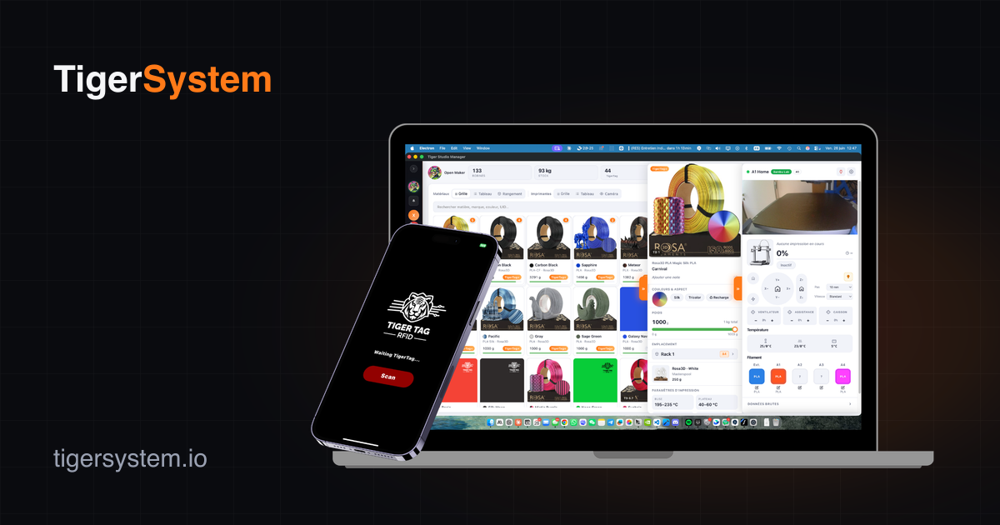
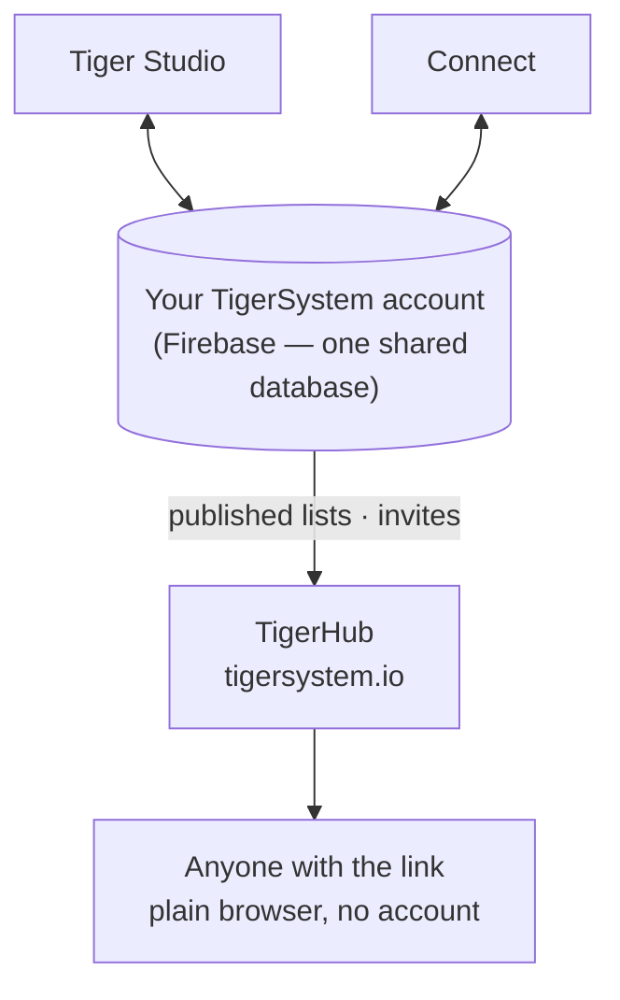

# TigerHub

## Purpose

**TigerHub is the ecosystem's home on the web** — the site at
**[tigersystem.io](https://tigersystem.io)**. It presents the TigerSystem
sandbox and what the open TigerTag protocol makes possible, and it hosts the
**social side** of the sandbox: share a wishlist, invite someone to become a
friend, publish a read-only list anyone can open in a browser.

## Where it sits

## Features — all live today

- **Ecosystem showcase** — the home page tells the whole story: how it works,
 the six printer brands, the components, and the three tiers (TigerData —
 software-only tracking · TigerTag — the offline chip · TigerTag+ — verified
 authenticity).
- **Your account on the web** (`/account`) — sign in to your TigerSystem
 account from a browser.
- **Wishlists** — public ones and friends-only ones, both deployed.
- **Friend codes & invitations** — add each other as friends from the web.
- **Public list links** — share a list read-only as
 `https://tigersystem.io/wishlist/<token>`; the viewer needs no app and no
 account.
- **Material catalogue & reference database** (`/materials`, `/database`) —
 browse the shared catalogue every app resolves against.
- **Printers & features** (`/printers`, `/features`) — what works with what.
- **3D models** (`/models`) — printable models (TigerPOD and friends).
- **For manufacturers, developers & press** (`/manufacturers`, `/developers`,
 `/press`) — the B2B story, integration pointers, media assets.
- **Goodies** (`/goodies`) — the official cap and polo. Buying one is one of
 the ways to [support the project](../support.md).

## A public list link, in practice

A public list link is `https://tigersystem.io/wishlist/<token>`. Three things to
know before you paste one somewhere:

- **The token is the whole key.** Anyone holding the link opens the list — no
  account, no app, nothing to prove. Treat it like a password you chose to
  share: fine for a forum post or a friend, not for a list you would mind
  seeing copied further.
- **Making a list public is what creates the link.** In the app, setting a
  list to *public* mints its token and publishes a copy of the list; setting
  it back to private deletes that copy and the token. Make it public again and
  it gets a **new** token, so a link handed out earlier is not revived.
  TigerHub only renders what the app publishes.
- **Read-only, and it says who shared it.** The viewer sees that one list —
  its items, and the occasion or message if you set one — never your inventory
  or your other lists. The page does show your **display name**, your **social
  links**, and an *add as a friend* button that carries your **discovery
  code**.

A link is one of two ways to share; the other is a friend:

| | Public list link | Friend |
|---|---|---|
| Who sees it | anyone with the link | one person you accepted |
| Needs an account | no | yes |
| How | make a list public | exchange discovery codes |
| Undo | make the list private | remove the friend |

The friend half is summarised here only to sit beside the link; the request
and removal rules, and the server-side enforcement of both, belong to
[Inventory & cloud sync](../concepts/inventory-and-cloud-sync.md).

## TigerHub is not the database

The user accounts and the data behind all the apps live in **plain Firebase**
(Auth + Firestore) — deliberately unbranded infrastructure: **a single shared
database, in a single place**, so Tiger Studio, Tiger NFC Connect, TigerScale
and the TigerSystem account all interoperate on the same data. TigerHub is the
**web surface** built on top of it. See
[Inventory & cloud sync](../concepts/inventory-and-cloud-sync.md).

## Interactions

| With | How |
|---|---|
| Tiger Studio / Connect | Make a list public or private — which creates or deletes its link — and send friend invites |
| Firebase (account database) | Source of the published data |
| Visitors | Plain browser, no account needed |

---

**◀ Previous:** [Tiger Studio](./tiger-studio.md) · **▲ [Documentation index](../../README.md)** · **Next ▶** [TigerPOD](./tigerpod.md)

**Related:** [Inventory & cloud sync](../concepts/inventory-and-cloud-sync.md), [Architecture](../architecture/overview.md)
