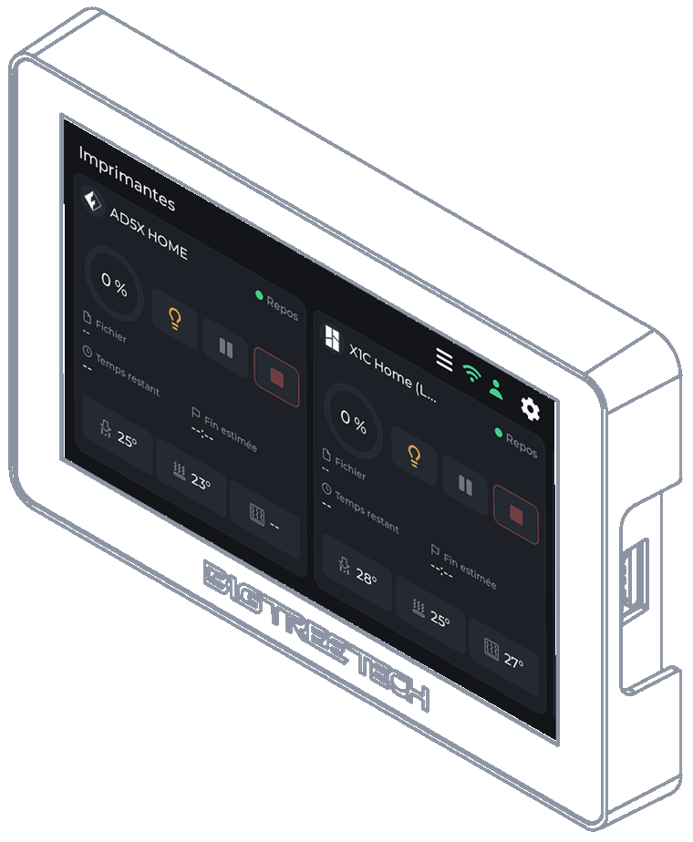
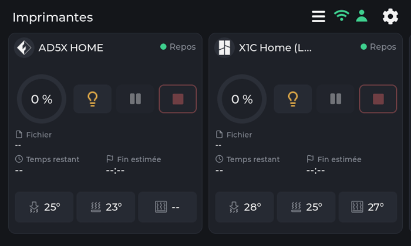
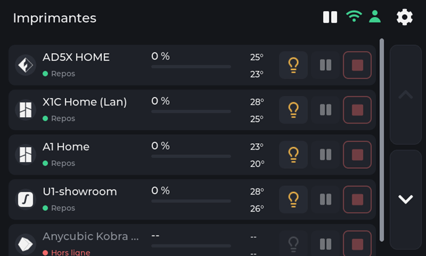
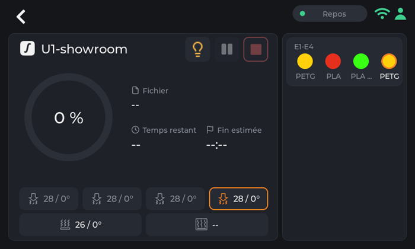
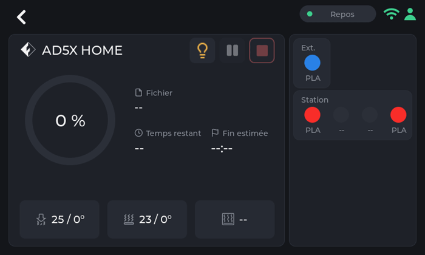
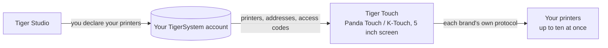
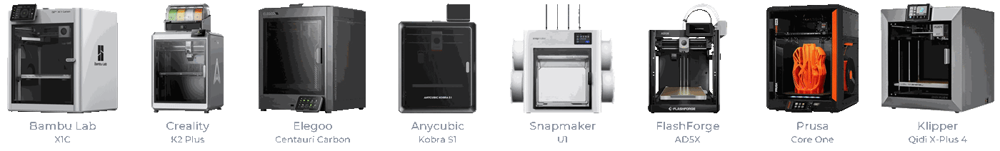

# Tiger Touch

**Your Panda Touch is in a drawer. Give it every printer you own.** A free,
open-source firmware that turns the BIGTREETECH Panda Touch and K-Touch into one
live touchscreen for all your 3D printers — no soldering, no computer.

*Two live printer cards on one screen: a FlashForge AD5X and a Bambu Lab X1C.*

<a class="ts-cta-primary" href="https://tigertag-project.github.io/Tiger-Touch/">Install from your browser</a>

<a href="https://github.com/TigerTag-Project/Tiger-Touch"> Sources</a>

BIGTREETECH sells one little 5" touchscreen under two names: the **Panda Touch**,
made for Bambu Lab printers, and the **K-Touch**, made for Klipper printers. Same
board, two firmwares, each tied to one family of machines. Change printer, and
the screen goes into a drawer.

**Tiger Touch is a new firmware for that same screen**, written from scratch. It
signs in to your free TigerTag account, finds every printer you declared there,
and talks to each one directly, over its own protocol, at the same time. If you
own a Panda Touch or a K-Touch that no longer matches your printers, it is the
hardware Tiger Touch was made for.

Open source under **MIT**. Nothing to solder, nothing to print, no Raspberry Pi,
no server in between: you plug the screen into a USB port, press **Install** in
your browser, and two minutes later it shows your printers.

## What it does

- **Every brand on one screen** — Bambu Lab, Creality, Elegoo, Anycubic,
  Snapmaker, FlashForge, Prusa, plus any Klipper (Moonraker) or OctoPrint
  machine.
- **Cloud and LAN** — Bambu Lab through the Bambu cloud or in LAN mode, Anycubic
  through the Anycubic cloud or on the LAN, the others on your local network.
- **Live, all of them** — state, progress, file, time left and end time,
  nozzles, bed, chamber and filament units (AMS, CFS, Station, ACE, MMU / AFC
  lanes), with up to **ten printers** followed at once.
- **Safe controls** — pause, resume, stop (a 1.5 s hold, so a stray finger never
  ends a print) and the printer's light. **Nothing else is ever sent**: no
  heating, no moving, no starting a print.
- **Updates itself** — new versions arrive over Wi-Fi, verified before install,
  rolled back by themselves if they fail to start.
- **Eleven languages** — English, French, German, Spanish, Italian, Chinese,
  Portuguese (Brazil and Portugal), Polish, Russian, Dutch.

<figure>

<figcaption><strong>Cards</strong>: one live card per printer, slide for more.</figcaption>
</figure>
<figure>

<figcaption><strong>List</strong>: every printer at a glance. One touch switches view.</figcaption>
</figure>
<figure>

<figcaption><strong>Snapmaker U1</strong>: four tool heads, the active one ringed.</figcaption>
</figure>
<figure>

<figcaption><strong>FlashForge AD5X</strong>: external spool and material station.</figcaption>
</figure>

## Where it sits

## What has to exist first

Tiger Touch reads your printers **from your TigerSystem account**, so it never
asks for an address or an access code on a 5" screen. Create the account and add
your printers in the **desktop** [Tiger Studio](./tiger-studio.md) (Windows,
macOS, Linux), which finds them on your network — the web version cannot add
printers.

> **In short:** Tiger Studio → create an account → add your printers →
> *then* set up the screen.

## Which printers

Tiger Touch picks the connection from the **brand**, not the model: any printer
of these families that Tiger Studio can add, Tiger Touch can show. Tiger Studio's
catalogue counts about 380 models from about 60 makers.

| Brand | Connection | Seen on a real machine |
|---|---|---|
| [Bambu Lab](../compatibility/bambu-lab.md) (X1, P1, P2S, A1, H2…) | Bambu cloud, or LAN (MQTT over TLS) | **Yes** — printing through the cloud (P2S), idle in LAN mode (X1C, A1) |
| [Creality](../compatibility/creality.md) (K2, K1, Hi, Ender-3 V4…) | WebSocket on the LAN | **Yes** — printing (K2), idle with its CFS (Ender-3 V4) |
| [Snapmaker](../compatibility/snapmaker.md) U1 | Moonraker WebSocket | **Yes** — idle, four tool heads |
| [FlashForge](../compatibility/flashforge.md) (AD5X, Adventurer 5M, Creator 5) | HTTP on the LAN | **Yes** — idle (AD5X) |
| [Anycubic](../compatibility/anycubic.md) (Kobra 3, Kobra X, Kobra S1…) | Anycubic cloud, or LAN (MQTT over TLS) | **Yes** — idle through the cloud (Kobra X), with its ACE |
| [Elegoo](../compatibility/elegoo.md) Centauri Carbon 1 and 2 | MQTT (CC2), SDCP (CC1) | Not yet |
| **Prusa** (MK4, Core One, XL, MINI) | PrusaLink | Not yet |
| [Klipper](../compatibility/klipper.md) — Voron, Qidi, Sovol, RatRig… | Moonraker HTTP | Against Tiger Studio's test printer only |
| **OctoPrint** — any Marlin printer behind it | OctoPrint REST API | Against Tiger Studio's test printer only |

"Not yet" means written from the maker's protocol and compiled, never run on that
machine: **a report from your printer is the most useful thing you can send.**
Pause, resume and stop work wherever the connection takes commands (not through
the Bambu or Anycubic cloud); the light works everywhere except Prusa, OctoPrint
and the Centauri Carbon 1. Every field and every test is in the
[per-brand status](https://github.com/TigerTag-Project/Tiger-Touch/blob/main/docs/PRINTER-COMPATIBILITY.md).

**A printer shows "offline"?** Check its LAN mode first: it is off by default on
Creality, FlashForge and Bambu Lab.

## One screen, every brand

The firmwares the screen ships with each know **one** family of printers.

| | **Tiger Touch** | Panda Touch firmware | K-Touch firmware |
|---|---|---|---|
| Printer families on one screen | **9** | 1 (Bambu Lab) | 1 (Klipper) |
| Printers live at once | **up to 10**, all updating together | several Bambu Lab, slows down from about 3 in our use | **1** at a time (50 saved, switch between them) |
| Printers set up | from your TigerTag account, nothing typed on the screen | IP, serial, access code | IP and port, or a scan |
| Over-the-air updates | Yes, verified, with automatic roll-back | No | No |

BIGTREETECH's firmwares give full control of their one family — starting prints,
temperatures, moves — which Tiger Touch deliberately does not. You can go back to
them at any time.

*The Panda Touch and K-Touch columns come from BIGTREETECH's own wiki (read
2026-10-16); "slows down from about 3" is the TigerTag team's own experience, not
a BIGTREETECH figure.*

## Install in two minutes

1. **Declare your printers** in Tiger Studio, as above.
2. **Flash the screen from your browser.** Open
   **<https://tigertag-project.github.io/Tiger-Touch/>** in **Chrome or Edge** on
   a computer (WebSerial: not Safari, not Firefox, not a phone), plug the screen
   in with a USB-C **data** cable, press **Install** and pick its port. Replacing
   the BIGTREETECH firmware: tick **Erase device**. Updating a Tiger Touch over
   USB: leave it unticked, your Wi-Fi and account are kept.
3. **Follow the screen.** Language, Wi-Fi, then your TigerTag account — e-mail
   and password, or **Continue with Google** with a QR code scanned by your
   phone. Switch on the printers you want to follow, and that is it. *Later* is
   always an answer: the screen starts at once and connects in the background.

After that there is nothing to do: the screen checks for a new version once a day
and installs it in two touches.

First time? The [install guide](https://github.com/TigerTag-Project/Tiger-Touch/blob/main/docs/INSTALL.md)
covers the USB driver (required on macOS), keeping a copy of the BIGTREETECH
firmware so you can go back, and the one box to tick.

## The hardware

The **BIGTREETECH Panda Touch** and **K-Touch** are designed and made by
**BIGTREETECH** (BIQU): a 5" 800×480 IPS touchscreen around an ESP32-S3 with 8 MB
of PSRAM and 16 MB of flash, Wi-Fi, USB-C and a battery. Tiger Touch runs on it
unmodified, and builds on the board support BIGTREETECH published for it under
the MIT license. The K-Touch is the same board as the Panda Touch, so the same
image is meant for it — but Tiger Touch has been run on a Panda Touch only so
far: a report from a K-Touch is welcome.

Tiger Touch is an independent project, not made or endorsed by BIGTREETECH, BIQU,
or any printer maker named here.

Build it yourself with ESP-IDF 5.5 — the steps are in the
[repository](https://github.com/TigerTag-Project/Tiger-Touch#build-it-yourself).

---

**▲ [Documentation index](../../README.md)** · **Related:** [Tiger Studio](./tiger-studio.md), [TigerSpool](./tigerspool.md), [Printer compatibility](../compatibility/README.md)
