# How to send a request

Tiger Studio Manager lets you send the team a problem, an idea, a catalogue fix
or a question without leaving the app. It is free, it needs **no GitHub
account**, it is sent **without your name or email**, and it becomes a **public
issue on GitHub** that the team can read and answer.

The screens below come from Tiger Studio Manager v2.41.0.

## Open the form

You need to be **signed in** to Tiger Studio Manager. In the sidebar, click
**Improvements & suggestions** (1) — the ✨ button near the bottom; if the
sidebar is collapsed, it is the ✨ icon.

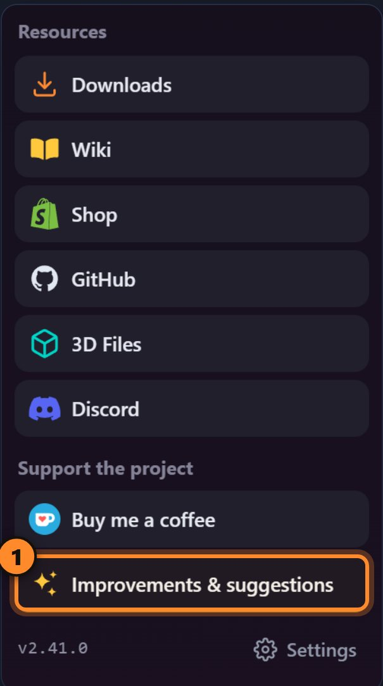

The form opens as a **side card**: the app stays usable behind it. Close it, go
to another screen, open it again — **your draft is kept** until you send it.

## Pick a type

There are six types, one per kind of request, and each has its own form with
its own wording. Pick the one that fits (1–6). The **Send feedback** tab (7) is
where you are; **My requests** (8) keeps track of everything you sent — see
[Follow your request](#follow-your-request).

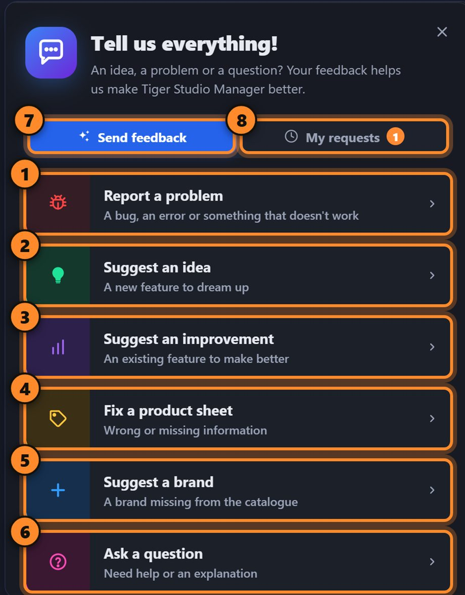

| Type | Use it for | Example |
|---|---|---|
| **Report a problem** | A bug, an error, something that does not work | The camera view freezes after a reconnect |
| **Suggest an idea** | A new feature for the whole Tiger System | Notify me when a spool is almost empty |
| **Suggest an improvement** | Something that exists but could be handier | Let me hide the shortcuts I never use |
| **Fix a product sheet** | A filament with a wrong or missing value in the catalogue | The barcode does not match the box |
| **Suggest a brand** | A brand that is missing from the catalogue | Example Filaments — examplefilaments.com |
| **Ask a question** | A number, a screen or a feature that puzzles you | What does the weight on a spool card include? |

*Fix a product sheet* and *Suggest a brand* are about the **catalogue data**
(a filament's values, a missing brand). *Ask a question* is for help or an
explanation. Everything about the app itself goes in *Report a problem*,
*Suggest an idea* or *Suggest an improvement*.

## Write your request

The form is the same for most types: a title, a description, the pictures, the
check — then send. Here it is for **Report a problem**:

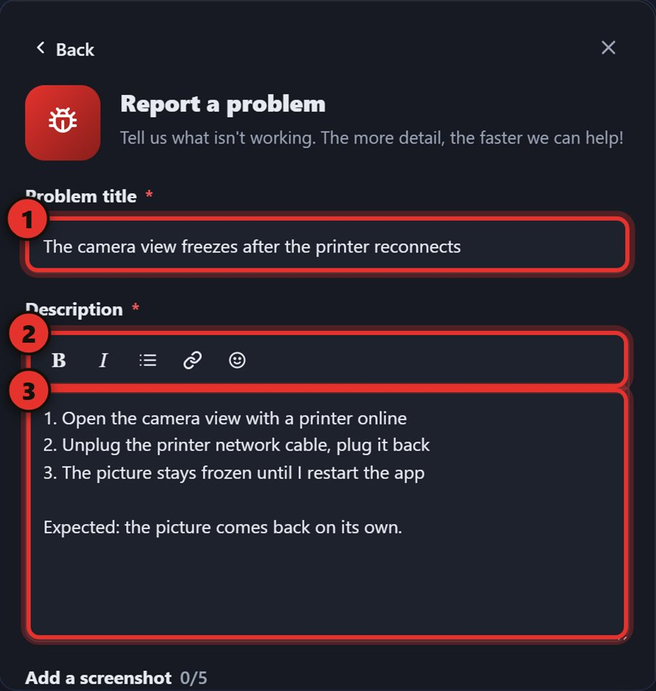

1. **Problem title** — one line.
2. **Formatting toolbar** — bold, *italic*, a list, a link and emoji.
3. **Description** — what you did, what you expected, what happened instead.

A good report, in three lines:

> **Title:** The camera view freezes after the printer reconnects
> **Description:** 1. Open the camera view with a printer online. 2. Unplug the
> printer's network cable and plug it back. 3. The picture stays frozen until I
> restart the app. Expected: it comes back on its own.

### The other five types

The three app types — *Report a problem*, *Suggest an idea*, *Suggest an
improvement* — share the same layout; only the labels and the send button's name
change (**Send my report**, **Send my idea**, **Send my suggestion**).

**Suggest an idea** — one line for the idea, then **how it would work** and
**what it would change for you**. It is for the whole Tiger System — the wilder,
the better.

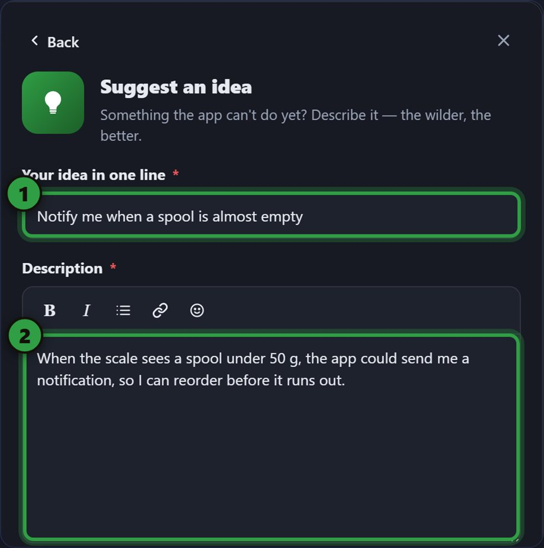

**Suggest an improvement** — one line for **what to improve**, then **what is
in the way today** and **how you would like it to work**. A picture of the
screen concerned makes it clear.

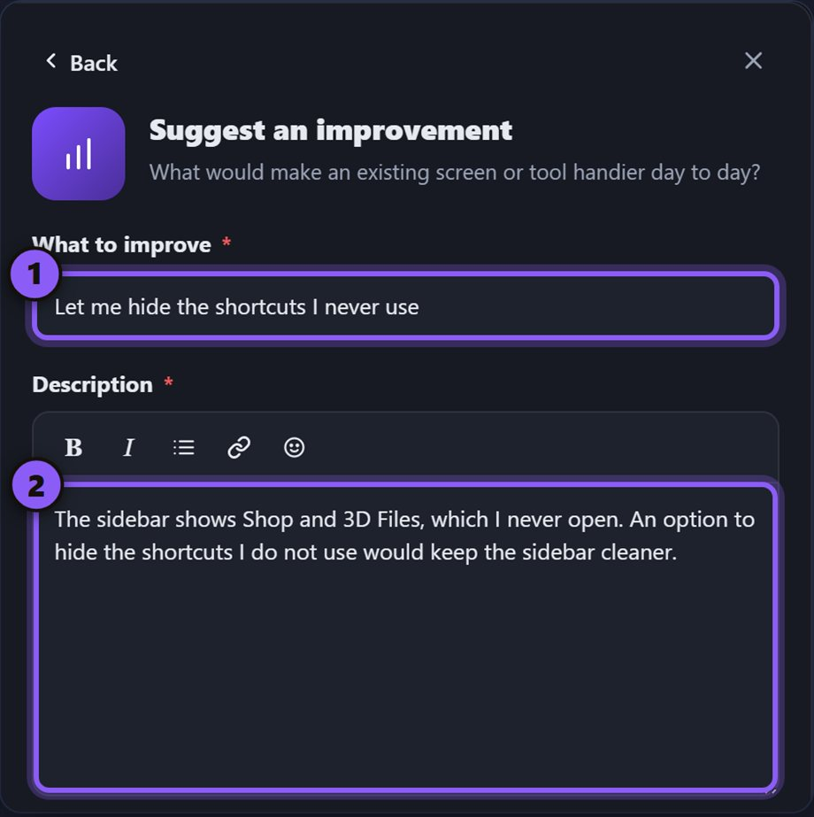

**Fix a product sheet** — search the material (brand, name, colour or barcode)
and pick it (1; 2 picks another one), then say **what is wrong** (3) and
**where you found the right value** — box, label, maker's website.

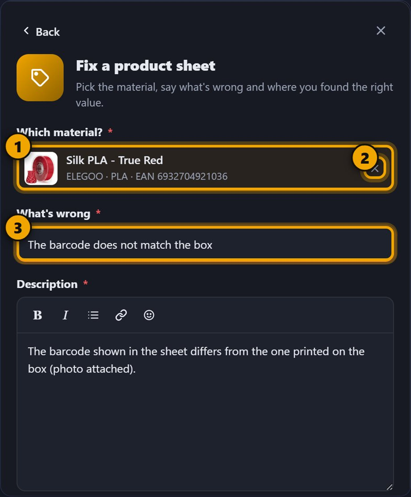

**Suggest a brand** — the **name** and the **website** are required: the team
checks the site before adding the brand. The description is optional — country,
materials, where to buy.

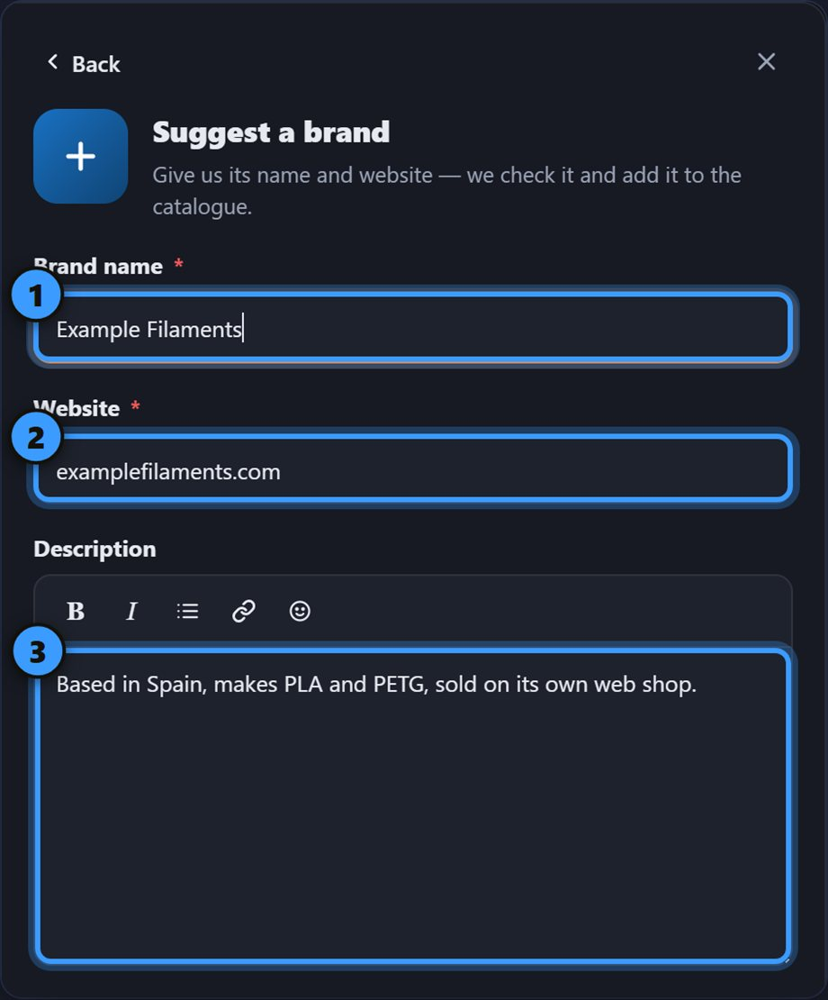

**Ask a question** — one line for the question, then **where you saw it** and
what does not add up. Pictures help here too.

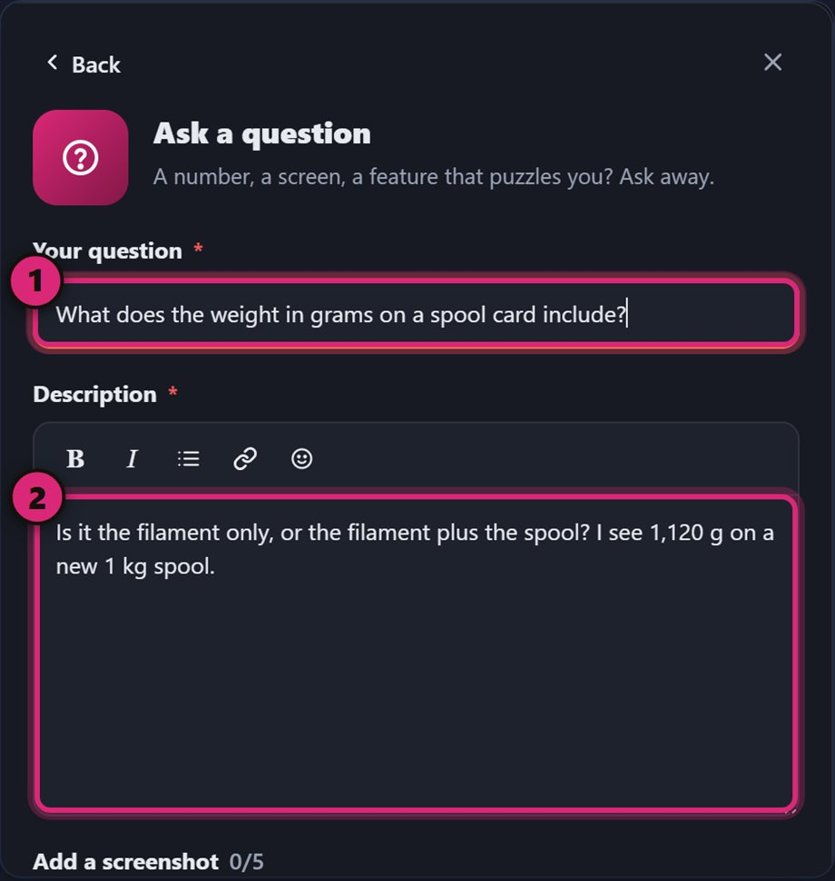

## Add pictures and files

A picture shows the problem better than a description. Drag files onto the
form, **browse** for them, **paste** a screenshot, or click **Capture the
current window** (2 in the next picture). The card hides itself for a moment
so the picture shows the app, not the form — so you can close the card, go to
another screen and capture it.

What you can attach:

- **Up to 5 files** in total.
- **Pictures** — PNG, JPG, WEBP.
- **PDF** — up to 5 MB (a datasheet, an invoice, a label).
- **JSON** — up to 2 MB, and it must be a valid JSON file (an export, a printer
  status…).
- Click the ✕ on a thumbnail to remove it.

### Draw on a picture

Click a picture to open the editor. Pick a tool and draw: a **box** around the
thing, **numbered steps** in the order things happen, an **arrow**… Every mark
stays editable until you click **Done** (top right); **Cancel** throws the
edits away.

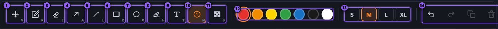

1. **Move** (V)
2. **Pen** (P)
3. **Eraser** (E)
4. **Arrow** (A)
5. **Line** (L)
6. **Box** (R)
7. **Circle** (O)
8. **Highlighter** (H)
9. **Text** (T)
10. **Numbered step** (N)
11. **Blur** (B)
12. **Colours**
13. **Sizes** — S, M, L, XL
14. **Undo, redo, duplicate, delete**

The letter shown on each tool is its keyboard shortcut. Hold the pointer over a
tool for its tip; drag an object to move it, use its corners to resize it,
**Delete** removes it.

:::caution[Hide anything private]
The request is public. Use the **Blur** tool to cover a name, an email, an
address or an IP shown in your picture **before** you send it.
:::

## Check and send

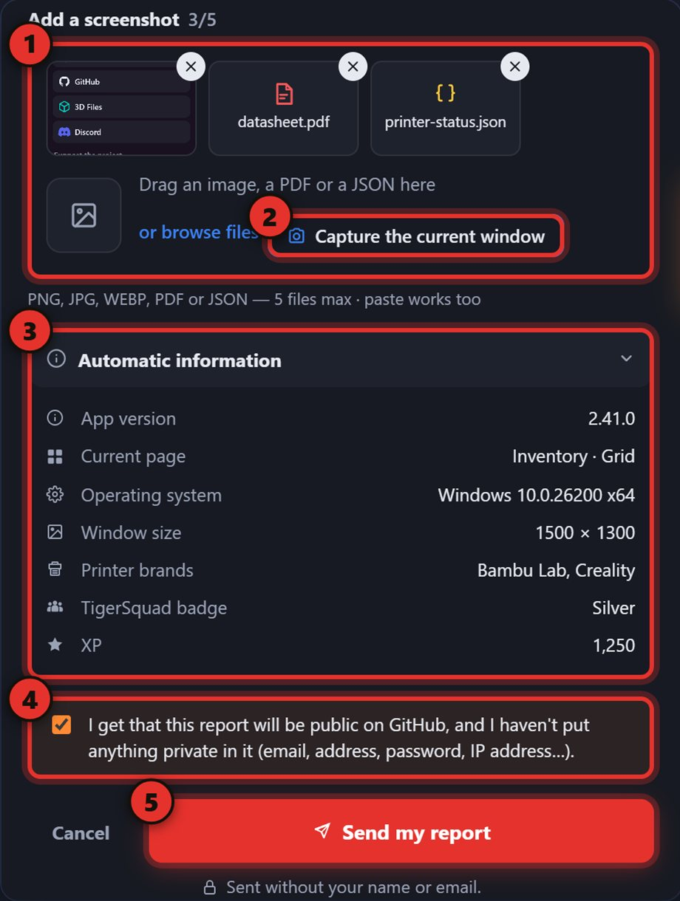

1. **Attachments** — pictures or files (optional).
2. **Capture the current window.**
3. **Automatic information** — open it to see exactly what travels with your
   request.
4. **Confirmation box** — your request is **public**, so put nothing private in
   it (email, address, password, IP address…). Tick the box.
5. **Send** — the button's name matches the type: **Send my report**, **Send my
   idea**, **Send my suggestion**…

What **Automatic information** contains:

- App version, current page, operating system and window size.
- Printer **brands** — never names, addresses or codes.
- Your TigerSquad badge and XP.
- If the app recorded errors, a box lets you **attach them too**.

## After you send

While it sends, a short progress list runs: preparing the message, adding the
system information, sending, wrapping up. If it fails, you stay on the form
with your draft — try again.

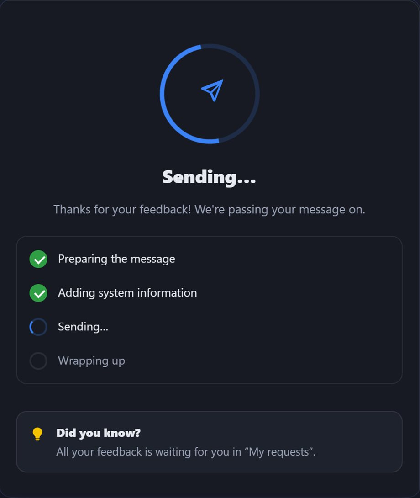

Then you get a confirmation: your request now exists as a public issue. Keep
the **tracking number** (1) — it is the number of the issue on GitHub. **See my
requests** (2) opens the follow-up; **Send another one** (3) starts a fresh
form.

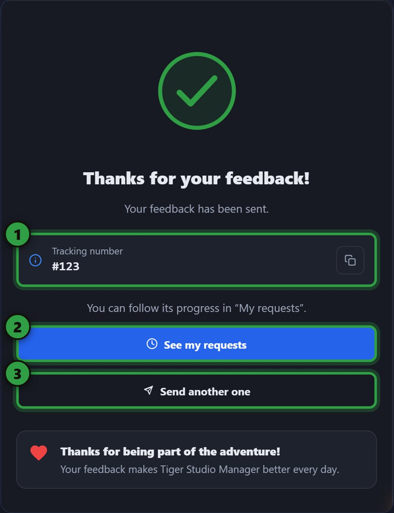

## Follow your request

The **My requests** tab lists everything you sent, with its progress; the
number on the tab counts the ones still open.

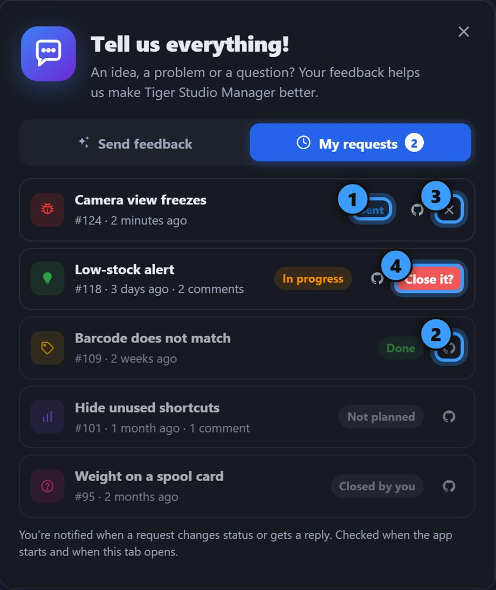

1. **Status**
2. **See it on GitHub**
3. **Close this request**
4. **Confirm**

| Status | Meaning |
|---|---|
| **Sent** | received, nobody has looked yet |
| **In progress** | someone is working on it |
| **Done** | fixed or shipped |
| **Not planned** | the team will not do it |
| **Closed by you** | you closed it yourself |

Only **Sent** and **In progress** requests can be closed: click the ✕, then
confirm with **Close it?**.

**You are notified.** When a request changes status or gets a reply from the
team, a notification appears in the bell. It is checked when the app starts and
when the **My requests** tab opens.

## If something goes wrong

- *"It didn't go through"* — try again in a moment, your draft is still there.
- *"Sign in first"* — the request needs your Tiger account.
- *"That's a lot of reports for one day"* — a daily limit; try again tomorrow.

---

**▲ [Documentation index](../../README.md)** · **Related:** [Tiger Studio](../products/tiger-studio.md), [FAQ](../faq/README.md), [Tutorials](./README.md)
