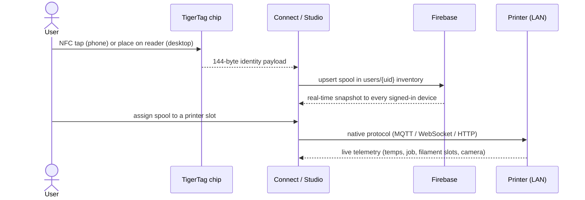
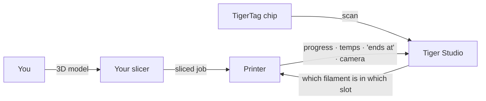

# Datenfluss

## Vom Antippen zum Druck

Der ganze Weg einer Spule durch das System:

## Wo welche Art von Daten liegt

| Daten | Liegen in | Hinweise |
|---|---|---|
| Identität der Spule | Der Chip + der Cloud-Bestand des Nutzers | Der Chip ist maßgeblich für die Offline-Nutzung |
| Referenzdatenbank (Marken, Materialien …) | `cdn.tigertag.io` (dasselbe Firebase-Projekt) | In die Apps eingebündelt, vom CDN aktualisiert |
| Spulenbilder (inkl. TigerTag+-Produktfotos) | `cdn.tigertag.io` (dasselbe Firebase-Projekt) | Für alle Apps bereitgestellt |
| Bestand, Racks, Freunde, Einstellungen | Firestore `users/{uid}/…` | Standardmäßig nur für den Besitzer, durch Regeln erzwungen |
| Öffentliche Erkennungscodes | Firestore `publicKeys/{code}` | Freundessuche in O(1) |
| Zugangsdaten und Telemetrie der Drucker | **Nur lokal** (Desktop) | LAN-Verkehr läuft nie über die Cloud |
| Live-Gewicht (TigerScale) | Gerät → Firestore | Erscheint live in allen Clients |

## Wo dein Slicer hineinpasst

TigerSystem **ersetzt deinen Slicer nicht** – es rundet das Bild um ihn herum ab:

- Du slicest und startest Aufträge genau wie bisher, mit jedem Slicer.
- Tiger Studio teilt dem Drucker mit, **welches Filament in welchem Slot liegt**
 (AMS / CFS / Canvas / ACE / IFS), damit die Angaben auf der Maschine der
 Wirklichkeit entsprechen.
- Egal was den Druck gestartet hat: Der Auftrag erscheint live in Tiger Studio –
 Fortschritt, Temperaturen, Endzeit, Kamera.
- Der Chip trägt die empfohlenen Druckeinstellungen des Filaments; es gibt
 **heute keinen automatischen Import von Slicer-Profilen** – du übernimmst sie
 selbst in dein Slicer-Profil.

## Zwei Ebenen, bewusst getrennt

- **Cloud-Ebene** – Identität, Bestand, Teilen. Internet, Firebase, durch Regeln
 erzwungen.
- **LAN-Ebene** – Druckersteuerung und Kameras. Nur lokales Netzwerk, native
 Herstellerprotokolle, null Cloud-Abhängigkeit (die Desktop-App arbeitet mit den
 Druckern auch offline weiter).

> **Hinweis:** Die Ausnahme ist der **Cloud-Modus** von Anycubic, bei dem die
> Drucker-Verbindung selbst über das Cloud-MQTT des Herstellers läuft – siehe
> [Anycubic-Kompatibilität](../compatibility/anycubic.md).

---

**◀ Zurück:** [Architekturübersicht](./overview.md) · **▲ [Dokumentationsindex](../../README.md)** · **Weiter ▶** [Produkte](../products/README.md)

**Siehe auch:** [Bestand & Cloud-Sync](../concepts/inventory-and-cloud-sync.md), [Kompatibilität](../compatibility/README.md)
