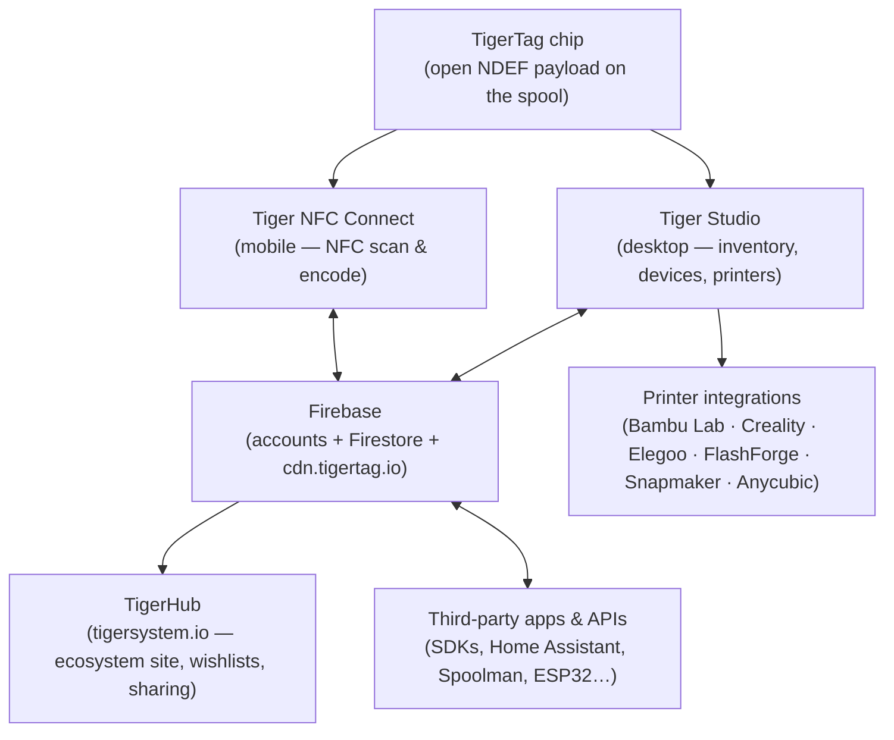
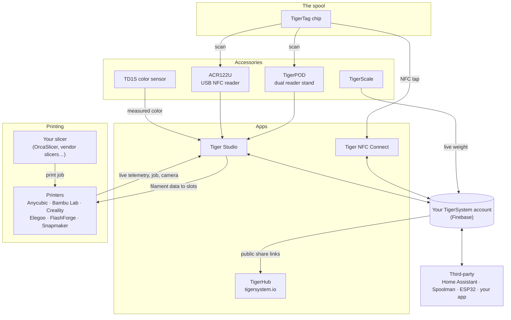

# Architekturübersicht

## Der Stack, von oben nach unten

## Schichten

| Schicht | Rolle | Maßgebliche Doku |
|---|---|---|
| **TigerTag-Chip** | Tragbare, offene Identität der physischen Spule | [Chip-Format](../concepts/tigertag-chip.md) |
| **Tiger NFC Connect** | Die Smartphone-Brücke: scannen, codieren, durchstöbern | [Produktseite](../products/tigertag-connect.md) |
| **Firebase** | Eine gemeinsame Datenbank – Konten, Bestand, Sync; der Interoperabilitätspunkt der Sandbox | [Bestand & Cloud-Sync](../concepts/inventory-and-cloud-sync.md) |
| **TigerHub** | Die Web-Heimat des Ökosystems: Schaufenster, Wunschlisten, Freunde, Teilen | [Produktseite](../products/tigerhub.md) |
| **Tiger Studio** | Desktop-Werkbank: Bestand, Racks, Sensoren, Drucker | [Produktseite](../products/tiger-studio.md) |
| **Drucker-Integrationen** | Live-LAN-Verbindungen zu sechs Druckermarken | [Kompatibilität](../compatibility/README.md) |
| **APIs von Drittanbietern** | SDKs + dokumentierte Firestore-Schnittstelle für alle | [Entwickler](../developers/README.md) |

## Die ganze Karte – jedes Element und seine Verbindungen

Zubehör, Apps, Cloud, Drucker, Slicer und Integrationen von Drittanbietern auf
einem Bild:

Lies es von links nach rechts: Der **Chip** identifiziert die Spule; das
**Zubehör** erfasst die Wirklichkeit (Scans, Gewicht, Farbe); die **Apps** und die
**Cloud** halten alles synchron; der **Drucker** empfängt die Filamentdaten und
meldet live zurück. Dein **Slicer behält seine Aufgabe** – TigerSystem slict
nicht, es sorgt dafür, dass alle (du, die Maschine, die Apps) genau wissen,
welches Filament wo liegt.

## Designprinzipien

1. **Der Chip ist autark.** Eine Spule identifiziert sich ohne Cloud, ohne Konto,
 ohne Netzwerk – die Nutzdaten sind vollständig und offen.
2. **Die Cloud gehört dem Nutzer, nicht dem System.** Der gesamte Zustand liegt
 unter dem Konto des Nutzers; serverseitige Sicherheitsregeln – nicht
 Client-Code – erzwingen den Zugriff.
3. **Jede Schicht ist optional.** Die Nutzung nur mit Handy, nur mit Desktop, nur
 mit Chip oder nur über die API funktioniert jeweils; Komponenten schaffen
 Mehrwert, schränken sich aber nie gegenseitig ein.
4. **Integrationen sprechen das native Protokoll des Druckers.** Keine
 Firmware-Mods, keine Umwege über die Cloud: Tiger Studio spricht
 MQTT/WebSocket/HTTP direkt im LAN (siehe [Datenfluss](./data-flow.md)).

---

**◀ Zurück:** [Bestand & Cloud-Sync](../concepts/inventory-and-cloud-sync.md) · **▲ [Dokumentationsindex](../../README.md)** · **Weiter ▶** [Datenfluss](./data-flow.md)

**Siehe auch:** [Produkte](../products/README.md), [Entwickler](../developers/README.md)
