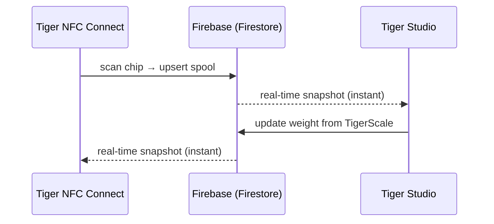

# Bestand und Cloud-Synchronisierung

## Ein Konto, jedes Gerät

Der Bestand eines Nutzers liegt in **seinem TigerSystem-Konto**, getragen von
schlichtem **Firebase** (Auth + Firestore) – bewusst markenlose Infrastruktur mit
einer einfachen Aufgabe: **eine gemeinsame Datenbank an einem Ort**, damit jedes
Element der Sandbox (Desktop, Mobil, Waage, Web) auf denselben Daten
zusammenarbeitet. Jeder Client – mobil, Desktop, Web – abonniert dieselben
Dokumente in Echtzeit:

Es gibt keinen „Sync-Button“: Änderungen verbreiten sich über die Live-Listener
von Firestore, und die Clients halten einen lokalen Cache für Lesezugriffe offline.

## Was synchronisiert wird

- **Bestand** – ein Dokument pro Spule (Identität, Gewicht, Behälter, Bild …).
- **Racks** – physische Regalaufbauten und die Platzierung der Spulen.
- **Freunde & Teilen** – Freundschaftsverbindungen, eingehende Anfragen, Benachrichtigungen.
- **Einstellungen** – Sprache, Einstellungen pro Konto.
- **Chip-Sicherungen** – [TigerTag+](../products/tigertag-plus.md)-Chip-Datensätze.

Das maßgebliche Datenmodell, Feld für Feld, ist im
[Firebase-Integrations-Repository](https://github.com/TigerTag-Project/TigerTag_Firebase_Integration)
dokumentiert (`docs/03-data-model.md`) – die Referenz für Integratoren von
Drittanbietern.

## Was deinen Arbeitsplatz verlässt – und was bleibt

Das Ökosystem sagt überall, dass die Cloud optional ist. Hier steht, was das
tatsächlich bedeutet und was es kostet, wenn du Nein sagst.

**Die Identifikation ist von Natur aus lokal.** Ein Gerät fragt keinen Server,
was ein Tag ist. Die Tabellen für Marken und Materialien liegen im eigenen
Speicher und werden höchstens einmal am Tag aus dem **öffentlichen**
[Referenz-Repository](https://github.com/TigerTag-Project/TigerTag-RFID-Guide)
aktualisiert. Eine Abfrage wartet also nie auf das Netzwerk, und sie funktioniert
auch bei ausgefallenem Internet.

**Ohne Konto verlierst du genau eine Sache: den Abgleich zwischen Geräten.** Eine
[TigerScale](../products/tigerscale.md) wiegt weiterhin, liest weiterhin Tags,
erkennt weiterhin Marke und Material und stellt weiterhin ihre eigene Weboberfläche
in deinem LAN bereit. Am Chip selbst hängt nichts von uns ab – das ist der ganze
Sinn, die Daten [auf den Chip](./tigertag-chip.md) zu schreiben.

**Mit Konto sendet ein Gerät Folgendes.** Am Beispiel der Waage: Bei jeder
abgeschlossenen Wägung und in einem regelmäßigen Heartbeat schreibt sie unter
deinem eigenen Nutzerdokument: die Tag-UIDs der Spule, Netto-/Brutto-/Behältergewicht,
Firmware-Version, WLAN-Signal und IP, Kalibrierfaktor, Zeit des letzten Heartbeats,
Akkustand und Bildschirmzustand. Diagnose- und Messdaten – nicht mehr. Jedes Feld
ist in
[der eigenen Referenz der Waage](https://github.com/TigerTag-Project/Tiger-Scale-V3/blob/main/docs/TELEMETRY.md)
dokumentiert.

**Und das speichert es lokal, was wichtiger ist.** Ein angemeldetes Gerät hält ein
Refresh-Token, deine Nutzer-ID und deine WLAN-Zugangsdaten. Dein Passwort speichert
es nie – die Anmeldung tauscht es gegen Token. Behandle ein eingerichtetes Gerät
aber so, als **hielte es eine Zugangsberechtigung**: Bevor du eines verleihst,
verkaufst oder verschenkst, melde dich ab *und* vergiss das WLAN. Ein einfaches
Neuflashen löscht keines von beiden – dieser Speicher bleibt absichtlich erhalten,
damit ein Firmware-Update dich nicht deine Einrichtung kostet.

**Zwei bewusste Entscheidungen, die man kennen sollte.** Die LAN-API eines Geräts
ist **nicht authentifiziert**: Jeder, der schon in deinem Netzwerk ist, kann seinen
Zustand lesen und eine Tara auslösen. Das ist eine Vereinfachung für ein
Heimnetzwerk – setze es in ein Gast-VLAN, wenn du deinem nicht traust. Und der im
Quellcode sichtbare Firebase-Schlüssel ist eine **öffentliche Projektkennung**,
kein Geheimnis; jeder Firebase-Client liefert ihn mit, und die Zugriffskontrolle
erzwingen serverseitige Regeln gegen den angemeldeten Nutzer, nicht das Verstecken
einer Zeichenkette.

Für die Waage ist all das ausführlich in
[`docs/CLOUD.md`](https://github.com/TigerTag-Project/Tiger-Scale-V3/blob/main/docs/CLOUD.md)
dokumentiert, das maßgeblich ist.

## Freigabemodell (Zusammenfassung)

- Jeder Nutzer hat einen öffentlichen **Erkennungscode** (`XXX-XXX`) für die
  Freundessuche in O(1).
- Freundschaft ist **beidseitig und einvernehmlich**: Anfrage → Annahme; jede Seite
  kann sie beenden. Der Lesezugriff auf den Bestand eines Freundes wird
  serverseitig durch die Sicherheitsregeln von Firestore erzwungen – nie durch den
  Client.
- Ein Bestand kann außerdem als **öffentlich** markiert oder als schreibgeschützte
  Weblist über Links von [TigerHub](../products/tigerhub.md) geteilt werden.

## Sicherheitsmodell (Zusammenfassung)

- Alle Daten pro Nutzer sind standardmäßig nur für den Besitzer zugänglich;
  nutzerübergreifender Zugriff setzt immer eine vorherige Beziehung voraus
  (Freundschaft, Anfrage), die durch serverseitige Regeln erzwungen wird.
- Die Firebase-Projektkonfiguration ist absichtlich öffentlich (Standardmuster);
  **die Sicherheit liegt in den Regeln, nicht in der Geheimhaltung**. Siehe
  [Account-API & Integration](../developers/account-api.md).

---

**◀ Zurück:** [Der TigerTag-Chip](./tigertag-chip.md) · **▲ [Dokumentationsindex](../../README.md)** · **Weiter ▶** [Architekturübersicht](../architecture/overview.md)

**Siehe auch:** [TigerHub](../products/tigerhub.md), [Entwickler – Account-API](../developers/account-api.md)
