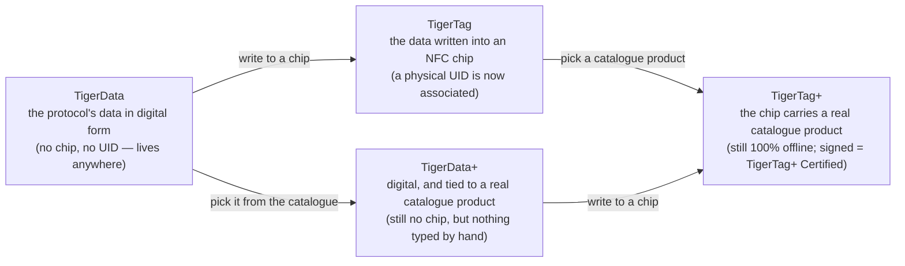

# Universelle Filament-Identität

## Eine Identität, überall lesbar

Ein TigerTag-Chip gibt einer Spule eine **universelle Identität**: einen einzigen,
offenen Datensatz darüber, was das Filament *ist* – unabhängig davon, wer es
hergestellt hat, wer es verkauft und welcher Drucker es schmelzen wird.

Die Identität umfasst (nicht abschließend):

| Feldfamilie | Beispiele |
|---|---|
| **Marke** | jeder Filamenthersteller, aus einer gemeinsamen Referenzliste |
| **Material / Typ** | PLA, PETG, ABS, TPU … + Untertyp |
| **Aspekt / Farbe** | Farbwert, Finish |
| **Geometrie** | Durchmesser (1,75 / 2,85 mm) |
| **Druckeinstellungen** | empfohlene Temperaturen |
| **Lebenszyklus** | Gewicht, Herstellungsdatum |

## Die gemeinsame Referenzdatenbank

Identitäten sind kein Freitext: Marken, Materialien, Aspekte, Typen, Durchmesser
und Einheiten stammen aus einer **gemeinsamen Referenzdatenbank**, die unter
`cdn.tigertag.io` bereitgestellt wird (gehostet im selben Firebase-Projekt wie die
Konten). Jede App löst dieselben IDs zur selben Bedeutung auf, sodass ein von
einem Tool codierter Chip in jedem anderen identisch gelesen wird.

Die Tabellen werden zweimal veröffentlicht, und es sind dieselben Tabellen. Sie
liegen als JSON-Dateien im Ordner
[`database/`](https://github.com/TigerTag-Project/TigerTag-RFID-Guide/tree/main/database)
des RFID-Guides, frei einbettbar (CC0) und alle 6 Stunden aus dem Katalog
synchronisiert. Die öffentliche API liefert sie ebenfalls, jede über einen
eigenen Endpunkt ([die Liste](https://github.com/TigerTag-Project/TigerTag-RFID-Guide#reference-tables-ship-with-the-protocol--the-api-is-optional)).
Garantiert sind die Dateien: Sie lösen jede ID auf, die ein Chip tragen kann,
ohne Netzwerk und ohne Konto. Tiger Studio liefert sie mit
(`assets/db/tigertag/`) und aktualisiert sie über das CDN.

## Eine Identität, vier Zustände

Die Identität ist der *Datensatz*, nicht der *Chip* – und sie durchläuft vier
Zustände:

- **TigerData** ist das Protokoll *vor* dem Chip: dieselbe Identität, digital
 gespeichert – in einem Bestand, einer Datenbank, einer Datei, irgendwo. Das
 TigerTag-Protokoll kann vollständig außerhalb eines RFID-Chips leben. Dieser
 Begriff des **virtuellen Chips ist eine Innovation von TigerSystem – es gibt ihn
 sonst nirgends**: einen kompletten Bestand ganz ohne NFC-Chips verwalten, eine
 Identität später oder nie in einen Chip schicken, und die Interoperabilität des
 Protokolls bleibt in beiden Fällen erhalten.
- **TigerData+** ist ein TigerData, das *genau weiß, welches Produkt es ist*.
 Immer noch kein Chip, immer noch nichts zu kaufen – aber statt dessen, was sein
 Besitzer eingetippt hat, trägt es ein echtes Produkt aus dem offiziellen
 Katalog: die genaue Marke, Farbe, das Material, die Temperaturen, den
 Durchmesser, SKU und EAN, direkt aus der Quelle. Du bekommst es, indem du ein
 Produkt auswählst, statt eines zu beschreiben.
 >Es ist **kein** TigerTag+ und behauptet das auch nie: kein Chip, keine UID. Das
 >`+` bedeutet *identifiziert*, nicht *zertifiziert*. Für Entwickler: Eine Spule
 >ist ein TigerData+, wenn sie chiplos ist **und** eine echte Produkt-ID trägt –
 >dieses Paar ist die Definition, und es wird im Datensatz als
 >`protocol: "TigerData+"` gespiegelt, damit du es direkt lesen kannst. Siehe die
 >[Firestore-Datenstruktur](https://github.com/TigerTag-Project/TigerTag_Firebase_Backend#-firestore-data-structure).
- In dem Moment, in dem diese Daten **in einen NFC-Chip geschrieben** werden,
 werden sie zu einem **TigerTag**: Eine physische **UID wird endlich mit der
 Identität verbunden**.
- Schreibst du ein **Katalogprodukt** statt von Hand getippter Werte in diesen
 Chip, ist es ein [**TigerTag+**](../products/tigertag-plus.md) – dasselbe `+`
 wie bei TigerData+, dieselbe Bedeutung: *identifiziert*. Von einem
 zertifizierten Hersteller signiert, wird daraus ein **TigerTag+ Certified**. In
 beiden Fällen bleibt der Chip zu 100 % offline lesbar.

Ein TigerData kann für immer digital bleiben oder **atomar zu einem echten Chip
aufgewertet** werden, sobald du bereit bist (Tiger Studio erledigt das in einem
Schritt). Und alle vier Zustände reisen als Dateien: Das
[**`.ttag`-Austauschformat**](../developers/ttag-format.md) transportiert ein oder
mehrere Bestandsmaterialien – TigerData, TigerData+, TigerTag oder TigerTag+ – auf
einem USB-Stick, in einer Mail, zwischen Tools.

## Der Datensatz und der Chip

Die vier Zustände oben sind Zustände des **Datensatzes**. Der
[RFID-Leitfaden](https://github.com/TigerTag-Project/TigerTag-RFID-Guide#three-tag-types)
listet stattdessen Tag-Typen auf, und die beschreiben den **Chip**: was auf dem
Silizium steht, offline gelesen, ohne Konto. Das sind zwei Achsen, nicht zwei
Fassungen derselben Liste, und keine von beiden ist falsch.

Was ein Lesegerät für jeden Zustand auf dem Chip findet:

| Zustand des Datensatzes | Auf dem Chip |
|---|---|
| **TigerData**, **TigerData+** | nichts: Es gibt noch keinen Chip |
| **TigerTag** | `ID TigerTag` `0x5BF59264` und `ID Product` `0xFFFFFFFF` (keine) |
| **TigerTag+** | `ID TigerTag` `0xBC0FCB97` und eine `ID Product` aus dem Katalog |
| **TigerTag+ Certified** | dasselbe wie ein TigerTag+, plus eine gültige Signatur in den Seiten `0x18`–`0x27` |

Ein TigerTag+ trägt dieselbe Typ-ID, ob signiert oder nicht. Ob ein Chip ein
TigerTag+ Certified ist, prüft ein Lesegerät an der Signatur; die Typ-ID kann
es nicht sagen.

Die Chip-Achse hat einen Wert ohne Datensatz dahinter: **TigerTag Init**
(`0x6C41A2E1`). Er markiert einen leeren Chip, der für einen Schreibvorgang
vorbereitet ist. Über das Filament ist noch nichts entschieden, also gibt es
keinen Datensatz, der in irgendeinem Zustand sein könnte, und es ist kein
fünfter.

## Aufwertung: vom Datensatz zum Chip

Eine Spule *aufwerten* heißt, im Diagramm von links nach rechts zu gehen: Ein
bestehender TigerData- oder TigerData+-Datensatz wird auf einen leeren NTAG-Chip
geschrieben, und die Spule trägt ihre Identität nun selbst, offline.

Was herauskommt, hängt nur davon ab, was hineinging:

| Du wertest auf … | Du erhältst … | Weil |
|---|---|---|
| ein **TigerData** – Werte, die sein Besitzer gewählt hat | ein **TigerTag** | jetzt eine physische UID mit der Identität verbunden ist |
| ein **TigerData+** – ein echtes Katalogprodukt | ein **TigerTag+** | der Chip jetzt die Produkt-ID aus dem Katalog trägt: *weiterhin identifiziert, weiterhin nicht signiert* |

Diese zweite Zeile ist das ganze `+`-Vokabular in einer Zeile. Die Aufwertung
ändert den *Zustand* – digital zu Chip – und nie die Bedeutung des `+`. Nur die
Signatur eines zertifizierten Herstellers macht einen Chip zu einem
[TigerTag+ Certified](../products/tigertag-plus.md), und keine Aufwertung
erzeugt einen.

Eine Einbahnstraße ist die Aufwertung auch nicht. Chips sind nie schreibgesperrt:
Ein aufgewerteter Chip kann aus [Tiger NFC Connect](../products/tiger-nfc-connect.md)
oder Tiger Studio gelöscht und neu beschrieben werden ([der TigerTag-Chip](./tigertag-chip.md)).
Die Identität ist der Datensatz; der Chip ist nur der Ort, an dem sie gerade lebt.

---

**◀ Zurück:** [Second-Life-Ablauf](../philosophy/second-life.md) · **▲ [Dokumentationsindex](../../README.md)** · **Weiter ▶** [Der TigerTag-Chip](./tigertag-chip.md)

**Siehe auch:** [TigerTag-Produktseite](../products/tigertag.md), [Bestand & Cloud-Sync](./inventory-and-cloud-sync.md)
