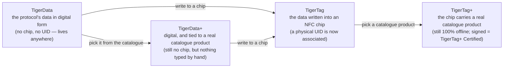

# Universelle Filament-Identität

## Eine Identität, überall lesbar

Ein TigerTag-Chip gibt einer Spule eine **universelle Identität**: einen einzigen,
offenen Datensatz darüber, was das Filament *ist* – unabhängig davon, wer es
hergestellt hat, wer es verkauft und welcher Drucker es schmelzen wird.

Die Identität umfasst (nicht abschließend):

| Feldfamilie | Beispiele |
|---|---|
| **Marke** | jeder Filamenthersteller, aus einer gemeinsamen Referenzliste |
| **Material / Typ** | PLA, PETG, ABS, TPU … + Untertyp |
| **Aspekt / Farbe** | Farbwert, Finish |
| **Geometrie** | Durchmesser (1,75 / 2,85 mm) |
| **Druckeinstellungen** | empfohlene Temperaturen |
| **Lebenszyklus** | Gewicht, Herstellungsdatum |

## Die gemeinsame Referenzdatenbank

Identitäten sind kein Freitext: Marken, Materialien, Aspekte, Typen, Durchmesser
und Einheiten stammen aus einer **gemeinsamen Referenzdatenbank**, die unter
`cdn.tigertag.io` bereitgestellt wird (gehostet im selben Firebase-Projekt wie die
Konten). Jede App löst dieselben IDs zur selben Bedeutung auf, sodass ein von
einem Tool codierter Chip in jedem anderen identisch gelesen wird.

> **TODO:** den öffentlichen Endpunkt zum Durchsuchen der Datenbank bzw. das
> Dump-Format verlinken, sobald der RFID-Guide es dokumentiert. Die Referenzdaten
> sind in Tiger Studio eingebündelt (`assets/db/tigertag/`) und werden vom CDN
> aktualisiert.

## Eine Identität, vier Zustände

Die Identität ist der *Datensatz*, nicht der *Chip* – und sie durchläuft vier
Zustände:

- **TigerData** ist das Protokoll *vor* dem Chip: dieselbe Identität, digital
 gespeichert – in einem Bestand, einer Datenbank, einer Datei, irgendwo. Das
 TigerTag-Protokoll kann vollständig außerhalb eines RFID-Chips leben. Dieser
 Begriff des **virtuellen Chips ist eine Innovation von TigerSystem – es gibt ihn
 sonst nirgends**: einen kompletten Bestand ganz ohne NFC-Chips verwalten, eine
 Identität später oder nie in einen Chip schicken, und die Interoperabilität des
 Protokolls bleibt in beiden Fällen erhalten.
- **TigerData+** ist ein TigerData, das *genau weiß, welches Produkt es ist*.
 Immer noch kein Chip, immer noch nichts zu kaufen – aber statt dessen, was sein
 Besitzer eingetippt hat, trägt es ein echtes Produkt aus dem offiziellen
 Katalog: die genaue Marke, Farbe, das Material, die Temperaturen, den
 Durchmesser, SKU und EAN, direkt aus der Quelle. Du bekommst es, indem du ein
 Produkt auswählst, statt eines zu beschreiben.
 >Es ist **kein** TigerTag+ und behauptet das auch nie: kein Chip, keine UID. Das
 >`+` bedeutet *identifiziert*, nicht *zertifiziert*. Für Entwickler: Eine Spule
 >ist ein TigerData+, wenn sie chiplos ist **und** eine echte Produkt-ID trägt –
 >dieses Paar ist die Definition, und es wird im Datensatz als
 >`protocol: "TigerData+"` gespiegelt, damit du es direkt lesen kannst. Siehe die
 >[Firestore-Datenstruktur](https://github.com/TigerTag-Project/TigerTag_Firebase_Backend#-firestore-data-structure).
- In dem Moment, in dem diese Daten **in einen NFC-Chip geschrieben** werden,
 werden sie zu einem **TigerTag**: Eine physische **UID wird endlich mit der
 Identität verbunden**.
- Schreibst du ein **Katalogprodukt** statt von Hand getippter Werte in diesen
 Chip, ist es ein [**TigerTag+**](../products/tigertag-plus.md) – dasselbe `+`
 wie bei TigerData+, dieselbe Bedeutung: *identifiziert*. Von einem
 zertifizierten Hersteller signiert, wird daraus ein **TigerTag+ Certified**. In
 beiden Fällen bleibt der Chip zu 100 % offline lesbar.

Ein TigerData kann für immer digital bleiben oder **atomar zu einem echten Chip
aufgewertet** werden, sobald du bereit bist (Tiger Studio erledigt das in einem
Schritt). Und alle vier Zustände reisen als Dateien: Das
[**`.ttag`-Austauschformat**](../developers/ttag-format.md) transportiert ein oder
mehrere Bestandsmaterialien – TigerData, TigerData+, TigerTag oder TigerTag+ – auf
einem USB-Stick, in einer Mail, zwischen Tools.

---

**◀ Zurück:** [Second-Life-Ablauf](../philosophy/second-life.md) · **▲ [Dokumentationsindex](../../README.md)** · **Weiter ▶** [Der TigerTag-Chip](./tigertag-chip.md)

**Siehe auch:** [TigerTag-Produktseite](../products/tigertag.md), [Bestand & Cloud-Sync](./inventory-and-cloud-sync.md)
