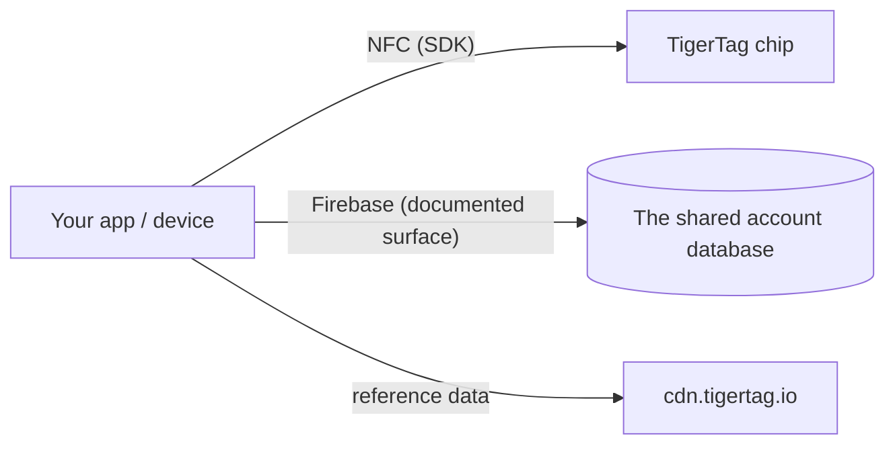

# Entwicklerdokumentation

Baue auf TigerSystem auf: Chips lesen, mit der Cloud sprechen oder eigene Hardware
und Software integrieren. Nichts davon braucht eine Erlaubnis – das Protokoll ist
offen.

## Was kannst du bauen?

Zum Lesen eines TigerTag genügt **jedes NFC-Smartphone**, ein an den Computer
angeschlossenes **USB-Lesegerät ACR122U** oder ein **Eigenbau – ein einfacher
ESP32 mit einem PN532- oder RC522-Lesemodul** (der Ansatz von TigerScale).
Handelsübliche Hardware, keine proprietäre Ausrüstung. Von diesem einen Scan aus
kannst du überall integrieren, wo eine Identität nützlich ist:

- **ERP / Lagerverwaltung** – Spulenidentität und Mengen mit dem bestehenden
 Bestandssystem deines Unternehmens verbinden.
- **Verbrauchserfassung** – protokollieren, welches Material in welchen Auftrag,
 welche Maschine oder welche Kundenbestellung ging.
- **Eigene Dashboards & Automatisierung** – Überwachung von Druckfarmen,
 Warnungen bei niedrigem Bestand, Nachbestell-Auslöser.
- **Verleihsysteme** – Fablabs, Schulen, Makerspaces, die Material ein- und
 ausgeben.
- **F&E-Projekte, privat oder öffentlich** – ein offener, wiederbeschreibbarer,
 dokumentierter Identitätsträger zum Experimentieren.

Nichts davon braucht unsere Apps oder unsere Cloud: Der Chip + ein SDK reichen.
Füge die [Konto-Schnittstelle](./account-api.md) nur hinzu, wenn du Konten und
Synchronisierung willst.

Baust du es, ist es **TigerTag Compatible**: kostenlos, selbst erklärt, ohne
Audit und ohne Erlaubnis. Lässt du es das Audit durchlaufen, kann es **TigerTag
Certified** werden – offen für alles, was ein Dritter baut, Hardware oder
Software, in zwei Bereichen (**TigerTag** und **TigerTag+**). Die Grenze zwischen
den Stufen ist nicht, was dein Produkt ist, sondern ob es jemand geprüft hat.
Compatible sagt *„es funktioniert“* auf dein Wort, Certified sagt *„wir haben es
getestet“* auf unseres
([Kriterien](https://github.com/TigerTag-Project/TigerTag-RFID-Guide/blob/main/CERTIFICATION.md),
melde dich über die [GitHub-Organisation](https://github.com/TigerTag-Project)).

Die Governance ist bewusst zweistufig: **Jeder** darf das Protokoll implementieren
und „kompatibel mit TigerTag“ sagen – nie ist eine Erlaubnis nötig – und das
TigerTag-Logo unverändert zeigen, um das zu sagen: in deiner App, deiner
Dokumentation, deinem Shop-Eintrag. Diese bezugnehmende Verwendung ist frei. Nur
**zertifizierte Partner** (im Zertifizierungsregister gelistet) dürfen die Marke –
Logo **oder Name** – **auf einem Chip beliebigen Formats (Chip, Inlay, Aufkleber,
Etikett, Carrier), einer Spule oder ihrer Verpackung** führen, wo sie aufhört,
Kompatibilität zu beschreiben, und beginnt, Herkunft zu behaupten; der Klartext
*„Compatible with TigerTag“* auf dem Karton eines kompatiblen Lesegeräts, Druckers
oder einer App bleibt frei, und nur sie dürfen **TigerTag+-Signaturen** ausstellen
(TigerTag verwahrt den privaten Schlüssel). Die Marken-Hürde ist Marketing; die
Signatur-Hürde ist technisch; **keine von beiden schränkt das Protokoll um eine
einzige Zeile ein** – ein nicht zertifizierter Chip funktioniert einwandfrei, er
kann nur seine Herkunft nicht beweisen.

Zwei Details, die man genau richtig haben sollte. Die Kompatibilitätsaussage
gilt **auch für die `+`-Stufe**: Das Prüfen einer TigerTag+-Signatur ist
kostenlos, offline und uneingeschränkt – die öffentlichen Schlüssel sind
veröffentlicht –, ein Lesegerät, das sie prüft, darf also *„kompatibel mit
TigerTag+“* sagen. Was es nicht darf: **einen Tag** TigerTag+ nennen, wenn dieser
Tag nicht wirklich eine von TigerTag ausgestellte Signatur trägt. Und das Wort
**„certified“ wird nie selbst vergeben**: TigerSystem erteilt es, niemand
beansprucht es.

Das ist bewusst das Modell, das Zigbee und Matter verwenden – eine kostenlose
Stufe *Compatible*, in die jeder eintreten darf, und eine gewährte Stufe
*Certified*, die für einen Käufer gerade deshalb etwas bedeutet, weil sie gewährt
wird. Vollständige Richtlinie, Zertifizierungsstufen und Marken-Assets:
[TRADEMARK.md](https://github.com/TigerTag-Project/TigerTag-RFID-Guide/blob/main/TRADEMARK.md) und
[CERTIFICATION.md](https://github.com/TigerTag-Project/TigerTag-RFID-Guide/blob/main/CERTIFICATION.md).

## Hier starten

| Ich möchte … | Lies |
|---|---|
| Sehen, wer schon auf TigerTag aufgebaut hat | [Integrationen von Drittanbietern](./integrations.md) |
| Die Bausteine verstehen | [Architekturübersicht](../architecture/overview.md) |
| Wissen, welches Repository was tut | [Repositories](./repositories.md) |
| TigerTag-Chips lesen/schreiben | [SDKs](./sdks.md) |
| Bestände als Dateien austauschen | [Das `.ttag`-Format](./ttag-format.md) |
| Die Farbe einer Spule so zeigen wie jede andere App | [Das Material-Farbmuster](./material-swatch.md) – und sein [Live-Referenz-Renderer](./material-swatch-playground.html) |
| Eine chiplose Spulen-ID erzeugen, das QR-Etikett einer Spule drucken oder zurücklesen | [Spulen-IDs und QR-Links](./spool-ids-and-qr-links.md) |
| Mit dem Cloud-Bestand des Nutzers synchronisieren | [Account-API & Integration](./account-api.md) |
| Die Nutzdaten des Chips verstehen | [Der TigerTag-Chip](../concepts/tigertag-chip.md) |

## Integrationswege

1. **Nur Chip** – Chips mit einem SDK parsen und codieren. Kein Konto, kein Netzwerk.
2. **Cloud-verbunden** – das *eigene Konto des Nutzers* authentifizieren und seine
 Daten innerhalb der serverseitigen Sicherheitsregeln lesen/schreiben
 ([Integrationsvertrag](./account-api.md)).
3. **Hardware** – es gibt funktionierende Beispiele für ESP32/Arduino, Home
 Assistant und eine Spoolman-Brücke (siehe die
 [Beispiele des Integrations-Repositorys](https://github.com/TigerTag-Project/TigerTag_Firebase_Integration/tree/main/examples)).

## Konventionen

- **Versionierung** – Produktversionen folgen SemVer; die Chip-Nutzdaten tragen
 für die Abwärtskompatibilität eine eigene Formatversion.
- **Benennung** – selbsterklärende Namen statt codierter oder raffinierter; keine
 magischen Werte mit mehreren Zuständen.
- **IDs, nie Bezeichnungen** – jede Logik, die von einem Wert aus den
 Referenztabellen abhängt (`id_aspect`, `id_brand`, `id_material`, `id_type`,
 `id_diameter`, `id_measure_unit`, `id_version` …), vergleicht ihre **numerische
 ID**, nie die Bezeichnung als Zeichenkette. Eine Bezeichnung ist Anzeigetext: Sie
 wird übersetzt, sie kann in der Referenzdatenbank umbenannt oder korrigiert
 werden, und sie liest sich in jeder Sprache anders – eine ID ändert sich nie.
 Halte die ID neben der Bezeichnung, benenne die IDs, auf die du verzweigst (z. B.
 Aspekt `Tricolor 24`, `Rainbow 145`, `Bicolor 252`), und verwende Bezeichnungen
 nur zur Anzeige.
- **Farbe** – die Farbe einer Spule wird als Daten gespeichert, nicht als Bild,
 also muss jede Oberfläche diese Daten in dasselbe Bild verwandeln:
 [die Konvention des Material-Farbmusters](./material-swatch.md) ist normativ und
 kommt mit einem [Referenz-Renderer](./material-swatch-playground.html), gegen den
 du deine eigene Implementierung prüfen kannst.
- **Beiträge** – jedes Repository hat seine eigene Anleitung; Beiträge zur
 Dokumentation folgen hier [CONTRIBUTING.md](../../CONTRIBUTING.md).

---

**◀ Zurück:** [OpenSpool](../compatibility/openspool.md) · **▲ [Dokumentationsindex](../../README.md)** · **Weiter ▶** [Repositories](./repositories.md)
