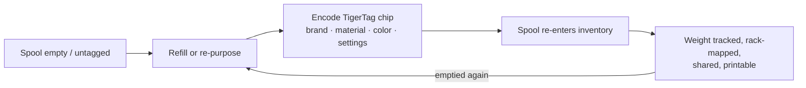

# Der Second-Life-Ablauf

## Das Problem mit „smarten“ Spulen heute

Wenn die getaggte Spule eines Herstellers leer ist, stirbt der Tag mit ihr: Er
beschrieb eine werkseitig befüllte Spule, im Format eines Herstellers, und kann nicht
wiederverwendet werden. Der Spulenkörper wird weggeworfen oder „dumm“ nachgefüllt.

## Second Life: neu identifizieren, nicht wegwerfen

Ein TigerTag-Chip ist **beschreibbar und wiederbeschreibbar**. Wird eine Spule geleert
und nachgefüllt – oder hat eine Spule irgendeiner Marke gar keinen brauchbaren Tag –,
codiert der Nutzer einen TigerTag-Chip mit dem echten Profil des neuen Filaments und
klebt ihn auf. Die Spule bekommt ein *zweites Leben* als vollwertiges, sich selbst
identifizierendes Objekt:

*Selbst ein spulenloser Refill trägt seine Identität – der Chip sitzt auf der Rolle
selbst.*

## Wie das Codieren funktioniert

- **Tiger NFC Connect** (mobil) – Chips per NFC-Antippen programmieren.
- **Tiger Studio** (Desktop) – geführte Chip-Aktualisierung mit einem ACR122U- /
 [TigerPOD](../products/tigerpod.md)-Lesegerät: Chip auflegen, UID-Abgleich,
 verifiziertes Schreiben.
- **Digital zuerst** – mit *TigerData* in Tiger Studio legst du jetzt eine vollständig
 digitale (chiplose) Spule an und **wertest sie später atomar zu einem echten Chip
 auf**.

> **Hinweis:** Der Katalog der Marken, Materialien und Farben, der beim Codieren
> verwendet wird, kommt aus der gemeinsamen
> [Referenzdatenbank](../concepts/universal-filament-identity.md), sodass ein neu
> codierter Chip so präzise ist wie ein werkseitiger.

## Das zweite Leben des Chips – null Elektroschrott

Die Spule ist nicht das Einzige, was ein zweites Leben bekommt: **die Chips auch.**
Jede Spule trägt [zwei Chips](../concepts/tigertag-chip.md) – jedes Kilo Filament, das
du druckst, hinterlässt dir also **zwei Standard-NTAG-Chips** zum Ernten. Zieh sie ab
und codiere sie als einfaches NDEF für alles Mögliche: einen smarten Schlüsselanhänger,
eine NFC-Visitenkarte, ein eigenes vernetztes Objekt – der Editor ist in die App
eingebaut. Er kann einen Chip sogar **in dem Format neu schreiben, das Elegoo-Drucker
erwarten**: dein Chip, deine Wahl.

Genau deshalb wurde die Produktion der offiziellen Marken-Chips auf **NTAG215**
umgestellt: Mehr Speicherreserve bedeutet mehr Wiederverwendungsmöglichkeiten, wenn die
Spule leer ist. Das Ziel ist einfach – **der Chip einer Spule soll nie zu
Elektroschrott werden.**

---

**◀ Zurück:** [Smartphone-Brücke](./smartphone-bridge.md) · **▲ [Dokumentationsindex](../../README.md)** · **Weiter ▶** [Universelle Filament-Identität](../concepts/universal-filament-identity.md)

**Siehe auch:** [TigerTag](../products/tigertag.md), [TigerTag+](../products/tigertag-plus.md)
