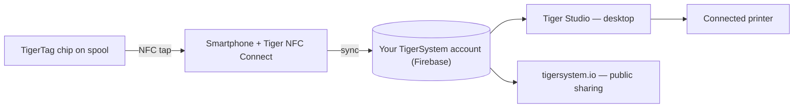

# Das Konzept der Smartphone-Brücke

## Die Einsicht

> In China fragten wir immer wieder: *„Wo sind die RFID-Lesegeräte?“* Alle
> antworteten: *„In den Bambu Labs.“* Falsch – die Lesegeräte von Bambu sitzen im AMS,
> nicht im Drucker; die Maschine kann eine Spule von Drittanbietern überhaupt nicht
> erkennen. **Die RFID-Lesegeräte sind in euren Hosentaschen** – in jedem Handy,
> einsatzbereit, ohne dass ihr es überhaupt wisst.

Jedes moderne Smartphone enthält ein NFC-Lesegerät. Das heißt: **Jeder 3D-Druck-Nutzer
besitzt bereits TigerTag-Hardware** – kein proprietäres Lesegerät, kein Drucker-Upgrade,
kein Kauf nötig, um anzufangen.

Das Handy fungiert als **Brücke** zwischen der physischen Spule und dem digitalen
Bestand:

1. **Antippen** – das Profil des Chips (Marke, Material, Farbe, Einstellungen) wird mit
 einer einzigen Geste gelesen.
2. **Synchronisieren** – die Spule erscheint sofort im Cloud-Bestand des Nutzers.
3. **Überall** – die Desktop-App, das Web und angeschlossene Drucker kennen die Spule
 nun.

## Natives RFID oder die Brücke

Manche Drucker lesen Tags nativ (ihr eigenes proprietäres Format); die meisten lesen
gar nichts. Die Brücke macht die Fähigkeiten des Druckers irrelevant:

| Weg | Voraussetzung | Funktioniert mit |
|---|---|---|
| **Natives RFID** | Ein Drucker, der den gesperrten Tag dieses Herstellers liest | Nur einer Marke |
| **Smartphone-Brücke** | Ein beliebiges NFC-Handy | **Jedem Drucker**, jeder Marke, selbst ganz offline betriebenen Maschinen |

Mit der Brücke erreichen die Filamentdaten den Drucker über die
[Drucker-Integrationen von Tiger Studio](../compatibility/README.md) (sechs Marken
heute live) – die Spule identifiziert sich gegenüber dem *System*, und das System
spricht mit der Maschine.

Der Beweis am Beispiel: **FlashForge-Drucker haben gar kein RFID-Lesegerät** – und
über die Brücke arbeiten sie jetzt trotzdem mit NFC-identifiziertem Filament. Eine
ganz neue Fähigkeit, den Maschinen anderer hinzugefügt, **für den Nutzer völlig
kostenlos** ([der Fall FlashForge](../compatibility/flashforge.md)).

---

**◀ Zurück:** [Offenes Ökosystem](./open-ecosystem.md) · **▲ [Dokumentationsindex](../../README.md)** · **Weiter ▶** [Second-Life-Ablauf](./second-life.md)

**Siehe auch:** [Tiger NFC Connect](../products/tigertag-connect.md), [Architekturübersicht](../architecture/overview.md)
