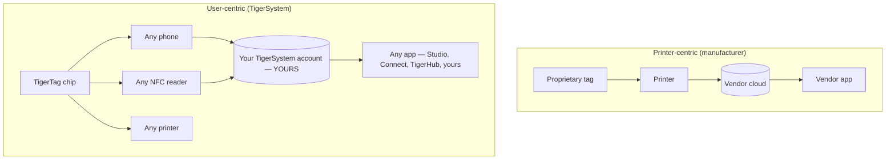

# Nutzerzentriert vs. druckerzentriert

> **Intelligenz im Dienst des Nutzers – nicht nur des Druckers.**

## Zwei gegensätzliche Architekturen

In einer druckerzentrierten Welt steht der **Drucker** im Mittelpunkt: Der Tag
existiert, um der Maschine zu dienen, und die Daten fließen in das Silo des
Herstellers.

In TigerSystem steht der **Nutzer** im Mittelpunkt. Dem Nutzer gehören:

- **das Filament** – jede Marke, jeder Anbieter;
- **die Metadaten** – Material, Farbe, Druckeinstellungen, codiert auf einem Chip, den
 er kontrolliert;
- **der Bestand** – gespeichert unter seinem eigenen Cloud-Konto, exportierbar;
- **die Historie** – Gewichte, Orte, Nutzung im Zeitverlauf;
- **die Synchronisierung** – dasselbe Konto speist jede App und jedes Gerät.

TigerSystem **verbindet einfach jede Komponente miteinander**.

## Warum Hersteller RFID sperren

Tags von Herstellern sind meist kryptografisch gesperrt (siehe den
[Abschnitt Kompatibilität](../compatibility/README.md) für Details pro Hersteller:
UID-abgeleitete Schlüssel, AES-verschlüsselte Sektoren, RSA-Signaturen). Das Sperren
dient dem Hersteller: Es bindet den Kauf von Verbrauchsmaterial an die Maschine und
hält die Datenpipeline proprietär. Es bedeutet auch, dass **dein eigener
Spulenbestand nicht dir gehört**.

TigerTag-Chips nehmen die entgegengesetzte Haltung ein: offene NDEF-Nutzdaten auf einem
Standard-NTAG-Chip, öffentlich dokumentiert, mit offenen SDKs zum Lesen und Schreiben.

---

**◀ Zurück:** [Warum es TigerSystem gibt](../vision/why-tigersystem.md) · **▲ [Dokumentationsindex](../../README.md)** · **Weiter ▶** [Offenes Ökosystem](./open-ecosystem.md)

**Siehe auch:** [Universelle Filament-Identität](../concepts/universal-filament-identity.md), [Kompatibilität](../compatibility/README.md)
