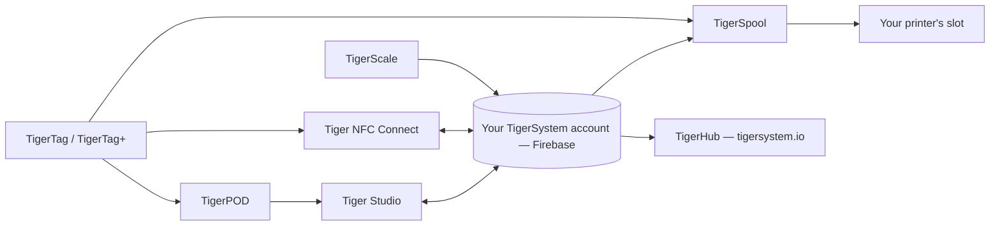

# Produkte

Das TigerSystem-Ökosystem, eine Seite pro Produkt.

**Dies sind die offiziellen Produkte** – von TigerSystem entworfen und
veröffentlicht. „Offiziell“ heißt hier *wir haben es gemacht*, nicht *du brauchst
es*: Jedes davon ist quelloffen und forkbar, und ihre Namen (Tiger Studio, TigerHub,
TigerScale, TigerPOD, Tiger NFC Connect) werden bewusst **nicht als Marken
beansprucht**. Nur die Marke **TigerTag** selbst ist reserviert, und nur für den Chip.

Jeder darf eine Alternative bauen und verkaufen – ein Lesegerät, eine App, eine Waage,
ein ganzes Bestandssystem. Was es schon gibt, steht unter
[Hardware von Drittanbietern](../compatibility/third-party-hardware.md) und
[Software, die auf TigerTag aufbaut](../developers/integrations.md). Ein Produkt eines
Drittanbieters ist **TigerTag Compatible**, indem es einfach funktioniert; es wird
nur dann **TigerTag Certified**, wenn TigerSystem es gewährt
([Markenrichtlinie](../../TRADEMARK.md)).

> **Hinweis:** Jedes **nutzerseitige** Produkt unten – und jedes künftige – ist ein
> funktionierender **Proof of Concept**. Sein einziges Ziel ist, das Potenzial eines
> quelloffenen, standardisierten, herstellerunabhängigen, plattformübergreifenden
> Protokolls zu zeigen und anzuregen, was andere darauf bauen werden. (Die
> fabrikseitige Werkzeugkette zur Chip-Programmierung ist eine andere Geschichte:
> industrietauglich, im Produktiveinsatz.) Siehe
> [Eine Sandbox, mit Absicht](../vision/why-tigersystem.md).

| Produkt | Was es ist | Typ |
|---|---|---|
|  [TigerData](../concepts/universal-filament-identity.md) | Der virtuelle Chip – die Identität in digitaler Form, kein Chip nötig, jederzeit aufwertbar | Konzept |
|  [TigerTag](./tigertag.md) | Offener RFID/NFC-Chip + Standard für die Spulenidentität | Hardware + Spezifikation |
|  [TigerTag+](./tigertag-plus.md) | Ein TigerTag mit einer Katalog-Produkt-ID und optionaler Anreicherung – weiterhin zu 100 % offline; signiert ist er TigerTag+ Certified | Hardware + Spezifikation |
|  [Tiger NFC Connect](./tiger-nfc-connect.md) | Mobile App (iOS/Android) – scannen, codieren, durchstöbern | App |
|  [Tiger Studio](./tiger-studio.md) | Desktop-App – Bestand, Racks, Sensoren, Drucker | App |
|  [TigerHub](./tigerhub.md) | Die Web-Heimat des Ökosystems – Schaufenster, Wunschlisten, Freunde & Teilen auf `tigersystem.io` | Web |
|  [TigerPOD](./tigerpod.md) | 3D-druckbarer Ständer für zwei NFC-Lesegeräte | Hardware |
|  [TigerScale](./tigerscale.md) | Quelloffene ESP32-Filamentwaage | Hardware |
|  [TigerSpool](./tigerspool.md) | Quelloffene ESP32-Box neben dem Drucker – Spule antippen, Slot wählen, jede Marke | Hardware |
|  [Tiger Touch](./tigertouch.md) | Quelloffene Firmware für den Bildschirm BIGTREETECH Panda Touch / K-Touch – jede Druckermarke, live, auf einem Bildschirm | Firmware |
|  [TigerTag Factory & Manager](./factory-suite.md) | Industrielle Chip-Programmierung & Filament-Datenbank-Werkzeuge für Fabriken – **nicht öffentlich**, produktionsreif | Industrie |

---

**◀ Zurück:** [Datenfluss](../architecture/data-flow.md) · **▲ [Dokumentationsindex](../../README.md)** · **Weiter ▶** [TigerTag](./tigertag.md)
