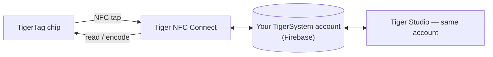

# Tiger NFC Connect (mobile App)

## Zweck

**Dein Handy ist schon ein TigerTag-Lesegerät – Connect schaltet es ein.** Die
iOS-/Android-App liest jede Spule mit einem Antippen, schreibt Chips genauso leicht und
trägt deine ganze Sammlung in der Tasche. Sie ist der alltägliche Einstieg in das
Ökosystem und die Verkörperung der
[Smartphone-Brücke](../philosophy/smartphone-bridge.md).

<strong>iPhone · iPad</strong>
<a class="ts-cta-primary" href="https://apps.apple.com/app/id6745437963">App Store</a>
Mit der Kamera scannen oder die Schaltfläche antippen

<strong>Android</strong>
<a class="ts-cta-primary" href="https://play.google.com/store/apps/details?id=com.tigertag.connect">Google Play</a>
Mit der Kamera scannen oder die Schaltfläche antippen

<a href="https://tigersystem.io/download">Alle Downloads auf tigersystem.io</a>
<a href="https://testflight.apple.com/join/jVHhmK4C">TestFlight-Beta (iOS)</a>
<a href="https://play.google.com/apps/testing/com.tigertag.connect">Google-Play-Beta</a>

Kostenlos, in beiden Stores. Die App liest einen Chip mit dem eigenen NFC des Handys –
nichts zu kaufen, kein Lesegerät, zum Lesen kein Konto nötig.

## Wo sie sich einfügt

## Funktionen

- **NFC-Scannen unterwegs** – eine Spule antippen und ihr ganzes Profil sehen.
- **Chip-Programmierung** – TigerTag-Chips vom Handy aus codieren und neu codieren.
- **Katalog durchstöbern** – die gemeinsame Referenzdatenbank für Marke/Material/Farbe.
- **Gemeinsames Konto** – dasselbe Firebase-Backend wie Tiger Studio: Bestand, Freunde
 und Racks bleiben geräteübergreifend in Echtzeit synchron.
- **USB-C-Zubehör** – unterstützt das Filament-Analysegerät **TD-1 / TD1s** von AJAX-3D
 über USB-C: die Transmission Distance (und Farbe) eines Filaments direkt vom Handy
 messen ([kompatible Hardware von Drittanbietern](../compatibility/third-party-hardware.md)).

## So bekommst du sie

- **Veröffentlicht** im **App Store (iOS)** und bei **Google Play (Android)** – heute
 Version 1.0.2.
- **Öffentliche Betas** ebenfalls verfügbar (TestFlight auf iOS, offene Beta auf Android).
- Alle Download-Links: **[tigersystem.io/download](https://tigersystem.io/download)** –
 ein QR-Code ist außerdem immer in der Seitenleiste von Tiger Studio verfügbar.

> **Hinweis zum Namen:** früher als *„TigerTag RFID Connect“* veröffentlicht – umbenannt
> in **Tiger NFC Connect**, um an das NFC-Lesegerät zu erinnern, das schon in jedem Handy
> steckt. Die App ist **kostenlos nutzbar, aber proprietär** (vorerst nicht quelloffen) –
> anders als Tiger Studio, die SDKs und die Hardware, die offen sind.

## Architektur

Flutter-App, die mit Firebase (Auth + Firestore) spricht – der einzigen gemeinsamen
Konto-Datenbank hinter allen Apps. Die Druckeranbindung am Handy ist cloudorientiert,
wo Hersteller es erlauben.

## Zusammenspiel

| Mit | Wie |
|---|---|
| TigerTag-Chips | Lesen & Schreiben per NFC-Antippen |
| Firebase (Konto-Datenbank) | Echtzeit-Sync von Bestand / Freunden / Einstellungen |
| Tiger Studio | Desktop-Begleiter – dasselbe Konto, ergänzende Funktionen |

## In Bildern

|| | | |
|---|---|---|---|
|  |  |  |  |

---

**◀ Zurück:** [TigerTag+ Certified](./tigertag-plus-certified.md) · **▲ [Dokumentationsindex](../../README.md)** · **Weiter ▶** [Tiger Studio](./tiger-studio.md)

**Siehe auch:** [Smartphone-Brücke](../philosophy/smartphone-bridge.md), [Bestand & Cloud-Sync](../concepts/inventory-and-cloud-sync.md)
