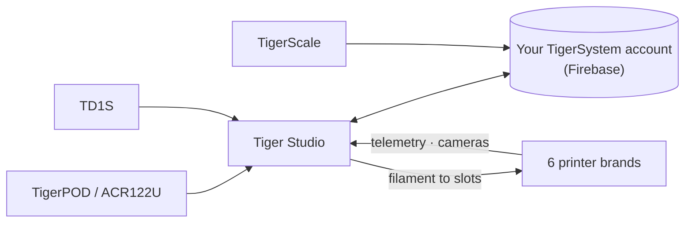

# Tiger Studio (Desktop-App)

## Zweck

**Tiger Studio ist die Kommandozentrale für dein Filament.** Jede Spule, jedes Rack,
jeder Drucker auf einem Bildschirm – Chip scannen, und seine Spule springt auf;
Gewicht aktualisieren, und es synchronisiert sich überall; auf einen Drucker blicken
und sehen, was er gerade tut. Quelloffen, für Windows / macOS / Linux.

*Tiger Studio auf dem Schreibtisch, die App in der Tasche, ein Lesegerät daneben – derselbe
Bestand, wo immer du ihn berührst.*

<a class="ts-cta-primary" href="https://tigersystem.io/download">Tiger Studio herunterladen – kostenlos</a>

<a href="https://github.com/TigerTag-Project/TigerTag-Studio-Manager"> Quellcode</a>

Es ist bewusst **ein Labor, nicht das Ziel** – eine Demonstration dessen, was das
offene Protokoll möglich macht, les-, fork- und frei kopierbar
([Philosophie](../philosophy/open-ecosystem.md)).

## Wo es sich einfügt

## Funktionen (Highlights)

- **Bestand** – Firestore-Sync in Echtzeit, Tabellen-/Rasteransichten, Detailfeld,
 Gewichtsverfolgung, Behälterkalibrierung, digitale Spulen (TigerData) mit atomarer
 Chip-Aufwertung.
- **Drucker** – Live-Integrationen für **6 Marken** (Telemetrie, Filament pro Slot,
 Auftragsfortschritt, Kameras und bei manchen Marken vollständige Bedienfelder). Siehe
 [Kompatibilität](../compatibility/README.md).
- **Racks** – physische Lagerabbildung per Drag-and-drop.
- **Freunde & Teilen** – Erkennungscodes, schreibgeschützte Bestände von Freunden.
- **Geräte** – vom Projekt selbst: [TigerPOD](./tigerpod.md) und
 [TigerScale](./tigerscale.md); von Drittanbietern: das NFC-Lesegerät ACR122U, die
 **AJAX-3D-Analysegeräte TD-1 & TD1s** (TD + Farbe direkt ins Profil der Spule) und
 **USB-HID-Waagen** (DYMO-M-Serie und jede konforme Waage) – vollständige Liste:
 [kompatible Hardware von Drittanbietern](../compatibility/third-party-hardware.md).
- **11 Sprachen** – EN · FR · DE · ES · IT · NL · PL · PT-BR · PT-PT · RU · 中文.

Der vollständige, stets aktuelle Katalog liegt in der
[FEATURES.md](https://github.com/TigerTag-Project/TigerTag-Studio-Manager/blob/main/FEATURES.md)
des App-Repositorys.

## Architektur

Electron + Vanilla-JS, kein Bundler. Die Drucker-Verbindungen sprechen das **native
LAN-Protokoll** jedes Herstellers direkt (MQTT / WebSocket / HTTP) – Protokollnotizen
pro Marke werden im App-Repository gepflegt (`renderer/printers/<brand>/PROTOCOL.md`).

## In Bildern

## Links

- Repo + Downloads: [TigerTag-Studio-Manager](https://github.com/TigerTag-Project/TigerTag-Studio-Manager) (MIT)
- Vollständiger Funktionskatalog: [FEATURES.md](https://github.com/TigerTag-Project/TigerTag-Studio-Manager/blob/main/FEATURES.md)

---

**◀ Zurück:** [Tiger NFC Connect](./tigertag-connect.md) · **▲ [Dokumentationsindex](../../README.md)** · **Weiter ▶** [TigerHub](./tigerhub.md)

**Siehe auch:** [Kompatibilität](../compatibility/README.md), [Architektur](../architecture/overview.md)
