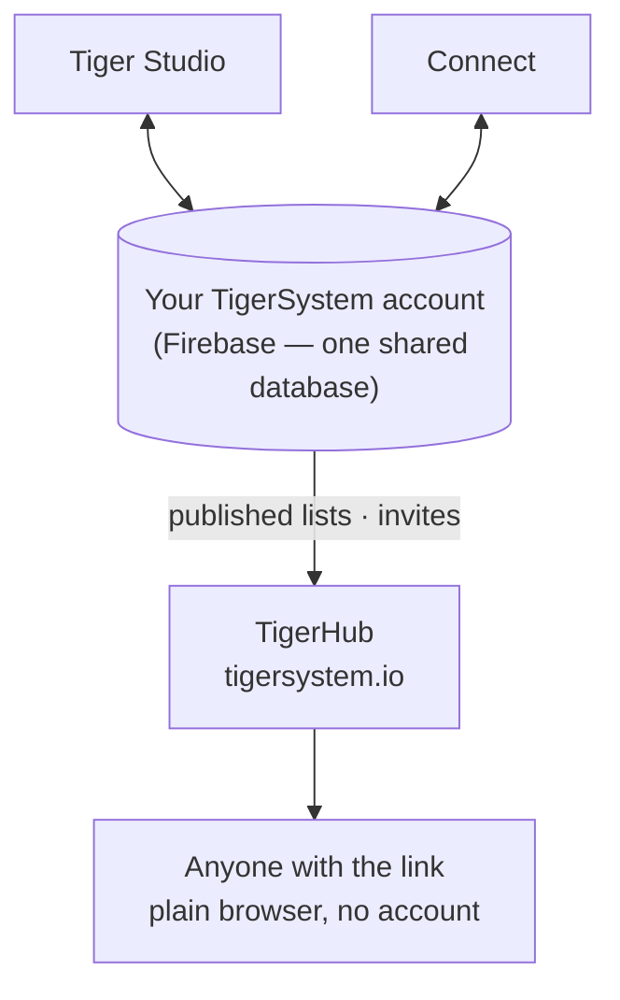

# TigerHub

## Zweck

**TigerHub ist die Heimat des Ökosystems im Web** – die Seite unter
**[tigersystem.io](https://tigersystem.io)**. Sie stellt die TigerSystem-Sandbox vor
und was das offene TigerTag-Protokoll möglich macht, und sie beherbergt die **soziale
Seite** der Sandbox: eine Wunschliste teilen, jemanden einladen, Freund zu werden, eine
schreibgeschützte Liste veröffentlichen, die jeder in einem Browser öffnen kann.

## Wo es sich einfügt

## Funktionen – alle heute live

- **Schaufenster des Ökosystems** – die Startseite erzählt die ganze Geschichte: wie es
 funktioniert, die sechs Druckermarken, die Komponenten und die drei Stufen
 (TigerData – reines Software-Tracking · TigerTag – der Offline-Chip · TigerTag+ –
 verifizierte Echtheit).
- **Dein Konto im Web** (`/account`) – melde dich in einem Browser an deinem
 TigerSystem-Konto an.
- **Wunschlisten** – öffentliche und nur für Freunde, beide im Einsatz.
- **Freundescodes & Einladungen** – füge dich gegenseitig vom Web aus als Freunde hinzu.
- **Öffentliche Listenlinks** – teile eine Liste schreibgeschützt als
 `https://tigersystem.io/wishlist/<token>`; der Betrachter braucht keine App
 und kein Konto.
- **Materialkatalog & Referenzdatenbank** (`/materials`, `/database`) – durchstöbere den
 gemeinsamen Katalog, gegen den jede App auflöst.
- **Drucker & Funktionen** (`/printers`, `/features`) – was mit was funktioniert.
- **3D-Modelle** (`/models`) – druckbare Modelle (TigerPOD und Freunde).
- **Für Hersteller, Entwickler & Presse** (`/manufacturers`, `/developers`, `/press`) –
 die B2B-Geschichte, Integrationshinweise, Medien-Assets.
- **Goodies** (`/goodies`) – die offizielle Kappe und das Polo. Eines zu kaufen ist
 eine der Möglichkeiten, das [Projekt zu unterstützen](../support.md).

## Ein öffentlicher Listenlink in der Praxis

Ein öffentlicher Listenlink ist `https://tigersystem.io/wishlist/<token>`. Drei
Dinge solltest du wissen, bevor du einen irgendwo einfügst:

- **Das Token ist der ganze Schlüssel.** Wer den Link hat, öffnet die Liste –
  kein Konto, keine App, nichts nachzuweisen. Behandle ihn wie ein Passwort,
  das du bewusst teilst: gut für einen Forenbeitrag oder einen Freund, nicht
  für eine Liste, bei der es dich stören würde, wenn sie weiterkopiert wird.
- **Eine Liste öffentlich zu machen, erzeugt den Link.** Wenn du eine Liste in
  der App auf *öffentlich* stellst, wird ihr Token erzeugt und eine Kopie der
  Liste veröffentlicht; stellst du sie wieder auf privat, werden diese Kopie
  und das Token gelöscht. Machst du sie wieder öffentlich, erhält sie ein
  **neues** Token, ein früher weitergegebener Link wird also nicht wieder
  lebendig. TigerHub zeigt nur an, was die App veröffentlicht.
- **Schreibgeschützt, und sie zeigt, wer sie geteilt hat.** Der Betrachter
  sieht diese eine Liste – ihre Einträge und den Anlass oder die Nachricht,
  falls du eine festgelegt hast –, nie deinen Bestand oder deine anderen
  Listen. Die Seite zeigt allerdings deinen **Anzeigenamen**, deine
  **Social-Media-Links** und einen Button *als Freund hinzufügen*, der deinen
  **Erkennungscode** enthält.

Ein Link ist eine von zwei Arten zu teilen; die andere ist ein Freund:

| | Öffentlicher Listenlink | Freund |
|---|---|---|
| Wer sieht sie | jeder mit dem Link | eine Person, die du angenommen hast |
| Braucht ein Konto | nein | ja |
| Wie | eine Liste öffentlich machen | Erkennungscodes austauschen |
| Rückgängig machen | die Liste privat machen | den Freund entfernen |

Die Seite der Freunde ist hier nur zusammengefasst, um neben dem Link zu
stehen; die Regeln für Anfragen und Entfernen und ihre serverseitige
Durchsetzung gehören zu [Bestand & Cloud-Sync](../concepts/inventory-and-cloud-sync.md).

## TigerHub ist nicht die Datenbank

Die Nutzerkonten und die Daten hinter allen Apps liegen in **schlichtem Firebase**
(Auth + Firestore) – bewusst markenlose Infrastruktur: **eine einzige gemeinsame
Datenbank an einem einzigen Ort**, damit Tiger Studio, Tiger NFC Connect, TigerScale
und das TigerSystem-Konto auf denselben Daten zusammenarbeiten. TigerHub ist die
**Weboberfläche**, die darauf aufbaut. Siehe
[Bestand & Cloud-Sync](../concepts/inventory-and-cloud-sync.md).

## Zusammenspiel

| Mit | Wie |
|---|---|
| Tiger Studio / Connect | Eine Liste öffentlich oder privat machen – was ihren Link erzeugt oder löscht – und Freundeseinladungen senden |
| Firebase (Konto-Datenbank) | Quelle der veröffentlichten Daten |
| Besucher | Normaler Browser, kein Konto nötig |

---

**◀ Zurück:** [Tiger Studio](./tiger-studio.md) · **▲ [Dokumentationsindex](../../README.md)** · **Weiter ▶** [TigerPOD](./tigerpod.md)

**Siehe auch:** [Bestand & Cloud-Sync](../concepts/inventory-and-cloud-sync.md), [Architektur](../architecture/overview.md)
