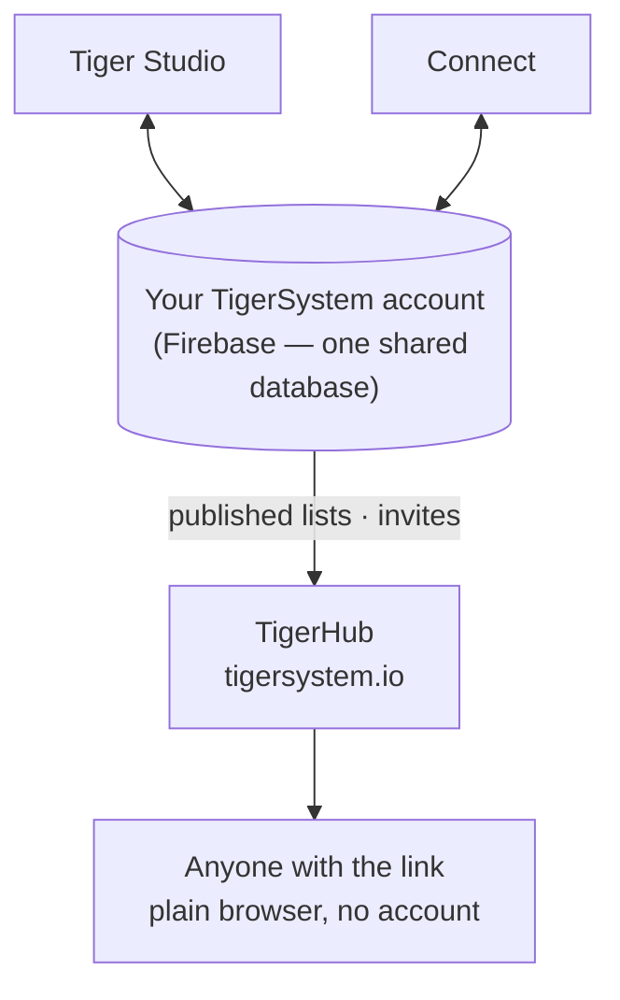

# TigerHub

## Zweck

**TigerHub ist die Heimat des Ökosystems im Web** – die Seite unter
**[tigersystem.io](https://tigersystem.io)**. Sie stellt die TigerSystem-Sandbox vor
und was das offene TigerTag-Protokoll möglich macht, und sie beherbergt die **soziale
Seite** der Sandbox: eine Wunschliste teilen, jemanden einladen, Freund zu werden, eine
schreibgeschützte Liste veröffentlichen, die jeder in einem Browser öffnen kann.

## Wo es sich einfügt

## Funktionen – alle heute live

- **Schaufenster des Ökosystems** – die Startseite erzählt die ganze Geschichte: wie es
 funktioniert, die sechs Druckermarken, die Komponenten und die drei Stufen
 (TigerData – reines Software-Tracking · TigerTag – der Offline-Chip · TigerTag+ –
 verifizierte Echtheit).
- **Dein Konto im Web** (`/account`) – melde dich in einem Browser an deinem
 TigerSystem-Konto an.
- **Wunschlisten** – öffentliche und nur für Freunde, beide im Einsatz.
- **Freundescodes & Einladungen** – füge dich gegenseitig vom Web aus als Freunde hinzu.
- **Öffentliche Listenlinks** – teile einen schreibgeschützten Bestand oder eine
 Wunschliste als `https://tigersystem.io/list/<token>`; der Betrachter braucht keine App
 und kein Konto.
- **Materialkatalog & Referenzdatenbank** (`/materials`, `/database`) – durchstöbere den
 gemeinsamen Katalog, gegen den jede App auflöst.
- **Drucker & Funktionen** (`/printers`, `/features`) – was mit was funktioniert.
- **3D-Modelle** (`/models`) – druckbare Modelle (TigerPOD und Freunde).
- **Für Hersteller, Entwickler & Presse** (`/manufacturers`, `/developers`, `/press`) –
 die B2B-Geschichte, Integrationshinweise, Medien-Assets.
- **Goodies** (`/goodies`) – die offizielle Kappe und das Polo. Eines zu kaufen ist
 eine der Möglichkeiten, das [Projekt zu unterstützen](../support.md).

## TigerHub ist nicht die Datenbank

Die Nutzerkonten und die Daten hinter allen Apps liegen in **schlichtem Firebase**
(Auth + Firestore) – bewusst markenlose Infrastruktur: **eine einzige gemeinsame
Datenbank an einem einzigen Ort**, damit Tiger Studio, Tiger NFC Connect, TigerScale
und das TigerSystem-Konto auf denselben Daten zusammenarbeiten. TigerHub ist die
**Weboberfläche**, die darauf aufbaut. Siehe
[Bestand & Cloud-Sync](../concepts/inventory-and-cloud-sync.md).

## Zusammenspiel

| Mit | Wie |
|---|---|
| Tiger Studio / Connect | Freigabelinks erzeugen und widerrufen, Freundeseinladungen senden |
| Firebase (Konto-Datenbank) | Quelle der veröffentlichten Daten |
| Besucher | Normaler Browser, kein Konto nötig |

---

**◀ Zurück:** [Tiger Studio](./tiger-studio.md) · **▲ [Dokumentationsindex](../../README.md)** · **Weiter ▶** [TigerPOD](./tigerpod.md)

**Siehe auch:** [Bestand & Cloud-Sync](../concepts/inventory-and-cloud-sync.md), [Architektur](../architecture/overview.md)
