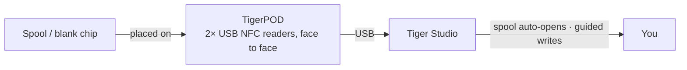

# TigerPOD

## Zweck

**Der erste „CD-Player“ für smarte Filamentspulen.** TigerPOD stellt einen
Spulen-Scanner auf deinen Schreibtisch – und du druckst ihn selbst.
Ein kostenloser, quelloffener 3D-druckbarer Ständer, der **zwei** USB-NFC-Lesegeräte
hält, die sich **gegenüberstehen**: Lege eine Spule hin, sie identifiziert sich in
Tiger Studio; lege einen leeren Chip hin, codiere ihn. So selbstverständlich wie das
Antippen mit dem Handy, aber freihändig am Schreibtisch.

*Leg die Spule hin; sie stellt sich vor.*

<a class="ts-cta-primary" href="https://tigersystem.io/tigerpod">Einen TigerPOD holen</a>
<a href="https://makerworld.com/fr/models/1289152-tigerpod-for-openspool-tigertag-rfid-filament#profileId-1318958">Selbst drucken – kostenlose STL</a>

<a href="https://github.com/TigerTag-Project/TigerPOD"> Quellcode</a>

## Warum zwei Lesegeräte, die sich gegenüberstehen

Das ist der ganze Sinn der Hülle und das Einzige, das man richtig machen muss. **Wir
empfehlen immer zwei Lesegeräte.** Ein Lesegerät funktioniert technisch auch, mindert
aber das Erlebnis auf zwei konkrete Arten:

- **Lesen.** Eine Spule trägt
 [**zwei Chips auf gegenüberliegenden Flächen**](../concepts/tigertag-chip.md). Mit einem
 einzigen Lesegerät muss eine Spule, die „falsch herum“ landet, aufgenommen und gewendet
 werden, bevor sie erkannt wird. Mit einem Lesegerät auf jeder Seite ist, wie auch immer
 du die Spule hineinsetzt, schon ein Chip vor einem Lesegerät. Nichts zu drehen, nichts
 zu zielen.
- **Schreiben.** Wenn du eine Spule selbst taggst, schreibst du **beide** Chips. Ein
 Lesegerät bedeutet zwei Durchgänge und zwei Gelegenheiten, sie nicht zusammenpassen zu
 lassen. Zwei Lesegeräte schreiben das Paar **in einem Zug**, und Tiger Studio kann sie
 gegeneinander prüfen.

Der Pod gibt es, um diese Geometrie zu halten: zwei Lesegeräte, aufrecht, einander
zugewandt, im Abstand einer Spule. Alles andere ist eine Hülle darum.

## Wo er sich einfügt

## Zwei Hüllen zum Drucken – beide kostenlos

| | **TigerPOD Mini** – *empfohlen* | **TigerPOD (Original)** |
|---|---|---|
| |  |  |
| Druck | Schneller, weniger Filament | Länger, mehr Filament |
| Platz auf dem Schreibtisch | Weniger | Mehr |
| Kabel | **Im Inneren** der Hülle geführt | Außen |
| Tags | TigerTag **und** OpenSpool (NDEF) | TigerTag **und** OpenSpool (NDEF) |
| Download | **[MakerWorld – TigerPOD Mini](https://makerworld.com/fr/models/3190348-tigerpod-mini-for-openspool-tigertag-rfid-filament#profileId-3609236)** | **[MakerWorld – TigerPOD Original](https://makerworld.com/fr/models/1289152-tigerpod-for-openspool-tigertag-rfid-filament#profileId-1318958)** |

Beide halten dieselben zwei Lesegeräte der Klasse ACR122U, die sich gegenüberstehen. Der
Mini ist eine Neukonstruktion des Originals und schlicht der bessere Pod: Fang dort an,
außer du willst ausdrücklich die größere Wiege.

Lizenziert unter **CC BY 4.0** – frei remixen und anpassen.

## Woraus er besteht

Die STL ist die Hülle; das sind die Teile, die hineingehören. Nichts davon ist
exklusiv – jedes Lesegerät der Klasse ACR122U und jeder USB-C-Splitter funktionieren –,
aber das ist die Kombination, um die herum die Hülle entworfen ist:

| Teil | Menge | Was es ist |
|---|---|---|
| **TigerTag Player** | **2** | Das USB-NFC-Lesegerät – ein Gerät der Klasse ACR122U. Eines pro Seite, sodass beide Chips der Spule in einem Durchgang erreicht werden. |
| **TigerTag Spliter** | 1 | USB-C auf 2× USB-A, damit die zwei Lesegeräte den Computer über einen Anschluss erreichen und parallel programmiert werden können. |
| **Die gedruckte Hülle** | 1 | **Mini** oder Original – siehe oben. |

### Die Teile besorgen

Die Hülle ist ein kostenloser Download; die zwei Lesegeräte und der Splitter sind der
Teil, den du kaufst. Sie werden als Bundle verkauft, der günstigste Weg, am Ende das
richtige Paar zu haben:

- **[TigerTag Player Bundle – 2 Lesegeräte + Spliter](https://www.atome3d.com/products/tigertag-player-bundle-2pcs-spliter)** (Atome3D)
- Auch erhältlich auf **[tigertag.io](https://shop.tigertag.io/collections/tigertag-rfid-maker)**

> **Hinweis:** Einen selbst zusammenzubauen und einen vormontierten zu kaufen, führt zu
> genau demselben Gerät. Zwei beliebige Lesegeräte der Klasse ACR122U genügen – das
> Bundle erspart dir nur, sie getrennt zu beschaffen.

## Selbst bauen

1. **Eine Hülle drucken** – den Mini oder das Original, siehe oben.
2. **Zwei ACR122U-kompatible Lesegeräte besorgen**, in jedem Shop deiner Wahl, und eine
 Packung leerer NTAG-213-/215-/216-Chips zum Beschreiben.
3. **Je ein Lesegerät in jeden Schlitz schieben** – keine Schrauben, kein Kleber, keine
 Verkabelung.
4. **Beide an den Computer anschließen.** Ein Splitter macht daraus ein Kabel; zwei
 USB-Anschlüsse funktionieren genauso gut.
5. **[Tiger Studio](./tiger-studio.md) installieren** – es erkennt die Lesegeräte von
 selbst.

Grobes Budget, getrennt beschafft – die Preise variieren je nach Shop und Region:

| Teil | Menge | Ca. | Wo |
|---|---|---|---|
| ACR122U-kompatibles NFC-Lesegerät | 2 | 15–25 € pro Stück | [Amazon](https://amzn.to/4vok3d7) · oder jeder Shop |
| Leere NTAG-213-/215-/216-Chips | 1 Packung | 10–20 € – zwei Chips pro Spule, eine Packung taggt also viele | [Amazon](https://amzn.to/3TzxGc7) · [offizielle Chips](./tigertag.md) |
| Die gedruckte Hülle | 1 | nur Filament | MakerWorld, siehe oben |
| USB-Splitter (2× USB-A-Buchse → 1× USB-A-Stecker) | 1 | 5–10 €, optional | [Amazon](https://amzn.to/4plgsv8) |

> Einige Links in dieser Tabelle sind **Amazon-Affiliate-Links**: Als Amazon-Partner
> verdient TigerTag an qualifizierten Käufen, **ohne Mehrkosten für dich**. Das hilft,
> das offene Protokoll zu finanzieren. Dieselben Teile anderswo zu kaufen, funktioniert
> genauso gut.

Das [Kit](https://shop.tigertag.io/collections/tigertag-rfid-maker) stattdessen zu kaufen
kostet weniger, als dieselben Teile einzeln zu beschaffen, die Lesegeräte kommen mit dem
offiziellen Logo des Projekts, und es finanziert den Standard – eine von mehreren
Möglichkeiten, das [Projekt zu unterstützen](../support.md). Aber einen aus gängigen
Teilen zu bauen ist **kein geringerer Weg – es ist derselbe Pod**. Das bedeutet ein
offenes Protokoll.

### Kompatibilität der Lesegeräte

Der ACR122U spricht **PC/SC**, den Smartcard-Standard auf Betriebssystemebene, den jedes
Lesegerät dieser Klasse implementiert. Weil der Pod auf PC/SC statt auf einem
Herstellertreiber aufbaut, läuft derselbe Aufbau unter **Windows, macOS und Linux**, und
jede PC/SC-Bibliothek kann ihn ansteuern.

## Funktionen

- 3D-druckbare Hülle – **kostenlose STLs auf MakerWorld**, in einer **Mini**- und einer
 **Original**-Größe.
- Nimmt zwei USB-Lesegeräte der Klasse ACR122U auf, einander zugewandt (Lese- +
 Schreibstationen).
- Plug-and-play mit [Tiger Studio](./tiger-studio.md): Das Scannen eines Chips öffnet
 automatisch die passende Spule; der geführte Ablauf zur Chip-Aktualisierung nutzt ihn
 für Schreibvorgänge mit UID-Prüfung.
- Nicht an TigerTag gebunden: Dieselben zwei Lesegeräte verarbeiten auch
 **OpenSpool**-Tags (NDEF).

## Mehr als TigerTag – eine universelle NFC-Station

Der Pod ist **nicht an das TigerTag-Protokoll gebunden**. Er ist buchstäblich zwei
Standard-PC/SC-Lesegeräte in einem spulenförmigen Halter: **Alles, was ein ACR122U kann,
kann der Pod.**

Du kontrollierst den Chip vollständig – lesen, was darauf ist, etwas Neues schreiben,
ändern, was dort steht, ihn wieder leer löschen. Alle vier, in beide Richtungen. Kein
Einmal-Schreiben, keine Einbahnstraße, keine Herstellerbindung. Und bei Filament geschieht
das in **Dual NFC**, beide Chips einer Spule gemeinsam verarbeitet, bei Spulen jeder
Marke.

Der ACR122U kann weit mehr als NTAG: **ISO 14443 Typ A und B**, **MIFARE** (Classic
1K/4K, Ultralight, DESFire), **FeliCa**, **Topaz/Jewel** und die **NFC-Forum-Tag-Typen
1–4**. Was immer du mit einem ACR122U lesen oder schreiben kannst, kannst du im Pod lesen
oder schreiben – einschließlich [OpenSpool](../compatibility/openspool.md)-Tags.

Das macht auch das [zweite Leben](../philosophy/second-life.md) real. Ein TigerTag ist nie
schreibgeschützt, wenn also eine Spule leer ist, kannst du ihre Chips löschen und als
frische TigerTags neu beschreiben – oder in etwas ganz anderes verwandeln: ein einfacher
**NDEF**-Tag für die Hausautomation, eine WLAN-Übergabe, eine URL, eine Visitenkarte. Und
wieder zurück in einen TigerTag, wann immer du willst. Der Chip ist ein
wiederverwendbares Gut, keine Einwegverpackung.

## Zusammenspiel

| Mit | Wie |
|---|---|
| TigerTag-Chips | Lesen / codieren / prüfen – beide Chips einer Spule gleichzeitig |
| Tiger Studio | Sofortige Spulenerkennung, Chip-Aufwertung & -Aktualisierung |

## In Bildern

## Links

- Repo: [TigerPOD](https://github.com/TigerTag-Project/TigerPOD)
- STL – **[TigerPOD Mini](https://makerworld.com/fr/models/3190348-tigerpod-mini-for-openspool-tigertag-rfid-filament#profileId-3609236)** · [TigerPOD Original](https://makerworld.com/fr/models/1289152-tigerpod-for-openspool-tigertag-rfid-filament#profileId-1318958)
- Lesegeräte: [TigerTag Player Bundle (2 Stück + Spliter)](https://www.atome3d.com/products/tigertag-player-bundle-2pcs-spliter)

---

**◀ Zurück:** [TigerHub](./tigerhub.md) · **▲ [Dokumentationsindex](../../README.md)** · **Weiter ▶** [TigerScale](./tigerscale.md)

**Siehe auch:** [Second-Life-Ablauf](../philosophy/second-life.md)
