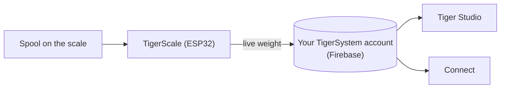

# TigerScale

## Zweck

**TigerScale beantwortet die ewige Frage: Wie viel Filament ist noch übrig?** Stelle
eine Spule auf die quelloffene ESP32-Waage, und das Live-Gewicht fließt direkt in
deinen Bestand – keine manuelle Eingabe, kein Schütteln der Spule neben dem Ohr.

*Die Spule kommt drauf, und die Waage weiß schon, was es ist: Der Chip liefert Marke,
Material und Farbe, die Wägezelle die Gramm. Nichts getippt, nichts geraten.*

<a class="ts-cta-primary" href="https://tigertag-project.github.io/Tiger-Scale-V3/">Aus dem Browser installieren</a>

<a href="https://tigersystem.io/tigerscale">TigerScale auf tigersystem.io</a>
<a href="https://makerworld.com/en/models/3161869-tigerscale-v3-best-smart-filament-scale-with-nfc#profileId-3573543">Das Gehäuse drucken</a>
<a href="https://github.com/TigerTag-Project/Tiger-Scale-V3"> Quellcode</a>

> **Der Chip weiß, was das Filament *ist*; die Waage weiß, wie viel *übrig* ist.**
> Zusammen machen sie den Bestand tatsächlich wahr: die Identität vom
> [TigerTag](./tigertag.md), die Live-Menge von der TigerScale.

## TigerScale V3 – die aktuelle Generation

[Tiger-Scale-V3](https://github.com/TigerTag-Project/Tiger-Scale-V3), MIT. Diese ist
die, die man bauen sollte.

- **Sie weiß, welche Spule auf ihr liegt**: **zwei PN532-NFC-Lesegeräte**, eines pro
 Seite – eine [Spule mit Twin-Tags](../concepts/tigertag-chip.md) wird erkannt, egal
 wie herum du sie hinstellst. Tag lesen, wiegen, das Gewicht der leeren Spule abziehen,
 synchronisieren – kein Tippen, kein Raten.
- **ESP32-S3** (16 MB Flash, PSRAM), **3,5″-Farb-Touchscreen mit 480×320** (LVGL) mit
 vollständiger Einrichtung am Bildschirm: WLAN-Auswahl + Tastatur, Kalibrierassistent,
 Hardware-Selbsttest, OTA-Updates.
- **Akkubetrieben** (PMIC AXP2101, Ladezustand auf dem Bildschirm), Audio-Codec.
- Präzises Wiegen: HX711 + Wägezelle, Median + adaptive EMA-Filterung – abgestimmt auf
 das Gefühl einer Küchenwaage.
- **8 Firmware-Sprachen**, Weboberfläche in 9 Sprachen.
- **Live-Gewichtsverfolgung** – Aktualisierungen erscheinen in Echtzeit in Tiger Studio
 und Tiger NFC Connect über Firestore.
- Funktioniert mit der **Behälter-Gewichtskalibrierung** von Tiger Studio, damit das
 Netto-Filamentgewicht pro Behältertyp genau bleibt.
- **Sie funktioniert offline.** Die Erkennung von Marke und Material kommt aus einer
 Datenbank im eigenen Flash des Geräts, höchstens einmal am Tag aktualisiert – eine
 Tag-Abfrage wartet nie auf das Netzwerk.
- **Cloud-Sync ist optional.** Die Waage ist ohne Konto voll nutzbar.
- **Eigene Weboberfläche**, vom Gerät ausgeliefert, mobilfreundlich, live per WebSocket
 mit 10 Hz – keine App nötig, um sie vom Handy aus zu bedienen.
- **Keine Binärblobs**: Alles wird aus dem Quellcode kompiliert.

*Auf der Werkbank: Spule hinstellen, sie identifiziert sich und wiegt sich selbst.*

## Eine bauen

> **Nicht so für Elektronik?** Eine USB-Waage und ein [TigerPOD](./tigerpod.md) leisten
> dasselbe, ohne etwas zu verdrahten oder zu flashen – die
> [offizielle Alternative ohne Elektronik](#eine-usb-waage-und-ein-tigerpod-ganz-ohne-elektronik).

Die Waage ist ein DIY-Bau, und die Schritte, die man für schwer hält, sind es nicht:

1. **Das Gehäuse drucken.** Ein `.3mf`-Projekt für Bambu Studio mit bereits
 angeordneten Platten – [auf MakerWorld](https://makerworld.com/en/models/3161869-tigerscale-v3-best-smart-filament-scale-with-nfc#profileId-3573543).
 Öffne es in Bambu Studio oder Orca und drücke Slice: nichts auszurichten, keine
 Stützen zu setzen.
2. **Die Komponenten verdrahten.** Verbinde Wägezelle, HX711, Lautsprecher und beide
 PN532-Lesegeräte mit dem Board nach dem [Schaltplan](#schaltplan) unten – dieselbe
 Pinbelegung für beide Board-Varianten.
3. **Aus dem Browser flashen.** Der
 [Web-Installer](https://tigertag-project.github.io/Tiger-Scale-V3/) liefert immer das
 aktuelle Release; danach aktualisiert sich die Waage selbst per Funk.

Die Teile sind gängige Ware:

| Menge | Komponente | Wo |
|---|---|---|
| 1 | Waveshare **ESP32-S3-Touch-LCD-3.5B** – 480×320-IPS-Touch (das **-3.5** ohne B funktioniert auch) | [-3.5B](https://link.amazon/B0gaANfF5) · [-3.5](https://link.amazon/B0dpgOlOQ) |
| 2 | **PN532-V3**-NFC-Modul – Stiftleiste **und** Modusschalter erforderlich | [Amazon](https://link.amazon/B0iTXrhjd) |
| 1 | 5-kg-Wägezelle + HX711 | [Amazon](https://link.amazon/B09LOUuI1) |
| 1 | USB-C-4-Pin-Kabel + Stecker | [Kabel](https://link.amazon/B0aoW8qQx) · [Stecker](https://link.amazon/B0aiEyjLx) |
| 1 | Li-Ion-Akku – **optional**, die Waage läuft über USB | [Amazon](https://link.amazon/B0etKlE1i) |
| — | Dupont-Kabel, selbstschneidende M3-Schrauben | [Kabel](https://link.amazon/B0bl6jvMs) · [Schrauben](https://link.amazon/B0ekzxx1E) |
| — | 2× M4×30 und 2× M5×30 (Wägezelle), 4× M2×6 (Display) | jeder Baumarkt |
| 1 | Ein kleiner Lautsprecher | liegt dem ESP32-S3-Board bei |

<figure>

<figcaption><strong>Beide Varianten funktionieren, brauchen aber unterschiedliche Firmware.</strong> Lies die Siebdruck-Beschriftung ab: <strong>-3.5B</strong> oder <strong>-3.5</strong>. Der Web-Installer fragt, welches du hast; Verdrahtung und Gehäuse sind in beiden Fällen gleich. Flashst du den falschen Build, startet die Waage einwandfrei, sieht aber nie einen Tag, ohne dass der Bildschirm sagt, warum.</figcaption>
</figure>
<figure>

<figcaption><strong>Warnung:</strong> Die Wägezelle muss 2× M4- und 2× M5-Gewindebohrungen haben, und die HX711-Platine muss mit der gezeigten identisch sein – sonst passt sie nicht in ihren vorgesehenen Platz.</figcaption>
</figure>

> Einige Links in dieser Tabelle sind **Amazon-Affiliate-Links**: Als Amazon-Partner
> verdient TigerTag an qualifizierten Käufen, **ohne Mehrkosten für dich**. Das hilft,
> das offene Protokoll zu finanzieren. Dieselben Teile anderswo zu kaufen, funktioniert
> genauso gut.

Die vollständige Stückliste mit Kosten liegt im
[Repository](https://github.com/TigerTag-Project/Tiger-Scale-V3).

### Montage

<figure>

<figcaption>Dreiviertel von vorn</figcaption>
</figure>
<figure>

<figcaption>Dreiviertel von hinten</figcaption>
</figure>
<figure>

<figcaption>Dreiviertel von hinten, nah</figcaption>
</figure>
<figure>

<figcaption>Seitenansicht</figcaption>
</figure>

<figure>

<figcaption>Position und Ausrichtung der Waage</figcaption>
</figure>
<figure>

<figcaption>PN532 in seinem Schlitz eingesetzt</figcaption>
</figure>

### Schaltplan

*[Interaktiver Schaltplan in Cirkit Designer](https://app.cirkitdesigner.com/project/c6aa6c0a-9462-498f-8923-9ad4454e0e69)*

### Fehlerbehebung

**Im [Web-Installer](https://tigertag-project.github.io/Tiger-Scale-V3/) wird kein COM-Port für den ESP32-S3 erkannt?**

Möglicherweise fehlt ein Treiber für dein System. [Folge der Anleitung zur Treiberinstallation](../tutorials/tigerscale-serial-port-driver.md).

## Zum Selbermachen und Verkaufen

**Jeder darf TigerScale-Hardware herstellen und verkaufen. Keine Lizenzgebühr, keine
Tantiemen, keine Registrierung.** Bau sie, flashe die offizielle Firmware, liefere sie
aus.

Die einzige Bedingung, dein Produkt **TigerScale** zu nennen, ist, dass es diese
offizielle Firmware **unverändert** ausführt, damit sich jedes Gerät im Ökosystem
identisch verhält. Forke sie, wenn du etwas ändern willst – und gib dem Fork einen
anderen Namen. Das ist der ganze Handel.

## Wo sie sich einfügt

## Die bisherige Geschichte

Drei Generationen, und die Gestalt des Dings änderte sich bei jeder:

| | Lesen | Bildschirm | Board | Bauform |
|---|---|---|---|---|
| **V1** – nie öffentlich veröffentlicht | **ein** PN532 | Mini-OLED | ESP32 | ein **Spulenhalter**: eine zentrale Stütze, die durch die Mitte der Spule führt |
| **V2** – [Tiger-Scale](https://github.com/TigerTag-Project/Tiger-Scale), MIT | 2× RC522 | 0,96″-OLED | ESP32-WROOM, USB-versorgt | eine flache Waage |
| **V3** – [Tiger-Scale-V3](https://github.com/TigerTag-Project/Tiger-Scale-V3), MIT | 2× PN532 | 3,5″-Farb-Touchscreen | ESP32-S3, Akku | eine flache Waage, in sich geschlossen |

Die V1 trug im Wesentlichen schon die Elektronik der V2 – ESP32, Mini-OLED, eine
HX711-Platine mit 5-kg-Wägezelle –, aber **ein einziges** Lesegerät und einen völlig
anderen Körper.

> **V3 ist andere Hardware, kein Firmware-Update.** Die beiden sind nicht
> austauschbar: Eine V2, die du schon gebaut hast, behält ihr eigenes Repository und
> funktioniert weiter. Sie wird nur nicht mehr weiterentwickelt.

Alle drei sind vollständig quelloffen (MIT) auf gängigen Teilen – der lebende Beweis,
dass ein ESP32 und ein NFC-Lesemodul (Klasse PN532 / RC522) genügen, um ein Gerät zu
bauen, das TigerTag liest.

## Eine USB-Waage und ein TigerPOD, ganz ohne Elektronik

Die **offizielle Alternative für alle, die keine Waage bauen wollen**. Eine
handelsübliche USB-Waage und ein [TigerPOD](./tigerpod.md), beide am Computer
angeschlossen, und Tiger Studio erledigt den Rest – nichts zu löten, zu verdrahten oder
zu flashen.

1. **Die Waage per USB an den Computer anschließen.**
2. **Den TigerPOD auf sie stellen** – den Mini oder das Original.
3. **Die Waage tarieren**, mit dem TigerPOD darauf.
4. **Tiger Studio öffnen.**
5. **Eine Spule auf den TigerPOD legen.** Er liest die Chips der Spule, und Tiger Studio
 öffnet ihre Karte.
6. **Die Waage wiegt sie**, und Tiger Studio aktualisiert das Gewicht der Spule von
 selbst.

### Welche Waagen funktionieren

Tiger Studio liest handelsübliche **USB-„HID-Waagen“** (HID-Usage-Page `0x8D`, Usage
`0x20`): angefangen bei der **DYMO M5** und dem Rest der DYMO-M-Serie (M10, M25 …
dasselbe Protokoll) sowie **jeder konformen HID-Waage**, egal welcher Marke. Die Waage
ist Hardware eines Drittanbieters, kein Tiger-Produkt; der Aufbau drumherum ist
offiziell und unterstützt.

Protokoll, auf echter Hardware validiert – 6-Byte-*Scale Data Reports* mit etwa 1 Hz:

| Byte | Bedeutung |
|---|---|
| `[0]` | Report-ID `0x03` |
| `[1]` | Status: 1 Fehler · 2 stabil bei null · 3 in Bewegung · 4 stabil · 5 negativ · 6 Überlast |
| `[2]` | Einheit (HID-PoS-Codes): `0x02` Gramm · `0x0B` Unze · `0x0C` Pfund |
| `[3]` | vorzeichenbehafteter Zehnerpotenz-Exponent, der auf den Rohwert angewendet wird |
| `[4..5]` | Gewicht, LE16 (LSB, MSB) |

DYMO-Hersteller-ID `0x0922`; die M5 hat die PID `0x8009`. Eigenheit: Der allererste
Frame direkt nach einer Tara meldet die Einheit `0x00`.

> **Die DYMO M2 wird nicht unterstützt** – sie hat gar keinen USB-Anschluss, es gibt
> also nichts, was man an einen Computer anschließen könnte. Das Protokoll ist dabei
> nebensächlich.

## Zusammenspiel

| Mit | Wie |
|---|---|
| Firebase (Konto-Datenbank) | Schreibt das Live-Gewicht in das Konto des Nutzers |
| Tiger Studio / Connect | Zeigen das Live-Gewicht an; Zustandsüberwachung |

## Links

- **V3 (aktuell)**: [Tiger-Scale-V3](https://github.com/TigerTag-Project/Tiger-Scale-V3) (MIT)
- Aus dem Browser flashen: [Web-Installer](https://tigertag-project.github.io/Tiger-Scale-V3/)
- Das Gehäuse drucken: [MakerWorld](https://makerworld.com/en/models/3161869-tigerscale-v3-best-smart-filament-scale-with-nfc#profileId-3573543)
- V2, nicht mehr weiterentwickelt: [Tiger-Scale](https://github.com/TigerTag-Project/Tiger-Scale) (MIT)

---

**◀ Zurück:** [TigerPOD](./tigerpod.md) · **▲ [Dokumentationsindex](../../README.md)** · **Weiter ▶** [Kompatibilität](../compatibility/README.md)

**Siehe auch:** [Bestand & Cloud-Sync](../concepts/inventory-and-cloud-sync.md)
