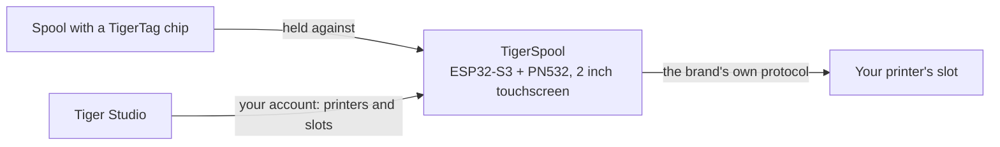

# TigerSpool

**Eine kleine Box neben dem Drucker. Einen Slot antippen, eine Spule daran halten, und
das Filament wird in diesen Slot geschrieben – bei jeder Druckermarke.**

*Die Box, eine Spule und die eigenen Slots des Druckers auf dem Bildschirm – jeder zeigt,
was darin geladen ist. Slot wählen, Spule an die Box halten, fertig.*

<a class="ts-cta-primary" href="https://tigertag-project.github.io/TigerSpool-RFID/">Aus dem Browser installieren</a>

<a href="https://github.com/TigerTag-Project/TigerSpool-RFID"> Quellcode</a>

Dein Drucker führt schon eine Liste von Slots. Deine Spule trägt schon ihre eigene
[Identität](../concepts/universal-filament-identity.md). TigerSpool sind die dreißig
Zentimeter dazwischen: keine App zu öffnen, keine Tastatur, nichts neu einzutippen, was
der Chip schon weiß.

Quelloffen unter **MIT**, ESP32-S3, etwa **40 €** an gängigen Teilen.

## Was es tut

1. **Tippe den gewünschten Slot** auf dem Touchscreen an – mit denselben Slot-Namen,
 die der Drucker selbst verwendet.
2. **Halte die Spule an die Box.** Der [TigerTag-Chip](../concepts/tigertag-chip.md) wird
 bei Berührung gelesen, und die Zuweisung geht sofort an den Drucker, über das eigene
 Protokoll dieser Marke: Material, Marke, Farbe und Temperaturen, im richtigen Slot.
 Es gibt nichts zu bestätigen.
3. **Lege die Spule ein.** Die Box sagt dir, in welchen Slot sie ging.

Sie spricht neun Sprachen, fragt vor allem anderen nach der gewünschten und
aktualisiert sich selbst per Funk.

:::caution[Warnung]
Einen TigerTag auf einen Slot auf dem Bildschirm zu scannen, lädt nichts – es teilt dem
Drucker nur mit, was die Spule *ist*. **Du musst die Spule weiterhin selbst
physisch in diesen Slot einlegen** – das CFS, das AMS, die ACE-Einheit oder wie dieser
Drucker sein eigenes Fach nennt. Lässt du das aus, meldet der Drucker kein Filament,
weil tatsächlich keines geladen ist.
:::

## Wo es sich einfügt

TigerSpool ist kein Chip-Schreibgerät – das ist die Aufgabe des [TigerPOD](./tigerpod.md)
auf dem Schreibtisch. TigerSpool nimmt eine bereits vorhandene Identität und legt sie
dorthin, wo der Drucker sie erwartet.

## Was zuerst vorhanden sein muss

**Hier stolpern die Leute, deshalb steht es vor der Hardware.**

Die Box hat bewusst keine Tastatur und keine Möglichkeit, die Adresse eines Druckers
einzutippen. Sie liest deine Drucker **aus deinem TigerSystem-Konto**, was bedeutet,
dass zwei Dinge vorhanden sein müssen, bevor sie nützlich ist:

1. **Ein Konto, erstellt in [Tiger Studio](./tiger-studio.md).** Die Box meldet sich
 daran an – per E-Mail oder mit Google über einen QR-Code, sodass nie ein Passwort auf
 einem Zwei-Zoll-Bildschirm getippt wird.
2. **Deine Drucker, in Tiger Studio hinzugefügt.** Adresse, Zugangscode, Marke und
 Modell liegen alle dort.

Überspringst du das, ist die Druckerliste auf der Box **leer**. Das ist kein Fehler,
und am Gerät gibt es nichts zu reparieren: Sie zeigt dir genau das, was dein Konto
enthält. Füge den Drucker in Tiger Studio hinzu, und er erscheint bei der nächsten
Synchronisierung.

> **Kurz gesagt:** Tiger Studio → Konto erstellen → Drucker hinzufügen →
> *dann* die Box einrichten.

## Welche Drucker

**Die sechs Marken, die Tiger Studio integriert, sind abgedeckt** – geschrieben und auf
Hardware getestet. Das sind nicht alle Drucker auf dem Markt, und *„jeder Drucker“*
bleibt das Ziel; es ist jede Marke, mit der dieses Ökosystem heute spricht:

| Marke | Firmware | Transport |
|---|---|---|
| [Creality](../compatibility/creality.md) | implementiert, bewährt | WebSocket |
| [FlashForge](../compatibility/flashforge.md) | implementiert, bewährt | HTTP |
| [Bambu Lab](../compatibility/bambu-lab.md) | implementiert, bewährt | MQTT über TLS |
| [Snapmaker](../compatibility/snapmaker.md) | implementiert, bewährt | Moonraker über WebSocket |
| [Elegoo](../compatibility/elegoo.md) | implementiert, Lesen bewährt – Schreiben an einem Drucker noch nicht bestätigt | MQTT |
| [Anycubic](../compatibility/anycubic.md) | implementiert, Lesen bewährt – Schreiben noch nicht bestätigt; nur LAN-Modus | MQTT über TLS |

Die Slot-Namen folgen denen des Druckers: `Ext.` und `1A`–`1D` bei Creality und
FlashForge, `A1`–`A4` dann `B1`–`B4` bei Bambu Lab, `E1`–`E4` bei Snapmaker, `S1`–`S4`
beim Canvas von Elegoo und ein Buchstabe pro ACE-Einheit bei Anycubic – `A1`, `A2` …
dann `B1` … für eine zweite Box.

Prüfe den [Status pro Marke](https://github.com/TigerTag-Project/TigerSpool-RFID/blob/main/docs/PRINTER-COMPATIBILITY.md),
bevor du Teile für eine bestimmte Maschine kaufst.

## Eine bauen

Drei Dinge zu kaufen, vier Drähte, eine gedruckte Hülle – plus zwei Extras, die man
erwägen sollte. **Die Elektronik ist für jede Druckermarke identisch** – nur die Hülle
ändert sich, was es bei einer Firmware und einer Teileliste hält.

| Menge | Komponente | Wo |
|---|---|---|
| 1 | Entwicklungsboard Waveshare **ESP32-S3-Touch-LCD-2** – 2,0″-IPS-Kapazitiv-Touch mit 240×320, ESP32-S3**R8**, 16 MB Flash, 8 MB Octal-PSRAM. Bildschirm, Touchpanel und MCU auf einem Board, und die 16 MB machen zwei OTA-Slots komfortabel | [Amazon](https://link.amazon/B0c5hr3uf) |
| 1 | **PN532-V3**-NFC-Modul – DIP-Schalter, muss **HSU/UART** unterstützen, beide Schalter auf `0` / OFF. Ein Zweierpack kostet kaum mehr als eines | [Amazon](https://link.amazon/B0dyEfwKa) |
| 1 | Ein USB-C-Kabel, **das Daten überträgt** – die Geschwindigkeit ist egal, jedes USB-2.0-Datenkabel genügt | [Amazon](https://link.amazon/B00Xg3WT4) |
| 1 | Magnetischer USB-C-Stecker – **empfohlen**: Der Anschluss ist das Teil, das täglich angefasst wird, und das Kabel löst sich, statt die Buchse zu beschädigen | [Amazon](https://link.amazon/B0bWVIBa0) |
| 1 | LiPo-Zelle 3,7 V 1000 mAh, PH1.25 – **optional**, per USB geladen; die Box läuft dann kabellos. Das Board kann eine Zelle nicht erkennen, daher meldest du sie in Settings › Battery an. Polarität prüfen | [Amazon](https://link.amazon/B0fL0jjf3) |

> Einige Links in dieser Tabelle sind **Amazon-Affiliate-Links**: Als Amazon-Partner
> verdient TigerTag an qualifizierten Käufen, **ohne Mehrkosten für dich**. Das hilft,
> das offene Protokoll zu finanzieren. Dieselben Teile anderswo zu kaufen, funktioniert
> genauso gut.

Die **vier Jumper-Kabel liegen dem PN532 bei** – 3V3, GND, TX, RX, und das ist der
ganze Kabelbaum. Keine Pegelwandler: Der PN532 läuft mit 3V3, wie das Board. Ein Akku
ist **optional** – die Box steht normalerweise neben einem Drucker, der ohnehin
angesteckt ist, und die obige Zelle ist für die Zeiten, in denen das nicht so ist.

*Der ganze Kabelbaum. Am PN532 sind die zwei Datenpins mit `SDA` und `SCL`
beschriftet – im HSU-Modus führen sie die UART: Das **TX des Boards geht an `SCL`**,
sein **RX an `SDA`**, und beide DIP-Schalter stehen auf `0` / OFF.
[Interaktiver Schaltplan](https://app.cirkitdesigner.com/project/5b546f4e-70b8-4735-afff-be6bd36bc10c).*

**Das Flashen geschieht aus dem Browser** – Board anschließen, auf Install klicken, eine
Minute warten. Chrome, Edge oder Opera am Desktop; Safari und Firefox implementieren
WebSerial nicht, und kein mobiler Browser tut es.

**[Aus dem Browser installieren →](https://tigertag-project.github.io/TigerSpool-RFID/)**

### Drei Fallen, die man vor der Bestellung kennen sollte

- **Das Lesegerät kommt an GPIO43/44, nie an GPIO6/7.** Dieses Paar ist auf diesem
 Board ein I²C-Bus mit Pull-ups: Ein dort angeschlossener PN532 startet, antwortet und
 liefert zufällige UIDs bei fehlschlagenden Lesevorgängen. Es sieht aus wie ein
 defekter Tag. Ist es nicht, und es kostet einen Tag.
- **`TXD` kreuzt zum RX des Boards, `RXD` zu seinem TX.** Senden spricht mit Empfangen.
 Meldet das Lesegerät beim Start die Firmware-Version 0, tausche diese beiden, bevor
 du irgendetwas anderes änderst.
- **Ein reines Ladekabel lässt ein funktionierendes Board tot wirken.** Der Bildschirm
 leuchtet, und es erscheint nie ein serieller Port, sodass der Web-Installer nichts
 findet, worauf er installieren könnte. Verwende ein Kabel, von dem du weißt, dass es
 Dateien überträgt.

Waveshare verkauft mehrere ähnliche Boards; die mit 1,28″, 1,69″ und 3,5″ aus
derselben Familie haben andere Panel-Controller und Pinbelegungen, und diese Firmware
läuft darauf nicht korrekt. Prüfe die Siebdruck-Beschriftung, nicht den Titel des
Angebots.

Vollständige Teileliste, Schaltplan und Inbetriebnahme-Checkliste:
[TigerSpool-RFID](https://github.com/TigerTag-Project/TigerSpool-RFID).

## Wo es heute steht

Aufgeschrieben statt entdeckt:

- **Die erste gedruckte Hülle ist veröffentlicht**: ein freistehender Tischständer, mit
 der Spule links oder rechts, in
 [Model3D/](https://github.com/TigerTag-Project/TigerSpool-RFID/tree/main/Model3D).
 Gehäuse, die an einen bestimmten Drucker montiert werden, folgen derselben Regel –
 dasselbe Board, dasselbe Lesegerät, dieselben vier Drähte, derselbe USB-C-Eingang –,
 sodass ein einziges Firmware-Image auf jedem Modell läuft und jeder eines beisteuern
 kann, ohne Code anzufassen.
- **Die Firmware ist nicht signiert.** Ihre Update-Verbindung wird gegen den
 Root-Zertifikatsspeicher geprüft, die Box weiß also, mit wem sie spricht – aber nicht,
 wer das Image erzeugt hat.
- **Höchstens zehn Drucker gleichzeitig verbunden** – von den 24, die ein Konto ihr
 liefern kann – und nicht mehr als drei, die TLS sprechen (Bambu Lab, Anycubic), die
 den meisten Speicher kosten.

---

**▲ [Dokumentationsindex](../../README.md)** · **Siehe auch:** [TigerPOD](./tigerpod.md), [Tiger Studio](./tiger-studio.md), [Der TigerTag-Chip](../concepts/tigertag-chip.md), [Kompatibilität der Drucker](../compatibility/README.md)
