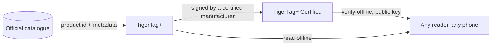

# TigerTag+ Certified

## Zweck

**Certified ist die Stufe, die beweisen kann, woher ein Chip stammt.** Ein
[TigerTag+](./tigertag-plus.md), der zusätzlich eine **kryptografische Signatur**
trägt, ist ein **TigerTag+ Certified**. Die Signatur wird von einem Hersteller
geschrieben, der die [TigerTag+-Zertifizierung](../developers/README.md) besitzt und
dabei die Signierwerkzeuge erhält; den privaten Schlüssel verwahrt TigerTag.

Es ist die einzige der drei Stufen, die nicht jedem offensteht, und die einzige, die
eine Frage beantwortet, die die anderen beiden nicht beantworten können: *Ist diese
Spule echt?*

## Die drei Stufen im Vergleich

| | TigerTag | TigerTag+ | TigerTag+ Certified |
|---|---|---|---|
| Druckdaten, **auf dem Chip** | ✅ | ✅ | ✅ |
| Funktioniert vollständig offline | ✅ | ✅ | ✅ |
| Katalog-Produkt-ID, **auf dem Chip** | — | ✅ | ✅ |
| Anreicherungs-Metadaten, **über die Web API, optional** | — | ✅ | ✅ |
| Herkunftssignatur, **auf dem Chip** | — | — | ✅ |
| Wer eines herstellen kann | jeder | jeder | **ein zertifizierter Hersteller** |

Lies die linke Spalte genau: Die Anreicherungs-Metadaten sind die einzige Zeile, die
**nicht** auf dem Chip liegt. Sie werden aus dem Katalog abgerufen, wenn du gerade
online bist, und können sich verbessern, nachdem der Chip beschrieben wurde – genau
deshalb kann der Chip sie nie brauchen. Alles, was der Drucker benötigt, steht in den
mit *auf dem Chip* markierten Zeilen, und das hält alle drei Stufen zu 100 % offline.

## Prüfen ist kostenlos – Ausstellen ist, was die Zertifizierung gewährt

Eine Signatur zu **prüfen** ist kostenlos, offline und uneingeschränkt: Die öffentlichen
Schlüssel sind veröffentlicht, und jedes Lesegerät kann eine ohne Konto und ohne
Netzwerk prüfen. Eine **auszustellen** ist, was die Zertifizierung gewährt.

Die signierte Nachricht deckt bewusst die **eigene UID** des Chips ab, sodass eine auf
einen anderen Chip kopierte signierte Nutzlast nicht mehr passt: Ein geklonter Tag
besteht die Prüfung nicht, auf dem eigenen Handy des Kunden. Dieselbe Eigenschaft ist
der Grund, warum die zwei Chips einer Spule zwei *verschiedene* Signaturen tragen
([wie die zwei Chips verbunden sind](../concepts/tigertag-chip.md)).

## Wo es sich einfügt

Das Byte-Layout – die Chip-Typ-IDs, der 64-Byte-Signaturbereich auf den Seiten
`0x18`–`0x27` – ist im
[TigerTag-RFID-Guide](https://github.com/TigerTag-Project/TigerTag-RFID-Guide)
spezifiziert.

## Wer zertifiziert ist

Die maßgebliche Liste der Hersteller, die die Marke auf einem Produkt führen dürfen, ist
das [Register der zertifizierten Partner](../certified-partners.md). Das TigerTag-Logo
oder der Name auf einem Chip beliebigen Formats, einem Carrier, einer Spule oder ihrer
Verpackung ist nur für die Hersteller auf dieser Seite autorisiert.

---

**◀ Zurück:** [TigerTag+](./tigertag-plus.md) · **▲ [Dokumentationsindex](../../README.md)** · **Weiter ▶** [Tiger NFC Connect](./tigertag-connect.md)

**Siehe auch:** [Der TigerTag-Chip](../concepts/tigertag-chip.md), [Zertifizierte Partner](../certified-partners.md), [Entwicklerdokumentation](../developers/README.md)
