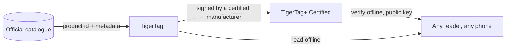

# TigerTag+

## Zweck

**Das `+` bedeutet identifiziert.** Ein TigerTag+ ist ein TigerTag, dessen Identität
eine **Produkt-ID aus dem offiziellen Katalog** trägt – nicht von Hand getippte Werte,
sondern das genaue Produkt: Marke, Farbe, Material, Temperaturen, Durchmesser, SKU, EAN,
direkt aus der Quelle. Darüber hinaus kann er **optionale Anreicherungs-Metadaten**
tragen, die über die Web API bereitgestellt werden und sich verbessern lassen, nachdem
der Chip beschrieben wurde.

Der Chip selbst bleibt **zu 100 % offline**. Alles, was zum Drucken nötig ist, steht
darauf, genau wie bei einem Standard-TigerTag – die Katalog-ID fügt die Möglichkeit
hinzu, reichere, aktuellere Daten nachzuschlagen, *wenn du gerade online bist*, und
nimmt nichts weg, wenn nicht. Ein im Flugmodus gelesener TigerTag+ verhält sich wie
jeder andere TigerTag.

Und *„online“* ist auch keine Voraussetzung. Die gesamte Referenz ist als eine Datei
veröffentlicht – jede ID jedes Filaments der Datenbank, frei zum Kopieren und Spiegeln
für jeden –, sodass ein Lesegerät, das sie besitzt, eine Katalog-ID ganz ohne Netzwerk
auflöst. Siehe [die Web API](../developers/web-api.md).

Es ist dasselbe `+` wie bei [TigerData+](../concepts/universal-filament-identity.md): In
beiden Fällen bedeutet es *diese Identität ist ein echtes Katalogprodukt*, und in keinem
von beiden bedeutet es *zertifiziert*.

> **Hinweis zum Namen:** früher als **„TigerTag Pro“** verkauft – der Name lautet jetzt
> **TigerTag+**.

## Was das `+` hinzufügt

| | TigerTag | TigerTag+ |
|---|---|---|
| Druckdaten, **auf dem Chip** | ✅ | ✅ |
| Funktioniert vollständig offline | ✅ | ✅ |
| Katalog-Produkt-ID, **auf dem Chip** | — | ✅ |
| Anreicherungs-Metadaten, **über die Web API, optional** | — | ✅ |
| Wer eines herstellen kann | jeder | jeder |

Die Anreicherungs-Metadaten sind die einzige Zeile, die **nicht** auf dem Chip liegt.
Sie werden aus dem Katalog abgerufen, wenn du gerade online bist, und können sich
verbessern, nachdem der Chip beschrieben wurde – genau deshalb kann der Chip sie nie
brauchen. Alles, was der Drucker benötigt, steht auf dem Chip, und das hält jede Stufe
zu 100 % offline.

## Die signierte Variante

Ein TigerTag+, der zusätzlich eine kryptografische Signatur trägt, ist ein
**[TigerTag+ Certified](./tigertag-plus-certified.md)** – die Stufe, die die Herkunft
einer Spule beweisen kann, und die einzige, die auf zertifizierte Hersteller beschränkt
ist. Eine Signatur zu prüfen bleibt für alle kostenlos und offline.

## Wo es sich einfügt

## Einen Chip sichern – eine eigene Funktion

Tiger Studio kann den **genauen Inhalt eines Chips** in deinem Konto sichern,
geschlüsselt auf seine physische UID, und ihn später in diesen Zustand zurückprogrammieren.
Das ist nützlich und hat mit dem `+` nichts zu tun: Es gilt für jeden Chip, den du
scannen kannst, und ein Backup macht einen Chip nicht zu einem TigerTag+.

- **Wiederherstellung des Werkszustands**: Wird ein Chip versehentlich überschrieben oder
 beschädigt, bringst du ihn genau wie zuvor zurück – samt Signatur, falls er eine hatte.
- **Nur derselbe Chip**: Die Wiederherstellung gilt auf dem ursprünglichen Chip, weil das
 Backup an seine UID gebunden ist. Eine Absicherung für *diesen* Chip, nie ein Weg zum
 Klonen.
- **Besitznachweis**: Ein Scan, der zum Backup passt, zeigt, dass der ursprüngliche Chip
 physisch in deiner Hand ist.

> **Hinweis:** Das Erstellen eines Backups erfordert derzeit **Tiger Studio + ein
> USB-Lesegerät (TigerPOD / ACR122U)**; Unterstützung am Handy ist geplant.

## Zusammenspiel

| Mit | Wie |
|---|---|
| Tiger Studio + TigerPOD/ACR122U | Liest und prüft Signaturen; erstellt und stellt Chip-Backups wieder her |
| Tiger NFC Connect | Liest und prüft; Backup-Unterstützung folgt |
| SDKs | `tigertag[verify]` prüft eine Signatur offline, in Python oder JS |
| Firebase (Konto-Datenbank) | Hält den Katalog, die Anreicherungs-Metadaten und die Chip-Backups pro Konto |

## Links

- Offizielle Chips: **[tigertag.io](https://tigertag.io)** (Shop)

---

**◀ Zurück:** [TigerTag](./tigertag.md) · **▲ [Dokumentationsindex](../../README.md)** · **Weiter ▶** [TigerTag+ Certified](./tigertag-plus-certified.md)

**Siehe auch:** [Universelle Filament-Identität](../concepts/universal-filament-identity.md), [Der TigerTag-Chip](../concepts/tigertag-chip.md), [Entwicklerdokumentation](../developers/README.md)
