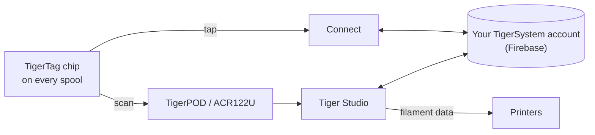

# TigerTag

## Zweck

**TigerTag gibt jeder Spule ein eigenes Gedächtnis.** Ein kleiner NFC-Chip hält alles
über das Filament fest – Marke, Material, Farbe, wie es gedruckt werden möchte –, sodass
du nie raten, beschriften oder dir etwas merken musst. Tippe es mit dem Handy an, und die
Spule sagt es dir selbst.

<a class="ts-cta-primary" href="https://tigersystem.io/tigertag">Was ist TigerTag – auf tigersystem.io</a>

<a href="https://github.com/TigerTag-Project/TigerTag-RFID-Guide"> Die offene Chip-Spezifikation</a>

Technisch ist es das Herz des Ökosystems: ein offener RFID-Standard, lesbar von jeder
kompatiblen App oder jedem Lesegerät – keine Herstellerbindung, kein geheimes Format.

## Wo es sich einfügt

## Funktionen

- Standard-Chip **NTAG213 / 215 / 216** (rund 25 mm empfohlen), offene
 144-Byte-NDEF-Nutzdaten – bemessen für den kleinsten NTAG213; keine Schlüssel, keine
 Bindung.
- **Zwei Chips pro Spule, auf gegenüberliegenden Seiten** – einer blickt immer zum
 Lesegerät (Druckerslot, AMS, Handy in der Hand), und jeder sichert den anderen ab
 ([warum](../concepts/tigertag-chip.md)).
- Die Identität wird gegen die gemeinsame
 [Referenzdatenbank](../concepts/universal-filament-identity.md) aufgelöst.
- Beschreibbar und **wiederbeschreibbar** – ermöglicht den
 [Second-Life-Ablauf](../philosophy/second-life.md); offizielle Marken-Chips werden als
 NTAG215 ausgeliefert, damit der Chip selbst als einfaches NDEF-Objekt weiterverwendet
 werden kann (Schlüsselanhänger, Visitenkarte …), sobald die Spule leer ist – nie
 Elektroschrott.
- Lesbar von jedem NFC-Smartphone, ACR122U-Lesegeräten und dem
 [TigerPOD](./tigerpod.md).
- Ein reservierter **64-Byte-Bereich** (Seiten `0x18`–`0x27`, sodass 80 Byte Daten
 bleiben): frei für **Zusatzfunktionen der Community** bei einem Standard-TigerTag; bei
 einem [TigerTag+](./tigertag-plus.md) trägt er die Herkunftssignatur – 32 Byte `R`,
 32 Byte `S`.

## Architektur

Siehe [Der TigerTag-Chip](../concepts/tigertag-chip.md) für die Zusammenfassung des
Formats und den
[TigerTag-RFID-Guide](https://github.com/TigerTag-Project/TigerTag-RFID-Guide) für die
maßgebliche Spezifikation auf Byte-Ebene.

## Zusammenspiel

| Mit | Wie |
|---|---|
| Tiger NFC Connect | NFC-Antippen: lesen, codieren |
| Tiger Studio | Ein Scan am Lesegerät öffnet die Spule automatisch; geführte Chip-Aktualisierung |
| SDKs | Parsen / prüfen / codieren aus JS oder Python |
| Drucker | Indirekt – über die [Smartphone-Brücke](../philosophy/smartphone-bridge.md) und die Drucker-Verbindungen von Studio |

## In Bildern

> **Hinweis zum Namen:** Standard-Chips wurden früher als **„TigerTag Maker“** verkauft –
> der Name lautet jetzt einfach **TigerTag**.

## Die offiziellen Chips und die aller anderen

**TigerSystem stellt die offiziellen Chips her** und bringt das TigerTag-Logo darauf an.
Sie gibt es in zwei Bauformen, und beide werden **leer** ausgeliefert:

| Bauform | Für |
|---|---|
| **Aufkleber** | jede Spule, die du schon besitzt – einer auf jeder Seite ([warum zwei](../concepts/tigertag-chip.md)) |
| **Refill-Carrier** | Filament-[Refills](../philosophy/second-life.md) mit Pappkern: Ein Carrier trägt bereits **beide Chips**, er sitzt im Kern, bevor der Refill auf eine wiederverwendbare Masterspool kommt, sodass der Chip mit dem Filament wandert, nicht mit der Rolle |

Wer was sagen darf, wenn ein Chip verkauft wird:

| Wer | Was verkauft wird | Darf es nennen | Logo |
|---|---|---|---|
| **TigerSystem** | die Chips, die es herstellt | **offiziell** – von uns gemacht | ja – es bringt die Marke an |
| **Jeder Wiederverkäufer oder Distributor** | genau diese echten Chips | **offiziell** – die Ware ist es | ja – die Marke ist schon darauf |
| **Ein Dritter, den TigerSystem auditiert hat** | alles, was er gebaut hat – Chips, Inlays, Carrier, ein Gerät, eine App | **zertifiziert** – gewährt, auditiert, gelistet, entziehbar | ja, auf dem Produkt |
| **Jeder, der einen eigenen Chip herstellt** | seinen eigenen kompatiblen Chip | *„kompatibel mit TigerTag“* – und mit **TigerTag+**, wenn er Signaturen prüft. Nie *„zertifiziert“*, das nur TigerSystem gewährt | in seiner App, Dokumentation und seinem Shop-Eintrag; *„Compatible with TigerTag“* im Klartext auf dem Karton eines kompatiblen Geräts – **nie das Logo oder der Name auf dem Chip (jedes Format), Carrier, der Spule oder der Verpackung** |

Diese letzte Unterscheidung ist die gesamte Markenrichtlinie, und sie ist enger, als sie
aussieht. Zu sagen, dass dein Produkt mit TigerTag *spricht*, ist eine Tatsache über dein
Produkt, und das Logo dafür zu zeigen ist frei. Die Marke – Logo oder Name – **auf**
einem Chip beliebigen Formats anzubringen, ist eine Aussage darüber, **wer ihn hergestellt
hat** – sie bedeutet nicht mehr „das funktioniert mit TigerTag“, sondern „das *ist* ein
TigerTag“. Nur diese zweite Verwendung braucht eine schriftliche Genehmigung. Siehe
[TRADEMARK.md](../../TRADEMARK.md).

Über **2,5 Millionen TigerTag-Chips** wurden produziert – die meisten ab Werk von
Filamentmarken integriert (Rosa3D, eSun, Sunlu, Landu, Jamg He, R3D – mit Filforme,
Nanovia und weiteren in Integration). Alle sind
[zertifizierte Partner](../certified-partners.md); diese Seite ist das Register und der
einzige maßgebliche Weg, zu prüfen, dass eine Marke auf einem Karton legitim ist.

|| | |
|---|---|---|
|  |  |  |

|| | | |
|---|---|---|---|
|  |  |  |  |

*Die Kartons und die Spulen darin – im Laden gekauft, nicht für ein Foto gestellt. So
sieht „am weitesten verbreitet“ aus.* Aber das Protokoll ist bewusst **nicht an
offizielle Chips gebunden**: Jeder günstige, leere NTAG-Chip, irgendwo gekauft (Amazon,
AliExpress, vor Ort), funktioniert identisch, und nichts blockiert ihn. Marken-Chips
unterstützen die Entwicklung; die Verbreitung des Protokolls ist die erste Belohnung.
Weitere Wege zu helfen – auch die, die nichts kosten – stehen unter
[Das Projekt unterstützen](../support.md).

Die Freiheit gilt in beide Richtungen: **Chips sind nie schreibgeschützt**. TigerTag ist
einfach das Basisprotokoll, mit dem Filamentfabriken Spulen ausliefern – wenn du ein
anderes NFC-/RFID-Protokoll (eigenes oder bestehendes) bevorzugst, kannst du den Chip
neu beschreiben und seine Daten dorthin migrieren. Deine Spule, dein Chip, dein Format.

## Wo du sie kaufst

Beide Bauformen werden **leer** ausgeliefert und von TigerSystem und seinen
Wiederverkäufern verkauft:

| | **Aufkleber** | **Refill-Carrier** |
|---|---|---|
| Was du bekommst | runde 25-mm-Klebechips – **zwei pro Spule**, einer auf jeder Seite | ein Carrier = **zwei bereits gepaarte Chips**, einer pro umgeklapptem Ende, für den Pappkern |
| Für | jede Spule mit Flanschen | Filament-Refills auf einer Masterspool |
| Offizieller Shop | [tigertag.io](https://shop.tigertag.io/collections/tigertag-rfid-maker) | [tigertag.io](https://shop.tigertag.io/collections/tigertag-rfid-maker) |
| Wiederverkäufer (FR) | [TigerTag Officiel, Atome3D](https://www.atome3d.com/products/tigertag) | [TigerTag Refill Officiel, Atome3D](https://www.atome3d.com/products/tigertag-pro-for-refill-1000-pcs) |

Beide gibt es in mehreren Packungsgrößen, bis hin zu professionellen Mengen. Und nichts
davon ist Pflicht: **Jeder irgendwo gekaufte leere NTAG-Chip funktioniert identisch** –
offizielle zu kaufen finanziert das Protokoll, mehr nicht.

## Links

- Offizielle Chips: **[tigertag.io](https://tigertag.io)** (Shop – unterstützt die Entwicklung)
- Chip-Format: [TigerTag-RFID-Guide](https://github.com/TigerTag-Project/TigerTag-RFID-Guide)

---

**◀ Zurück:** [Produkte](./README.md) · **▲ [Dokumentationsindex](../../README.md)** · **Weiter ▶** [TigerTag+](./tigertag-plus.md)

**Siehe auch:** [Universelle Filament-Identität](../concepts/universal-filament-identity.md), [Second Life](../philosophy/second-life.md)
