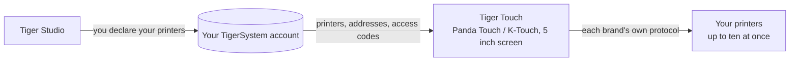

# Tiger Touch

**Dein Panda Touch liegt in einer Schublade. Gib ihm jeden Drucker, den du besitzt.** Eine
kostenlose, quelloffene Firmware, die den BIGTREETECH Panda Touch und den K-Touch in einen
einzigen Live-Touchscreen für alle deine 3D-Drucker verwandelt – ohne Löten, ohne Computer.

*Zwei Live-Druckerkarten auf einem Bildschirm: eine FlashForge AD5X und eine Bambu Lab X1C.*

<a class="ts-cta-primary" href="https://tigertag-project.github.io/Tiger-Touch/">Aus dem Browser installieren</a>

<a href="https://github.com/TigerTag-Project/Tiger-Touch"> Quellcode</a>

BIGTREETECH verkauft einen kleinen 5-Zoll-Touchscreen unter zwei Namen: den **Panda
Touch**, gebaut für Bambu-Lab-Drucker, und den **K-Touch**, gebaut für Klipper-Drucker.
Dasselbe Board, zwei Firmwares, jede an eine Familie von Maschinen gebunden. Wechselst du
den Drucker, wandert der Bildschirm in eine Schublade.

**Tiger Touch ist eine neue Firmware für denselben Bildschirm**, von Grund auf neu
geschrieben. Sie meldet sich an deinem kostenlosen TigerTag-Konto an, findet jeden Drucker,
den du dort deklariert hast, und spricht mit jedem direkt, über sein eigenes Protokoll,
gleichzeitig. Wenn du einen Panda Touch oder K-Touch besitzt, der nicht mehr zu deinen
Druckern passt, ist er genau die Hardware, für die Tiger Touch gemacht wurde.

Quelloffen unter **MIT**. Nichts zu löten, nichts zu drucken, kein Raspberry Pi, kein
Server dazwischen: Du steckst den Bildschirm an einen USB-Port, drückst im Browser auf
**Install**, und zwei Minuten später zeigt er deine Drucker.

## Was er tut

- **Jede Marke auf einem Bildschirm** – Bambu Lab, Creality, Elegoo, Anycubic, Snapmaker,
  FlashForge, Prusa sowie jede Klipper- (Moonraker-) oder OctoPrint-Maschine.
- **Cloud und LAN** – Bambu Lab über die Bambu-Cloud oder im LAN-Modus, Anycubic über die
  Anycubic-Cloud oder im LAN, die anderen in deinem lokalen Netzwerk.
- **Live, alle** – Zustand, Fortschritt, Datei, Restzeit und Endzeit, Düsen, Bett, Kammer
  und Filament-Einheiten (AMS, CFS, Station, ACE, MMU- / AFC-Bahnen), mit bis zu **zehn
  Druckern** gleichzeitig.
- **Sichere Steuerung** – Pause, Fortsetzen, Stopp (ein Halten von 1,5 s, damit ein
  verirrter Finger nie einen Druck beendet) und das Licht des Druckers. **Nie wird
  etwas anderes gesendet**: kein Heizen, kein Bewegen, kein Starten eines Drucks.
- **Aktualisiert sich selbst** – neue Versionen kommen per WLAN, vor der Installation
  geprüft, und werden von selbst zurückgerollt, wenn sie nicht starten.
- **Elf Sprachen** – Englisch, Französisch, Deutsch, Spanisch, Italienisch, Chinesisch,
  Portugiesisch (Brasilien und Portugal), Polnisch, Russisch, Niederländisch.

<figure>

<figcaption><strong>Karten</strong>: eine Live-Karte pro Drucker, wische für weitere.</figcaption>
</figure>
<figure>

<figcaption><strong>Liste</strong>: jeder Drucker auf einen Blick. Eine Berührung wechselt die Ansicht.</figcaption>
</figure>
<figure>

<figcaption><strong>Snapmaker U1</strong>: vier Werkzeugköpfe, der aktive eingekreist.</figcaption>
</figure>
<figure>

<figcaption><strong>FlashForge AD5X</strong>: externe Spule und Materialstation.</figcaption>
</figure>

## Wo er sich einfügt

## Was zuerst vorhanden sein muss

Tiger Touch liest deine Drucker **aus deinem TigerSystem-Konto**, fragt also nie nach einer
Adresse oder einem Zugangscode auf einem 5-Zoll-Bildschirm. Erstelle das Konto und füge
deine Drucker im **Desktop**-[Tiger Studio](./tiger-studio.md) (Windows, macOS, Linux) hinzu,
das sie in deinem Netzwerk findet – die Webversion kann keine Drucker hinzufügen.

> **Kurz gesagt:** Tiger Studio → Konto erstellen → Drucker hinzufügen →
> *dann* den Bildschirm einrichten.

## Welche Drucker

Tiger Touch wählt die Verbindung nach der **Marke**, nicht nach dem Modell: Jeden Drucker
dieser Familien, den Tiger Studio hinzufügen kann, kann Tiger Touch anzeigen. Der Katalog
von Tiger Studio zählt mehr als 400 Modelle von etwa 60 Herstellern.

| Marke | Verbindung | An einer echten Maschine gesehen |
|---|---|---|
| [Bambu Lab](../compatibility/bambu-lab.md) (X1, P1, P2S, A1, H2 …) | Bambu-Cloud oder LAN (MQTT über TLS) | **Ja** – druckend über die Cloud (P2S), im Leerlauf im LAN-Modus (X1C, A1) |
| [Creality](../compatibility/creality.md) (K2, K1, Hi, Ender-3 V4 …) | WebSocket im LAN | **Ja** – druckend (K2), im Leerlauf mit seinem CFS (Ender-3 V4) |
| [Snapmaker](../compatibility/snapmaker.md) U1 | Moonraker-WebSocket | **Ja** – im Leerlauf, vier Werkzeugköpfe |
| [FlashForge](../compatibility/flashforge.md) (AD5X, Adventurer 5M, Creator 5, Creator 5 Pro) | HTTP im LAN | **Ja** – AD5X: Pause, Stopp und das Licht |
| [Anycubic](../compatibility/anycubic.md) (Kobra 3, Kobra X, Kobra S1 …) | Anycubic-Cloud oder LAN (MQTT über TLS) | **Ja** – über die Cloud (Kobra X), mit seinem ACE: das Licht, Pause, Fortsetzen und Stopp |
| [Elegoo](../compatibility/elegoo.md) Centauri Carbon 1 und 2 | MQTT (CC2), SDCP (CC1) | **Ja** – Centauri Carbon 2 und Centauri Carbon: Pause, Fortsetzen, Stopp und das Licht beim CC2 |
| **Prusa** (MK4, Core One, XL, MINI) | PrusaLink | **Ja** – Fortschritt, Temperaturen, Pause, Fortsetzen, Stopp |
| [Klipper](../compatibility/klipper.md) – Voron, Qidi, Sovol, RatRig … | Moonraker-HTTP | **Ja** – an einem echten Klipper-Drucker: Pause, Fortsetzen, Stopp und das Licht |
| **OctoPrint** – jeder Marlin-Drucker dahinter | OctoPrint-REST-API | Nur am Testdrucker von Tiger Studio |

OctoPrint ist bisher nur dem Testdrucker von Tiger Studio begegnet, und jede Marke hat
Modelle, die noch niemand ausprobiert hat: **Eine Rückmeldung von deinem Drucker ist das
Nützlichste, was du senden kannst.** Pause, Fortsetzen und Stopp funktionieren überall,
wo die Verbindung Befehle annimmt (nicht über die Bambu-Cloud); das Licht funktioniert
überall außer bei Prusa, OctoPrint und dem Centauri Carbon 1. Jede Marke hat ihre eigene
Seite mit Einrichtung und Fragen auf der
[Installer-Seite](https://tigertag-project.github.io/Tiger-Touch/). Jedes Feld und jeder
Test steht im
[Status pro Marke](https://github.com/TigerTag-Project/Tiger-Touch/blob/main/docs/PRINTER-COMPATIBILITY.md).

**Ein Drucker wird als „offline“ angezeigt?** Prüfe zuerst seinen LAN-Modus: Er ist bei
Creality, FlashForge und Bambu Lab standardmäßig aus.

## Ein Bildschirm, jede Marke

Die Firmwares, mit denen der Bildschirm ausgeliefert wird, kennen jeweils **eine** Familie
von Druckern.

| | **Tiger Touch** | Firmware des Panda Touch | Firmware des K-Touch |
|---|---|---|---|
| Druckerfamilien auf einem Bildschirm | **9** | 1 (Bambu Lab) | 1 (Klipper) |
| Drucker live gleichzeitig | **bis zu 10**, alle aktualisieren sich zusammen | mehrere Bambu Lab, wird ab etwa 3 langsamer nach unserer Erfahrung | **1** gleichzeitig (50 gespeichert, dazwischen wechseln) |
| Einrichtung der Drucker | aus deinem TigerTag-Konto, nichts am Bildschirm getippt | IP, Seriennummer, Zugangscode | IP und Port oder ein Scan |
| Over-the-Air-Updates | Ja, geprüft, mit automatischem Zurückrollen | Nein | Nein |

Die Firmwares von BIGTREETECH geben volle Kontrolle über ihre eine Familie – Drucke
starten, Temperaturen, Bewegungen –, was Tiger Touch bewusst nicht tut. Du kannst jederzeit
zu ihnen zurückkehren.

*Die Spalten zu Panda Touch und K-Touch stammen aus dem eigenen Wiki von BIGTREETECH
(gelesen am 2026-10-16); „wird ab etwa 3 langsamer“ ist die eigene Erfahrung des
TigerTag-Teams, keine Zahl von BIGTREETECH.*

## In zwei Minuten installieren

1. **Deklariere deine Drucker** in Tiger Studio, wie oben.
2. **Flashe den Bildschirm aus deinem Browser.** Öffne
   **<https://tigertag-project.github.io/Tiger-Touch/>** in **Chrome oder Edge** auf einem
   Computer (WebSerial: nicht Safari, nicht Firefox, kein Handy), schließe den Bildschirm
   mit einem USB-C-**Datenkabel** an, drücke **Install** und wähle seinen Port. Zum
   Ersetzen der BIGTREETECH-Firmware: **Erase device** ankreuzen. Zum Aktualisieren eines
   Tiger Touch per USB: nicht ankreuzen, dein WLAN und dein Konto bleiben erhalten.
3. **Folge dem Bildschirm.** Sprache, WLAN, dann dein TigerTag-Konto – E-Mail und Passwort
   oder **Weiter mit Google** mit einem QR-Code, den dein Handy scannt. Schalte die Drucker
   ein, denen du folgen willst, und das war's. *Später* ist immer eine Antwort: Der
   Bildschirm startet sofort und verbindet sich im Hintergrund.

Danach ist nichts mehr zu tun: Der Bildschirm sucht einmal am Tag nach einer neuen Version
und installiert sie mit zwei Berührungen.

Zum ersten Mal? Die [Installationsanleitung](https://github.com/TigerTag-Project/Tiger-Touch/blob/main/docs/INSTALL.md)
behandelt den USB-Treiber (unter macOS erforderlich), die Sicherung der BIGTREETECH-Firmware,
damit du zurückkehren kannst, und das eine Kästchen, das anzukreuzen ist.

## Die Hardware

Der **BIGTREETECH Panda Touch** und der **K-Touch** werden von **BIGTREETECH** (BIQU)
entworfen und hergestellt: ein 5-Zoll-IPS-Touchscreen mit 800×480 um einen ESP32-S3 mit 8 MB
PSRAM und 16 MB Flash, WLAN, USB-C und einem Akku. Tiger Touch läuft unverändert darauf und
baut auf der Board-Unterstützung auf, die BIGTREETECH dafür unter der MIT-Lizenz
veröffentlicht hat. Der K-Touch ist dasselbe Board wie der Panda Touch, daher ist dasselbe
Image für ihn gedacht – aber Tiger Touch lief bisher nur auf einem Panda Touch: Eine
Rückmeldung von einem K-Touch ist willkommen.

Tiger Touch ist ein unabhängiges Projekt, weder von BIGTREETECH, BIQU noch einem hier
genannten Druckerhersteller hergestellt oder gebilligt.

Baue ihn selbst mit ESP-IDF 5.5 – die Schritte stehen im
[Repository](https://github.com/TigerTag-Project/Tiger-Touch#build-it-yourself).

---

**▲ [Dokumentationsindex](../../README.md)** · **Siehe auch:** [Tiger Studio](./tiger-studio.md), [TigerSpool](./tigerspool.md), [Kompatibilität der Drucker](../compatibility/README.md)
