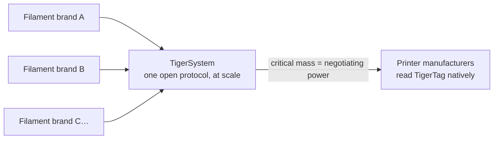

# Für Filamenthersteller

> **Mach deine Spulen smart und vernetzt.**

## Die smarte Spule kommt – der einzige offene Weg dorthin liegt hier

Drucker erwarten zunehmend intelligentes Filament: Systeme der AMS-Klasse, Materialerkennung
pro Slot, automatische Einstellungen. Jeder Druckerhersteller antwortet mit einem
**geschlossenen Tag, an seine Maschinen gebunden, der seine Cloud speist** – null
Interoperabilität, null Wert für deine Marke außerhalb seiner Mauern. Und jeder
gesperrte Tag dient einem zweiten Zweck: **deine Kunden zum eigenen Filament des
Druckerherstellers zu lenken.** TigerTag entstand 2023 genau dafür, damit
Drittmarken eine bessere Antwort haben – Spulen, die smarter sind als die
proprietären, ohne geschlossenen Garten.

**TigerTag ist das am weitesten verbreitete RFID-Protokoll eines Drittanbieters weltweit** –
und heute die einzige tragfähige offene Smart-Spool-Lösung, die in großem Maßstab ausgeliefert wird: ein
offenes, standardisiertes, herstellerunabhängiges, plattformübergreifendes Protokoll mit mehr als
**2,5 Millionen bereits produzierten Chips**, ab Werk integriert von Marken
wie Rosa3D, eSun, Sunlu, Landu, Jamg He und R3D – mit Filforme und
Nanovia in der Integration.

## Fabrikintegration: Tage, nicht Monate

Wir haben die Erfahrung und die Technologie, um TigerTag-Chips **schnell, einfach und zu sehr
geringen Kosten** in deine Produktionslinie zu bringen – **in nur 5 Tagen einsatzbereit**, mit
**etwa 1 Sekunde pro Chip** beim Schreiben (Tausende
Spulen am Tag, ein Klick):

- Standard-NTAG-Hardware (keine proprietären Komponenten, keine Bindung an Werkzeuge),
 beschafft in einem Maßstab und zu Kosten, die für ein unverhandelbares Ziel gewählt sind: **die
 Technologie hinzufügen, ohne den Endkundenpreis der Spule um einen Cent zu erhöhen.**
- Ein bewährtes Integrationsrezept, das bereits in mehreren Fabriken im Einsatz ist,
 getragen von der industriellen Werkzeugkette [TigerTag Factory & Manager](../products/factory-suite.md):
 auf der einen Seite deine Filamentdatenbank, auf der anderen das Massenschreiben mit Liniengeschwindigkeit
 in jede Spule – mit der **Fabriksignatur, die die Herkunft jedes Produkts
 belegt**.
- Die gemeinsame Referenzdatenbank gibt deinen Produkten eine präzise, universelle
 Identität, die jede kompatible App identisch auflöst.

Marken, die TigerTags in ihren Produkten ausliefern, dürfen das Zeichen **TigerTag
Certified** tragen – ein sichtbares Signal an Kunden, dass die Spule smart und
offen ist.

> Melde dich unter **[tigertag@tigertag.io](mailto:tigertag@tigertag.io)** (oder
> über die [GitHub-Organisation](https://github.com/TigerTag-Project)), um
> das Gespräch zu beginnen.

## Danke, Integratoren

Die Marken unten haben die offene Spule Wirklichkeit werden lassen – jede auf ihrem
eigenen Engagement-Niveau, und jede verdient die Anerkennung. Die Stufen sind eine
**Leiter**: Je weiter sich eine Marke verpflichtet, desto prominenter erscheint sie –
hier und auf allen Flächen des Ökosystems. Die Besten stehen am höchsten.

### Platin – der Gipfel

**TigerTag+ in der gesamten Produktion**: jedes Spulenformat, signierte Chips
serienmäßig auf jeder einzelnen Spule, die die Fabrik verlässt. Nichts optional,
nichts teilweise – das volle Erlebnis der offenen Spule, für jeden Kunden, von
Haus aus. Platin-Integratoren bekommen **überall die Top-Platzierung**: zuerst genannt,
größtes Logo, ihre Geschichte erzählt.

**[Rosa3D](https://rosa3d.pl)** – der **weltweit erste** Integrator, der
TigerTag+ in seiner gesamten Produktion einsetzt. Die Referenz, der alle anderen
hinterherjagen.

### Gold – verpflichtet, in großem Maßstab

**Integration auf Abruf zur Produktionszeit**, mit bereits produzierten großen Mengen, hohem
Integrationsgrad und einer **offiziellen öffentlichen
Verpflichtung**. Einen Schritt vom Gipfel entfernt: die signierten Chips in der
gesamten Linie zum Standard machen und zu Platin aufsteigen.

&nbsp;&nbsp;&nbsp;&nbsp;

**[R3D](https://r3dprint.com)** · **[eSun](https://www.esun3d.com)**

### Silber – an Bord

**Die Technologie auf Abruf integriert** – der erste Schritt, schon ein echter:
Ihre Kunden können heute Spulen mit TigerTag kaufen. Die nächste Sprosse
ist Gold: die Stückzahlen steigern und die Verpflichtung öffentlich machen.

&nbsp;&nbsp;&nbsp;&nbsp;&nbsp;&nbsp;&nbsp;&nbsp;

**[Sunlu](https://www.sunlu.com)** · **[Landu](https://www.landustore.com)** · **[Jamg He](https://www.jamghe.com)**

…und weitere in der Integration –
[Filforme](https://www.filforme.com), [Nanovia](https://nanovia.tech) und
andere sind unterwegs.

**Du willst dein Logo auf dieser Leiter – und größer?** Eine Produktionslinie betreibt
TigerTag in nur 5 Tagen:
[tigertag@tigertag.io](mailto:tigertag@tigertag.io).

## Sie haben es selbst angekündigt

Öffentliche Beiträge auf den eigenen Kanälen der Marken – nicht unsere Pressemitteilung
(Quellen & vollständige Ankündigungen:
[tigersystem.io/en/manufacturers](https://tigersystem.io/en/manufacturers)).
**Klick auf ein Bild, um den Originalbeitrag zu öffnen:**

|| | |
|---|---|---|
|  |  |  |

> **ROSA 3D FILAMENTS** – *„hat das offene TigerTag-RFID-Protokoll offiziell in 100 %
> unserer Filamentproduktion integriert.“* (*"officially integrated the open TigerTag RFID
> protocol across 100 % of our filament production."*) Mehr als 250 000
> Spulen bereits mit TigerTag produziert.
> ([Originalbeitrag](https://www.instagram.com/p/DVyeOZajZSm/))

> **R3D Filament** – *„hat offiziell den großflächigen Einsatz des offenen
> TigerTag-RFID-Protokolls in seiner Filamentproduktion in Europa begonnen.“* (*"officially begun large-scale deployment of the open
> TigerTag RFID protocol across its filament production in Europe."*)
> ([Originalbeitrag](https://www.instagram.com/reel/DVoAMqTk5ck/))

> **eSUN** – *„hat die TigerTag-RFID-Technologie offiziell integriert!“* (*"officially integrated TigerTag RFID technology!"*) – Pilot
> auf dem französischen Markt, Ausweitung auf ganz Europa.
> ([Originalbeitrag](https://www.instagram.com/p/DUjydNXkc1W/))

## Wie die Tags in deine Spulen kommen

<table>
<tr>
<td align="center" width="55%">
<strong>Vorderseite</strong> 
 
<strong>Rückseite</strong> 

</td>
<td align="center">

</td>
</tr>
</table>

*Vorderseite – die zwei markierten Chips, mit dem industriellen 3M-Klebstoff
(468MP / 200MP) in der Mitte. Rückseite – die zwei unabhängigen NFC-Antennen, eine
an jedem Ende. Am Refill angebracht: ein Chip pro Seite, dein Bediener zieht ab und
klebt – sonst ändert sich nichts an der Linie.*

## Schon im Regal

|| | |
|---|---|---|
|  |  |  |

*Rosa3D, eSun, Sunlu – echte Kartons, ausgeliefert mit TigerTag darin.*

|| | | |
|---|---|---|---|
|  |  |  |  |

*Das Filament selbst: Rosa3D, eSUN, Sunlu, R3D – jedes davon wird
mit TigerTag-Chips auf der Spule ausgeliefert.*

## Was deine Kunden am ersten Tag bekommen

Eine Spule, die sich bei **jedem NFC-Smartphone** selbst identifiziert, ein vollständiges
Bestands-Ökosystem (mobil, Desktop, Web), Live-Integration mit sechs Druckermarken,
Gewichtserfassung, Teilen – ein Erlebnis **weit jenseits dessen, was eine geschlossene
Umgebung eines einzelnen Herstellers bietet**, und es funktioniert mit jedem Drucker, den deine
Kunden besitzen, nicht nur mit dem einer Marke.

## Die Daten aktualisieren, auch nachdem sie deine Fabrik verlassen haben

Ein gedrucktes Etikett ist an dem Tag eingefroren, an dem es gedruckt wird. Eine TigerTag-Spule nicht:
Weil Chips ihre Identität gegen die **gemeinsame Referenzdatenbank** auflösen,
kannst du die Daten eines Produkts verfeinern oder korrigieren – Einstellungen,
Beschreibungen, Bildmaterial – **sogar für Spulen, die bereits verkauft sind und bei
deinen Kunden zu Hause liegen**. TigerTag ist die einzige Technologie auf diesem Markt, die
die Daten deines Produkts aktualisierbar hält, nachdem es die Fabrik verlassen hat.

## Das gemeinsame Spiel

Jede Filamentmarke, die sich TigerSystem anschließt, stärkt alle anderen:

Allein kann keine Filamentmarke Druckerhersteller überzeugen, ihre Tags zu lesen.
**Gemeinsam, hinter einem offenen Protokoll, können wir es.** Und die Bitte ist klein: Ein
Druckerhersteller kann das Lesen von TigerTag in **unter 3 Tagen** in seine Firmware einbauen. Je mehr Marken
TigerTag ausliefern, desto stärker das Argument für native Unterstützung von TigerTag auf Firmware-Ebene
in den Druckern selbst – und jeder Beteiligte profitiert von
dieser Hebelwirkung.

---

**▲ [Dokumentationsindex](../../README.md)** · **Siehe auch:** [Warum es TigerSystem gibt](./why-tigersystem.md), [Kompatibilität](../compatibility/README.md), [FAQ – Hersteller](../faq/README.md)
