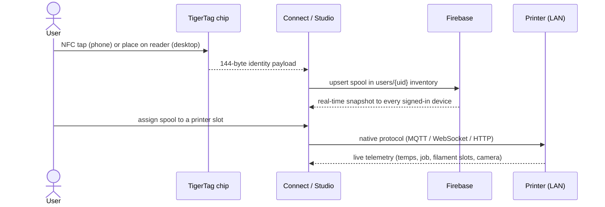
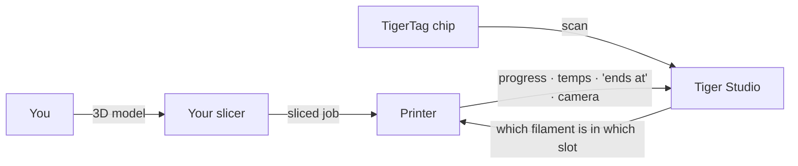

# Flujo de datos

## Del toque a la impresión

El recorrido completo de una bobina por el sistema:

## Dónde reside cada tipo de dato

| Dato | Reside en | Notas |
|---|---|---|
| Identidad de la bobina | El chip + el inventario en la nube del usuario | El chip es la fuente autorizada para el uso sin conexión |
| Base de datos de referencia (marcas, materiales…) | `cdn.tigertag.io` (mismo proyecto de Firebase) | Incluida en las apps, actualizada desde la CDN |
| Imágenes de bobinas (incl. fotos de producto de TigerTag+) | `cdn.tigertag.io` (mismo proyecto de Firebase) | Servidas a todas las apps |
| Inventario, racks, amigos, preferencias | Firestore `users/{uid}/…` | Solo del propietario por defecto, aplicado por reglas |
| Códigos públicos de descubrimiento | Firestore `publicKeys/{code}` | Búsqueda de amigos en O(1) |
| Credenciales y telemetría de la impresora | **Solo local** (escritorio) | El tráfico de la LAN nunca pasa por la nube |
| Peso en vivo (TigerScale) | Dispositivo → Firestore | Aparece en vivo en todos los clientes |

## Dónde encaja tu slicer

TigerSystem **no sustituye a tu slicer**: completa el panorama a su alrededor:

- Laminas y lanzas trabajos exactamente como antes, con cualquier slicer.
- Tiger Studio le dice a la impresora **qué filamento está en qué ranura**
 (AMS / CFS / Canvas / ACE / IFS), para que la información del lado de la máquina
 coincida con la realidad.
- Sea lo que sea lo que haya iniciado la impresión, el trabajo aparece en vivo en
 Tiger Studio: progreso, temperaturas, hora de finalización, cámara.
- El chip lleva los ajustes de impresión recomendados del filamento; **hoy no hay
 importación automática de perfiles al slicer**: los reproduces tú mismo en el
 perfil de tu slicer.

## Dos planos, deliberadamente separados

- **Plano de la nube** — identidad, inventario, uso compartido. Internet, Firebase,
 aplicado por reglas.
- **Plano de la LAN** — control de la impresora y cámaras. Solo red local,
 protocolos nativos de cada fabricante, cero dependencia de la nube (la aplicación
 de escritorio sigue funcionando con las impresoras sin conexión).

> **Nota:** la excepción es el **modo nube** de Anycubic, donde el propio enlace con
> la impresora pasa por el MQTT de la nube del fabricante; véase la
> [compatibilidad con Anycubic](../compatibility/anycubic.md).

---

**◀ Anterior:** [Visión general de la arquitectura](./overview.md) · **▲ [Índice de la documentación](../../README.md)** · **Siguiente ▶** [Productos](../products/README.md)

**Véase también:** [Inventario y sincronización en la nube](../concepts/inventory-and-cloud-sync.md), [Compatibilidad](../compatibility/README.md)
