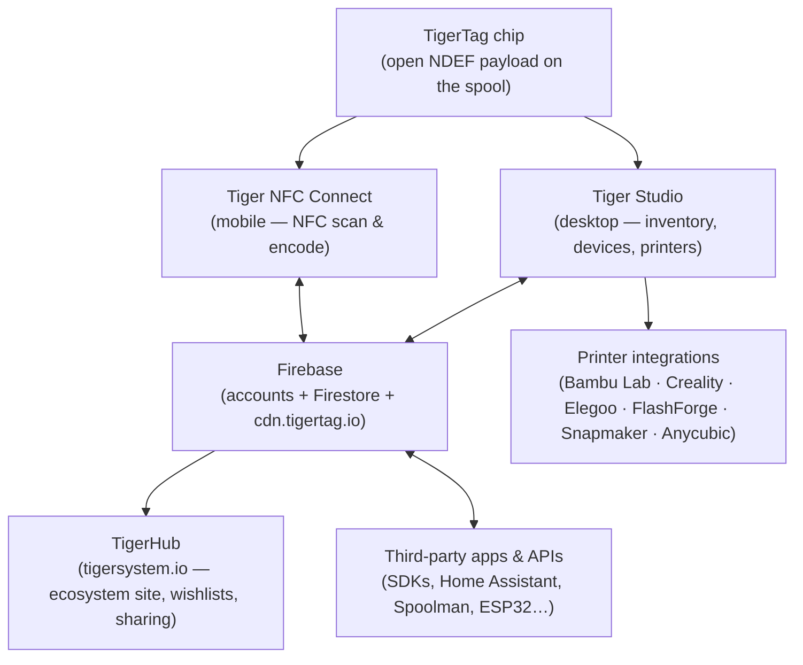
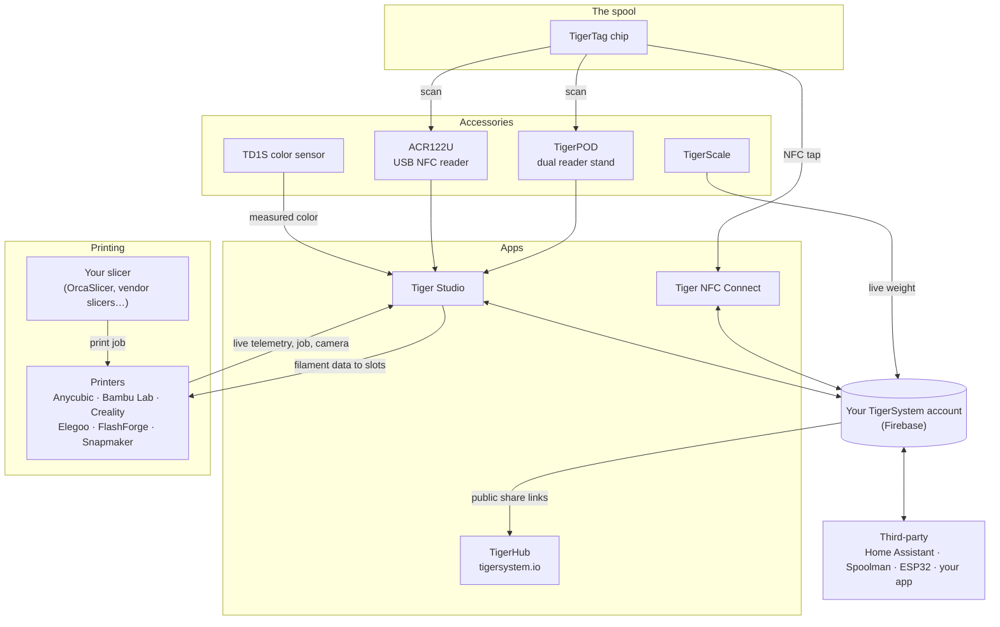

# Visión general de la arquitectura

## La pila, de arriba abajo

## Capas

| Capa | Función | Documentación de referencia |
|---|---|---|
| **Chip TigerTag** | Identidad portátil y abierta de la bobina física | [Formato del chip](../concepts/tigertag-chip.md) |
| **Tiger NFC Connect** | El puente con el smartphone: escanear, codificar, explorar | [Página del producto](../products/tiger-nfc-connect.md) |
| **Firebase** | Una base de datos compartida: cuentas, inventario, sincronización; el punto de interoperabilidad del entorno de pruebas | [Inventario y sincronización en la nube](../concepts/inventory-and-cloud-sync.md) |
| **TigerHub** | La casa web del ecosistema: escaparate, listas de deseos, amigos, uso compartido | [Página del producto](../products/tigerhub.md) |
| **Tiger Studio** | Banco de trabajo de escritorio: inventario, racks, sensores, impresoras | [Página del producto](../products/tiger-studio.md) |
| **Integraciones de impresoras** | Enlaces LAN en vivo con seis marcas de impresoras | [Compatibilidad](../compatibility/README.md) |
| **API de terceros** | SDK + superficie de Firestore documentada para todo el mundo | [Desarrolladores](../developers/README.md) |

## El mapa completo: cada elemento y sus conexiones

Accesorios, aplicaciones, nube, impresoras, slicers e integraciones de terceros,
en una sola imagen:

Léelo de izquierda a derecha: el **chip** identifica la bobina; los **accesorios**
capturan la realidad (escaneos, peso, color); las **aplicaciones** y la **nube**
lo mantienen todo sincronizado; la **impresora** recibe los datos del filamento y
responde en vivo. Tu **slicer conserva su trabajo**: TigerSystem no lamina, se
asegura de que todos (tú, la máquina, las aplicaciones) sepan exactamente qué
filamento está dónde.

## Principios de diseño

1. **El chip se basta a sí mismo.** Una bobina se identifica sin nube, sin
 cuenta, sin red: la carga útil es completa y abierta.
2. **La nube es del usuario, no del sistema.** Todo el estado vive bajo la cuenta
 del usuario; las reglas de seguridad del servidor, y no el código del cliente,
 controlan el acceso.
3. **Cada capa es opcional.** Funciona el uso solo con el teléfono, solo con el
 escritorio, solo con el chip o solo con la API; los componentes aportan valor
 pero nunca se condicionan entre sí.
4. **Las integraciones hablan el protocolo nativo de la impresora.** Sin
 modificaciones de firmware, sin rodeos por la nube: Tiger Studio habla
 MQTT/WebSocket/HTTP directamente en la LAN (véase el [flujo de datos](./data-flow.md)).

---

**◀ Anterior:** [Inventario y sincronización en la nube](../concepts/inventory-and-cloud-sync.md) · **▲ [Índice de la documentación](../../README.md)** · **Siguiente ▶** [Flujo de datos](./data-flow.md)

**Véase también:** [Productos](../products/README.md), [Desarrolladores](../developers/README.md)
