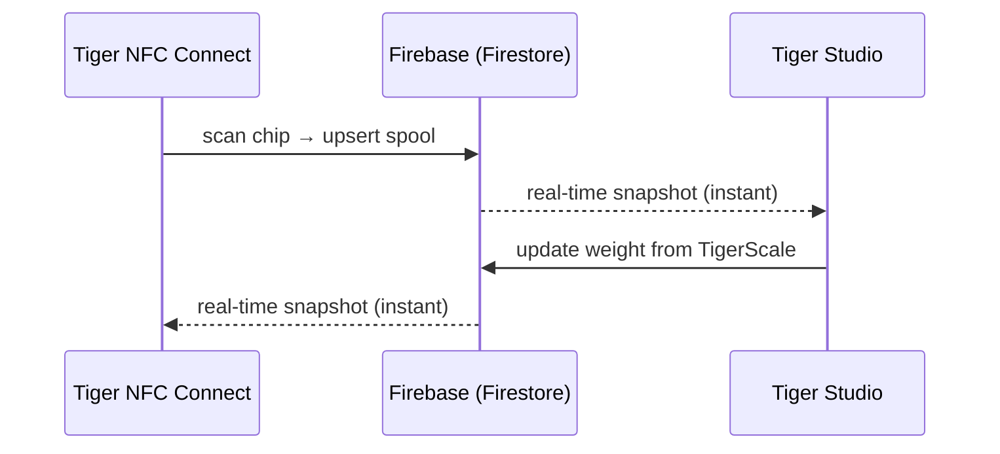

# Inventario y sincronización en la nube

## Una cuenta, todos los dispositivos

El inventario de un usuario vive en **su cuenta TigerSystem**, respaldada por
**Firebase** sin más (Auth + Firestore): una infraestructura deliberadamente sin
marca cuyo trabajo es simple: **una base de datos compartida, en un solo lugar**,
para que todos los elementos del entorno de pruebas (escritorio, móvil, báscula,
web) interoperen sobre los mismos datos. Todos los clientes (móvil, escritorio,
web) se suscriben a los mismos documentos en tiempo real:

No hay «botón de sincronizar»: los cambios se propagan mediante los listeners en
vivo de Firestore, y los clientes mantienen una caché local para lecturas sin
conexión.

## Qué se sincroniza

- **Inventario**: un documento por bobina (identidad, peso, envase, imagen…).
- **Racks**: distribución física de las estanterías y colocación de las bobinas.
- **Amigos y uso compartido**: vínculos de amistad, solicitudes recibidas, notificaciones.
- **Preferencias**: idioma, ajustes por cuenta.
- **Copias de seguridad de chips**: registros de chips [TigerTag+](../products/tigertag-plus.md).

El modelo de datos de referencia, campo por campo, está documentado en el
[repositorio de integración con Firebase](https://github.com/TigerTag-Project/TigerTag_Firebase_Integration)
(`docs/03-data-model.md`): la referencia para los integradores de terceros.

## Qué sale de tu banco de trabajo y qué se queda

El ecosistema dice por todas partes que la nube es opcional. Esto es lo que eso
significa realmente, y lo que cuesta decir que no.

**La identificación es local por diseño.** Un dispositivo no pregunta a un servidor
qué es una etiqueta. Las tablas de marcas y materiales viven en su propio
almacenamiento y se actualizan desde el [repositorio de referencia](https://github.com/TigerTag-Project/TigerTag-RFID-Guide)
**público** como máximo una vez al día. Así, una consulta nunca espera a la red y
funciona sin internet.

**Sin cuenta pierdes exactamente una cosa: la sincronización entre dispositivos.**
Una [TigerScale](../products/tigerscale.md) sigue pesando, sigue leyendo etiquetas,
sigue identificando marca y material, sigue sirviendo su propia interfaz web en tu
LAN. Nada del propio chip nos necesita: ese es justo el sentido de escribir los
datos [en el chip](./tigertag-chip.md).

**Con una cuenta, esto es lo que un dispositivo envía realmente.** Tomando la
báscula como ejemplo, en cada pesada completada y en cada latido escribe, bajo tu
propio documento de usuario: los UID de las etiquetas de la bobina, el peso
neto/bruto/del envase, la versión de firmware, la señal WiFi y la IP, el factor de
calibración, la hora del último latido, el estado de la batería y el estado de la
pantalla. Diagnósticos y mediciones, nada más. Cada campo está documentado en
[la propia referencia de la báscula](https://github.com/TigerTag-Project/Tiger-Scale-V3/blob/main/docs/TELEMETRY.md).

**Y esto es lo que guarda en local, que importa más.** Un dispositivo con la sesión
iniciada guarda un token de actualización, tu id de usuario y tus credenciales
WiFi. Nunca guarda tu contraseña: el inicio de sesión la cambia por tokens. Pero
trata un dispositivo aprovisionado como si **guardara una credencial**: antes de
prestarlo, venderlo o regalarlo, cierra la sesión *y* olvida el WiFi. Un simple
reflasheo no borra ninguna de las dos cosas: ese almacenamiento se conserva a
propósito para que una actualización de firmware no te cueste la configuración.

**Dos decisiones deliberadas que conviene conocer.** La API LAN de un dispositivo
**no está autenticada**: cualquiera que ya esté en tu red puede leer su estado y
lanzar una tara. Es una simplificación para una red doméstica: ponla en una VLAN
de invitados si no te fías de la tuya. Y la clave de Firebase visible en el código
fuente es un **identificador público de proyecto**, no un secreto; todos los
clientes de Firebase la incluyen, y el control de acceso lo aplican las reglas del
servidor frente al usuario con sesión iniciada, no ocultando una cadena.

Para la báscula, todo esto está documentado por completo en
[`docs/CLOUD.md`](https://github.com/TigerTag-Project/Tiger-Scale-V3/blob/main/docs/CLOUD.md),
que es la referencia canónica.

## Modelo de uso compartido (resumen)

- Cada usuario tiene un **código de descubrimiento** público (`XXX-XXX`) para
 localizar amigos en O(1).
- La amistad es **bidireccional y basada en el consentimiento**: solicitud →
 aceptación; cualquiera de las dos partes puede eliminarla. El acceso de lectura
 al inventario de un amigo lo aplican las reglas de seguridad de Firestore en el
 servidor, nunca el cliente.
- Un inventario también puede marcarse como **público**, o compartirse como lista
 web de solo lectura mediante enlaces de [TigerHub](../products/tigerhub.md).

## Modelo de seguridad (resumen)

- Todos los datos por usuario son exclusivos del propietario por defecto; el acceso
 entre usuarios siempre requiere una relación previa (amistad, solicitud),
 aplicada por reglas del servidor.
- La configuración del proyecto Firebase es pública a propósito (patrón estándar);
 **la seguridad está en las reglas, no en el secreto**. Véase
 [API de cuenta e integración](../developers/account-api.md).

---

**◀ Anterior:** [El chip TigerTag](./tigertag-chip.md) · **▲ [Índice de la documentación](../../README.md)** · **Siguiente ▶** [Visión general de la arquitectura](../architecture/overview.md)

**Véase también:** [TigerHub](../products/tigerhub.md), [Desarrolladores — API de cuenta](../developers/account-api.md)
