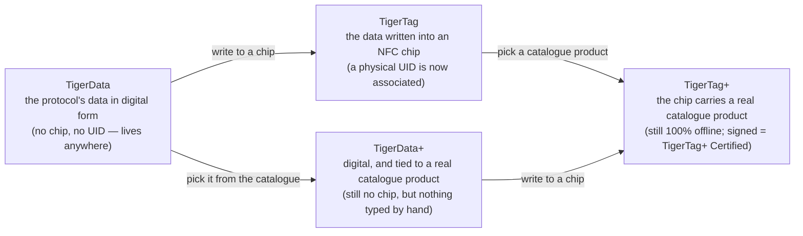

# Identidad universal del filamento

## Una identidad, legible en todas partes

Un chip TigerTag da a una bobina una **identidad universal**: un único registro
abierto de lo que el filamento *es*, independiente de quién lo fabricó, quién lo
vende y qué impresora lo va a fundir.

La identidad abarca (lista no exhaustiva):

| Familia de campos | Ejemplos |
|---|---|
| **Marca** | cualquier fabricante de filamento, de una lista de referencia compartida |
| **Material / tipo** | PLA, PETG, ABS, TPU… + subtipo |
| **Aspecto / color** | valor de color, acabado |
| **Geometría** | diámetro (1,75 / 2,85 mm) |
| **Ajustes de impresión** | temperaturas recomendadas |
| **Ciclo de vida** | peso, fecha de fabricación |

## La base de datos de referencia compartida

Las identidades no son texto libre: marcas, materiales, aspectos, tipos, diámetros
y unidades proceden de una **base de datos de referencia compartida** servida en
`cdn.tigertag.io` (alojada en el mismo proyecto Firebase que las cuentas). Todas
las aplicaciones resuelven los mismos ids con el mismo significado, de modo que un
chip codificado con una herramienta se lee igual en todas las demás.

Las tablas se publican dos veces, y son las mismas tablas. Son archivos JSON en
la carpeta
[`database/`](https://github.com/TigerTag-Project/TigerTag-RFID-Guide/tree/main/database)
de la guía RFID, libres para integrar (CC0) y sincronizados desde el catálogo
cada 6 horas. La API pública también las sirve, cada una con su propio endpoint
([la lista](https://github.com/TigerTag-Project/TigerTag-RFID-Guide#reference-tables-ship-with-the-protocol--the-api-is-optional)).
Los archivos son lo que el protocolo garantiza: resuelven todo id que un chip
pueda llevar, sin red y sin cuenta. Tiger Studio los incluye
(`assets/db/tigertag/`) y los actualiza desde el CDN.

## Una identidad, cuatro estados

La identidad es el *registro*, no el *chip*, y pasa por cuatro estados:

- **TigerData** es el protocolo *antes* del chip: la misma identidad, almacenada
 en digital, en un inventario, una base de datos, un archivo, donde sea. El
 protocolo TigerTag puede vivir por completo fuera de un chip RFID. Esta noción
 de **chip virtual es una innovación de TigerSystem: no existe en ningún otro
 sitio**: gestiona un inventario completo con cero chips NFC, envía una identidad
 a un chip más tarde o nunca, y la interoperabilidad del protocolo se conserva en
 ambos casos.
- **TigerData+** es un TigerData que sabe *exactamente qué producto es*. Sigue sin
 chip y sin nada que comprar, pero en lugar de lo que su dueño haya tecleado,
 lleva un producto real del catálogo oficial: la marca, el color, el material, las
 temperaturas, el diámetro, el SKU y el EAN exactos, directamente de la fuente. Es
 lo que obtienes al elegir un producto en lugar de describirlo.
 >**No** es un TigerTag+ y nunca pretende serlo: sin chip, sin UID. El `+`
 >significa *identificado*, no *certificado*. Para desarrolladores: una bobina es
 >un TigerData+ cuando no tiene chip **y** lleva un id de producto real; ese par es
 >la definición, y se refleja en el registro como `protocol: "TigerData+"` para que
 >puedas leerlo directamente. Véase la
 >[estructura de datos de Firestore](https://github.com/TigerTag-Project/TigerTag_Firebase_Backend#-firestore-data-structure).
- En el momento en que esos datos se **escriben en un chip NFC**, se convierte en
 un **TigerTag**: por fin se **asocia un UID físico** a la identidad.
- Escribe en ese chip un **producto del catálogo** en lugar de valores tecleados a
 mano y es un [**TigerTag+**](../products/tigertag-plus.md): el mismo `+` que en
 TigerData+, con el mismo significado: *identificado*. Firmado por un fabricante
 certificado, se convierte en un **TigerTag+ Certified**. En ambos casos el chip
 sigue siendo legible 100 % sin conexión.

Un TigerData puede seguir siendo digital para siempre, o **promoverse a un chip
real de forma atómica** cuando estés listo (Tiger Studio lo hace en un solo paso).
Y los cuatro estados viajan como archivos: el
[**formato de intercambio `.ttag`**](../developers/ttag-format.md) transporta uno o
más materiales del inventario (TigerData, TigerData+, TigerTag o TigerTag+) en una
memoria USB, en un correo, entre herramientas.

## El registro y el chip

Los cuatro estados de arriba son estados del **registro**. La
[guía RFID](https://github.com/TigerTag-Project/TigerTag-RFID-Guide#three-tag-types)
enumera en cambio tipos de tag, y esos describen el **chip**: lo que está
escrito en el silicio, leído sin conexión y sin cuenta. Son dos ejes, no dos
versiones de una misma lista, y ninguno de los dos está equivocado.

Lo que un lector encuentra en el chip, para cada estado:

| Estado del registro | En el chip |
|---|---|
| **TigerData**, **TigerData+** | nada: todavía no hay chip |
| **TigerTag** | `ID TigerTag` `0x5BF59264`, e `ID Product` `0xFFFFFFFF` (ninguno) |
| **TigerTag+** | `ID TigerTag` `0xBC0FCB97`, y un `ID Product` del catálogo |
| **TigerTag+ Certified** | lo mismo que un TigerTag+, más una firma válida en las páginas `0x18`–`0x27` |

Un TigerTag+ lleva el mismo id de tipo, esté firmado o no. Para saber si un
chip es un TigerTag+ Certified, un lector verifica la firma; el id de tipo no
puede decirlo.

El eje del chip tiene un valor sin ningún registro detrás: **TigerTag Init**
(`0x6C41A2E1`). Marca un chip virgen preparado para recibir una escritura.
Todavía no se ha decidido nada sobre el filamento, así que no hay ningún
registro que pueda estar en un estado, y no es un quinto.

## Promoción: de un registro a un chip

*Promover* una bobina es pasar de la izquierda del diagrama a la derecha: un
registro TigerData o TigerData+ existente se escribe en un chip NTAG virgen, y
la bobina pasa a llevar su identidad ella misma, sin conexión.

Lo que sale depende solo de lo que entró:

| Promueves… | Obtienes… | Porque |
|---|---|---|
| un **TigerData**: valores que eligió su propietario | un **TigerTag** | ahora hay un UID físico asociado a la identidad |
| un **TigerData+**: un producto real del catálogo | un **TigerTag+** | el chip lleva ahora el ID de producto del catálogo: *sigue identificado, sigue sin firmar* |

Esa segunda fila es todo el vocabulario del `+` en una línea. La promoción
cambia el *estado* (de digital a chip) y nunca el significado del `+`. Solo la
firma de un fabricante certificado convierte un chip en un
[TigerTag+ Certified](../products/tigertag-plus.md), y ninguna promoción
produce uno.

Tampoco es la promoción una puerta de un solo sentido. Los chips nunca se
bloquean contra escritura: un chip promovido puede borrarse desde
[Tiger NFC Connect](../products/tiger-nfc-connect.md) o Tiger Studio y volver a
escribirse ([el chip TigerTag](./tigertag-chip.md)). La identidad es el
registro; el chip es solo donde vive ahora mismo.

---

**◀ Anterior:** [Flujo de trabajo de segunda vida](../philosophy/second-life.md) · **▲ [Índice de la documentación](../../README.md)** · **Siguiente ▶** [El chip TigerTag](./tigertag-chip.md)

**Véase también:** [Página de producto TigerTag](../products/tigertag.md), [Inventario y sincronización en la nube](./inventory-and-cloud-sync.md)
