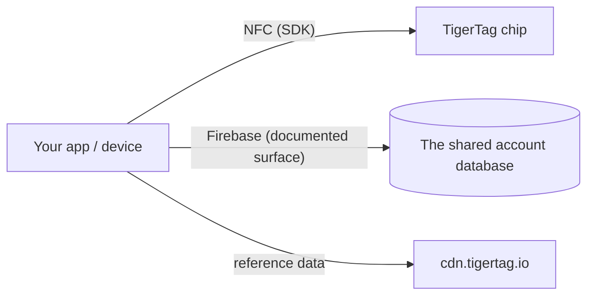

# Documentación para desarrolladores

Construye sobre TigerSystem: lee chips, habla con la nube o integra tu propio
hardware y software. Nada requiere permiso: el protocolo es abierto.

## ¿Qué puedes construir?

Leer un TigerTag requiere **cualquier smartphone NFC**, un **lector USB ACR122U**
conectado a un ordenador o un **dispositivo DIY: un simple ESP32 con un módulo
lector PN532 o RC522** (el enfoque que usa TigerScale). Hardware común, sin equipo
propietario. A partir de ese único escaneo, integra donde una identidad sea útil:

- **ERP / gestión de existencias**: conecta la identidad y las cantidades de las
 bobinas con el sistema de inventario que ya tenga tu empresa.
- **Seguimiento de uso**: registra qué material fue a qué trabajo, máquina o
 pedido de cliente.
- **Paneles y automatización a medida**: supervisión de granjas de impresión,
 alertas de existencias bajas, disparadores de reposición.
- **Sistemas de préstamo**: fablabs, escuelas y makerspaces que registran la
 entrada y salida de material.
- **Proyectos de I+D, privados o públicos**: un soporte de identidad abierto,
 reescribible y documentado con el que experimentar.

Nada de esto necesita nuestras aplicaciones ni nuestra nube: basta el chip + un
SDK. Añade la [superficie de cuenta](./account-api.md) solo si quieres cuentas y
sincronización.

Constrúyelo y es **TigerTag Compatible**: gratis, autodeclarado, sin auditoría y
sin permiso. Pásalo por la auditoría y puede convertirse en **TigerTag
Certified**: abierto a todo lo que construya un tercero, hardware o software, en
dos ámbitos (**TigerTag** y **TigerTag+**). La línea entre los niveles no es lo que
es tu producto, sino si alguien lo comprobó. Compatible dice *«funciona»* bajo tu
palabra, Certified dice *«lo hemos probado»* bajo la nuestra
([criterios](https://github.com/TigerTag-Project/TigerTag-RFID-Guide/blob/main/CERTIFICATION.md), ponte en contacto a través de la
[organización de GitHub](https://github.com/TigerTag-Project)).

La gobernanza es deliberadamente de doble puerta: **cualquiera** puede implementar
el protocolo y decir «compatible con TigerTag» (sin permiso, nunca) y mostrar el
logotipo de TigerTag, sin modificar, para decirlo: en tu aplicación, tu
documentación, la ficha de tu tienda. Ese uso referencial es libre. Solo los
**socios certificados** (listados en el registro de certificados) pueden poner la
marca, logotipo **o nombre**, **en un chip de cualquier formato (chip, inlay,
pegatina, etiqueta, soporte), una bobina o su embalaje**, donde deja de describir
compatibilidad y empieza a afirmar origen; el texto sencillo *«Compatible con
TigerTag»* en la caja de un lector, impresora o aplicación compatible sigue siendo
libre, y solo ellos pueden emitir **firmas TigerTag+** (TigerTag conserva la clave
privada). La puerta de la marca es de marketing; la puerta de la firma es técnica;
**ninguna restringe el protocolo ni en una línea**: un chip no certificado funciona
perfectamente, solo que no puede demostrar su origen.

Dos detalles que conviene tener exactos. La afirmación de compatibilidad cubre
**también el nivel `+`**: verificar una firma TigerTag+ es gratis, sin conexión y
sin restricciones (las claves públicas están publicadas), así que un lector que las
compruebe puede decir *«compatible con TigerTag+»*. Lo que no puede hacer es llamar
TigerTag+ a **una etiqueta** a menos que esa etiqueta lleve realmente una firma
emitida por TigerTag. Y la palabra **«certificado» nunca se aplica uno mismo**:
la concede TigerSystem, nadie la reclama.

Este es deliberadamente el modelo que usan Zigbee y Matter: un nivel *Compatible*
libre al que cualquiera puede acceder, y un nivel *Certified* concedido que
significa algo para un comprador precisamente porque se concede. Política
completa, niveles de certificación y recursos de marca:
[TRADEMARK.md](https://github.com/TigerTag-Project/TigerTag-RFID-Guide/blob/main/TRADEMARK.md) y
[CERTIFICATION.md](https://github.com/TigerTag-Project/TigerTag-RFID-Guide/blob/main/CERTIFICATION.md).

## Empieza aquí

| Quiero… | Leer |
|---|---|
| Ver quién ya ha construido sobre TigerTag | [Integraciones de terceros](./integrations.md) |
| Entender las piezas | [Visión general de la arquitectura](../architecture/overview.md) |
| Saber qué repositorio hace qué | [Repositorios](./repositories.md) |
| Leer/escribir chips TigerTag | [SDK](./sdks.md) |
| Intercambiar inventarios como archivos | [El formato `.ttag`](./ttag-format.md) |
| Mostrar el color de una bobina como lo hace cualquier otra aplicación | [La muestra de material](./material-swatch.md) y su [renderizador de referencia en vivo](./material-swatch-playground.html) |
| Generar el id de una bobina sin chip, imprimir la etiqueta QR de una bobina o volver a leerla | [Ids de bobina y enlaces QR](./spool-ids-and-qr-links.md) |
| Sincronizar con el inventario en la nube del usuario | [API de cuenta e integración](./account-api.md) |
| Entender la carga útil del chip | [El chip TigerTag](../concepts/tigertag-chip.md) |

## Vías de integración

1. **Solo chip**: analiza y codifica chips con un SDK. Sin cuenta, sin red.
2. **Conectado a la nube**: autentica la *cuenta propia del usuario* y lee/escribe
 sus datos dentro de las reglas de seguridad del servidor
 ([contrato de integración](./account-api.md)).
3. **Hardware**: existen ejemplos funcionales para ESP32/Arduino, Home Assistant y
 un puente con Spoolman (véanse los
 [ejemplos del repositorio de integración](https://github.com/TigerTag-Project/TigerTag_Firebase_Integration/tree/main/examples)).

## Convenciones

- **Versiones**: las versiones de los productos usan SemVer; la carga útil del chip
 lleva su propia versión de formato para la compatibilidad hacia atrás.
- **Nombres**: nombres que se explican solos mejor que codificados o ingeniosos;
 sin valores mágicos de varios estados.
- **IDs, nunca etiquetas**: cualquier lógica que dependa de un valor de las tablas
 de referencia (`id_aspect`, `id_brand`, `id_material`, `id_type`,
 `id_diameter`, `id_measure_unit`, `id_version`…) compara su **ID numérico**,
 nunca su etiqueta como cadena. Una etiqueta es texto para mostrar: se traduce,
 puede renombrarse o corregirse en la base de datos de referencia y se lee distinto
 en cada idioma; un ID nunca cambia. Guarda el ID junto a la etiqueta, da nombre a
 los IDs en los que ramificas (p. ej., aspecto `Tricolor 24`, `Rainbow 145`,
 `Bicolor 252`) y usa las etiquetas solo para mostrar.
- **Color**: el color de una bobina se almacena como datos, no como imagen, así que
 cada superficie debe convertir esos datos en la misma imagen:
 [la convención de la muestra de material](./material-swatch.md) es normativa, e
 incluye un [renderizador de referencia](./material-swatch-playground.html) con el
 que puedes comprobar tu propia implementación.
- **Contribuciones**: cada repositorio tiene su propia guía; las contribuciones a
 la documentación siguen [CONTRIBUTING.md](../../CONTRIBUTING.md) aquí.

---

**◀ Anterior:** [OpenSpool](../compatibility/openspool.md) · **▲ [Índice de la documentación](../../README.md)** · **Siguiente ▶** [Repositorios](./repositories.md)
