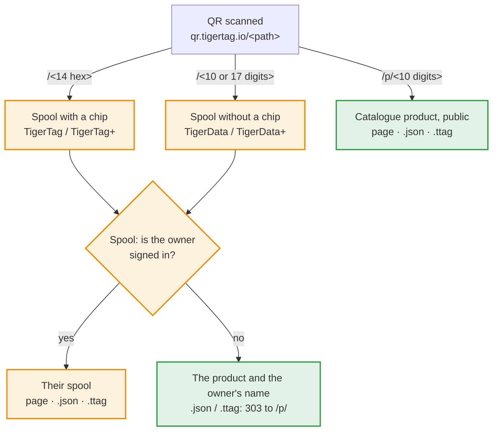

# Ids de bobina y enlaces QR

> **Ratificado el 2026-11-05 — aún no implementado.** Las aplicaciones se basan en
> este contrato. Los puntos todavía abiertos se enumeran al final; resolver uno
> cambia solo lo que nombra. Las secciones marcadas como **Propuesto** aún no
> están ratificadas: no construyas sobre ellas antes de que lo estén.

## Explicación rápida

Un código QR de TigerTag contiene un único enlace corto,
`https://qr.tigertag.io/<path>`. La ruta dice qué abre:



Naranja: privado, solo para el propietario de la bobina; verde: público.

| Código QR en | Ruta | Ejemplo |
|---|---|---|
| una bobina con chip (TigerTag / TigerTag+) | el UID del chip en hexadecimal, 14 caracteres, impreso en minúsculas; el UID del chip gemelo abre la misma bobina | [qr.tigertag.io/1d33dbda0d1080](https://qr.tigertag.io/1d33dbda0d1080) |
| una bobina sin chip (TigerData / TigerData+) | el id sin su prefijo `TigerData_`: 10 o 17 dígitos; la forma larga (`TigerData_6130922252`, `tigerdata-…`) también funciona | [qr.tigertag.io/6130922252](https://qr.tigertag.io/6130922252) |
| un producto (TigerQR+) | `p/` + el `id_product` en decimal, siempre 10 dígitos, rellenado con ceros (`p/0010303748`); las etiquetas antiguas con 8 caracteres hexadecimales (`p/9f5e0644`) siguen abriéndose | [qr.tigertag.io/p/2673739332](https://qr.tigertag.io/p/2673739332) |

- **Un enlace de bobina:** el propietario, con la sesión iniciada, ve su
  bobina; cualquier otra persona ve el producto y el nombre del propietario.
  `.json` y `.ttag` dan la bobina solo a su propietario; los demás reciben un
  `303` hacia el `.json` / `.ttag` del producto.
- **Un enlace de producto** es público, sin iniciar sesión: la página del
  catálogo, sus datos ([`p/2673739332.json`](https://qr.tigertag.io/p/2673739332.json)) y su archivo ([`p/2673739332.ttag`](https://qr.tigertag.io/p/2673739332.ttag)).
- Los enlaces se leen en mayúsculas o minúsculas.
- Para compartir una bobina o un producto, comparte este enlace corto: es el
  que va impreso en las etiquetas, y todas las aplicaciones lo leen. Un enlace compartido puede empezar por un idioma (`qr.tigertag.io/fr/p/2673739332`): la página se abre entonces en ese idioma para todos. Las etiquetas impresas nunca lo llevan.

El resto de esta página es el contrato en sí.

Las reglas que sigue toda aplicación de TigerSystem:

1. cómo obtiene su id una **bobina sin chip** (TigerData / TigerData+);
2. cómo una bobina **conserva su enlace** cuando recibe un chip;
3. cómo se escribe el id de una bobina en el **código QR** de una etiqueta
   impresa, y cómo se vuelve a leer;
4. cómo una aplicación **llama a una bobina con valores** (un peso, una nota) a
   través de un enlace;
5. cómo obtiene un **producto** su propio enlace;
6. cómo responde un enlace en **JSON** o como **archivo `.ttag`**.
7. qué lleva una **etiqueta impresa**, y sus plantillas.

## 1. Ids de bobina

Una bobina es un documento del inventario de la cuenta,
`users/{uid}/inventory/{spoolId}`. El id del documento **es** el id de la
bobina: una cuenta no puede contener dos bobinas con el mismo id.

| Bobina | Id | Ejemplo |
|---|---|---|
| Chip (TigerTag / TigerTag+) | el UID NFC del chip, en hexadecimal en mayúsculas, 14 caracteres (el UID de 7 bytes de un NTAG) | `04AB12CD3E4F80` |
| Sin chip, generado a partir de ahora | `TigerData_` + **milisegundos** epoch (13 dígitos) + un número aleatorio **0000–9999** (siempre 4 dígitos) | `TigerData_17623456789014213` |
| Sin chip, generado antes de este contrato | `TigerData_` + 10 dígitos aleatorios | `TigerData_4480517985` |
| Sin chip, prefijo heredado | `CLOUD_` + 10 dígitos aleatorios | `CLOUD_4480517985` |
| Decimal heredado (antigua aplicación de Android) | el UID escrito en decimal, en proceso de migración a hexadecimal | `1234567890123456` |

Este contrato **nunca reescribe** los ids ya generados. Los lectores solo
comprueban el prefijo (`TigerData_` / `CLOUD_` → sin chip); ninguno depende del
número de dígitos. El id es un identificador, nada más: nunca deduzcas de él una
fecha de creación. Un UID de 4 bytes (un chip propietario vinculado a una bobina)
nunca es el nombre de un documento del inventario, así que nunca aparece en un
enlace.

### Generar un id sin chip

Toda aplicación que crea bobinas sin chip (hoy Tiger Studio, más adelante la
aplicación móvil) genera el id de la misma manera:

1. **Componer** `TigerData_<Date.now()><four random digits>`.
2. **Comprobación local**: si el id ya está en el inventario que tiene la
   aplicación (la copia del listener en vivo, caché sin conexión incluida) o en
   su `uidMigrationMap`, compón otro. Esto funciona sin conexión.
3. **Escribir**
   - **con conexión:** en una transacción que lee primero el documento y falla
     si existe; si falla, vuelve al paso 1;
   - **sin conexión:** una escritura simple, que Firestore pone en cola hasta que
     vuelve la red. Los pasos 1 y 2 son la única protección.

Un `set()` simple sobre un id que ya existe **sobrescribe** la bobina que ya
estaba allí, en silencio. Eso es lo que evita el paso 3.

Los cuatro dígitos aleatorios hacen además que un nuevo id sin chip sea
prácticamente único **entre todas las cuentas** (aproximadamente una colisión
cada 600 años con un millón de bobinas sin chip al año), de modo que un servidor
pueda más adelante resolver un enlace para alguien que no sea el propietario sin
cambiar ninguna etiqueta impresa.

## 2. Conservar el enlace cuando una bobina recibe un chip

Programar un chip en una bobina sin chip traslada la bobina al UID del chip. En
**un solo lote**:

1. escribir la bobina bajo el UID del chip (y bajo el UID gemelo, en un par
   gemelo);
2. eliminar el documento `TigerData_…`;
3. escribir la redirección `users/{uid}/uidMigrationMap/{old id}` →
   `{ hex_uid, migrated_at }`.

El lote hace que las tres cosas ocurran juntas o ninguna. La redirección vive en
`uidMigrationMap` (la colección que ya asocia los ids decimales heredados con el
hexadecimal), nunca como documento auxiliar en el inventario: todo lo que lee el
inventario cuenta un documento como una bobina.

## 3. Enlaces QR

Una etiqueta de bobina impresa lleva un código QR con un enlace a la bobina, **y
nada más** (ni peso ni nota: los valores impresos se quedan desfasados):

```
https://qr.tigertag.io/<id>
```

No se imprime nada en claro junto al código: ni id, ni enlace. El código QR es
el camino de vuelta a la bobina.

`<id>` es el id de la bobina **sin su prefijo**:

| Bobina | Enlace |
|---|---|
| Chip | `https://qr.tigertag.io/04ab12cd3e4f80` |
| Sin chip (nueva) | `https://qr.tigertag.io/17623456789014213` |
| Sin chip (antes de este contrato) | `https://qr.tigertag.io/4480517985` |
| `CLOUD_` | **sin enlace QR**: la etiqueta se imprime sin código QR |
| Decimal heredado | **sin enlace QR**: migra primero la bobina a hexadecimal |

### Codificación

- Todo el enlace va en **minúsculas**, el id incluido: `https://qr.tigertag.io/04ab12cd3e4f80`.
  Probado el 2026-11-07: la cámara del iPhone abre un enlace en cualquiera de
  los dos casos, pero la cámara de Samsung (Galaxy S24) muestra un enlace
  `HTTPS://` en mayúsculas como texto plano y solo abre uno en minúsculas.
- Un único segmento en modo **byte**. Un esquema en minúsculas no puede usar el
  modo alfanumérico, y dividir el enlace en segmentos no ahorra nada (medido:
  todas las variantes son de 29 × 29).
- Corrección de errores **M** (15 %): las etiquetas se rayan y se doblan.
- Resultado: **29 × 29 módulos** para cada enlace de bobina y de producto. Dibuja
  cada módulo sobre un número entero de puntos de la impresora, con la zona de
  silencio estándar de 4 módulos.

### Volver a leer un enlace

Los lectores extraen el id del enlace **sin conexión**: una aplicación que
escanea una etiqueta nunca necesita el sitio web. Leen la ruta sin distinguir
mayúsculas de minúsculas, ignoran una `/` final y la resuelven según su forma:

| Ruta | Id de bobina |
|---|---|
| 17 dígitos | `TigerData_<17 digits>` |
| 10 dígitos | `TigerData_<10 digits>` |
| 14 caracteres hexadecimales | el UID, en mayúsculas |
| 13 caracteres hexadecimales que empiezan por `4` | un UID NTAG truncado: `0` + los 13 caracteres ([regla de reparación](https://github.com/TigerTag-Project/TigerTag-Studio-Manager/issues/146)) |
| `p/` + el `id_product`: 10 dígitos decimales (forma impresa) u 8 caracteres hexadecimales (etiquetas antiguas) | un producto: [sección 5](#5-enlaces-de-producto) |

Una terminación `.JSON` o `.TTAG` pide la respuesta para herramientas: [sección 6](#6-respuestas-json-y-ttag).

Las aplicaciones **escriben** la forma corta de arriba, pero los lectores también
**aceptan la forma larga**: el prefijo `TigerData` en mayúsculas o minúsculas,
seguido de `_` o `-`, y luego los 17 o 10 dígitos. `TigerData_17623456789014213`,
`TigerData-17623456789014213`, `TIGERDATA-17623456789014213` y
`tigerdata_4480517985` resuelven todos a la misma bobina. Un enlace tecleado o
compartido a mano sigue funcionando. El prefijo `CLOUD` no se acepta en ninguna
de las dos formas.

Un UID puede ser solo de dígitos, pero tiene 14 caracteres, nunca 17 ni 10, así
que la longitud siempre decide. Ningún id decimal heredado llega a un lector,
porque nunca se imprime ninguno. Cualquier **otra forma** es una etiqueta de una
versión más reciente: el lector lo dice («actualiza la aplicación») en lugar de
fallar. Cualquier otro tipo de cosa tiene su propia carpeta, una letra y una `/`
(`p/` para un producto, más adelante `r/` para un rack), de modo que nunca puede
chocar con los enlaces de bobina ya impresos.

### Prefijo de idioma

Un enlace compartido puede llevar el idioma de quien lo comparte antes de la
ruta. *(2026-11-11.)*

```
https://qr.tigertag.io/<lang>/<spool id>
https://qr.tigertag.io/<lang>/p/<id_product>
```

`<lang>` es uno de `en`, `fr`, `de`, `es`, `it`, `zh`, `pt`, `pt-pt`, `pl`,
`ru`, `nl`, escrito en minúsculas y leído en mayúsculas o minúsculas.

- La página se abre entonces en ese idioma para todos, incluidos los robots de
  vista previa de enlaces: `/fr/p/2673739332` →
  `tigersystem.io/fr/catalog/2673739332`.
- Sin prefijo, decide el idioma del navegador del visitante.
- Un prefijo desconocido da un `404`.
- **Las etiquetas impresas nunca llevan prefijo**: siguen siendo neutras en
  idioma. Solo los botones Compartir lo añaden (tigersystem.io hoy, Tiger Studio
  con su próxima versión).

### Resolver la bobina

1. Busca el id **en el propio inventario del espectador que ha iniciado sesión**.
2. Si no está → búscalo en el `uidMigrationMap` del espectador y sigue la
   redirección.
3. Un par gemelo tiene una etiqueta, con el UID principal; cualquiera de los dos
   UID abre la bobina.
4. Una bobina eliminada (`deleted: true`) se abre como «eliminada», no como un
   error.

   **El propietario ve la bobina en la propia página**, leída en el navegador
   desde su propio documento de inventario (las reglas lo limitan a él): el
   producto (foto sobre su color), marca, material, nivel, peso restante sobre
   la capacidad, temperaturas de boquilla, cama y secado, diámetro, rack y
   ranura, peso de la bobina vacía. Dos botones: «Open in Tiger Studio»
   (`https://studio.tigersystem.io/?spool=<docId>`, con los valores del enlace)
   y «See the product page». Un propietario que ha iniciado sesión en Studio Web
   en el dispositivo pero no en el sitio se envía a Studio Web: el sitio no
   puede leer el documento sin su propia sesión. *(2026-11-07.)* El propietario
   puede cambiar allí el peso y la nota, con la misma escritura que Studio:
   `weight_available` o `message` (como máximo 28 bytes UTF-8), `updatedAt`
   (hora del servidor), `needUpdateAt` (hora del servidor) en un formato de
   chip, el gemelo en el mismo lote. El contenedor (bobina vacía) también puede
   cambiarse allí, tal como lo escribe Studio: `container_id`,
   `container_weight` (con la corrección propia de la cuenta), `updatedAt`, el
   gemelo en el mismo lote. La página tiene un botón para cerrar sesión.
   *(2026-11-08.)*

5. Quien **no es el propietario** (sin sesión, otra cuenta, un amigo aceptado
   incluido) **se envía al producto** de la bobina; nunca se le muestra la
   bobina: el servidor encuentra la bobina por su id entre todas las cuentas
   (un índice sobre el id de la bobina), lee su `id_product` y redirige al
   enlace de producto de la [sección 5](#5-enlaces-de-producto). El mismo id en
   dos cuentas con productos distintos (un chip reescrito cuyo documento antiguo
   conservó otra cuenta) → el producto del documento actualizado en último
   lugar (`updatedAt`), correcto en prácticamente todos los casos. Sin producto
   o sin coincidencia → una página que dice que la bobina es privada, con
   «Start my inventory». La búsqueda solo se ejecuta para esos escaneos, así que
   su coste sigue a los escaneos, no al número de cuentas. *(Ratificado el
   2026-11-06; la regla de conflicto, el 2026-11-07.)*

   Un visitante **sin sesión** (no se encuentra ningún inicio de sesión en el
   dispositivo) no se redirige: la página le deja elegir. Muestra una tarjeta
   del producto de la bobina (solo el producto público, nunca para una bobina
   privada), inicia sesión ahí mismo (una vez iniciada la sesión, la
   comprobación del propietario vuelve a ejecutarse y el propietario llega a la
   bobina) o continúa a la página del producto. Alguien que ha iniciado sesión y
   no es el propietario se envía al producto, como arriba. *(2026-11-07.)*

   **De quién es la bobina.** Cualquiera que escanee una bobina, con sesión o
   sin ella, ve a su propietario: el nombre visible y la foto de `userProfiles`
   de la cuenta cuyo documento se actualizó en último lugar, incluso cuando el
   perfil no es público e incluso para una bobina sin producto, para que quien
   encuentre una bobina sepa a quién pertenece. Nunca el uid ni el correo
   electrónico. *(2026-11-08.)*

**Privacidad:** conocer un id nunca muestra una bobina. Un enlace escaneado abre
una bobina solo para su propietario; dentro de las aplicaciones, una bobina solo
se muestra a alguien a quien las reglas de Firestore ya permiten leerla (el
propietario, un amigo aceptado, un inventario público). Los ids contienen una
marca de tiempo y pueden adivinarse; eso nunca debe importar. El producto de una
bobina no es privado: está impreso en la etiqueta, y un chip TigerTag+ lo lleva
en claro para cualquier teléfono NFC. El peso, la nota y el rack nunca salen; el
propietario solo aparece como nombre visible y foto (arriba). Un escaneo se
cuenta una vez por pestaña del navegador y bobina (recargar no es un escaneo
nuevo), con su producto, marca, material y un lugar a nivel de ciudad, nunca el
id de la bobina. El informe de escaneo también lleva la dirección IP del
visitante, conservada contra las avalanchas de peticiones y para el análisis:
solo se muestra en el historial de administración, nunca a las marcas, y sirve
para comprobar la ciudad que informó el edge. Se conserva durante un año, solo
por seguridad. Un escaneo de un visitante que ha iniciado sesión se vincula a su
cuenta.

## 4. Llamar a una bobina con valores

Una aplicación puede construir un enlace que abre una bobina **y propone
valores**, con parámetros de consulta normales (estos enlaces nunca se imprimen,
así que la legibilidad prima sobre el tamaño del QR):

```
https://qr.tigertag.io/04AB12CD3E4F80?weight=640&note=Opened%20in%20June
```

### Parámetros

| Parámetro | Valor | Límite |
|---|---|---|
| `weight` | peso neto del filamento, en gramos | número entero, de 0 a la capacidad de la bobina |
| `note` | la nota de la bobina (el campo `message`) | texto plano, 28 bytes UTF-8 como máximo (el espacio del chip) |

Los nombres no distinguen mayúsculas de minúsculas. Un parámetro desconocido se
ignora, nunca es un error. Un valor fuera de su límite se rechaza. Los parámetros
nuevos se añaden a esta tabla, nunca los inventa una aplicación por su cuenta.

### Quién puede aplicarlos

| Situación | Qué ocurre |
|---|---|
| Sin sesión | Valores **rechazados**. El enlace ofrece iniciar sesión y luego abre la bobina sin ellos. |
| Con sesión, no el propietario (incluida la bobina de un amigo) | Valores **rechazados**. La bobina se abre si las reglas lo permiten. |
| Con sesión, el propietario | Studio: la bobina se abre con los valores **prerrellenados**, y **un solo gesto** los guarda («Update: 640 g»). La página del Hub: un peso que cabe en la capacidad y difiere del guardado **se guarda de inmediato**, en la bobina y su gemela en un solo lote, y luego un aviso ofrece volver a poner el peso anterior («Revert to 772 g»), por si se vuelve a escanear un enlace antiguo. *(Hub, 2026-11-08.)* |

Un enlace de cualquier otra persona nunca escribe: los valores solo se aplican a
la propia bobina del propietario. Una aplicación que tiene que escribir sin
confirmación (una báscula que actualiza el peso de forma continua, una
integración) no usa enlaces: escribe a través de la cuenta del usuario bajo las
reglas de Firestore
([guía de integración](https://github.com/TigerTag-Project/TigerTag_Firebase_Integration)).

## 5. Enlaces de producto

> **Ratificado el 2026-11-06.**

Un producto (un filamento del catálogo, sea quien sea el propietario de una
bobina de él) tiene su propio enlace, para el embalaje, el estante de una tienda,
un showroom o un catálogo impreso:

```
https://qr.tigertag.io/p/<id_product>
```

- `<id_product>` se escribe en **decimal, siempre con 10 dígitos**, rellenado con
  ceros a la izquierda: un `id_product` nunca tiene más de 10 dígitos (el mayor es
  `4294967295`). Ejemplos: producto `2855882328` →
  `https://qr.tigertag.io/p/2855882328`; producto `10303748` →
  `https://qr.tigertag.io/p/0010303748`. **29 × 29** módulos.
- Las etiquetas impresas antes llevan la forma anterior, el `id_product` en **8
  caracteres hexadecimales** en minúsculas (`p/aa394e58`); sigue siendo legible
  para siempre (ver más abajo).
- Un id que no está, o ya no está, en el catálogo (`p/0000000000` y `p/4294967295`,
  «sin producto», nunca impresos; un id desconocido; un producto archivado,
  eliminado o fusionado) abre **una única página de «producto olvidado»**: este
  filamento ya no está en el catálogo, con la búsqueda. Un solo estado para
  todos, `404` (la página y las respuestas `.json` / `.ttag` por igual): por qué
  desapareció un producto no le importa al lector. Un `id_product` nunca se da a
  otro producto: una etiqueta ya pegada nunca puede abrir el filamento
  equivocado.
- Los enlaces los sirve el **Hub** (`tigersystem.io`): `qr.tigertag.io` apunta a
  él. La página es la página de catálogo del Hub (abajo); las respuestas
  `.JSON` y `.TTAG` son rutas de la API del Hub que leen el catálogo (en caché).
- Una etiqueta de bobina nunca repite su producto: el enlace de la bobina ya
  lleva a él ([sección 3](#resolver-la-bobina)).

### Leer un enlace de producto

Un enlace de producto bien formado tiene una de dos longitudes, así que nunca
puede leerse mal:

1. **10 dígitos** → decimal (`p/2673739332`, `p/0010303748`).
2. **8 caracteres** `0-9` / `a-f` → hexadecimal, la forma impresa anterior,
   todavía aceptada (`p/9f5e0644` abre el mismo producto que `p/2673739332`).

Como tolerancia, sin garantía, un decimal tecleado a mano con otra longitud se lee
en decimal, salvo exactamente 8 dígitos: esos se leen primero en hexadecimal y
luego en decimal si ese producto no existe. Un valor por encima de `4294967295` es
un enlace desconocido. `0` y `4294967295`, en cualquier forma, significan «sin
producto» (`404`). Las terminaciones `.json` y `.ttag` funcionan en todas las
formas, sin distinguir mayúsculas.

### La página que abre

`p/…` redirige (`302`) a la **página de catálogo existente** del producto,
`tigersystem.io/<lang>/catalog/<id_product in decimal>`, en el idioma del enlace ([prefijo de idioma](#prefijo-de-idioma)), si no, en el del teléfono. No hay una página de escaneo aparte: la página de catálogo está
pensada **primero para el teléfono** (adaptable), ya que la mayoría de sus
visitas vienen de un escaneo: foto y muestra de color, marca, material y nombre
del color arriba, los ajustes de impresión legibles de un vistazo, y luego el
resto de la página.

## 6. Respuestas JSON y .TTAG

> **Ratificado el 2026-11-06.**

Un enlace que termina en `.JSON` (en mayúsculas o minúsculas), o que se envía con
`Accept: application/json`, responde en JSON en lugar de con una página. Un
enlace que termina en `.TTAG` responde con el mismo registro como
[archivo `.ttag`](./ttag-format.md) para descargar
(`Content-Disposition: attachment`). Son direcciones para herramientas, nunca se
imprimen.

La misma lógica que un escaneo ([resolver la bobina](#resolver-la-bobina)): el
propietario obtiene la bobina; cualquier otra persona, su producto.

| Enlace | El propietario (`Authorization: Bearer <Firebase ID token>`) | Cualquier otra persona (sin sesión, otra cuenta, un amigo) |
|---|---|---|
| `…/p/2855882328.json` | el registro del producto | lo mismo |
| `…/p/2855882328.ttag` | el producto como archivo `.ttag` | lo mismo |
| `…/04ab12cd3e4f80.json` | la bobina | `303` → `…/p/<id_product>.json`; sin producto de catálogo (un TigerData, un TigerTag de maker) → `404` |
| `…/04ab12cd3e4f80.ttag` | la bobina como archivo `.ttag` | `303` → `…/p/<id_product>.ttag`; sin producto de catálogo → `404` |

Sin producto de catálogo no se responde nada de la bobina, ni siquiera su
material: el `404` corresponde a la página de «bobina privada» de un escaneo.

- **Bobina:** un [archivo `.ttag`](./ttag-format.md) que contiene ese único
  registro, el documento del inventario tal como lo guarda Firestore. Lleva
  `id_product`; una herramienta que quiera el producto llama después a
  `…/p/<id_product>.json`.
- **Producto:** el registro del catálogo tal como lo devuelve la API de
  productos, en el idioma de `?lang=` (inglés por defecto). En caché en el
  servidor y permitido desde cualquier sitio.
- Una respuesta de bobina nunca se guarda en caché: depende de quién pregunta.
- Abierto en Tiger Studio, el `.ttag` de una bobina se importa en modo
  **Restore** (la bobina tal como era, chip y copia de seguridad incluidos); el
  `.ttag` de un producto se importa en modo **Import**, como un nuevo
  TigerData+ con un id nuevo.
- Una petición JSON o `.TTAG` nunca escribe: los valores del enlace
  (`?weight=`, `?note=`) se ignoran ahí.

## 7. Etiquetas impresas

Todas las aplicaciones imprimen las mismas etiquetas: dos tipos, un solo juego de
plantillas, para que una etiqueta impresa desde Tiger Studio, la aplicación móvil
o el sitio web tenga el mismo aspecto y se escanee igual.

| Etiqueta | Su código QR | Se imprime para |
|---|---|---|
| **Bobina** | el enlace de la bobina ([sección 3](#3-enlaces-qr)) | cualquier bobina que tenga un enlace QR (no `CLOUD_`, no decimal heredado) |
| **Producto** (tarjeta de muestra) | el enlace del producto ([sección 5](#5-enlaces-de-producto)) | una bobina o un producto del catálogo con un `id_product` real (TigerTag+, TigerData+) |

El propietario que escanea una etiqueta de bobina obtiene la bobina; cualquier
otra persona, su producto ([resolver la bobina](#resolver-la-bobina)). Una
etiqueta de producto abre el producto para todo el mundo: es la que sirve para
una muestra, un estante o un showroom.

### Qué lleva una etiqueta

- la marca, donde iría el logotipo de un fabricante (los logotipos de fabricante llegarán más adelante);
- la serie en blanco sobre una barra negra (`PLA Rainbow`; el material cuando no hay serie);
- el nombre del color, y su(s) código(s) hexadecimal(es) (`#F2D066`, hasta tres en las plantillas anchas);
- en una etiqueta de bobina, el nombre de la etiqueta en la esquina superior derecha, como una píldora contorneada:
  `TigerQR+` cuando su referencia es un producto del catálogo (un `id_product` real) o un
  chip TigerTag+, si no, `TigerQR` (así, un chip TigerTag sin producto da `TigerQR`); una
  etiqueta de producto (filamento) lleva siempre `TigerQR+`. Como en TigerTag y TigerTag+,
  el `+` significa vinculado al catálogo. La píldora no dice si la bobina tiene chip;
- hasta **cuatro casillas de valores**, elegidas por el usuario entre: rango de boquilla, rango de cama,
  secado (temperatura · tiempo), TD, diámetro;
- el código QR.

Solo lo que no cambia: nunca el peso restante, la nota, el rack ni el
propietario. Nada en claro junto al código QR ([sección 3](#3-enlaces-qr)).

### Plantillas

Nueve plantillas, los tamaños y diseños habituales de etiquetas de bobina:

| Plantilla | Tamaño (ancho × alto) | Diseño |
|---|---|---|
| Classic (por defecto) | 40 × 30 mm | marca, barra, color + hex, cuatro casillas, QR abajo a la derecha |
| Wide | 50 × 30 mm | la Classic, con la barra más ancha |
| Compact | 40 × 25 mm | marca, QR a la izquierda, barra, color, hex; sin casillas |
| Slim | 40 × 12 mm | QR a la izquierda, marca, barra, color; sin casillas |
| Slicer-friendly | 40 × 30 mm | marca, serie, color apilados en grande, QR grande a la derecha; sin casillas |
| Vertical | 30 × 40 mm | marca, barra, color en grande, hex, una línea, casillas apiladas a la izquierda, QR abajo a la derecha |
| Vertical bold | 30 × 40 mm | marca, barra a todo el ancho, color, una línea, QR centrado debajo; sin casillas |
| Vertical compact | 25 × 40 mm | marca, barra, color, hex, una línea, QR grande debajo; sin casillas |
| Solo QR | 25 × 30 mm | la píldora TigerQR / TigerQR+ centrada arriba, un QR de 20 mm debajo; nada más, sin casillas |

Solo QR está decidida (2026-11-11) y disponible en tigersystem.io; llega a Tiger Studio con su próxima versión.

Cada plantilla es un SVG maquetado en décimas de milímetro y escalado a los
puntos de la impresora. El código QR ocupa el mismo recuadro que en las etiquetas
de bobina habituales (≈ 14 mm en la Classic), con un número entero de puntos de
impresora por módulo: el más cercano, redondeado hacia arriba cuando eso queda
dentro del 6 % del recuadro. Los márgenes blancos de la etiqueta son su zona de
silencio. A 203 dpi, un código de 29 × 29 tiene 4 puntos por módulo en la Classic
(≈ 14,5 mm).

### Salida

- **PDF**, **PNG** (a la resolución de la impresora) y **SVG**, para que funcione
  cualquier impresora, a través de su propia aplicación si hace falta;
- la impresión directa en impresoras de etiquetas (Brother QL, Niimbot, Phomemo)
  llegará más adelante, impresora por impresora, con las mismas plantillas.

## Puntos abiertos

- **Enlaces de aplicación.** iOS (`apple-app-site-association`) y Android
  (filtros de intent) comparan las rutas distinguiendo mayúsculas de minúsculas
  por defecto: los enlaces se imprimen en minúsculas, pero un enlace tecleado o
  compartido a mano puede no estarlo, así que la aplicación móvil declara una
  coincidencia sin distinción de mayúsculas (iOS) y filtra la ruta en el código
  (Android).
- **Dominio.** `qr.tigertag.io` queda impreso para siempre: renueva
  `tigertag.io` a largo plazo.

---

**▲ [Índice de la documentación](../../README.md)** · **Véase también:** [Identidad universal del filamento](../concepts/universal-filament-identity.md), [Inventario y sincronización en la nube](../concepts/inventory-and-cloud-sync.md), [Resumen para desarrolladores](./README.md)
