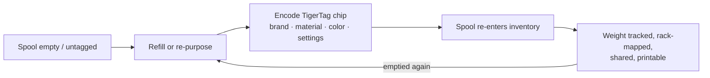

# El flujo Second Life

## El problema de las bobinas «inteligentes» actuales

Cuando se agota una bobina con etiqueta de fabricante, la etiqueta muere con ella:
describía una bobina rellenada en fábrica, en el formato de un solo fabricante, y no
se puede reutilizar. El soporte de la bobina se tira o se rellena «tonto».

## Second Life: reidentificar, no desechar

Un chip TigerTag se puede **escribir y reescribir**. Cuando una bobina se vacía y
se rellena, o cuando una bobina de cualquier marca no tiene ninguna etiqueta útil,
el usuario codifica un chip TigerTag con el perfil real del nuevo filamento y lo
pega. La bobina obtiene una *segunda vida* como objeto de primera clase que se
identifica a sí mismo:

*Incluso una recarga sin bobina lleva su identidad: el chip va en la propia madeja.*

## Cómo se codifica

- **Tiger NFC Connect** (móvil) — programa chips con un toque NFC.
- **Tiger Studio** (escritorio) — actualización guiada del chip con un lector ACR122U /
 [TigerPOD](../products/tigerpod.md): coloca el chip, comprobación de coincidencia del UID,
 escritura verificada.
- **Digital primero** — *TigerData* de Tiger Studio te permite crear ahora una bobina
 totalmente digital (sin chip) y **convertirla más tarde en una con chip real, de forma atómica**.

> **Nota:** el catálogo de marcas, materiales y colores usado al codificar lo sirve
> la [base de datos de referencia](../concepts/universal-filament-identity.md) compartida,
> así que un chip recodificado es tan preciso como uno de fábrica.

## La segunda vida del propio chip — cero residuos electrónicos

La bobina no es lo único que obtiene una segunda vida: **los chips también.**
Cada bobina lleva [dos chips](../concepts/tigertag-chip.md), así que cada kilo de
filamento que imprimes te deja **dos chips NTAG estándar** para recuperar. Despégalos
y recodifícalos como NDEF simple para lo que quieras: un llavero inteligente, una
tarjeta de visita NFC, un objeto conectado propio; el editor está integrado en la
app. Incluso puede reescribir un chip **en el formato que esperan las impresoras
Elegoo**: tu chip, tu elección.

Por eso mismo la producción oficial de chips de marca pasó al **NTAG215**: más
margen de memoria significa más posibilidades de reutilización cuando la bobina
está vacía. El objetivo es sencillo: **el chip de una bobina nunca debería
convertirse en residuo electrónico.**

---

**◀ Anterior:** [Puente smartphone](./smartphone-bridge.md) · **▲ [Índice de la documentación](../../README.md)** · **Siguiente ▶** [Identidad universal del filamento](../concepts/universal-filament-identity.md)

**Véase también:** [TigerTag](../products/tigertag.md), [TigerTag+](../products/tigertag-plus.md)
