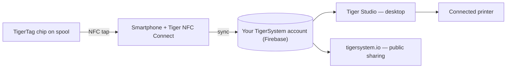

# El concepto del puente smartphone

## La idea clave

> En China nos preguntábamos sin parar: *«¿Dónde están los lectores RFID?»* Todos
> respondían: *«En las Bambu Lab.»* Falso: los lectores de Bambu están en el AMS, no
> en la impresora; la máquina no puede detectar en absoluto una bobina de terceros.
> **Los lectores RFID están en tus bolsillos**: en cada teléfono, listos para usar,
> sin que ni siquiera lo sepas.

Todo smartphone moderno incluye un lector NFC. Eso significa que **todo usuario de
impresión 3D ya posee hardware TigerTag**: sin lector propietario, sin actualizar
la impresora, sin necesidad de comprar nada para empezar.

El teléfono hace de **puente** entre la bobina física y el inventario digital:

1. **Tocar** — el perfil del chip (marca, material, color, ajustes) se lee con un solo gesto.
2. **Sincronizar** — la bobina aparece al instante en el inventario en la nube del usuario.
3. **En todas partes** — la aplicación de escritorio, la web y las impresoras conectadas ya conocen la bobina.

## RFID nativo frente al puente

Algunas impresoras leen etiquetas de forma nativa: normalmente en su propio
formato propietario, de vez en cuando TigerTag mismo; la mayoría no lee nada. El
puente hace irrelevantes las capacidades de la impresora:

| Vía | Requiere | Funciona con |
|---|---|---|
| **RFID nativo — etiqueta del fabricante** | Una impresora que lea la etiqueta bloqueada de ese fabricante | Una sola marca |
| **RFID nativo — TigerTag** | Una máquina cuyo propio firmware lee TigerTag: algo raro y, hasta ahora, obra de la comunidad | Todas las marcas, sin aplicación de por medio |
| **Puente smartphone** | Cualquier teléfono NFC | **Todas las impresoras**, de cualquier marca, incluso máquinas totalmente sin conexión |

La fila del medio no es nuestra, y es reciente. El firmware ampliado de la
comunidad convierte a la [Snapmaker U1](../compatibility/snapmaker.md) en la
primera impresora que lee un TigerTag en la propia máquina; y el **BT-AMS-C**, un
lector de cuatro ranuras que se monta sobre un AMS de Bambu Lab, envía los datos
TigerTag directamente a la BMCU de la impresora
([hardware de terceros](../compatibility/third-party-hardware.md)). Ambos siguen
siendo excepciones, y eso es un argumento a favor del puente, no en su contra:
nunca tuvo que esperarlos.

Con el puente, los datos del filamento llegan a la impresora a través de las
[integraciones de impresoras de Tiger Studio](../compatibility/README.md) (seis
marcas en vivo hoy): la bobina se identifica ante el *sistema*, y el sistema habla
con la máquina.

La prueba con un ejemplo: **las impresoras FlashForge no tienen ningún lector RFID**
y, gracias al puente, ahora funcionan igualmente con filamento identificado por NFC.
Una capacidad totalmente nueva, añadida a máquinas de otros, **totalmente gratis
para el usuario** ([el caso FlashForge](../compatibility/flashforge.md)).

---

**◀ Anterior:** [Ecosistema abierto](./open-ecosystem.md) · **▲ [Índice de la documentación](../../README.md)** · **Siguiente ▶** [Flujo Second Life](./second-life.md)

**Véase también:** [Tiger NFC Connect](../products/tigertag-connect.md), [Visión general de la arquitectura](../architecture/overview.md)
