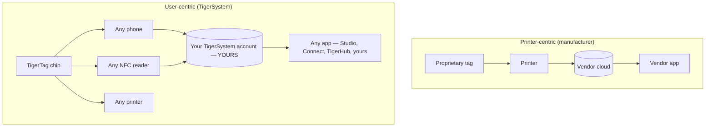

# Centrado en el usuario frente a centrado en la impresora

> **Inteligencia al servicio del usuario, no solo de la impresora.**

## Dos arquitecturas opuestas

En un mundo centrado en la impresora, el centro es la **impresora**: la etiqueta
existe para servir a la máquina, y los datos fluyen hacia el silo del fabricante.

En TigerSystem el centro es el **usuario**. El usuario es dueño de:

- **el filamento** — de cualquier marca, de cualquier proveedor;
- **los metadatos** — material, color, ajustes de impresión, codificados en un chip que controla;
- **el inventario** — almacenado en su propia cuenta en la nube, exportable;
- **el historial** — pesos, ubicaciones, uso a lo largo del tiempo;
- **la sincronización** — la misma cuenta alimenta todas las aplicaciones y dispositivos.

TigerSystem se limita a **conectar todos los componentes entre sí**.

## Por qué los fabricantes bloquean el RFID

Las etiquetas de los fabricantes suelen estar bloqueadas criptográficamente (véase
la [sección de compatibilidad](../compatibility/README.md) para los detalles por
fabricante: claves derivadas del UID, sectores cifrados con AES, firmas RSA). El
bloqueo sirve al fabricante: vincula la compra de consumibles a la máquina y
mantiene propietario el flujo de datos. También significa que **tu propio
inventario de bobinas no es tuyo**.

Los chips TigerTag adoptan la postura contraria: una carga útil NDEF abierta en un
chip NTAG estándar, documentada públicamente, con SDK abiertos para leerla y escribirla.

---

**◀ Anterior:** [Por qué existe TigerSystem](../vision/why-tigersystem.md) · **▲ [Índice de la documentación](../../README.md)** · **Siguiente ▶** [Ecosistema abierto](./open-ecosystem.md)

**Véase también:** [Identidad universal del filamento](../concepts/universal-filament-identity.md), [Compatibilidad](../compatibility/README.md)
