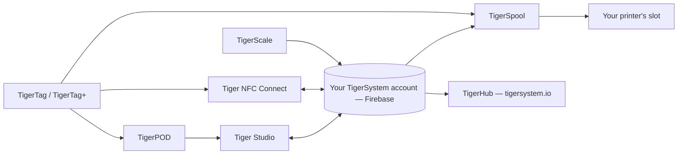

# Productos

El ecosistema TigerSystem, una página por producto.

**Estos son los productos oficiales**, diseñados y publicados por TigerSystem.
«Oficial» significa aquí *lo hicimos nosotros*, no *lo necesitas*: todos son de
código abierto y se pueden bifurcar, y sus nombres (Tiger Studio, TigerHub,
TigerScale, TigerPOD, Tiger NFC Connect) deliberadamente **no se reclaman como
marcas registradas**. Solo la marca **TigerTag** en sí está reservada, y solo para
el chip.

Cualquiera puede construir y vender una alternativa: un lector, una aplicación, una
báscula, todo un sistema de inventario. Consulta el [hardware de terceros](../compatibility/third-party-hardware.md)
y el [software construido sobre TigerTag](../developers/integrations.md) para ver lo
que ya existe. Un producto de terceros es **TigerTag Compatible** con solo
funcionar; pasa a ser **TigerTag Certified** únicamente cuando TigerSystem se lo
concede ([política de marca](../../TRADEMARK.md)).

> **Nota:** todos los productos **de cara al usuario** de abajo, y todos los
> futuros, son **pruebas de concepto** funcionales. Su único objetivo es mostrar el
> potencial de un protocolo de código abierto, estándar, agnóstico y multiplataforma,
> e inspirar lo que otros construirán con él. (La cadena de herramientas de
> programación de chips del lado de la fábrica es otra historia: de nivel
> industrial, en producción.) Consulta
> [Un sandbox, a propósito](../vision/why-tigersystem.md).

| Producto | Qué es | Tipo |
|---|---|---|
|  [TigerData](../concepts/universal-filament-identity.md) | El chip virtual: la identidad en forma digital, sin chip, actualizable en cualquier momento | Concepto |
|  [TigerTag](./tigertag.md) | Chip RFID/NFC abierto + estándar de identidad de la bobina | Hardware + especificación |
|  [TigerTag+](./tigertag-plus.md) | Un TigerTag que lleva un ID de producto del catálogo y un enriquecimiento opcional, siempre 100 % sin conexión; firmado, es TigerTag+ Certified | Hardware + especificación |
|  [Tiger NFC Connect](./tiger-nfc-connect.md) | Aplicación móvil (iOS/Android): escanear, codificar, explorar | Aplicación |
|  [Tiger Studio](./tiger-studio.md) | Aplicación de escritorio: inventario, racks, sensores, impresoras | Aplicación |
|  [TigerHub](./tigerhub.md) | La casa web del ecosistema: escaparate, listas de deseos, amigos y compartir en `tigersystem.io` | Web |
|  [TigerPOD](./tigerpod.md) | Soporte lector NFC doble imprimible en 3D | Hardware |
|  [TigerScale](./tigerscale.md) | Báscula de filamento ESP32 de código abierto | Hardware |
|  [TigerSpool](./tigerspool.md) | Caja ESP32 de código abierto junto a la impresora: toca una bobina, elige una ranura, cualquier marca | Hardware |
|  [Tiger Touch](./tigertouch.md) | Firmware de código abierto para la pantalla BIGTREETECH Panda Touch / K-Touch: todas las marcas de impresora, en directo, en una sola pantalla | Firmware |
|  [TigerTag Factory y Manager](./factory-suite.md) | Herramientas industriales de programación de chips y de base de datos de filamentos para fábricas: **no es público**, de nivel de producción | Industrial |

---

**◀ Anterior:** [Flujo de datos](../architecture/data-flow.md) · **▲ [Índice de la documentación](../../README.md)** · **Siguiente ▶** [TigerTag](./tigertag.md)
