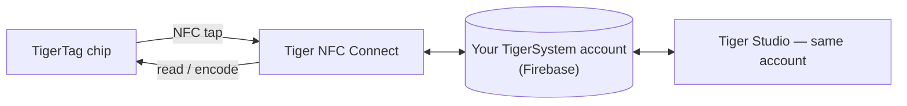

# Tiger NFC Connect (aplicación móvil)

## Propósito

**Tu teléfono ya es un lector TigerTag: Connect lo enciende.** La aplicación para
iOS/Android lee cualquier bobina con un toque, escribe chips con la misma facilidad y
guarda toda tu colección en el bolsillo. Es la puerta de entrada diaria al ecosistema
y la encarnación del [puente del smartphone](../philosophy/smartphone-bridge.md).

<strong>iPhone · iPad</strong>
<a class="ts-cta-primary" href="https://apps.apple.com/app/id6745437963">App Store</a>
Escanea con la cámara o toca el botón

<strong>Android</strong>
<a class="ts-cta-primary" href="https://play.google.com/store/apps/details?id=com.tigertag.connect">Google Play</a>
Escanea con la cámara o toca el botón

<a href="https://tigersystem.io/download">Todas las descargas en tigersystem.io</a>
<a href="https://testflight.apple.com/join/jVHhmK4C">Beta en TestFlight (iOS)</a>
<a href="https://play.google.com/apps/testing/com.tigertag.connect">Beta en Google Play</a>

Gratis, en ambas tiendas. La aplicación lee un chip con el NFC del propio teléfono:
nada que comprar, ningún lector, sin cuenta para leer.

## Dónde encaja

## Funciones

- **Escaneo NFC sobre la marcha**: toca una bobina y ve su perfil completo.
- **Programación de chips**: codifica y recodifica chips TigerTag desde el teléfono.
- **Exploración del catálogo**: la base de datos de referencia compartida de
 marcas/materiales/colores.
- **Cuenta compartida**: el mismo backend Firebase que Tiger Studio; inventario,
 amigos y racks se mantienen sincronizados en tiempo real entre dispositivos.
- **Accesorios USB-C**: admite el analizador de filamento AJAX-3D **TD-1 / TD1s** por
 USB-C: mide la Transmission Distance (y el color) de un filamento directamente desde
 el teléfono
 ([hardware de terceros compatible](../compatibility/third-party-hardware.md)).

## Consíguela

- **Publicada** en la **App Store (iOS)** y en **Google Play (Android)**, versión
 1.0.2 hoy.
- También hay **betas públicas** (TestFlight en iOS, beta abierta en Android).
- Todos los enlaces de descarga: **[tigersystem.io/download](https://tigersystem.io/download)**;
 además, siempre hay un código QR disponible en la barra lateral de Tiger Studio.

> **Nota sobre el nombre:** publicada antes como *«TigerTag RFID Connect»*; renombrada
> **Tiger NFC Connect** para hacerse eco del lector NFC que ya lleva todo teléfono.
> La aplicación es **gratuita pero propietaria** (no de código abierto) por ahora, a
> diferencia de Tiger Studio, los SDK y el hardware, que son abiertos.

## Arquitectura

Aplicación Flutter que habla con Firebase (Auth + Firestore), la única base de datos
de cuenta compartida detrás de todas las aplicaciones. La conectividad con
impresoras en el móvil está orientada a la nube donde los fabricantes lo permiten.

## Interacciones

| Con | Cómo |
|---|---|
| Chips TigerTag | Lectura y escritura con un toque NFC |
| Firebase (base de datos de la cuenta) | Sincronización en tiempo real de inventario / amigos / preferencias |
| Tiger Studio | Complemento de escritorio: misma cuenta, funciones complementarias |

## En imágenes

|| | | |
|---|---|---|---|
|  |  |  |  |

---

**◀ Anterior:** [TigerTag+ Certified](./tigertag-plus-certified.md) · **▲ [Índice de la documentación](../../README.md)** · **Siguiente ▶** [Tiger Studio](./tiger-studio.md)

**Véase también:** [Puente del smartphone](../philosophy/smartphone-bridge.md), [Inventario y sincronización en la nube](../concepts/inventory-and-cloud-sync.md)
