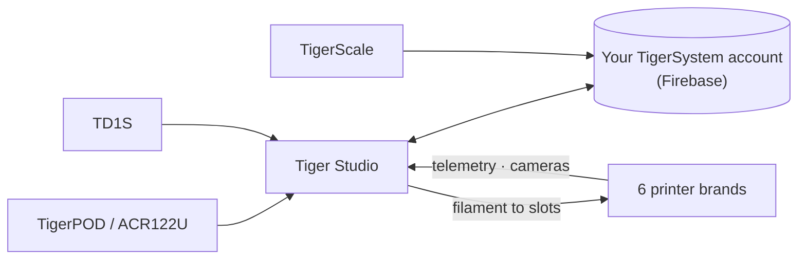

# Tiger Studio (aplicación de escritorio)

## Propósito

**Tiger Studio es el centro de mando de tu filamento.** Cada bobina, cada rack,
cada impresora en una sola pantalla: escanea un chip y se abre su bobina, actualiza
un peso y se sincroniza en todas partes, echa un vistazo a una impresora y ve lo que
está haciendo ahora mismo. Código abierto, en Windows / macOS / Linux.

*Tiger Studio en el escritorio, la aplicación en tu bolsillo, un lector al lado: el
mismo inventario, lo toques donde lo toques.*

<a class="ts-cta-primary" href="https://tigersystem.io/download">Descargar Tiger Studio — gratis</a>

<a href="https://github.com/TigerTag-Project/TigerTag-Studio-Manager"> Código fuente</a>

Es deliberadamente **un laboratorio, no el destino**: una demostración de lo que el
protocolo abierto hace posible, legible, bifurcable y libre de copiar
([filosofía](../philosophy/open-ecosystem.md)).

## Dónde encaja

## Funciones (destacadas)

- **Inventario** — sincronización en tiempo real con Firestore, vistas de tabla y
 cuadrícula, panel de detalle, seguimiento del peso, calibración de envases,
 bobinas digitales (TigerData) con promoción atómica a chip.
- **Impresoras** — integraciones en directo para **6 marcas** (telemetría,
 filamento por ranura, progreso del trabajo, cámaras y, en algunas marcas, paneles
 de control completos). Consulta la [compatibilidad](../compatibility/README.md).
- **Racks** — mapa del almacenamiento físico con arrastrar y soltar.
- **Amigos y compartir** — códigos de descubrimiento, inventarios de amigos de solo
 lectura.
- **Dispositivos** — propios: [TigerPOD](./tigerpod.md) y
 [TigerScale](./tigerscale.md); de terceros: el lector NFC ACR122U, los
 analizadores **AJAX-3D TD-1 y TD1s** (TD + color directamente en el perfil de la
 bobina) y las **básculas USB HID** (DYMO serie M y cualquier báscula compatible);
 lista completa: [hardware de terceros compatible](../compatibility/third-party-hardware.md).
- **11 idiomas** — EN · FR · DE · ES · IT · NL · PL · PT-BR · PT-PT · RU · 中文.

El catálogo completo y siempre actualizado vive en el
[FEATURES.md](https://github.com/TigerTag-Project/TigerTag-Studio-Manager/blob/main/FEATURES.md)
del repositorio de la aplicación.

## Arquitectura

Electron + JS puro, sin empaquetador. Los enlaces con las impresoras hablan
directamente el **protocolo LAN nativo** de cada fabricante (MQTT / WebSocket / HTTP);
las notas de protocolo por marca se mantienen en el repositorio de la aplicación
(`renderer/printers/<brand>/PROTOCOL.md`).

## En imágenes

## Enlaces

- Repositorio + descargas: [TigerTag-Studio-Manager](https://github.com/TigerTag-Project/TigerTag-Studio-Manager) (MIT)
- Catálogo completo de funciones: [FEATURES.md](https://github.com/TigerTag-Project/TigerTag-Studio-Manager/blob/main/FEATURES.md)

---

**◀ Anterior:** [Tiger NFC Connect](./tiger-nfc-connect.md) · **▲ [Índice de la documentación](../../README.md)** · **Siguiente ▶** [TigerHub](./tigerhub.md)

**Véase también:** [Compatibilidad](../compatibility/README.md), [Arquitectura](../architecture/overview.md)
