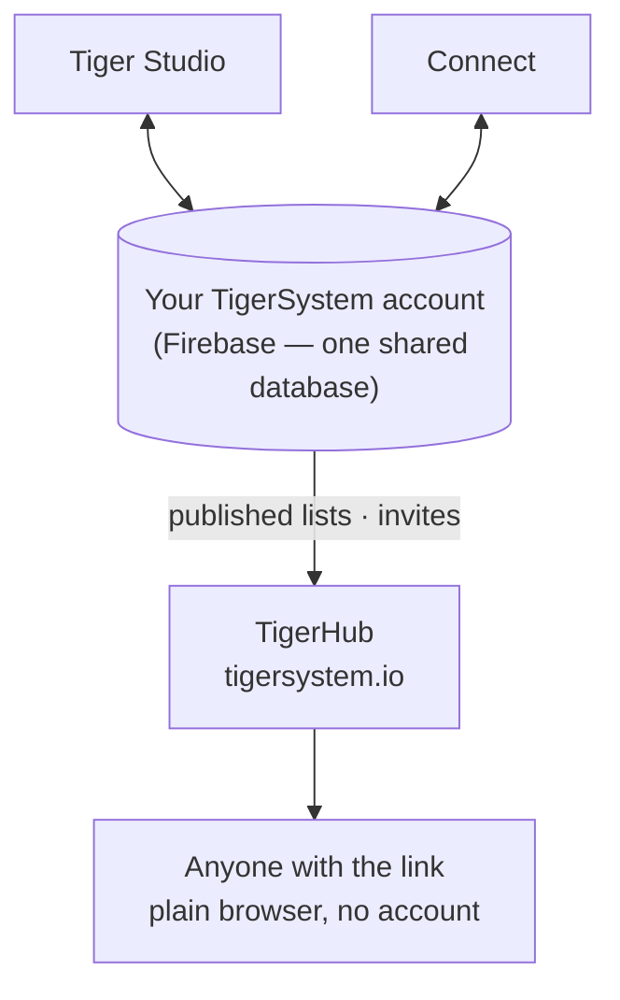

# TigerHub

## Propósito

**TigerHub es la casa del ecosistema en la web**: el sitio
**[tigersystem.io](https://tigersystem.io)**. Presenta el entorno de pruebas de
TigerSystem y lo que hace posible el protocolo abierto TigerTag, y aloja el
**lado social** de ese entorno: compartir una lista de deseos, invitar a alguien a
ser amigo, publicar una lista de solo lectura que cualquiera pueda abrir en un navegador.

## Dónde encaja

## Funciones — todas disponibles hoy

- **Escaparate del ecosistema** — la página de inicio cuenta toda la historia: cómo
 funciona, las seis marcas de impresoras, los componentes y los tres niveles
 (TigerData — seguimiento solo por software · TigerTag — el chip sin conexión ·
 TigerTag+ — autenticidad verificada).
- **Tu cuenta en la web** (`/account`) — inicia sesión en tu cuenta de TigerSystem
 desde un navegador.
- **Listas de deseos** — públicas y solo para amigos, ambas desplegadas.
- **Códigos de amigo e invitaciones** — añadíos como amigos desde la web.
- **Enlaces de lista pública** — comparte una lista en solo lectura como
 `https://tigersystem.io/wishlist/<token>`; quien la vea no necesita
 aplicación ni cuenta.
- **Catálogo de materiales y base de datos de referencia** (`/materials`, `/database`) —
 explora el catálogo compartido con el que se resuelven todas las aplicaciones.
- **Impresoras y funciones** (`/printers`, `/features`) — qué funciona con qué.
- **Modelos 3D** (`/models`) — modelos imprimibles (TigerPOD y compañía).
- **Para fabricantes, desarrolladores y prensa** (`/manufacturers`, `/developers`,
 `/press`) — la historia B2B, indicaciones de integración, recursos de medios.
- **Merchandising** (`/goodies`) — la gorra y el polo oficiales. Comprar uno es una de
 las formas de [apoyar el proyecto](../support.md).

## Un enlace de lista pública, en la práctica

Un enlace de lista pública es `https://tigersystem.io/wishlist/<token>`. Tres
cosas que conviene saber antes de pegar uno en algún sitio:

- **El token es toda la llave.** Cualquiera que tenga el enlace abre la lista:
  sin cuenta, sin aplicación, sin nada que demostrar. Trátalo como una
  contraseña que decidiste compartir: bien para una publicación en un foro o
  para un amigo, no para una lista que no querrías ver copiada más allá.
- **Hacer pública una lista es lo que crea el enlace.** En la aplicación, poner
  una lista en *pública* genera su token y publica una copia de la lista;
  volver a ponerla en privada borra esa copia y el token. Si la haces pública de
  nuevo, recibe un token **nuevo**, así que un enlace repartido antes no
  revive. TigerHub solo muestra lo que publica la aplicación.
- **Solo lectura, y dice quién la compartió.** Quien la ve ve esa única lista
  (sus elementos, y la ocasión o el mensaje si pusiste uno), nunca tu
  inventario ni tus otras listas. La página sí muestra tu **nombre visible**,
  tus **enlaces a redes sociales** y un botón *añadir como amigo* que lleva tu
  **código de descubrimiento**.

Un enlace es una de las dos formas de compartir; la otra es un amigo:

| | Enlace de lista pública | Amigo |
|---|---|---|
| Quién lo ve | cualquiera con el enlace | una persona que aceptaste |
| Necesita una cuenta | no | sí |
| Cómo | hacer pública una lista | intercambiar códigos de descubrimiento |
| Deshacer | hacer privada la lista | eliminar al amigo |

La parte de los amigos se resume aquí solo para ponerla junto al enlace; las
reglas de solicitud y eliminación, y su aplicación en el servidor, corresponden a
[Inventario y sincronización en la nube](../concepts/inventory-and-cloud-sync.md).

## TigerHub no es la base de datos

Las cuentas de usuario y los datos de todas las aplicaciones residen en **Firebase
a secas** (Auth + Firestore), una infraestructura deliberadamente sin marca:
**una única base de datos compartida, en un único lugar**, para que Tiger Studio,
Tiger NFC Connect, TigerScale y la cuenta de TigerSystem interoperen sobre los
mismos datos. TigerHub es la **superficie web** construida encima. Véase
[Inventario y sincronización en la nube](../concepts/inventory-and-cloud-sync.md).

## Interacciones

| Con | Cómo |
|---|---|
| Tiger Studio / Connect | Hacer una lista pública o privada (lo que crea o borra su enlace) y enviar invitaciones de amistad |
| Firebase (base de datos de cuentas) | Origen de los datos publicados |
| Visitantes | Navegador normal, sin necesidad de cuenta |

---

**◀ Anterior:** [Tiger Studio](./tiger-studio.md) · **▲ [Índice de la documentación](../../README.md)** · **Siguiente ▶** [TigerPOD](./tigerpod.md)

**Véase también:** [Inventario y sincronización en la nube](../concepts/inventory-and-cloud-sync.md), [Arquitectura](../architecture/overview.md)
