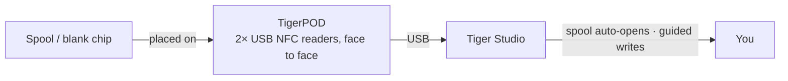

# TigerPOD

## Propósito

**El primer «reproductor de CD» para bobinas de filamento inteligentes.** TigerPOD
pone un escáner de bobinas en tu escritorio, y lo imprimes tú mismo.
Un soporte gratuito, de código abierto e imprimible en 3D que sostiene **dos**
lectores NFC USB **enfrentados**: coloca una bobina y se identifica sola en Tiger
Studio; coloca un chip en blanco y codifícalo. Tan natural como tocar con un
teléfono, pero con las manos libres en el escritorio.

*Deja la bobina; se presenta sola.*

<a class="ts-cta-primary" href="https://tigersystem.io/tigerpod">Consigue un TigerPOD</a>
<a href="https://makerworld.com/fr/models/1289152-tigerpod-for-openspool-tigertag-rfid-filament#profileId-1318958">Imprímelo — STL gratuito</a>

<a href="https://github.com/TigerTag-Project/TigerPOD"> Código fuente</a>

## Por qué dos lectores, enfrentados

Este es el sentido de toda la carcasa y lo único que hay que hacer bien. **Siempre
recomendamos dos lectores.** Técnicamente un lector funciona, pero degrada la
experiencia de dos maneras concretas:

- **Lectura.** Una bobina lleva
 [**dos chips, en caras opuestas**](../concepts/tigertag-chip.md). Con un solo
 lector, una bobina que cae del lado «equivocado» hay que levantarla y darle la
 vuelta antes de que se vea. Con un lector a cada lado, la dejes como la dejes, ya
 hay un chip delante de un lector. Nada que girar, nada que apuntar.
- **Escritura.** Cuando etiquetas tú mismo una bobina, escribes **los dos** chips.
 Un lector significa dos pasadas y dos oportunidades de que no coincidan. Dos
 lectores escriben el par **de una sola vez**, y Tiger Studio puede verificarlos
 entre sí.

El Pod existe para mantener esa geometría: dos lectores, verticales, enfrentados, a
la distancia de la bobina. Todo lo demás es una carcasa a su alrededor.

## Dónde encaja

## Dos carcasas para imprimir, ambas gratuitas

| | **TigerPOD Mini** — *recomendado* | **TigerPOD (original)** |
|---|---|---|
| |  |  |
| Impresión | Más rápida, menos filamento | Más larga, más filamento |
| Espacio en el escritorio | Menos | Más |
| Cables | Pasan **por dentro** de la carcasa | Externos |
| Etiquetas | TigerTag **y** OpenSpool (NDEF) | TigerTag **y** OpenSpool (NDEF) |
| Descarga | **[MakerWorld — TigerPOD Mini](https://makerworld.com/fr/models/3190348-tigerpod-mini-for-openspool-tigertag-rfid-filament#profileId-3609236)** | **[MakerWorld — TigerPOD original](https://makerworld.com/fr/models/1289152-tigerpod-for-openspool-tigertag-rfid-filament#profileId-1318958)** |

Ambas sostienen los mismos dos lectores de clase ACR122U enfrentados. El Mini es un
rediseño del original y es sencillamente el mejor Pod: empieza por él, salvo que
quieras específicamente el soporte más grande.

Con licencia **CC BY 4.0**: remézclalo y adáptalo con libertad.

## De qué está hecho

El STL es la carcasa; estas son las piezas que van dentro. Nada de esto es
exclusivo (sirve cualquier lector de clase ACR122U y cualquier divisor USB-C), pero
es la combinación en torno a la cual está diseñada la carcasa:

| Pieza | Cantidad | Qué es |
|---|---|---|
| **TigerTag Player** | **2** | El lector NFC USB: un dispositivo de clase ACR122U. Uno por lado, de modo que los dos chips de la bobina se alcanzan en una sola pasada. |
| **TigerTag Spliter** | 1 | USB-C a 2× USB-A, para que los dos lectores lleguen al ordenador por un solo puerto y puedan programarse en paralelo. |
| **La carcasa impresa** | 1 | **Mini** u original: ver arriba. |

### Cómo conseguir las piezas

La carcasa es una descarga gratuita; los dos lectores y el divisor son la parte que
compras. Se venden en un pack, que es la forma más barata de acabar con el par
correcto:

- **[TigerTag Player Bundle — 2 lectores + Spliter](https://www.atome3d.com/products/tigertag-player-bundle-2pcs-spliter)** (Atome3D)
- También disponible en **[tigertag.io](https://shop.tigertag.io/collections/tigertag-rfid-maker)**

> **Nota:** montar uno tú mismo y comprar uno premontado dan exactamente el mismo
> dispositivo. Valen dos lectores cualesquiera de clase ACR122U; el pack solo te
> ahorra buscarlos por separado.

## Constrúyelo

1. **Imprime una carcasa**: la Mini o la original, arriba.
2. **Consigue dos lectores compatibles con ACR122U**, en la tienda que prefieras, y
 un pack de chips NTAG 213 / 215 / 216 en blanco para escribir.
3. **Desliza un lector en cada ranura**: sin tornillos, sin pegamento, sin cableado.
4. **Conecta ambos a tu ordenador.** Un divisor lo deja en un solo cable; dos
 puertos USB funcionan igual de bien.
5. **Instala [Tiger Studio](./tiger-studio.md)**: detecta los lectores por sí solo.

Presupuesto aproximado, con las piezas compradas por separado; los precios varían
según la tienda y la región:

| Pieza | Cant. | Aprox. | Dónde |
|---|---|---|---|
| Lector NFC compatible con ACR122U | 2 | 15–25 € cada uno | [Amazon](https://amzn.to/4vok3d7) · o cualquier tienda |
| Chips NTAG 213 / 215 / 216 en blanco | 1 pack | 10–20 €: dos chips por bobina, así que un pack etiqueta muchas | [Amazon](https://amzn.to/3TzxGc7) · [chips oficiales](./tigertag.md) |
| La carcasa impresa | 1 | solo filamento | MakerWorld, arriba |
| Divisor USB (2× USB-A hembra → 1× USB-A macho) | 1 | 5–10 €, opcional | [Amazon](https://amzn.to/4plgsv8) |

> Algunos enlaces de esta tabla son **enlaces de afiliado de Amazon**: como Asociado
> de Amazon, TigerTag gana con las compras que cumplen los requisitos, **sin coste
> adicional para ti**. Ayuda a financiar el protocolo abierto. Comprar las mismas
> piezas en cualquier otro sitio funciona exactamente igual de bien.

Comprar el [kit](https://shop.tigertag.io/collections/tigertag-rfid-maker) en su
lugar cuesta menos que conseguir las mismas piezas una a una, los lectores llegan con
el logotipo oficial del proyecto y financia el estándar: una de las varias formas de
[apoyar el proyecto](../support.md). Pero construirlo con piezas genéricas **no es un
camino inferior: es el mismo Pod**. Eso es lo que significa un protocolo abierto.

### Compatibilidad de lectores

El ACR122U habla **PC/SC**, el estándar de tarjetas inteligentes a nivel de sistema
operativo que implementa todo lector de esta clase. Como el Pod se apoya en PC/SC y
no en un controlador de fabricante, la misma configuración funciona en **Windows,
macOS y Linux**, y cualquier biblioteca PC/SC puede manejarla.

## Funciones

- Carcasa imprimible en 3D: **STL gratuitos en MakerWorld**, en tamaño **Mini** y
 **original**.
- Aloja dos lectores USB de clase ACR122U, cara a cara (estaciones de lectura +
 escritura).
- Plug-and-play con [Tiger Studio](./tiger-studio.md): escanear un chip abre
 automáticamente la bobina correspondiente; el flujo guiado de actualización de chips
 lo usa para escrituras con verificación de UID.
- No está atado a TigerTag: los mismos dos lectores manejan también etiquetas
 **OpenSpool** (NDEF).

## Más que TigerTag: una estación NFC universal

El Pod **no está atado al protocolo TigerTag**. Son, literalmente, dos lectores PC/SC
estándar en un soporte con forma de bobina: **todo lo que puede hacer un ACR122U, lo
puede hacer el Pod.**

Controlas el chip por completo: leer lo que tiene, escribir algo nuevo, cambiar lo
que hay, borrarlo hasta dejarlo en blanco. Las cuatro cosas, en ambos sentidos. Sin
escritura única, sin calle de sentido único, sin dependencia de un fabricante. Y para
el filamento eso ocurre en **Dual NFC**, con los dos chips de una bobina tratados
juntos, en bobinas de cualquier marca.

El ACR122U maneja mucho más que NTAG: **ISO 14443 Tipo A y B**, **MIFARE** (Classic
1K/4K, Ultralight, DESFire), **FeliCa**, **Topaz/Jewel** y los **tipos de etiqueta
1–4 del NFC Forum**. Todo lo que puedas leer o escribir con un ACR122U, lo puedes
leer o escribir en el Pod, incluidas las etiquetas [OpenSpool](../compatibility/openspool.md).

Eso es también lo que hace real la [segunda vida](../philosophy/second-life.md). Un
TigerTag nunca está bloqueado contra escritura, así que cuando una bobina se acaba
puedes borrar sus chips y reescribirlos como TigerTags nuevos, o convertirlos en otra
cosa por completo: una etiqueta **NDEF** normal para domótica, un traspaso de Wi-Fi,
una URL, una tarjeta de visita. Y de nuevo en un TigerTag cuando quieras. El chip es
un activo reutilizable, no un embalaje de un solo uso.

## Interacciones

| Con | Cómo |
|---|---|
| Chips TigerTag | Leer / codificar / verificar, los dos chips de una bobina a la vez |
| Tiger Studio | Identificación instantánea de la bobina, promoción y actualización de chips |

## En imágenes

## Enlaces

- Repositorio: [TigerPOD](https://github.com/TigerTag-Project/TigerPOD)
- STL — **[TigerPOD Mini](https://makerworld.com/fr/models/3190348-tigerpod-mini-for-openspool-tigertag-rfid-filament#profileId-3609236)** · [TigerPOD original](https://makerworld.com/fr/models/1289152-tigerpod-for-openspool-tigertag-rfid-filament#profileId-1318958)
- Lectores: [TigerTag Player Bundle (2 uds. + Spliter)](https://www.atome3d.com/products/tigertag-player-bundle-2pcs-spliter)

---

**◀ Anterior:** [TigerHub](./tigerhub.md) · **▲ [Índice de la documentación](../../README.md)** · **Siguiente ▶** [TigerScale](./tigerscale.md)

**Véase también:** [Flujo de Segunda vida](../philosophy/second-life.md)
