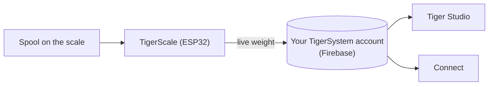

# TigerScale

## Propósito

**TigerScale responde a la eterna pregunta: ¿cuánto filamento queda?** Pon una
bobina en la báscula ESP32 de código abierto y el peso en directo fluye directamente
a tu inventario: sin introducción manual, sin sacudir la bobina junto a la oreja.

*Se pone la bobina y la báscula ya sabe qué es: el chip da la marca, el material y el
color, la celda de carga da los gramos. Nada tecleado, nada adivinado.*

<a class="ts-cta-primary" href="https://tigertag-project.github.io/Tiger-Scale-V3/">Instálala desde tu navegador</a>

<a href="https://tigersystem.io/tigerscale">TigerScale en tigersystem.io</a>
<a href="https://makerworld.com/en/models/3161869-tigerscale-v3-best-smart-filament-scale-with-nfc#profileId-3573543">Imprime la carcasa</a>
<a href="https://github.com/TigerTag-Project/Tiger-Scale-V3"> Código fuente</a>

> **El chip sabe lo que *es* el filamento; la báscula sabe cuánto *queda*.** Juntos
> hacen que el inventario sea de verdad cierto: la identidad viene de
> [TigerTag](./tigertag.md), la cantidad en directo de TigerScale.

## TigerScale V3: la generación actual

[Tiger-Scale-V3](https://github.com/TigerTag-Project/Tiger-Scale-V3), MIT.
Esta es la que hay que construir.

- **Sabe qué bobina tiene encima**: **dos lectores NFC PN532**, uno por lado; una
 [bobina con doble etiqueta](../concepts/tigertag-chip.md) se identifica la pongas
 como la pongas. Leer la etiqueta, pesar, restar el peso de la bobina vacía,
 sincronizar: sin teclear, sin adivinar.
- **ESP32-S3** (16 MB de flash, PSRAM), **pantalla táctil en color de 3,5″ y 480×320**
 (LVGL) con configuración completa en pantalla: selector de Wi-Fi + teclado, asistente
 de calibración, autodiagnóstico del hardware, actualizaciones OTA.
- **Funciona con batería** (PMIC AXP2101, estado de carga en pantalla), códec de audio.
- Pesaje de precisión: HX711 + celda de carga, filtrado por mediana + EMA adaptativo,
 ajustado para dar sensación de báscula de cocina.
- **8 idiomas de firmware**, interfaz web en 9 idiomas.
- **Seguimiento del peso en directo**: las actualizaciones aparecen en tiempo real en
 Tiger Studio y Tiger NFC Connect a través de Firestore.
- Funciona con la **calibración del peso de envases** de Tiger Studio para que el peso
 neto de filamento siga siendo preciso por tipo de envase.
- **Funciona sin conexión.** La identificación de marca y material viene de una base
 de datos alojada en la propia flash del dispositivo, actualizada como máximo una vez
 al día: una consulta de etiqueta nunca espera a la red.
- **La sincronización en la nube es opcional.** La báscula es totalmente utilizable
 sin cuenta.
- **Su propia interfaz web**, servida desde el dispositivo, adaptada al móvil, en
 directo por WebSocket a 10 Hz: sin aplicación que instalar para manejarla desde un
 teléfono.
- **Sin blobs binarios**: todo se compila desde el código fuente.

*En el banco: deja la bobina, se identifica y se pesa sola.*

## Construir una

> **¿No te va la electrónica?** Una báscula USB y un [TigerPOD](./tigerpod.md) hacen
> el mismo trabajo sin nada que cablear ni flashear: la
> [alternativa oficial sin electrónica](#una-báscula-usb-y-un-tigerpod-sin-electrónica).

La báscula es un montaje casero, y los pasos que la gente espera que sean difíciles
no lo son:

1. **Imprime la carcasa.** Un proyecto `.3mf` de Bambu Studio con las placas ya
 dispuestas — [en MakerWorld](https://makerworld.com/en/models/3161869-tigerscale-v3-best-smart-filament-scale-with-nfc#profileId-3573543).
 Ábrelo en Bambu Studio u Orca y pulsa Slice: nada que orientar, ningún soporte que
 colocar.
2. **Cablea los componentes.** Conecta la celda de carga, el HX711, el altavoz y los
 dos lectores PN532 a la placa siguiendo el [diagrama de cableado](#diagrama-de-cableado)
 de abajo: el mismo mapa de pines para cualquiera de las dos variantes de placa.
3. **Flashea desde tu navegador.** El
 [instalador web](https://tigertag-project.github.io/Tiger-Scale-V3/) sirve siempre
 la versión actual; después la báscula se actualiza sola por aire.

Las piezas son corrientes:

| Cant. | Componente | Dónde |
|---|---|---|
| 1 | Waveshare **ESP32-S3-Touch-LCD-3.5B** — táctil IPS de 480×320 (la **-3.5** sin la B también sirve) | [-3.5B](https://link.amazon/B0gaANfF5) · [-3.5](https://link.amazon/B0dpgOlOQ) |
| 2 | Módulo NFC **PN532 V3** — se requieren tira de pines **y** interruptor de modo | [Amazon](https://link.amazon/B0iTXrhjd) |
| 1 | Celda de carga de 5 kg + HX711 | [Amazon](https://link.amazon/B09LOUuI1) |
| 1 | Cable USB-C de 4 pines + conector | [cable](https://link.amazon/B0aoW8qQx) · [conector](https://link.amazon/B0aiEyjLx) |
| 1 | Batería de iones de litio — **opcional**, la báscula funciona con USB | [Amazon](https://link.amazon/B0etKlE1i) |
| — | Cables Dupont, tornillos autorroscantes M3 | [cables](https://link.amazon/B0bl6jvMs) · [tornillos](https://link.amazon/B0ekzxx1E) |
| — | 2× M4×30 y 2× M5×30 (celda de carga), 4× M2×6 (pantalla) | cualquier ferretería |
| 1 | Un pequeño altavoz | viene con la placa ESP32-S3 |

<figure>

<figcaption><strong>Las dos variantes funcionan, pero necesitan firmware distinto.</strong> Lee la serigrafía: <strong>-3.5B</strong> o <strong>-3.5</strong>. El instalador web pregunta cuál tienes; el cableado y la carcasa son los mismos en ambos casos. Si flasheas la versión equivocada, la báscula arranca perfectamente pero nunca ve una etiqueta, sin nada en pantalla que explique por qué.</figcaption>
</figure>
<figure>

<figcaption><strong>Advertencia:</strong> la celda de carga debe tener 2 orificios roscados M4 y 2 M5, y la placa HX711 debe ser idéntica a la que se muestra; de lo contrario no encajará en su ranura prevista.</figcaption>
</figure>

> Algunos enlaces de esta tabla son **enlaces de afiliado de Amazon**: como Asociado
> de Amazon, TigerTag gana con las compras que cumplen los requisitos, **sin coste
> adicional para ti**. Ayuda a financiar el protocolo abierto. Comprar las mismas
> piezas en cualquier otro sitio funciona exactamente igual de bien.

La lista de materiales completa y con costes está en el
[repositorio](https://github.com/TigerTag-Project/Tiger-Scale-V3).

### Montaje

<figure>

<figcaption>Tres cuartos frontal</figcaption>
</figure>
<figure>

<figcaption>Tres cuartos trasero</figcaption>
</figure>
<figure>

<figcaption>Tres cuartos trasero, de cerca</figcaption>
</figure>
<figure>

<figcaption>Alzado lateral</figcaption>
</figure>

<figure>

<figcaption>Posición y orientación de la báscula</figcaption>
</figure>
<figure>

<figcaption>PN532 asentado en su ranura</figcaption>
</figure>

### Diagrama de cableado

*[Esquema interactivo en Cirkit Designer](https://app.cirkitdesigner.com/project/c6aa6c0a-9462-498f-8923-9ad4454e0e69)*

### Solución de problemas

**¿No se detecta ningún puerto COM para el ESP32-S3 en el [instalador web](https://tigertag-project.github.io/Tiger-Scale-V3/)?**

Puede que falte un controlador para tu sistema. [Sigue la guía de instalación del controlador](../tutorials/tigerscale-serial-port-driver.md).

## Tuya para fabricar y vender

**Cualquiera puede fabricar y vender hardware TigerScale. Sin tasa de licencia, sin
regalías, sin registro.** Constrúyela, flashea el firmware oficial, envíala.

La única condición para llamar **TigerScale** a tu producto es ejecutar ese firmware
oficial **sin modificar**, para que cada unidad se comporte igual dentro del
ecosistema. Bifúrcalo si quieres cambiarlo, y dale otro nombre a la bifurcación. Ese
es todo el trato.

## Dónde encaja

## La historia hasta ahora

Tres generaciones, y la forma de la cosa cambió en cada una:

| | Lectura | Pantalla | Placa | Factor de forma |
|---|---|---|---|---|
| **V1** — nunca publicada | **un** PN532 | mini OLED | ESP32 | un **soporte de bobina**: un soporte central que atraviesa el centro de la bobina |
| **V2** — [Tiger-Scale](https://github.com/TigerTag-Project/Tiger-Scale), MIT | 2× RC522 | OLED de 0,96″ | ESP32-WROOM, alimentada por USB | una báscula plana |
| **V3** — [Tiger-Scale-V3](https://github.com/TigerTag-Project/Tiger-Scale-V3), MIT | 2× PN532 | pantalla táctil en color de 3,5″ | ESP32-S3, batería | una báscula plana, autónoma |

La V1 ya llevaba esencialmente la electrónica de la V2 (ESP32, mini OLED, una placa
HX711 con una celda de carga de 5 kg), pero con un **único** lector y un cuerpo
completamente distinto.

> **La V3 es hardware distinto, no una actualización de firmware.** Las dos no son
> intercambiables: una V2 que ya hayas construido conserva su propio repositorio y
> sigue funcionando. Simplemente ya no se desarrolla.

Las tres son totalmente de código abierto (MIT) con piezas corrientes: la prueba viva
de que un ESP32 y un módulo lector NFC (clase PN532 / RC522) bastan para construir un
dispositivo que lea TigerTag.

## Una báscula USB y un TigerPOD, sin electrónica

La **alternativa oficial para quien no quiere construir una báscula**. Una báscula USB
estándar y un [TigerPOD](./tigerpod.md), ambos conectados al ordenador, y Tiger Studio
hace el resto: nada que soldar, cablear ni flashear.

1. **Conecta la báscula a tu ordenador** por USB.
2. **Coloca el TigerPOD encima**: el Mini o el original.
3. **Tara la báscula**, con el TigerPOD encima.
4. **Abre Tiger Studio.**
5. **Pon una bobina en el TigerPOD.** Lee los chips de la bobina y Tiger Studio abre
 su ficha.
6. **La báscula la pesa**, y Tiger Studio actualiza el peso de la bobina por sí solo.

### Qué básculas funcionan

Tiger Studio lee los **dispositivos USB «HID Scale»** estándar (página de uso HID
`0x8D`, uso `0x20`): empezando por la **DYMO M5** y el resto de la serie DYMO M (M10,
M25… mismo protocolo), y **cualquier HID Scale compatible**, sea cual sea la marca. La
báscula es hardware de terceros, no un producto Tiger; la configuración a su
alrededor es oficial y cuenta con soporte.

Protocolo, validado en hardware real: *Scale Data Reports* de 6 bytes a ~1 Hz:

| Byte | Significado |
|---|---|
| `[0]` | id de informe `0x03` |
| `[1]` | estado: 1 fallo · 2 estable a cero · 3 en movimiento · 4 estable · 5 negativo · 6 sobrecapacidad |
| `[2]` | unidad (códigos HID PoS): `0x02` gramo · `0x0B` onza · `0x0C` libra |
| `[3]` | exponente de potencia de diez con signo aplicado al valor bruto |
| `[4..5]` | peso, LE16 (LSB, MSB) |

ID de fabricante de DYMO `0x0922`; la M5 es pid `0x8009`. Particularidad: el primer
fotograma justo después de una tara informa de la unidad `0x00`.

> **La DYMO M2 no es compatible**: no tiene puerto USB en absoluto, así que no hay
> nada que conectar a un ordenador. El protocolo es lo de menos.

## Interacciones

| Con | Cómo |
|---|---|
| Firebase (base de datos de la cuenta) | Escribe el peso en directo en la cuenta del usuario |
| Tiger Studio / Connect | Muestran el peso en directo; supervisión del estado |

## Enlaces

- **V3 (actual)**: [Tiger-Scale-V3](https://github.com/TigerTag-Project/Tiger-Scale-V3) (MIT)
- Flashéala desde tu navegador: [instalador web](https://tigertag-project.github.io/Tiger-Scale-V3/)
- Imprime la carcasa: [MakerWorld](https://makerworld.com/en/models/3161869-tigerscale-v3-best-smart-filament-scale-with-nfc#profileId-3573543)
- V2, ya no se desarrolla: [Tiger-Scale](https://github.com/TigerTag-Project/Tiger-Scale) (MIT)

---

**◀ Anterior:** [TigerPOD](./tigerpod.md) · **▲ [Índice de la documentación](../../README.md)** · **Siguiente ▶** [Compatibilidad](../compatibility/README.md)

**Véase también:** [Inventario y sincronización en la nube](../concepts/inventory-and-cloud-sync.md)
