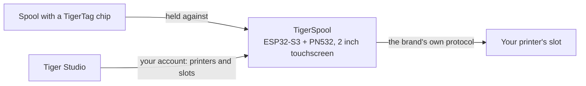

# TigerSpool

**Una pequeña caja junto a la impresora. Toca una ranura, acerca una bobina y el
filamento se escribe en esa ranura, en cualquier marca de impresora.**

*La caja, una bobina y las ranuras de la propia impresora en pantalla, cada una
mostrando lo que tiene cargado. Elige una ranura, acerca la bobina a la caja, listo.*

<a class="ts-cta-primary" href="https://tigertag-project.github.io/TigerSpool-RFID/">Instálalo desde tu navegador</a>

<a href="https://github.com/TigerTag-Project/TigerSpool-RFID"> Código fuente</a>

Tu impresora ya guarda una lista de ranuras. Tu bobina ya lleva su propia
[identidad](../concepts/universal-filament-identity.md). TigerSpool son los treinta
centímetros entre las dos: sin aplicación que abrir, sin teclado, nada que volver a
teclear de lo que el chip ya sabe.

Código abierto bajo **MIT**, ESP32-S3, unos **40 €** de piezas corrientes.

## Qué hace

1. **Toca la ranura** que quieras en la pantalla táctil: son los mismos nombres de
 ranura que usa la propia impresora.
2. **Acerca la bobina a la caja.** El [chip TigerTag](../concepts/tigertag-chip.md) se
 lee al contacto, y la asignación sale de inmediato hacia la impresora, con el
 protocolo propio de esa marca: material, marca, color y temperaturas, en la ranura
 correcta. No hay nada que confirmar.
3. **Carga la bobina.** La caja te dice a qué ranura fue.

Habla nueve idiomas, pregunta cuál antes que nada y se actualiza sola por aire.

:::caution[Advertencia]
Escanear un TigerTag sobre una ranura en la pantalla no carga
nada: solo le dice a la impresora lo que la bobina *es*. **Sigues teniendo que
poner físicamente la bobina en esa ranura tú mismo**: el CFS, el AMS, la unidad ACE
o como llame esa impresora a su propia bandeja. Si lo omites, la impresora informa de
que no hay filamento, porque de verdad no hay ninguno cargado.
:::

## Dónde encaja

TigerSpool no es un escritor de chips: eso es trabajo del [TigerPOD](./tigerpod.md),
en el escritorio. TigerSpool toma una identidad que ya existe y la pone donde la
impresora la espera.

## Qué tiene que existir antes

**Esto es lo que pilla a la gente, así que va antes del hardware.**

La caja no tiene teclado ni forma de teclear la dirección de una impresora, a
propósito. Lee tus impresoras **de tu cuenta de TigerSystem**, lo que significa que
dos cosas deben existir antes de que sea útil:

1. **Una cuenta, creada en [Tiger Studio](./tiger-studio.md).** La caja inicia sesión
 en ella, por email o con Google mediante un código QR, de modo que nunca se teclea
 una contraseña en una pantalla de dos pulgadas.
2. **Tus impresoras, añadidas en Tiger Studio.** Dirección, código de acceso, marca y
 modelo viven allí.

Si te lo saltas, la lista de impresoras de la caja estará **vacía**. Eso no es un
fallo y no hay nada que reparar en el dispositivo: te está mostrando exactamente lo
que contiene tu cuenta. Añade la impresora en Tiger Studio y aparecerá en la próxima
sincronización.

> **En resumen:** Tiger Studio → crea una cuenta → añade tus impresoras → *después*
> configura la caja.

## Qué impresoras

**Las seis marcas que integra Tiger Studio están cubiertas**: escritas y probadas en
hardware. No son todas las impresoras del mercado, y *«cualquier impresora»* sigue
siendo el objetivo; son todas las marcas con las que este ecosistema habla hoy:

| Marca | Firmware | Transporte |
|---|---|---|
| [Creality](../compatibility/creality.md) | implementado, probado | WebSocket |
| [FlashForge](../compatibility/flashforge.md) | implementado, probado | HTTP |
| [Bambu Lab](../compatibility/bambu-lab.md) | implementado, probado | MQTT sobre TLS |
| [Snapmaker](../compatibility/snapmaker.md) | implementado, probado | Moonraker sobre WebSocket |
| [Elegoo](../compatibility/elegoo.md) | implementado, lectura probada; escritura aún no confirmada en una impresora | MQTT |
| [Anycubic](../compatibility/anycubic.md) | implementado, lectura probada; escritura aún no confirmada; solo modo LAN | MQTT sobre TLS |

Los nombres de las ranuras siguen los de la impresora: `Ext.` y `1A`–`1D` en Creality
y FlashForge, `A1`–`A4` y luego `B1`–`B4` en Bambu Lab, `E1`–`E4` en Snapmaker,
`S1`–`S4` en el Canvas de Elegoo, y una letra por unidad ACE en Anycubic: `A1`,
`A2`… y luego `B1`… para una segunda caja.

Consulta el [estado por marca](https://github.com/TigerTag-Project/TigerSpool-RFID/blob/main/docs/PRINTER-COMPATIBILITY.md)
antes de comprar piezas para una máquina concreta.

## Constrúyelo

Tres cosas que comprar, cuatro cables, una carcasa impresa, más dos extras que
conviene considerar. **La electrónica es idéntica para todas las marcas de
impresora**; solo cambia la carcasa, y eso es lo que mantiene un solo firmware y una
sola lista de piezas.

| Cant. | Componente | Dónde |
|---|---|---|
| 1 | Placa de desarrollo Waveshare **ESP32-S3-Touch-LCD-2** — táctil capacitiva IPS de 2,0" y 240×320, ESP32-S3**R8**, 16 MB de flash, 8 MB de PSRAM octal. Pantalla, panel táctil y MCU en una sola placa, y los 16 MB son lo que hace cómodos dos ranuras OTA | [Amazon](https://link.amazon/B0c5hr3uf) |
| 1 | Módulo NFC **PN532 V3** — interruptores DIP, debe admitir **HSU/UART**, ambos interruptores en `0` / OFF. Un pack de dos cuesta apenas más que uno | [Amazon](https://link.amazon/B0dyEfwKa) |
| 1 | Un cable USB-C **que transmita datos** — la velocidad es irrelevante, vale cualquier cable de datos USB 2.0 | [Amazon](https://link.amazon/B00Xg3WT4) |
| 1 | Conector USB-C magnético — **recomendado**: el puerto es la pieza que se maneja a diario, y así es el cable el que cede en lugar del enchufe | [Amazon](https://link.amazon/B0bWVIBa0) |
| 1 | Celda LiPo de 3,7 V y 1000 mAh, PH1.25 — **opcional**, se carga por USB; entonces la caja funciona sin cable. La placa no puede detectar una celda, así que la declaras en Ajustes › Batería. Comprueba la polaridad | [Amazon](https://link.amazon/B0fL0jjf3) |

> Algunos enlaces de esta tabla son **enlaces de afiliado de Amazon**: como Asociado
> de Amazon, TigerTag gana con las compras que cumplen los requisitos, **sin coste
> adicional para ti**. Ayuda a financiar el protocolo abierto. Comprar las mismas
> piezas en cualquier otro sitio funciona exactamente igual de bien.

Los **cuatro cables puente vienen con el PN532**: 3V3, GND, TX, RX, y ese es todo el
arnés. Sin conversores de nivel: el PN532 funciona a 3V3, igual que la placa. Una
batería es **opcional**: la caja normalmente está junto a una impresora que ya está
enchufada, y la celda de arriba es para cuando no lo está.

*Todo el arnés. En el PN532 los dos pines de datos están serigrafiados como `SDA` y
`SCL`; en modo HSU transportan la UART: el **TX de la placa va a `SCL`**, su **RX a
`SDA`**, y ambos interruptores DIP están en `0` / OFF.
[Esquema interactivo](https://app.cirkitdesigner.com/project/5b546f4e-70b8-4735-afff-be6bd36bc10c).*

**El flasheo se hace desde el navegador**: conecta la placa, haz clic en Install y
espera un minuto. Chrome, Edge u Opera en un ordenador; Safari y Firefox no
implementan WebSerial, y ningún navegador móvil lo hace.

**[Instálalo desde tu navegador →](https://tigertag-project.github.io/TigerSpool-RFID/)**

### Tres trampas que conviene conocer antes de pedir

- **El lector va en GPIO43/44, nunca en GPIO6/7.** Ese par es un bus I²C con
 pull-ups en esta placa: un PN532 cableado ahí se enciende, responde y devuelve UIDs
 aleatorios con lecturas fallidas. Parece una etiqueta mala. No lo es, y cuesta un
 día.
- **`TXD` se cruza con el RX de la placa, `RXD` con su TX.** Transmitir habla con
 recibir. Si el lector informa de la versión de firmware 0 al arrancar, intercambia
 esos dos antes de cambiar nada más.
- **Un cable USB solo de carga hace que una placa que funciona parezca muerta.** La
 pantalla se enciende y nunca aparece un puerto serie, así que el instalador web no
 encuentra dónde instalar. Usa un cable que sepas que transfiere archivos.

Waveshare vende varias placas parecidas; las de 1,28", 1,69" y 3,5" de la misma
familia tienen controladores de panel y mapas de pines distintos, y este firmware no
funcionará correctamente en ellas. Comprueba la serigrafía, no el título del anuncio.

Lista completa de piezas, diagrama de cableado y lista de comprobación de puesta en
marcha: [TigerSpool-RFID](https://github.com/TigerTag-Project/TigerSpool-RFID).

## Dónde estamos hoy

Escrito en lugar de descubierto:

- **La primera carcasa impresa está publicada**: un soporte de escritorio
 independiente, con la bobina a la izquierda o a la derecha, en
 [Model3D/](https://github.com/TigerTag-Project/TigerSpool-RFID/tree/main/Model3D).
 Las carcasas que se montan en una impresora concreta siguen la misma regla: misma
 placa, mismo lector, los mismos cuatro cables, la misma entrada USB-C; así una sola
 imagen de firmware funciona en todos los modelos y cualquiera puede aportar una sin
 tocar código.
- **El firmware no está firmado.** Su conexión de actualización se verifica contra el
 almacén de certificados raíz, así que la caja sabe con quién habla, pero no quién
 produjo la imagen.
- **Diez impresoras conectadas a la vez, como máximo** (de las 24 que una cuenta puede
 darle) y no más de tres que hablen TLS (Bambu Lab, Anycubic), que son las que más
 memoria cuestan.

---

**▲ [Índice de la documentación](../../README.md)** · **Véase también:** [TigerPOD](./tigerpod.md), [Tiger Studio](./tiger-studio.md), [El chip TigerTag](../concepts/tigertag-chip.md), [Compatibilidad de impresoras](../compatibility/README.md)
