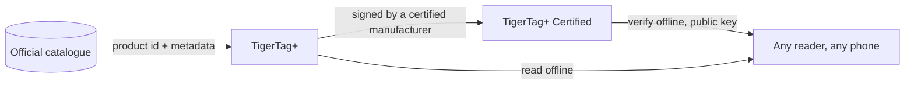

# TigerTag+ Certified

## Propósito

**Certified es el nivel que puede demostrar de dónde viene un chip.** Un
[TigerTag+](./tigertag-plus.md) que además lleva una **firma criptográfica** es un
**TigerTag+ Certified**. La firma la escribe un fabricante con la
[certificación TigerTag+](../developers/README.md), al que se le entregan para ello
las herramientas de firma; la clave privada la conserva TigerTag.

Es el único de los tres niveles que no está abierto a todo el mundo, y el único que
responde a una pregunta que los otros dos no pueden: *¿es auténtica esta bobina?*

## Los tres niveles, lado a lado

| | TigerTag | TigerTag+ | TigerTag+ Certified |
|---|---|---|---|
| Datos de impresión, **en el chip** | ✅ | ✅ | ✅ |
| Funciona totalmente sin conexión | ✅ | ✅ | ✅ |
| ID de producto del catálogo, **en el chip** | — | ✅ | ✅ |
| Metadatos de enriquecimiento, **mediante la API web, opcionales** | — | ✅ | ✅ |
| Firma de origen, **en el chip** | — | — | ✅ |
| Quién puede producirlo | todo el mundo | todo el mundo | **un fabricante certificado** |

Lee con atención la columna izquierda: los metadatos de enriquecimiento son la única
fila que **no** reside en el chip. Se consultan en el catálogo cuando estás en línea,
y pueden mejorar después de escribir el chip, y precisamente por eso nunca pueden ser
algo que el chip necesite. Todo lo que exige la impresora está en las filas marcadas
*en el chip*, y eso es lo que mantiene los tres niveles 100 % sin conexión.

## Verificar es gratis; emitir es lo que concede la certificación

**Verificar** una firma es gratuito, funciona sin conexión y sin restricciones: las
claves públicas están publicadas y cualquier lector puede comprobarla sin cuenta ni
red. **Emitir** una es lo que concede la certificación.

El mensaje firmado cubre deliberadamente el **UID propio** del chip, de modo que una
carga útil firmada y copiada en otro chip deja de coincidir: una etiqueta clonada
falla la verificación, en el propio teléfono del cliente. La misma propiedad explica
por qué los dos chips de una misma bobina llevan dos firmas *distintas*
([cómo se vinculan los dos chips](../concepts/tigertag-chip.md)).

## Dónde encaja

La disposición a nivel de byte —los ID de tipo de chip, el área de firma de 64
bytes en las páginas `0x18`–`0x27`— está especificada en
[TigerTag-RFID-Guide](https://github.com/TigerTag-Project/TigerTag-RFID-Guide).

## Quién está certificado

La lista oficial de los fabricantes autorizados a poner la marca en un producto es
el [registro de socios certificados](../certified-partners.md). El logotipo o el
nombre TigerTag en un chip de cualquier formato, un soporte, una bobina o su
embalaje solo está autorizado para los fabricantes de esa página.

---

**◀ Anterior:** [TigerTag+](./tigertag-plus.md) · **▲ [Índice de la documentación](../../README.md)** · **Siguiente ▶** [Tiger NFC Connect](./tigertag-connect.md)

**Véase también:** [El chip TigerTag](../concepts/tigertag-chip.md), [Socios certificados](../certified-partners.md), [Documentación para desarrolladores](../developers/README.md)
