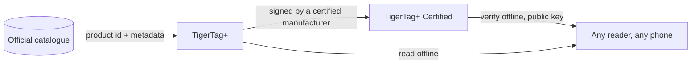

# TigerTag+

## Propósito

**El `+` significa identificado.** Un TigerTag+ es un TigerTag cuya identidad lleva
un **ID de producto del catálogo oficial**: no valores que alguien escribió, sino el
producto exacto: marca, color, material, temperaturas, diámetro, SKU, EAN,
directamente de la fuente. Además, puede llevar **metadatos de enriquecimiento
opcionales**, servidos por la Web API y mejorables después de escribir el chip.

El propio chip sigue siendo **100 % sin conexión**. Todo lo necesario para imprimir
está en él, exactamente como en un TigerTag estándar: el ID de catálogo añade la
posibilidad de consultar datos más ricos y recientes *cuando estás en línea*, y no
quita nada cuando no lo estás. Un TigerTag+ leído en modo avión se comporta como
cualquier otro TigerTag.

Y *«en línea»* tampoco es un requisito. Toda la referencia se publica como un único
archivo (cada id de cada filamento de la base de datos, libre para que cualquiera lo
copie y lo replique), de modo que un lector que lo tenga resuelve un ID de catálogo
sin red alguna. Consulta [la Web API](../developers/web-api.md).

Es el mismo `+` que en [TigerData+](../concepts/universal-filament-identity.md): en
ambos casos significa *esta identidad es un producto real del catálogo*, y en ninguno
significa *certificado*.

> **Nota sobre el nombre:** vendido antes como **«TigerTag Pro»**; el nombre ahora es
> **TigerTag+**.

## Qué añade el `+`

| | TigerTag | TigerTag+ |
|---|---|---|
| Datos de impresión, **en el chip** | ✅ | ✅ |
| Funciona totalmente sin conexión | ✅ | ✅ |
| ID de producto del catálogo, **en el chip** | — | ✅ |
| Metadatos de enriquecimiento, **vía la Web API, opcionales** | — | ✅ |
| Quién puede producir uno | todo el mundo | todo el mundo |

Los metadatos de enriquecimiento son la única fila que **no** vive en el chip. Se
consultan en el catálogo cuando estás en línea, y pueden mejorar después de escribir
el chip, que es precisamente la razón de que nunca puedan ser algo que el chip
necesite. Todo lo que la impresora requiere está en el chip, y eso es lo que mantiene
cada nivel 100 % sin conexión.

## La variante firmada

Un TigerTag+ que además lleva una firma criptográfica es un
**[TigerTag+ Certified](./tigertag-plus-certified.md)**: el nivel que puede probar el
origen de una bobina y el único restringido a fabricantes certificados. Verificar una
firma sigue siendo gratis y sin conexión para todo el mundo.

## Dónde encaja

## Copia de seguridad de un chip: una función aparte

Tiger Studio puede **respaldar el contenido exacto de un chip** en tu cuenta, ligado
a su UID físico, y más tarde reprogramarlo para devolverlo a ese estado. Es útil y no
tiene relación con el `+`: se aplica a cualquier chip que puedas escanear, y tener una
copia de seguridad no convierte un chip en un TigerTag+.

- **Restauración al estado de fábrica**: si un chip se reescribe por accidente o se
 corrompe, déjalo exactamente como estaba, firma incluida si la tenía.
- **Solo el mismo chip**: la restauración es válida en el chip original, porque la
 copia de seguridad está ligada a su UID. Una salvaguarda para *ese* chip, nunca una
 forma de clonar.
- **Prueba de posesión**: un escaneo que coincide con la copia de seguridad muestra
 que el chip original está físicamente en tus manos.

> **Nota:** crear una copia de seguridad requiere actualmente **Tiger Studio + un
> lector USB (TigerPOD / ACR122U)**; la compatibilidad móvil está prevista.

## Interacciones

| Con | Cómo |
|---|---|
| Tiger Studio + TigerPOD/ACR122U | Lee y verifica firmas; crea y restaura copias de seguridad de chips |
| Tiger NFC Connect | Lee y verifica; compatibilidad con copias de seguridad próximamente |
| SDKs | `tigertag[verify]` comprueba una firma sin conexión, en Python o JS |
| Firebase (base de datos de la cuenta) | Contiene el catálogo, los metadatos de enriquecimiento y las copias de seguridad de chips por cuenta |

## Enlaces

- Chips oficiales: **[tigertag.io](https://tigertag.io)** (tienda)

---

**◀ Anterior:** [TigerTag](./tigertag.md) · **▲ [Índice de la documentación](../../README.md)** · **Siguiente ▶** [TigerTag+ Certified](./tigertag-plus-certified.md)

**Véase también:** [Identidad universal del filamento](../concepts/universal-filament-identity.md), [El chip TigerTag](../concepts/tigertag-chip.md), [Documentación para desarrolladores](../developers/README.md)
