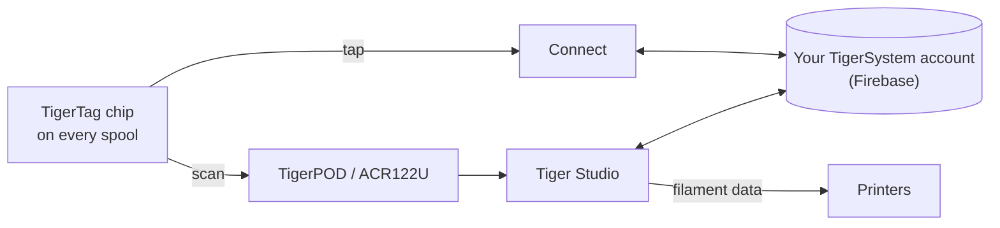

# TigerTag

## Propósito

**TigerTag da a cada bobina una memoria propia.** Un pequeño chip NFC guarda todo
sobre el filamento (marca, material, color, cómo le gusta que lo impriman), así que
nunca tienes que adivinar, etiquetar ni recordar. Tócalo con el teléfono y la bobina
te lo cuenta ella misma.

<a class="ts-cta-primary" href="https://tigersystem.io/tigertag">Qué es TigerTag — en tigersystem.io</a>

<a href="https://github.com/TigerTag-Project/TigerTag-RFID-Guide"> La especificación abierta del chip</a>

Técnicamente, es el corazón del ecosistema: un estándar RFID abierto, legible por
cualquier aplicación o lector compatible, sin dependencia de un proveedor y sin
formato secreto.

## Dónde encaja

## Funciones

- Chip estándar **NTAG213 / 215 / 216** (se recomienda redondo de 25 mm), carga útil
 NDEF abierta de 144 bytes, dimensionada para caber en el NTAG213 más pequeño; sin
 claves, sin dependencia.
- **Dos chips por bobina, en lados opuestos**: uno siempre mira al lector (ranura de
 la impresora, AMS, teléfono en la mano) y cada uno respalda al otro
 ([por qué](../concepts/tigertag-chip.md)).
- Identidad resuelta contra la [base de datos de referencia](../concepts/universal-filament-identity.md) compartida.
- Escribible y **reescribible**: permite el [flujo Segunda vida](../philosophy/second-life.md);
 los chips oficiales de marca se entregan como NTAG215 para que el propio chip pueda
 reutilizarse como un objeto NDEF normal (llavero, tarjeta de visita…) cuando la
 bobina esté vacía; nunca residuo electrónico.
- Legible por cualquier smartphone NFC, lectores ACR122U y el [TigerPOD](./tigerpod.md).
- Un **área reservada de 64 bytes** (páginas `0x18`–`0x27`, que deja 80 bytes de
 datos): libre para **funciones adicionales de la comunidad** en un TigerTag
 estándar; en un [TigerTag+](./tigertag-plus.md) lleva la firma de origen: 32 bytes
 de `R`, 32 de `S`.

## Arquitectura

Consulta [El chip TigerTag](../concepts/tigertag-chip.md) para el resumen del formato
y [TigerTag-RFID-Guide](https://github.com/TigerTag-Project/TigerTag-RFID-Guide)
para la especificación canónica a nivel de byte.

## Interacciones

| Con | Cómo |
|---|---|
| Tiger NFC Connect | Toque NFC: leer, codificar |
| Tiger Studio | El escaneo del lector abre automáticamente la bobina; actualización guiada del chip |
| SDKs | Analizar / verificar / codificar desde JS o Python |
| Impresoras | Indirectamente: a través del [puente del smartphone](../philosophy/smartphone-bridge.md) y de los enlaces de Studio con las impresoras |

## En imágenes

> **Nota sobre el nombre:** los chips estándar se vendían antes como **«TigerTag
> Maker»**; el nombre ahora es simplemente **TigerTag**.

## Los chips oficiales y los de los demás

**TigerSystem fabrica los chips oficiales** y les pone el logotipo de TigerTag.
Vienen en dos formatos, y ambos se entregan **en blanco**:

| Formato | Para |
|---|---|
| **Pegatina** | cualquier bobina que ya tengas: una en cada lado ([por qué dos](../concepts/tigertag-chip.md)) |
| **Soporte de refill** | [refills](../philosophy/second-life.md) de filamento con núcleo de cartón: un soporte ya lleva **los dos chips**, va dentro del núcleo antes de que el refill se monte en una bobina maestra reutilizable, de modo que el chip viaja con el filamento, no con el carrete |

Quién puede decir qué cuando se vende un chip:

| Quién | Qué vende | Puede llamarlo | Logotipo |
|---|---|---|---|
| **TigerSystem** | los chips que fabrica | **oficial**: hecho por nosotros | sí: aplica la marca |
| **Cualquier revendedor o distribuidor** | esos mismos chips genuinos | **oficial**: lo es la mercancía | sí: la marca ya está en ellos |
| **Un tercero auditado por TigerSystem** | cualquier cosa que haya construido: chips, inlays, soportes, un dispositivo, una aplicación | **certificado**: concedido, auditado, listado, retirable | sí, en el producto |
| **Cualquiera que haga su propio chip** | su propio chip compatible | *«compatible con TigerTag»*, y con **TigerTag+** si verifica firmas. Nunca *«certificado»*, que solo concede TigerSystem | en su aplicación, documentación y ficha de tienda; *«Compatible con TigerTag»* en texto plano en la caja de un dispositivo compatible; **nunca el logotipo ni el nombre en el chip (en ningún formato), soporte, bobina ni embalaje** |

Esa última distinción es toda la política de marca, y es más estrecha de lo que
parece. Decir que tu producto *habla con* TigerTag es un hecho sobre tu producto, y
mostrar el logotipo para decirlo es gratis. Poner la marca (logotipo o nombre)
**en** un chip de cualquier formato es una afirmación sobre **quién lo fabricó**:
deja de significar «esto funciona con TigerTag» y empieza a significar «esto *es* un
TigerTag». Solo ese segundo uso necesita autorización por escrito. Consulta
[TRADEMARK.md](../../TRADEMARK.md).

Se han producido más de **2,5 millones de chips TigerTag**, la mayoría integrados en
fábrica por marcas de filamento (Rosa3D, eSun, Sunlu, Landu, Jamg He, R3D, con
Filforme, Nanovia y más en proceso de integración). Todas son
[socios certificados](../certified-partners.md); esa página es el registro y la
única forma autorizada de comprobar que una marca en una caja es legítima.

|| | |
|---|---|---|
|  |  |  |

|| | | |
|---|---|---|---|
|  |  |  |  |

*Las cajas y las bobinas que llevan dentro, compradas en una tienda, no montadas para
una foto. Así es «el más desplegado».* Pero el protocolo deliberadamente **no está
atado a chips oficiales**: cualquier chip NTAG en blanco y barato comprado donde sea
(Amazon, AliExpress, en tiendas locales) funciona igual, y nada lo bloquea. Los chips
de marca ayudan a financiar la I+D; la adopción del protocolo es la primera
recompensa. Otras formas de ayudar, incluidas las que no cuestan nada, están en
[Apoya el proyecto](../support.md).

La libertad funciona en ambos sentidos: **los chips nunca están bloqueados contra
escritura**. TigerTag es simplemente el protocolo base con el que las fábricas de
filamento envían las bobinas; si prefieres otro protocolo NFC/RFID (a medida o ya
existente), puedes reescribir el chip y migrar sus datos a él. Tu bobina, tu chip, tu
formato.

## Dónde comprarlos

Ambos formatos se entregan **en blanco**, y ambos los venden TigerSystem y sus
revendedores:

| | **Pegatina** | **Soporte de refill** |
|---|---|---|
| Qué obtienes | chips adhesivos redondos de 25 mm: **dos por bobina**, uno en cada lado | un soporte = **dos chips ya emparejados**, uno por extremo plegado, para el núcleo de cartón |
| Para | cualquier bobina con bridas | refills de filamento montados en una bobina maestra |
| Tienda oficial | [tigertag.io](https://shop.tigertag.io/collections/tigertag-rfid-maker) | [tigertag.io](https://shop.tigertag.io/collections/tigertag-rfid-maker) |
| Revendedor (FR) | [TigerTag Officiel, Atome3D](https://www.atome3d.com/products/tigertag) | [TigerTag Refill Officiel, Atome3D](https://www.atome3d.com/products/tigertag-pro-for-refill-1000-pcs) |

Ambos vienen en varios tamaños de paquete, hasta cantidades profesionales. Y nada de
esto es obligatorio: **cualquier chip NTAG en blanco comprado donde sea funciona
igual**; comprar los oficiales financia el protocolo, nada más.

## Enlaces

- Chips oficiales: **[tigertag.io](https://tigertag.io)** (tienda: financia la I+D)
- Formato del chip: [TigerTag-RFID-Guide](https://github.com/TigerTag-Project/TigerTag-RFID-Guide)

---

**◀ Anterior:** [Productos](./README.md) · **▲ [Índice de la documentación](../../README.md)** · **Siguiente ▶** [TigerTag+](./tigertag-plus.md)

**Véase también:** [Identidad universal del filamento](../concepts/universal-filament-identity.md), [Segunda vida](../philosophy/second-life.md)
