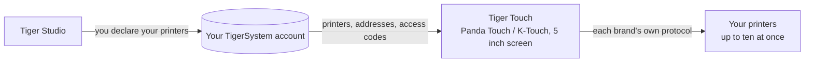

# Tiger Touch

**Tu Panda Touch está en un cajón. Dale todas las impresoras que tienes.** Un
firmware gratuito y de código abierto que convierte la BIGTREETECH Panda Touch y la
K-Touch en una única pantalla táctil en directo para todas tus impresoras 3D: sin
soldar, sin ordenador.

*Dos tarjetas de impresora en directo en una pantalla: una FlashForge AD5X y una Bambu Lab X1C.*

<a class="ts-cta-primary" href="https://tigertag-project.github.io/Tiger-Touch/">Instálalo desde tu navegador</a>

<a href="https://github.com/TigerTag-Project/Tiger-Touch"> Código fuente</a>

BIGTREETECH vende una pequeña pantalla táctil de 5" con dos nombres: la **Panda
Touch**, hecha para impresoras Bambu Lab, y la **K-Touch**, hecha para impresoras
Klipper. La misma placa, dos firmwares, cada uno atado a una familia de máquinas.
Cambias de impresora y la pantalla acaba en un cajón.

**Tiger Touch es un firmware nuevo para esa misma pantalla**, escrito desde cero.
Inicia sesión en tu cuenta gratuita de TigerTag, encuentra todas las impresoras que
declaraste allí y habla con cada una directamente, con su propio protocolo, a la vez.
Si tienes una Panda Touch o una K-Touch que ya no encaja con tus impresoras, es el
hardware para el que se hizo Tiger Touch.

Código abierto bajo **MIT**. Nada que soldar, nada que imprimir, sin Raspberry Pi,
sin servidor intermedio: conectas la pantalla a un puerto USB, pulsas **Install** en
tu navegador y dos minutos después muestra tus impresoras.

## Qué hace

- **Todas las marcas en una pantalla** — Bambu Lab, Creality, Elegoo, Anycubic,
  Snapmaker, FlashForge, Prusa, además de cualquier máquina Klipper (Moonraker) u
  OctoPrint.
- **Nube y LAN** — Bambu Lab a través de la nube de Bambu o en modo LAN, Anycubic a
  través de la nube de Anycubic o en la LAN, las demás en tu red local.
- **En directo, todas** — estado, progreso, archivo, tiempo restante y hora de fin,
  boquillas, cama, cámara y unidades de filamento (carriles AMS, CFS, Station, ACE,
  MMU / AFC), con hasta **diez impresoras** seguidas a la vez.
- **Controles seguros** — pausa, reanudar, parar (una pulsación de 1,5 s, para que un
  dedo despistado nunca acabe una impresión) y la luz de la impresora. **Nunca se
  envía nada más**: ni calentar, ni mover, ni iniciar una impresión.
- **Se actualiza sola** — las versiones nuevas llegan por Wi-Fi, verificadas antes de
  instalarse, y se revierten solas si no arrancan.
- **Once idiomas** — inglés, francés, alemán, español, italiano, chino, portugués
  (Brasil y Portugal), polaco, ruso, neerlandés.

<figure>

<figcaption><strong>Tarjetas</strong>: una tarjeta en directo por impresora, desliza para ver más.</figcaption>
</figure>
<figure>

<figcaption><strong>Lista</strong>: todas las impresoras de un vistazo. Un toque cambia de vista.</figcaption>
</figure>
<figure>

<figcaption><strong>Snapmaker U1</strong>: cuatro cabezales, el activo rodeado.</figcaption>
</figure>
<figure>

<figcaption><strong>FlashForge AD5X</strong>: bobina externa y estación de materiales.</figcaption>
</figure>

## Dónde encaja

## Qué tiene que existir antes

Tiger Touch lee tus impresoras **de tu cuenta de TigerSystem**, así que nunca pide una
dirección ni un código de acceso en una pantalla de 5". Crea la cuenta y añade tus
impresoras en [Tiger Studio](./tiger-studio.md) de **escritorio** (Windows, macOS,
Linux), que las encuentra en tu red; la versión web no puede añadir impresoras.

> **En resumen:** Tiger Studio → crea una cuenta → añade tus impresoras → *después*
> configura la pantalla.

## Qué impresoras

Tiger Touch elige la conexión por la **marca**, no por el modelo: cualquier impresora
de estas familias que Tiger Studio pueda añadir, Tiger Touch puede mostrarla. El
catálogo de Tiger Studio cuenta más de 400 modelos de unos 60 fabricantes.

| Marca | Conexión | Visto en una máquina real |
|---|---|---|
| [Bambu Lab](../compatibility/bambu-lab.md) (X1, P1, P2S, A1, H2…) | Nube de Bambu, o LAN (MQTT sobre TLS) | **Sí** — imprimiendo a través de la nube (P2S), inactiva en modo LAN (X1C, A1) |
| [Creality](../compatibility/creality.md) (K2, K1, Hi, Ender-3 V4…) | WebSocket en la LAN | **Sí** — imprimiendo (K2), inactiva con su CFS (Ender-3 V4) |
| [Snapmaker](../compatibility/snapmaker.md) U1 | WebSocket de Moonraker | **Sí** — inactiva, cuatro cabezales |
| [FlashForge](../compatibility/flashforge.md) (AD5X, Adventurer 5M, Creator 5, Creator 5 Pro) | HTTP en la LAN | **Sí** — AD5X: pausa, parada y la luz |
| [Anycubic](../compatibility/anycubic.md) (Kobra 3, Kobra X, Kobra S1…) | Nube de Anycubic, o LAN (MQTT sobre TLS) | **Sí** — a través de la nube (Kobra X), con su ACE: la luz, pausa, reanudar y parada |
| [Elegoo](../compatibility/elegoo.md) Centauri Carbon 1 y 2 | MQTT (CC2), SDCP (CC1) | **Sí** — Centauri Carbon 2 y Centauri Carbon: pausa, reanudar, parada, y la luz en la CC2 |
| **Prusa** (MK4, Core One, XL, MINI) | PrusaLink | **Sí** — progreso, temperaturas, pausa, reanudar, parada |
| [Klipper](../compatibility/klipper.md) — Voron, Qidi, Sovol, RatRig… | HTTP de Moonraker | **Sí** — en una impresora Klipper real: pausa, reanudar, parada y la luz |
| **OctoPrint** — cualquier impresora Marlin detrás | API REST de OctoPrint | Solo contra la impresora de pruebas de Tiger Studio |

OctoPrint solo se ha encontrado hasta ahora con la impresora de pruebas de Tiger
Studio, y cada marca tiene modelos que nadie ha probado todavía: **un informe de tu
impresora es lo más útil que puedes enviar.** Pausa, reanudar y parada funcionan
donde la conexión admite órdenes (no a través de la nube de Bambu); la luz funciona
en todas partes salvo en Prusa, OctoPrint y la Centauri Carbon 1. Cada marca tiene su
propia página, con su configuración y sus preguntas, en el
[sitio del instalador](https://tigertag-project.github.io/Tiger-Touch/). Cada campo y
cada prueba están en el
[estado por marca](https://github.com/TigerTag-Project/Tiger-Touch/blob/main/docs/PRINTER-COMPATIBILITY.md).

**¿Una impresora aparece «offline»?** Comprueba primero su modo LAN: está desactivado
por defecto en Creality, FlashForge y Bambu Lab.

## Una pantalla, todas las marcas

Los firmwares con los que se entrega la pantalla conocen cada uno **una** familia de
impresoras.

| | **Tiger Touch** | Firmware de la Panda Touch | Firmware de la K-Touch |
|---|---|---|---|
| Familias de impresoras en una pantalla | **9** | 1 (Bambu Lab) | 1 (Klipper) |
| Impresoras en directo a la vez | **hasta 10**, todas actualizándose a la vez | varias Bambu Lab, se ralentiza a partir de unas 3 en nuestro uso | **1** a la vez (50 guardadas, se cambia entre ellas) |
| Impresoras configuradas | desde tu cuenta de TigerTag, nada que teclear en la pantalla | IP, número de serie, código de acceso | IP y puerto, o un escaneo |
| Actualizaciones por aire | Sí, verificadas, con reversión automática | No | No |

Los firmwares de BIGTREETECH dan control total de su única familia (iniciar
impresiones, temperaturas, movimientos), algo que Tiger Touch deliberadamente no hace.
Puedes volver a ellos en cualquier momento.

*Las columnas de la Panda Touch y la K-Touch proceden de la propia wiki de BIGTREETECH
(leída el 2026-10-16); «se ralentiza a partir de unas 3» es la experiencia del propio
equipo de TigerTag, no una cifra de BIGTREETECH.*

## Instálalo en dos minutos

1. **Declara tus impresoras** en Tiger Studio, como arriba.
2. **Flashea la pantalla desde tu navegador.** Abre
   **<https://tigertag-project.github.io/Tiger-Touch/>** en **Chrome o Edge** en un
   ordenador (WebSerial: no Safari, no Firefox, no un teléfono), conecta la pantalla
   con un cable USB-C **de datos**, pulsa **Install** y elige su puerto. Si sustituyes
   el firmware de BIGTREETECH: marca **Erase device**. Si actualizas un Tiger Touch por
   USB: déjalo sin marcar, se conservan tu Wi-Fi y tu cuenta.
3. **Sigue la pantalla.** Idioma, Wi-Fi y luego tu cuenta de TigerTag: email y
   contraseña, o **Continue with Google** con un código QR escaneado con tu teléfono.
   Activa las impresoras que quieras seguir, y listo. *Más tarde* siempre es una
   respuesta: la pantalla arranca de inmediato y se conecta en segundo plano.

Después no hay nada que hacer: la pantalla comprueba una vez al día si hay una versión
nueva y la instala en dos toques.

¿Primera vez? La [guía de instalación](https://github.com/TigerTag-Project/Tiger-Touch/blob/main/docs/INSTALL.md)
cubre el controlador USB (obligatorio en macOS), cómo guardar una copia del firmware
de BIGTREETECH para poder volver y la única casilla que hay que marcar.

## El hardware

La **BIGTREETECH Panda Touch** y la **K-Touch** las diseña y fabrica **BIGTREETECH**
(BIQU): una pantalla táctil IPS de 5" y 800×480 en torno a un ESP32-S3 con 8 MB de
PSRAM y 16 MB de flash, Wi-Fi, USB-C y una batería. Tiger Touch funciona en ella sin
modificar, y se apoya en el soporte de placa que BIGTREETECH publicó para ella con
licencia MIT. La K-Touch es la misma placa que la Panda Touch, así que la misma imagen
está pensada para ella, pero Tiger Touch solo se ha ejecutado hasta ahora en una Panda
Touch: se agradece un informe desde una K-Touch.

Tiger Touch es un proyecto independiente, no fabricado ni respaldado por BIGTREETECH,
BIQU ni ningún fabricante de impresoras citado aquí.

Compílalo tú mismo con ESP-IDF 5.5; los pasos están en el
[repositorio](https://github.com/TigerTag-Project/Tiger-Touch#build-it-yourself).

---

**▲ [Índice de la documentación](../../README.md)** · **Véase también:** [Tiger Studio](./tiger-studio.md), [TigerSpool](./tigerspool.md), [Compatibilidad de impresoras](../compatibility/README.md)
