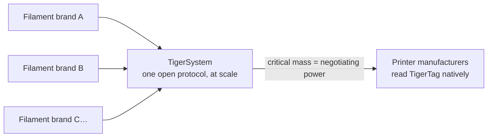

# Para fabricantes de filamento

> **Haz tus bobinas inteligentes y conectadas.**

## La bobina inteligente ya está en marcha: la única forma abierta de hacerlo está aquí

Las impresoras esperan cada vez más un filamento inteligente: sistemas de clase AMS,
detección del material por ranura, ajustes automáticos. Todos los fabricantes de
impresoras responden con una **etiqueta cerrada, atada a sus máquinas, que alimenta
su nube**: cero interoperabilidad, cero valor para tu marca fuera de sus muros. Y
cada etiqueta bloqueada cumple un segundo propósito: **orientar a tus clientes hacia
el propio filamento del fabricante de la impresora.** TigerTag se creó en 2023
precisamente para que las marcas de terceros tuvieran una respuesta mejor: bobinas
más inteligentes que las propietarias, sin el jardín vallado.

**TigerTag es el protocolo RFID de terceros más desplegado del mundo** y, hoy, la
única solución abierta viable de bobina inteligente que se envía a escala: un
protocolo abierto, estándar, agnóstico y multiplataforma con más de **2,5 millones de
chips ya producidos** e integrados en fábrica por marcas como Rosa3D, eSun, Sunlu,
Landu, Jamg He y R3D, con Filforme y Nanovia en proceso de integración.

## Integración en fábrica: días, no meses

Tenemos la experiencia y la tecnología para llevar chips TigerTag a tu línea de
producción **rápida, fácilmente y a muy bajo coste: en marcha en apenas 5 días**,
escribiendo **cada chip en cerca de 1 segundo** (miles de bobinas al día, con un
clic):

- Hardware NTAG estándar (sin componentes propietarios, sin dependencia de
 herramientas), adquirido a una escala y coste elegidos para un objetivo
 innegociable: **añadir la tecnología sin añadir un solo céntimo al precio final de
 la bobina.**
- Un manual de integración probado ya desplegado en varias fábricas, impulsado por la
 suite industrial [TigerTag Factory y Manager](../products/factory-suite.md): tu base
 de datos de filamentos por un lado, escritura masiva a velocidad de línea en cada
 bobina por el otro, con la **firma de fábrica que prueba el origen de cada
 producto**.
- La base de datos de referencia compartida da a tus productos una identidad precisa
 y universal que toda aplicación compatible resuelve de forma idéntica.

Las marcas que envían TigerTags en sus productos pueden llevar la marca **TigerTag
Certified**: una señal visible para los clientes de que la bobina es inteligente y
abierta.

> Ponte en contacto en **[tigertag@tigertag.io](mailto:tigertag@tigertag.io)** (o a
> través de la [organización de GitHub](https://github.com/TigerTag-Project)) para
> iniciar la conversación.

## Gracias, integradores

Las marcas de abajo hicieron real la bobina abierta, cada una con su propio nivel de
compromiso, y todas merecen el reconocimiento. Los niveles son una **escalera**:
cuanto más se compromete una marca, con más prominencia aparece, aquí y en todas las
superficies del ecosistema. Las mejores son las que más alto se alzan.

### Platino: la cumbre

**TigerTag+ en toda la producción**: todos los formatos de bobina, con chips firmados
como estándar en cada una de las bobinas que salen de la fábrica. Nada opcional, nada
parcial: la experiencia completa de bobina abierta, para todos los clientes, por
defecto. Los integradores Platino tienen **el mejor puesto en todas partes**: los
primeros nombrados, el logotipo más grande, su historia contada.

**[Rosa3D](https://rosa3d.pl)**: el **primer integrador del mundo** en poner
TigerTag+ en toda su producción. La referencia que todos los demás persiguen.

### Oro: comprometidos, a escala

**Integración bajo demanda en el momento de la producción**, con grandes cantidades
ya producidas, un alto nivel de integración y un **compromiso público oficial**. A un
paso de la cumbre: hacer estándar los chips firmados en toda la línea y unirse a
Platino.

&nbsp;&nbsp;&nbsp;&nbsp;

**[R3D](https://r3dprint.com)** · **[eSun](https://www.esun3d.com)**

### Plata: a bordo

**La tecnología integrada bajo demanda**: el primer paso, que ya es real: sus
clientes pueden comprar hoy bobinas equipadas con TigerTag. El siguiente peldaño es
Oro: escalar los volúmenes y hacer público el compromiso.

&nbsp;&nbsp;&nbsp;&nbsp;&nbsp;&nbsp;&nbsp;&nbsp;

**[Sunlu](https://www.sunlu.com)** · **[Landu](https://www.landustore.com)** · **[Jamg He](https://www.jamghe.com)**

…y más en proceso de integración:
[Filforme](https://www.filforme.com), [Nanovia](https://nanovia.tech) y otras en camino.

**¿Quieres tu logotipo en esta escalera, y más grande?** Una línea de producción pone
en marcha TigerTag en apenas 5 días:
[tigertag@tigertag.io](mailto:tigertag@tigertag.io).

## Lo anunciaron ellos mismos

Publicaciones públicas en los canales propios de las marcas, no en nuestro
comunicado de prensa (fuentes y anuncios completos:
[tigersystem.io/en/manufacturers](https://tigersystem.io/en/manufacturers)).
**Haz clic en cualquier imagen para abrir la publicación original:**

|| | |
|---|---|---|
|  |  |  |

> **ROSA 3D FILAMENTS** — *«integró oficialmente el protocolo RFID abierto TigerTag
> en el 100 % de nuestra producción de filamento.»* Más de 250 000 bobinas ya
> producidas con TigerTag.
> Original para citar: *"officially integrated the open TigerTag RFID
> protocol across 100 % of our filament production."*
> ([publicación original](https://www.instagram.com/p/DVyeOZajZSm/))

> **R3D Filament** — *«inició oficialmente el despliegue a gran escala del protocolo
> RFID abierto TigerTag en su producción de filamento en Europa.»*
> Original para citar: *"officially begun large-scale deployment of the open
> TigerTag RFID protocol across its filament production in Europe."*
> ([publicación original](https://www.instagram.com/reel/DVoAMqTk5ck/))

> **eSUN** — *«integró oficialmente la tecnología RFID TigerTag.»* — en piloto en el
> mercado francés, ampliándose por Europa.
> Original para citar: *"officially integrated TigerTag RFID technology!"*
> ([publicación original](https://www.instagram.com/p/DUjydNXkc1W/))

## Cómo llegan las etiquetas a tus bobinas

<table>
<tr>
<td align="center" width="55%">
<strong>Anverso</strong> 
 
<strong>Reverso</strong> 

</td>
<td align="center">

</td>
</tr>
</table>

*Anverso: los dos chips de marca, con el adhesivo industrial 3M
(468MP / 200MP) en medio. Reverso: las dos antenas NFC independientes, una
por extremo. Colocado en el refill: un chip por lado, tu operario despega y
pega; nada más cambia en la línea.*

## Ya en las estanterías

|| | |
|---|---|---|
|  |  |  |

*Rosa3D, eSun, Sunlu: cajas reales, enviadas con TigerTag dentro.*

|| | | |
|---|---|---|---|
|  |  |  |  |

*El propio filamento: Rosa3D, eSUN, Sunlu, R3D; todas estas bobinas se envían con
chips TigerTag.*

## Lo que tus clientes obtienen desde el primer día

Una bobina que se identifica sola ante **cualquier teléfono NFC**, un ecosistema de
inventario completo (móvil, escritorio, web), integración en directo con seis marcas
de impresoras, seguimiento del peso, compartir: una experiencia **muy por encima de lo
que ofrece cualquier entorno cerrado de un solo fabricante**, y funciona con todas las
impresoras que tienen tus clientes, no solo con las de una marca.

## Actualiza los datos incluso después de que salgan de tu fábrica

Una etiqueta impresa queda congelada el día en que se imprime. Una bobina TigerTag
no: como los chips resuelven su identidad contra la **base de datos de referencia
compartida**, puedes afinar o corregir los datos de un producto (ajustes,
descripciones, imágenes) **incluso en bobinas ya vendidas que están en casa de tus
clientes**. TigerTag es la única tecnología de este mercado que mantiene actualizables
los datos de tu producto después de que haya salido de la fábrica.

## La jugada colectiva

Cada marca de filamento que se une a TigerSystem refuerza a todas las demás:

Ninguna marca de filamento, sola, puede convencer a los fabricantes de impresoras de
que lean sus etiquetas. **Juntas, detrás de un protocolo abierto, sí podemos.** Y lo
que se pide es poco: un fabricante de impresoras puede añadir la lectura de TigerTag a
su firmware en **menos de 3 días**. Cuantas más marcas envíen TigerTag, más sólido es
el argumento a favor de la compatibilidad nativa de TigerTag, a nivel de firmware, en
las propias impresoras, y todos los participantes se benefician de esa palanca.

---

**▲ [Índice de la documentación](../../README.md)** · **Véase también:** [Por qué existe TigerSystem](./why-tigersystem.md), [Compatibilidad](../compatibility/README.md), [Preguntas frecuentes: fabricantes](../faq/README.md)
