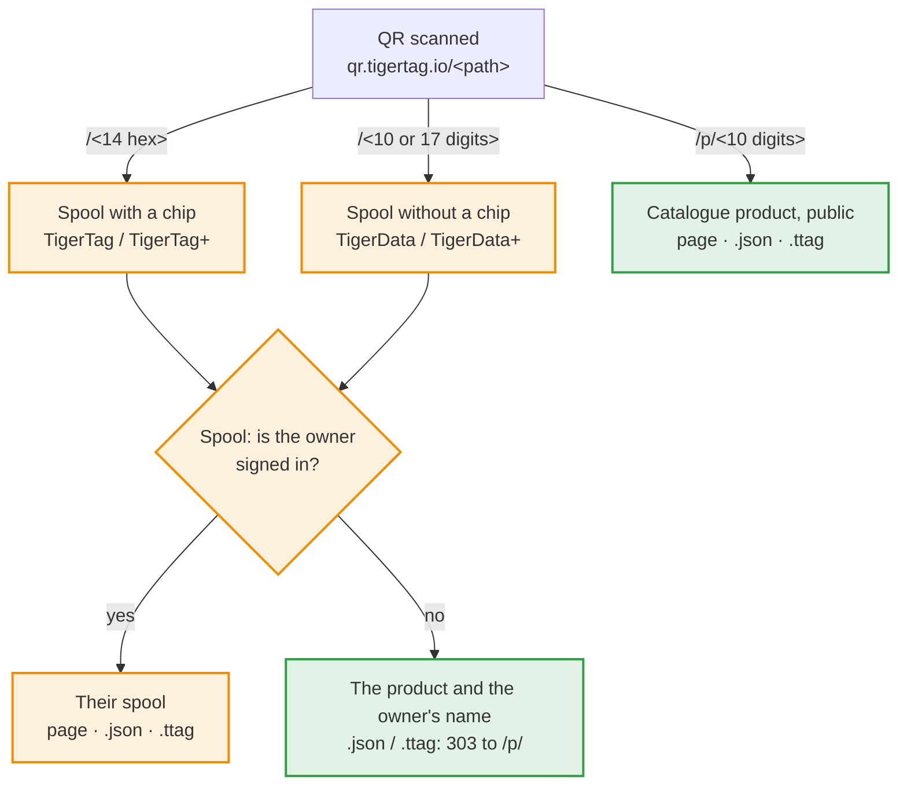

# Identifiants de bobine et liens QR

> **Ratifié le 2026-11-05 — pas encore implémenté.** Les applications
> s'appuient sur ce contrat. Les points encore ouverts sont listés à la fin ;
> en trancher un ne change que ce qu'il nomme. Les sections marquées
> **Proposé** ne sont pas encore ratifiées : ne vous appuyez pas dessus avant.

## Explication rapide

Un QR code TigerTag contient un seul lien court, `https://qr.tigertag.io/<path>`.
Le chemin dit ce qu'il ouvre :



En orange, ce qui est privé, réservé au propriétaire de la bobine ; en vert, ce
qui est public.

| QR code sur | Chemin | Exemple |
|---|---|---|
| une bobine avec puce (TigerTag / TigerTag+) | l'UID de la puce en hexadécimal, 14 caractères, imprimé en minuscules ; l'UID de la puce jumelle ouvre la même bobine | [qr.tigertag.io/1d33dbda0d1080](https://qr.tigertag.io/1d33dbda0d1080) |
| une bobine sans puce (TigerData / TigerData+) | l'id sans son préfixe `TigerData_` : 10 ou 17 chiffres ; la forme longue (`TigerData_6130922252`, `tigerdata-…`) marche aussi | [qr.tigertag.io/6130922252](https://qr.tigertag.io/6130922252) |
| un produit (TigerQR+) | `p/` + l'`id_product` en décimal, toujours 10 chiffres, complété par des zéros (`p/0010303748`) ; les anciennes étiquettes à 8 caractères hexadécimaux (`p/9f5e0644`) s'ouvrent toujours | [qr.tigertag.io/p/2673739332](https://qr.tigertag.io/p/2673739332) |

- **Un lien de bobine :** le propriétaire, connecté, voit sa bobine ; tout autre
  visiteur voit le produit et le nom du propriétaire. `.json` et `.ttag` ne
  donnent la bobine qu'à son propriétaire ; les autres reçoivent un `303` vers
  le `.json` / `.ttag` du produit.
- **Un lien de produit** est public, sans connexion : la page du catalogue, ses
  données ([`p/2673739332.json`](https://qr.tigertag.io/p/2673739332.json)) et son fichier ([`p/2673739332.ttag`](https://qr.tigertag.io/p/2673739332.ttag)).
- L'id et la terminaison `.json` / `.ttag` se lisent en majuscules comme en
  minuscules.
- Pour partager une bobine ou un produit, partagez ce lien court : c'est celui
  qui est imprimé sur les étiquettes, et toutes les applications le lisent.

La suite de la page est le contrat lui-même.

Les règles que suit chaque application TigerSystem :

1. comment une **bobine sans puce** (TigerData / TigerData+) reçoit son
   identifiant ;
2. comment une bobine **garde son lien** quand elle reçoit une puce ;
3. comment l'identifiant d'une bobine est écrit dans le **QR code** d'une
   étiquette imprimée, puis relu ;
4. comment une application **appelle une bobine avec des valeurs** (un poids,
   une note) par un lien ;
5. comment un **produit** a son propre lien ;
6. comment un lien répond en **JSON** ou en **fichier `.ttag`**.
7. ce que porte une **étiquette imprimée**, et ses gabarits.

## 1. Identifiants de bobine

Une bobine est un document de l'inventaire du compte,
`users/{uid}/inventory/{spoolId}`. L'identifiant du document **est**
l'identifiant de la bobine : un compte ne peut pas contenir deux bobines avec
le même identifiant.

| Bobine | Identifiant | Exemple |
|---|---|---|
| Avec puce (TigerTag / TigerTag+) | l'UID NFC de la puce, en hexadécimal majuscule, 14 caractères (l'UID de 7 octets d'une NTAG) | `04AB12CD3E4F80` |
| Sans puce, créée à partir de maintenant | `TigerData_` + l'heure en **millisecondes** (13 chiffres) + un nombre au hasard **0000–9999** (toujours 4 chiffres) | `TigerData_17623456789014213` |
| Sans puce, créée avant ce contrat | `TigerData_` + 10 chiffres au hasard | `TigerData_4480517985` |
| Sans puce, ancien préfixe | `CLOUD_` + 10 chiffres au hasard | `CLOUD_4480517985` |
| Ancien décimal (ancienne application Android) | l'UID écrit en décimal, en cours de migration vers l'hexadécimal | `1234567890123456` |

Ce contrat ne **réécrit jamais** un identifiant déjà créé. Les lecteurs ne
testent que le préfixe (`TigerData_` / `CLOUD_` → sans puce) ; aucun ne dépend
du nombre de chiffres. L'identifiant n'est qu'un identifiant : n'en déduisez
jamais une date de création. Un UID de 4 octets (une puce propriétaire liée à
une bobine) n'est jamais le nom d'un document d'inventaire : il n'apparaît
donc jamais dans un lien.

### Créer un identifiant sans puce

Chaque application qui crée des bobines sans puce (Tiger Studio aujourd'hui,
l'application mobile plus tard) crée l'identifiant de la même façon :

1. **Composer** `TigerData_<Date.now()><quatre chiffres au hasard>`.
2. **Vérification locale** — si l'identifiant est déjà dans l'inventaire que
   tient l'application (la copie de l'écoute en direct, cache hors ligne
   compris) ou dans son `uidMigrationMap`, en composer un autre. Cela
   fonctionne hors ligne.
3. **Écrire**
   - **en ligne :** dans une transaction qui lit d'abord le document et
     échoue s'il existe ; en cas d'échec, revenir à l'étape 1 ;
   - **hors ligne :** une écriture simple, mise en attente par Firestore
     jusqu'au retour du réseau. Les étapes 1 et 2 sont alors la seule
     protection.

Un simple `set()` sur un identifiant qui existe déjà **écrase** la bobine qui
s'y trouve, sans prévenir. C'est ce qu'empêche l'étape 3.

Les quatre chiffres au hasard rendent aussi un nouvel identifiant sans puce
pratiquement unique **sur tous les comptes** (environ une collision tous les
600 ans à un million de bobines sans puce par an) : un serveur pourra donc plus
tard résoudre un lien pour quelqu'un d'autre que le propriétaire, sans changer
aucune étiquette imprimée.

## 2. Garder le lien quand une bobine reçoit une puce

Programmer une puce sur une bobine sans puce déplace la bobine vers l'UID de la
puce. En **un seul lot d'écritures** :

1. écrire la bobine sous l'UID de la puce (et l'UID jumeau, pour une paire
   jumelle) ;
2. supprimer le document `TigerData_…` ;
3. écrire la redirection `users/{uid}/uidMigrationMap/{ancien identifiant}` →
   `{ hex_uid, migrated_at }`.

Le lot fait que les trois se produisent ensemble ou pas du tout. La
redirection vit dans `uidMigrationMap` (la collection qui fait déjà
correspondre les anciens identifiants décimaux à l'hexadécimal), jamais sous
forme de document vide dans l'inventaire : tout ce qui lit l'inventaire compte
un document comme une bobine.

## 3. Liens QR

Une étiquette de bobine imprimée porte un QR code contenant un lien vers la
bobine, **et rien d'autre** (ni poids, ni note — une valeur imprimée devient
fausse) :

```
https://qr.tigertag.io/<id>
```

Rien n'est imprimé en clair à côté du code : ni identifiant, ni lien. Le QR
code est le chemin vers la bobine.

`<id>` est l'identifiant de la bobine **sans son préfixe** :

| Bobine | Lien |
|---|---|
| Avec puce | `https://qr.tigertag.io/04ab12cd3e4f80` |
| Sans puce (nouvelle) | `https://qr.tigertag.io/17623456789014213` |
| Sans puce (avant ce contrat) | `https://qr.tigertag.io/4480517985` |
| `CLOUD_` | **pas de lien QR** — l'étiquette est imprimée sans QR code |
| Ancien décimal | **pas de lien QR** — migrer d'abord la bobine vers l'hexadécimal |

### Encodage

- Tout le lien est en **minuscules**, identifiant compris :
  `https://qr.tigertag.io/04ab12cd3e4f80`. Testé le 2026-11-07 : l'appareil
  photo de l'iPhone ouvre un lien dans les deux casses, mais celui de Samsung
  (Galaxy S24) affiche un lien `HTTPS://` en majuscules comme du simple texte
  et n'ouvre qu'un lien en minuscules.
- Un seul segment en mode **octet**. Un schéma en minuscules ne peut pas
  utiliser le mode alphanumérique, et découper le lien en segments ne fait rien
  gagner (mesuré : toutes les variantes font 29 × 29).
- Correction d'erreur **M** (15 %) : les étiquettes se rayent et se plient.
- Résultat : **29 × 29 modules** pour tout lien de bobine ou de produit.
  Dessinez chaque module sur un nombre entier de points d'impression, avec la
  marge standard de 4 modules.

### Relire un lien

Les lecteurs extraient l'identifiant du lien **hors ligne** : une application
qui scanne une étiquette n'a jamais besoin du site. Ils lisent le chemin sans
tenir compte de la casse, ignorent un `/` final, et le résolvent par sa forme :

| Chemin | Identifiant de bobine |
|---|---|
| 17 chiffres | `TigerData_<17 chiffres>` |
| 10 chiffres | `TigerData_<10 chiffres>` |
| 14 caractères hexadécimaux | l'UID, en majuscules |
| 13 caractères hexadécimaux commençant par `4` | un UID NTAG tronqué : `0` + les 13 caractères ([règle de réparation](https://github.com/TigerTag-Project/TigerTag-Studio-Manager/issues/146)) |
| `p/` + l'`id_product` : 10 chiffres décimaux (forme imprimée) ou 8 caractères hexadécimaux (anciennes étiquettes) | un produit — [section 5](#5-liens-produit) |

Une fin en `.JSON` ou `.TTAG` demande la réponse pour les outils — [section 6](#6-réponses-json-et-ttag).

Les applications **écrivent** la forme courte ci-dessus, mais les lecteurs
**acceptent aussi la forme longue** : le préfixe `TigerData` dans n'importe
quelle casse, suivi de `_` ou `-`, puis les 17 ou 10 chiffres —
`TigerData_17623456789014213`, `TigerData-17623456789014213`,
`TIGERDATA-17623456789014213`, `tigerdata_4480517985` mènent tous à la même
bobine. Un lien tapé ou partagé à la main continue de fonctionner. Le préfixe
`CLOUD` n'est accepté sous aucune forme.

Un UID peut ne contenir que des chiffres, mais il fait 14 caractères, jamais 17
ni 10 : la longueur tranche toujours. Aucun ancien identifiant décimal n'arrive
à un lecteur, puisqu'aucun n'est jamais imprimé. Toute **autre forme** est une
étiquette d'une version plus récente : le lecteur le dit (« mettez
l'application à jour ») au lieu d'échouer. Chaque autre type de chose a son
propre dossier, une lettre et un `/` (`P/` pour un produit, plus tard `R/` pour
un rack) : il ne peut jamais entrer en conflit avec les liens de bobine déjà
imprimés.

### Retrouver la bobine

1. Chercher l'identifiant **dans l'inventaire de la personne connectée**.
2. Absent → le chercher dans son `uidMigrationMap` et suivre la redirection.
3. Une paire jumelle a une seule étiquette, avec l'UID principal ; l'un ou
   l'autre UID ouvre la bobine.
4. Une bobine supprimée (`deleted: true`) s'ouvre comme « supprimée », pas
   comme une erreur.

   **Le propriétaire voit la bobine sur la page même**, lue dans le navigateur
   depuis son propre document d'inventaire (les règles la lui réservent) : le
   produit (photo sur sa couleur), la marque, la matière, le niveau, le poids
   restant sur la capacité, les températures de buse, de plateau et de séchage,
   le diamètre, le rack et l'emplacement, le poids de la bobine vide. Deux
   boutons : « Ouvrir dans Tiger Studio »
   (`https://studio.tigersystem.io/?spool=<docId>`, avec les valeurs du lien)
   et « Voir la fiche produit ». Un propriétaire connecté à Studio Web sur
   l'appareil mais pas au site est envoyé vers Studio Web : le site ne peut pas
   lire le document sans sa propre session. *(2026-11-07.)* Le propriétaire y
   modifie le poids et la note, avec la même écriture que Studio :
   `weight_available` ou `message` (28 octets UTF-8 au plus), `updatedAt`
   (heure serveur), `needUpdateAt` (heure serveur) sur un format à puce, la
   jumelle dans le même lot. La bobine vide s'y change aussi, comme Studio
   l'écrit : `container_id`, `container_weight` (avec la correction propre au
   compte), `updatedAt`, la jumelle dans le même lot. La page a un bouton de
   déconnexion. *(2026-11-08.)*

5. Toute personne qui **n'est pas le propriétaire** — non connectée, un autre
   compte, un ami accepté compris — est **renvoyée vers le produit** de la
   bobine, sans jamais voir la bobine : le serveur retrouve la bobine par son
   identifiant sur tous les comptes (un index sur l'identifiant de bobine), lit
   son `id_product` et redirige vers le lien produit de la
   [section 5](#5-liens-produit). Le même identifiant dans deux comptes avec
   deux produits différents (une puce réécrite dont un autre compte a gardé
   l'ancien doc) → le produit du doc mis à jour le plus récemment
   (`updatedAt`), juste dans la quasi-totalité des cas. Pas de produit ou pas
   de correspondance → une page qui dit que la bobine est privée, avec « Créer
   mon inventaire ». La recherche ne tourne que pour ces scans : son coût suit
   ces scans, pas le nombre de comptes. *(Ratifié le 2026-11-06 ; la règle de
   conflit le 2026-11-07.)*

   Un visiteur **sans session** (aucune connexion trouvée sur l'appareil) n'est
   pas redirigé : la page le laisse choisir. Elle montre une carte du produit de
   la bobine (le produit public seulement, jamais pour une bobine privée),
   permet de se connecter sur place (une fois connecté, la vérification du
   propriétaire repart et le propriétaire arrive sur sa bobine), ou de passer à
   la fiche produit. Une personne connectée qui n'est pas le propriétaire est
   renvoyée vers le produit comme ci-dessus. *(2026-11-07.)*

   **À qui est la bobine.** Toute personne qui scanne une bobine, connectée ou
   non, voit son propriétaire : le pseudo et la photo de `userProfiles` du
   compte dont le doc a été mis à jour le plus récemment, même si le profil
   n'est pas public et même pour une bobine sans produit, pour que celui qui
   trouve une bobine sache à qui elle est. Jamais l'uid ni l'e-mail.
   *(2026-11-08.)*

**Confidentialité :** connaître un identifiant ne montre jamais une bobine. Un
lien scanné n'ouvre une bobine que pour son propriétaire ; dans les
applications, une bobine n'est montrée qu'à quelqu'un que les règles Firestore
autorisent déjà à la lire (le propriétaire, un ami accepté, un inventaire public). Les
identifiants contiennent une heure et peuvent se deviner ; cela ne doit jamais
compter. Le produit d'une bobine n'est pas privé : il est imprimé sur
l'étiquette, et une puce TigerTag+ le porte en clair pour tout téléphone NFC.
Le poids, la note et le rack ne sortent jamais ; le propriétaire n'apparaît que
par son pseudo et sa photo (ci-dessus). Un scan est compté une fois par onglet
et par bobine (recharger la page n'est pas un nouveau scan), avec son produit, sa marque, sa matière et un lieu à l'échelle de la
ville, jamais l'identifiant de la bobine. Le compte rendu du scan porte aussi
l'adresse IP du visiteur, gardée contre les inondations de requêtes et pour
l'analyse : elle ne s'affiche que dans l'historique d'administration, jamais
pour les marques, et sert à vérifier la ville donnée par le serveur de bord. Elle est gardée un an,
pour la sécurité seulement. Le scan d'un visiteur connecté est lié à son compte.

## 4. Appeler une bobine avec des valeurs

Une application peut construire un lien qui ouvre une bobine **et propose des
valeurs**, avec des paramètres classiques (ces liens ne sont jamais imprimés :
la lisibilité l'emporte sur la taille du QR code) :

```
https://qr.tigertag.io/04AB12CD3E4F80?weight=640&note=Opened%20in%20June
```

### Paramètres

| Paramètre | Valeur | Limite |
|---|---|---|
| `weight` | poids net de filament, en grammes | nombre entier, de 0 à la capacité de la bobine |
| `note` | la note de la bobine (le champ `message`) | texte brut, 28 octets UTF-8 au plus (l'emplacement de la puce) |

Les noms ne tiennent pas compte de la casse. Un paramètre inconnu est ignoré,
jamais une erreur. Une valeur hors limite est refusée. Les nouveaux paramètres
sont ajoutés à ce tableau, jamais inventés par une seule application.

### Qui peut les appliquer

| Situation | Ce qui se passe |
|---|---|
| Non connecté | Valeurs **refusées**. Le lien propose de se connecter, puis ouvre la bobine sans elles. |
| Connecté, pas le propriétaire (bobine d'un ami comprise) | Valeurs **refusées**. La bobine s'ouvre si les règles le permettent. |
| Connecté, le propriétaire | Studio : la bobine s'ouvre avec les valeurs **pré-remplies**, et **un geste** les enregistre (« Mettre à jour : 640 g »). La page du Hub : un poids qui tient dans la capacité et diffère de celui enregistré est **enregistré tout de suite**, sur la bobine et sa jumelle en un seul lot, puis un bandeau propose de remettre l'ancien poids (« Revenir à 772 g »), contre un vieux lien scanné à nouveau. *(Hub, 2026-11-08.)* |

Les valeurs ne s'appliquent qu'à la bobine du propriétaire lui-même.
Une application qui doit écrire sans confirmation (une balance qui met le poids
à jour en continu, une intégration) n'utilise pas de lien : elle écrit par le
compte de l'utilisateur, sous les règles Firestore
([guide d'intégration](https://github.com/TigerTag-Project/TigerTag_Firebase_Integration)).

## 5. Liens produit

> **Ratifié le 2026-11-06.**

Un produit — un filament du catalogue, quel que soit le propriétaire d'une
bobine de ce filament — a son propre lien, pour un emballage, un rayon de
magasin, un showroom ou un catalogue imprimé :

```
https://qr.tigertag.io/p/<id_product>
```

- `<id_product>` s'écrit en **décimal, toujours sur 10 chiffres**, complété par
  des zéros devant : un `id_product` ne dépasse jamais 10 chiffres (le plus grand
  est `4294967295`). Exemples : produit `2855882328` →
  `https://qr.tigertag.io/p/2855882328` ; produit `10303748` →
  `https://qr.tigertag.io/p/0010303748`. **29 × 29** modules.
- Les étiquettes imprimées auparavant portent l'ancienne forme, l'`id_product`
  en **8 caractères hexadécimaux** minuscules (`p/aa394e58`) ; elle reste lisible
  pour toujours (voir plus bas).
- Un identifiant qui n'est pas, ou plus, au catalogue — `p/0000000000` et
  `p/4294967295` (« pas de produit », jamais imprimés), un identifiant inconnu, un
  produit archivé, supprimé ou fusionné — ouvre **une seule page « produit
  oublié »** : ce filament n'est plus au catalogue, avec la recherche. Un seul
  statut pour tous, `404` (la page comme les réponses `.json` / `.ttag`) :
  pourquoi un produit a disparu ne compte pas pour celui qui scanne. Un
  `id_product` n'est jamais redonné à un autre produit : une étiquette déjà
  collée ne peut jamais ouvrir le mauvais filament.
- Les liens sont servis par le **Hub** (`tigersystem.io`) : `qr.tigertag.io`
  pointe vers lui. La page est la page catalogue du Hub (ci-dessous) ; les réponses `.JSON` et `.TTAG` sont des routes d'API du Hub qui
  lisent le catalogue (en cache).
- Une étiquette de bobine ne répète jamais son produit : le lien de la bobine y
  mène déjà ([section 3](#retrouver-la-bobine)).

### Lire un lien produit

Un lien produit bien formé a l'une de deux longueurs, donc il ne peut jamais être
mal lu :

1. **10 chiffres** → décimal (`p/2673739332`, `p/0010303748`).
2. **8 caractères** `0-9` / `a-f` → hexadécimal, l'ancienne forme imprimée,
   toujours acceptée (`p/9f5e0644` ouvre le même produit que `p/2673739332`).

En tolérance, sans garantie, un décimal tapé à la main avec une autre longueur
est lu en décimal, sauf exactement 8 chiffres : ceux-là sont lus d'abord en
hexadécimal, puis en décimal si ce produit n'existe pas. Une valeur au-delà de
`4294967295` est un lien inconnu. `0` et `4294967295`, sous n'importe quelle
forme, veulent dire « pas de produit » (`404`). Les terminaisons `.json` et
`.ttag` marchent sur toutes les formes, sans distinction de casse.

### La page qu'il ouvre

`p/…` redirige (`302`) vers la **page catalogue existante** du produit,
`tigersystem.io/<lang>/catalog/<id_product en décimal>`, dans la langue du
téléphone. Il n'y a pas de page de scan à part : la page catalogue est conçue
**d'abord pour le téléphone** (responsive), puisque la plupart de ses visites
viennent d'un scan — photo et pastille de couleur, marque, matière et nom de la
couleur en haut, les réglages d'impression lisibles d'un coup d'œil, puis le
reste de la page.

## 6. Réponses JSON et .TTAG

> **Ratifié le 2026-11-06.**

Un lien qui finit par `.JSON` (dans n'importe quelle casse) — ou envoyé avec
`Accept: application/json` — répond en JSON au lieu d'une page. Un lien qui
finit par `.TTAG` répond avec le même enregistrement sous forme de
[fichier `.ttag`](./ttag-format.md) à télécharger
(`Content-Disposition: attachment`). Ce sont des adresses pour les outils,
jamais imprimées.

La même logique qu'un scan ([retrouver la bobine](#retrouver-la-bobine)) : le
propriétaire obtient la bobine, toute autre personne son produit.

| Lien | Le propriétaire (`Authorization: Bearer <jeton d'identité Firebase>`) | Toute autre personne (non connectée, un autre compte, un ami) |
|---|---|---|
| `…/p/2855882328.json` | la fiche produit | pareil |
| `…/p/2855882328.ttag` | le produit en fichier `.ttag` | pareil |
| `…/04ab12cd3e4f80.json` | la bobine | `303` → `…/p/<id_product>.json` ; pas de produit du catalogue (une TigerData, une TigerTag maker) → `404` |
| `…/04ab12cd3e4f80.ttag` | la bobine en fichier `.ttag` | `303` → `…/p/<id_product>.ttag` ; pas de produit du catalogue → `404` |

Sans produit du catalogue, rien de la bobine n'est répondu, pas même sa
matière : le `404` correspond à la page « bobine privée » d'un scan.

- **Bobine :** un [fichier `.ttag`](./ttag-format.md) contenant ce seul
  enregistrement, le document d'inventaire tel que Firestore le stocke. Il
  contient `id_product` ; un outil qui veut le produit appelle ensuite
  `…/p/<id_product>.json`.
- **Produit :** la fiche du catalogue telle que l'API produit la renvoie, dans
  la langue de `?lang=` (anglais par défaut). Mise en cache sur le serveur et
  autorisée depuis n'importe quel site.
- Une réponse de bobine n'est jamais mise en cache : elle dépend de qui
  demande.
- Ouvert dans Tiger Studio, le `.ttag` d'une bobine s'importe en mode
  **Restaurer** (la bobine telle qu'elle était, puce et sauvegarde comprises) ;
  celui d'un produit en mode **Importer**, comme une nouvelle TigerData+ avec un
  identifiant neuf.
- Une requête JSON ou `.TTAG` n'écrit jamais : les valeurs de lien
  (`?weight=`, `?note=`) y sont ignorées.

## 7. Étiquettes imprimées

Toutes les applications impriment les mêmes étiquettes : deux sortes, un seul
jeu de gabarits. Une étiquette imprimée depuis Tiger Studio, l'application
mobile ou le site a le même aspect et se scanne de la même façon.

| Étiquette | Son QR code | Imprimée pour |
|---|---|---|
| **Bobine** | le lien de la bobine ([section 3](#3-liens-qr)) | toute bobine qui a un lien QR (pas `CLOUD_`, pas l'ancien décimal) |
| **Produit** (carte nuancier) | le lien du produit ([section 5](#5-liens-produit)) | une bobine ou un produit du catalogue avec un vrai `id_product` (TigerTag+, TigerData+) |

Le propriétaire qui scanne une étiquette de bobine obtient la bobine ; les
autres obtiennent son produit ([retrouver la bobine](#retrouver-la-bobine)). Une
étiquette produit ouvre le produit pour tout le monde : c'est celle d'un
nuancier, d'une étagère ou d'un showroom.

### Ce que porte une étiquette

- la marque, à la place d'un logo de fabricant (les logos viendront plus tard) ;
- la série en blanc sur une barre noire (`PLA Rainbow` ; la matière quand il n'y a
  pas de série) ;
- le nom de la couleur et son ou ses codes hex (`#F2D066`, jusqu'à trois sur les
  gabarits larges) ;
- sur une étiquette de bobine, le nom de l'étiquette en haut à droite, dans une
  pastille cernée : `TigerQR+` quand sa référence est un produit du catalogue (un
  vrai `id_product`) ou une puce TigerTag+, sinon `TigerQR` (une puce TigerTag
  sans produit donne donc `TigerQR`) ; une étiquette produit (filament) porte
  toujours `TigerQR+`. Comme pour TigerTag et TigerTag+, le `+` veut dire lié au
  catalogue. La pastille ne dit pas si la bobine a une puce ;
- jusqu'à **quatre cases de valeurs**, choisies par l'utilisateur parmi : plage
  de buse, plage de plateau, séchage (température · durée), TD, diamètre ;
- le QR code.

Seulement ce qui ne change pas : jamais le poids restant, la note, le rack ou
le propriétaire. Rien en clair à côté du QR code ([section 3](#3-liens-qr)).

### Gabarits

Neuf gabarits, les tailles et mises en page courantes des étiquettes de bobine :

| Gabarit | Taille (largeur × hauteur) | Mise en page |
|---|---|---|
| Classique (par défaut) | 40 × 30 mm | marque, barre, couleur + hex, quatre cases, QR en bas à droite |
| Large | 50 × 30 mm | le Classique, barre plus large |
| Compact | 40 × 25 mm | marque, QR à gauche, barre, couleur, hex — sans cases |
| Fin | 40 × 12 mm | QR à gauche, marque, barre, couleur — sans cases |
| Pour slicers | 40 × 30 mm | marque, série, couleur empilées en grand, grand QR à droite — sans cases |
| Vertical | 30 × 40 mm | marque, barre, couleur en grand, hex, un filet, cases empilées à gauche, QR en bas à droite |
| Vertical gras | 30 × 40 mm | marque, barre pleine largeur, couleur, un filet, QR centré dessous — sans cases |
| Vertical compact | 25 × 40 mm | marque, barre, couleur, hex, un filet, grand QR dessous — sans cases |
| QR seul | 25 × 30 mm | la pastille TigerQR / TigerQR+ centrée en haut, un QR de 20 mm dessous — rien d'autre, sans cases |

QR seul est décidé (2026-11-11) mais pas encore sorti : il arrive avec la prochaine version de Tiger Studio et la prochaine mise à jour de tigersystem.io.

Chaque gabarit est un SVG mis en page en dixièmes de millimètre puis mis à
l'échelle des points de l'imprimante. Le QR code remplit le même cadre que sur
les étiquettes de bobine courantes (≈ 14 mm sur le Classique), en un nombre
entier de points d'imprimante par module : le plus proche, arrondi au-dessus
tant que ça reste dans 6 % du cadre. Les marges blanches de l'étiquette font sa
zone de silence. À 203 ppp, un code 29 × 29 fait 4 points par module sur le
Classique (≈ 14,5 mm).

### Sortie

- **PDF**, **PNG** (à la résolution de l'imprimante) et **SVG**, pour que
  n'importe quelle imprimante fonctionne, au besoin par sa propre application ;
- l'impression directe sur les imprimantes d'étiquettes (Brother QL, Niimbot,
  Phomemo) vient ensuite, imprimante par imprimante, avec les mêmes gabarits.

## Points ouverts

- **Liens d'application.** iOS (`apple-app-site-association`) et Android
  (filtres d'intention) comparent les chemins en tenant compte de la casse par
  défaut : les liens sont imprimés en minuscules, mais un lien tapé ou partagé
  à la main peut ne pas l'être ; l'application mobile déclare donc une
  correspondance insensible à la casse (iOS) et filtre le chemin dans le code
  (Android).
- **Domaine.** `qr.tigertag.io` est imprimé pour toujours : renouveler
  `tigertag.io` sur une longue durée.

---

**▲ [Index de la documentation](../../README.md)** · **Voir aussi :** [Identité universelle du filament](../concepts/universal-filament-identity.md), [Inventaire et synchronisation cloud](../concepts/inventory-and-cloud-sync.md), [Vue d'ensemble pour les développeurs](./README.md)
