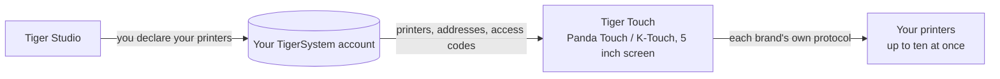

# Tiger Touch

**Votre Panda Touch dort dans un tiroir. Donnez-lui toutes vos imprimantes.**
Un firmware libre et open source qui transforme le BIGTREETECH Panda Touch et le
K-Touch en un seul écran tactile en direct pour toutes vos imprimantes 3D — sans
soudure, sans ordinateur.

*Deux cartes d'imprimante en direct sur un seul écran : une FlashForge AD5X et
une Bambu Lab X1C.*

<a class="ts-cta-primary" href="https://tigertag-project.github.io/Tiger-Touch/">Installer depuis le navigateur</a>

<a href="https://github.com/TigerTag-Project/Tiger-Touch"> Les sources</a>

BIGTREETECH vend un même petit écran tactile de 5" sous deux noms : le **Panda
Touch**, conçu pour les imprimantes Bambu Lab, et le **K-Touch**, conçu pour les
imprimantes Klipper. Même carte, deux firmwares, chacun lié à une seule famille
de machines. Vous changez d'imprimante, et l'écran part dans un tiroir.

**Tiger Touch est un nouveau firmware pour ce même écran**, écrit de zéro. Il se
connecte à votre compte TigerTag gratuit, trouve toutes les imprimantes que vous
y avez déclarées, et parle à chacune directement, avec son propre protocole, en
même temps. Si vous possédez un Panda Touch ou un K-Touch qui ne correspond plus
à vos imprimantes, c'est exactement le matériel pour lequel Tiger Touch a été
fait.

Open source sous licence **MIT**. Rien à souder, rien à imprimer, pas de
Raspberry Pi, aucun serveur au milieu : vous branchez l'écran sur un port USB,
vous appuyez sur **Installer** dans votre navigateur, et deux minutes plus tard
il affiche vos imprimantes.

## Ce qu'il fait

- **Toutes les marques sur un seul écran** — Bambu Lab, Creality, Elegoo,
  Anycubic, Snapmaker, FlashForge, Prusa, plus toute machine Klipper (Moonraker)
  ou OctoPrint.
- **Cloud et LAN** — Bambu Lab via le cloud Bambu ou en mode LAN, Anycubic via
  le cloud Anycubic ou sur le réseau local, les autres sur votre réseau local.
- **En direct, toutes** — état, progression, fichier, temps restant et heure de
  fin, buses, plateau, caisson et unités de filament (AMS, CFS, Station, ACE,
  voies MMU / AFC), avec jusqu'à **dix imprimantes** suivies en même temps.
- **Commandes sûres** — pause, reprise, arrêt (un appui maintenu 1,5 s, pour
  qu'un doigt égaré ne mette jamais fin à une impression) et la lumière de
  l'imprimante. **Rien d'autre n'est jamais envoyé** : pas de chauffe, pas de
  déplacement, pas de lancement d'impression.
- **Se met à jour tout seul** — les nouvelles versions arrivent par Wi-Fi,
  vérifiées avant l'installation, et annulées d'elles-mêmes si elles ne
  démarrent pas.
- **Onze langues** — anglais, français, allemand, espagnol, italien, chinois,
  portugais (Brésil et Portugal), polonais, russe, néerlandais.

<figure>

<figcaption><strong>Cartes</strong> : une carte en direct par imprimante, faites défiler pour voir les autres.</figcaption>
</figure>
<figure>

<figcaption><strong>Liste</strong> : toutes les imprimantes d'un coup d'œil. Un seul appui change de vue.</figcaption>
</figure>
<figure>

<figcaption><strong>Snapmaker U1</strong> : quatre têtes d'outil, l'active est entourée.</figcaption>
</figure>
<figure>

<figcaption><strong>FlashForge AD5X</strong> : bobine externe et station de matériaux.</figcaption>
</figure>

## Où il se situe

## Ce qui doit exister d'abord

Tiger Touch lit vos imprimantes **depuis votre compte TigerSystem** : il ne vous
demande donc jamais une adresse ni un code d'accès sur un écran de 5". Créez le
compte et ajoutez vos imprimantes dans [Tiger Studio](./tiger-studio.md)
**bureau** (Windows, macOS, Linux), qui les trouve sur votre réseau — la version
web ne peut pas ajouter d'imprimantes.

> **En bref :** Tiger Studio → créer un compte → ajouter vos imprimantes →
> *puis* installer l'écran.

## Quelles imprimantes

Tiger Touch choisit la connexion d'après la **marque**, pas le modèle : toute
imprimante de ces familles que Tiger Studio peut ajouter, Tiger Touch peut
l'afficher. Le catalogue de Tiger Studio compte environ 380 modèles de
quelque 60 fabricants.

| Marque | Connexion | Vue sur une vraie machine |
|---|---|---|
| [Bambu Lab](../compatibility/bambu-lab.md) (X1, P1, P2S, A1, H2…) | Cloud Bambu, ou LAN (MQTT sur TLS) | **Oui** — en impression via le cloud (P2S), au repos en mode LAN (X1C, A1) |
| [Creality](../compatibility/creality.md) (K2, K1, Hi, Ender-3 V4…) | WebSocket sur le LAN | **Oui** — en impression (K2), au repos avec son CFS (Ender-3 V4) |
| [Snapmaker](../compatibility/snapmaker.md) U1 | WebSocket Moonraker | **Oui** — au repos, quatre têtes d'outil |
| [FlashForge](../compatibility/flashforge.md) (AD5X, Adventurer 5M, Creator 5) | HTTP sur le LAN | **Oui** — au repos (AD5X) |
| [Anycubic](../compatibility/anycubic.md) (Kobra 3, Kobra X, Kobra S1…) | Cloud Anycubic, ou LAN (MQTT sur TLS) | **Oui** — au repos via le cloud (Kobra X), avec son ACE |
| [Elegoo](../compatibility/elegoo.md) Centauri Carbon 1 et 2 | MQTT (CC2), SDCP (CC1) | Pas encore |
| **Prusa** (MK4, Core One, XL, MINI) | PrusaLink | Pas encore |
| [Klipper](../compatibility/klipper.md) — Voron, Qidi, Sovol, RatRig… | HTTP Moonraker | Seulement sur l'imprimante de test de Tiger Studio |
| **OctoPrint** — toute imprimante Marlin derrière | API REST OctoPrint | Seulement sur l'imprimante de test de Tiger Studio |

« Pas encore » signifie écrit d'après le protocole du fabricant et compilé, mais
jamais exécuté sur cette machine : **un retour depuis votre imprimante est ce que
vous pouvez envoyer de plus utile.** La pause, la reprise et l'arrêt marchent
partout où la connexion accepte des commandes (pas via le cloud Bambu ou
Anycubic) ; la lumière marche partout sauf sur Prusa, OctoPrint et la Centauri
Carbon 1. Chaque champ et chaque test se trouvent dans l'[état marque par marque](https://github.com/TigerTag-Project/Tiger-Touch/blob/main/docs/PRINTER-COMPATIBILITY.md).

**Une imprimante s'affiche « hors ligne » ?** Vérifiez d'abord son mode LAN : il
est désactivé par défaut sur Creality, FlashForge et Bambu Lab.

## Un écran, toutes les marques

Les firmwares livrés avec l'écran ne connaissent chacun qu'**une** famille
d'imprimantes.

| | **Tiger Touch** | Firmware Panda Touch | Firmware K-Touch |
|---|---|---|---|
| Familles d'imprimantes sur un écran | **9** | 1 (Bambu Lab) | 1 (Klipper) |
| Imprimantes en direct en même temps | **jusqu'à 10**, toutes mises à jour ensemble | plusieurs Bambu Lab, ralentit à partir d'environ 3 d'après notre usage | **1** à la fois (50 enregistrées, on passe de l'une à l'autre) |
| Configuration des imprimantes | depuis votre compte TigerTag, rien à saisir sur l'écran | IP, numéro de série, code d'accès | IP et port, ou un scan |
| Mises à jour par voie hertzienne | Oui, vérifiées, avec retour arrière automatique | Non | Non |

Les firmwares de BIGTREETECH donnent le contrôle complet de leur unique famille
— lancer des impressions, températures, déplacements — ce que Tiger Touch ne
fait volontairement pas. Vous pouvez y revenir à tout moment.

*Les colonnes Panda Touch et K-Touch viennent du wiki de BIGTREETECH lui-même
(consulté le 2026-10-16) ; « ralentit à partir d'environ 3 » est l'expérience de
l'équipe TigerTag, pas un chiffre de BIGTREETECH.*

## Installer en deux minutes

1. **Déclarez vos imprimantes** dans Tiger Studio, comme ci-dessus.
2. **Flashez l'écran depuis votre navigateur.** Ouvrez
   **<https://tigertag-project.github.io/Tiger-Touch/>** dans **Chrome ou Edge**
   sur un ordinateur (WebSerial : ni Safari, ni Firefox, ni un téléphone),
   branchez l'écran avec un câble USB-C **qui transmet des données**, appuyez sur
   **Installer** et choisissez son port. Pour remplacer le firmware BIGTREETECH :
   cochez **Erase device**. Pour mettre à jour un Tiger Touch par USB : laissez
   décoché, votre Wi-Fi et votre compte sont conservés.
3. **Suivez l'écran.** Langue, Wi-Fi, puis votre compte TigerTag — e-mail et mot
   de passe, ou **Continuer avec Google** avec un QR code scanné par votre
   téléphone. Activez les imprimantes que vous voulez suivre, et c'est tout.
   *Plus tard* est toujours une réponse : l'écran démarre aussitôt et se connecte
   en arrière-plan.

Ensuite il n'y a plus rien à faire : l'écran cherche une nouvelle version une
fois par jour et l'installe en deux appuis.

Première fois ? Le [guide d'installation](https://github.com/TigerTag-Project/Tiger-Touch/blob/main/docs/INSTALL.md)
couvre le pilote USB (obligatoire sur macOS), la sauvegarde du firmware
BIGTREETECH pour pouvoir y revenir, et la case à cocher.

## Le matériel

Le **BIGTREETECH Panda Touch** et le **K-Touch** sont conçus et fabriqués par
**BIGTREETECH** (BIQU) : un écran tactile IPS de 5" en 800×480 autour d'un
ESP32-S3 avec 8 Mo de PSRAM et 16 Mo de flash, Wi-Fi, USB-C et une batterie.
Tiger Touch tourne dessus sans modification, et s'appuie sur le support de carte
que BIGTREETECH a publié pour lui sous licence MIT. Le K-Touch est la même carte
que le Panda Touch, la même image est donc prévue pour lui — mais Tiger Touch n'a
été essayé que sur un Panda Touch jusqu'ici : un retour depuis un K-Touch est le
bienvenu.

Tiger Touch est un projet indépendant, ni fabriqué ni approuvé par BIGTREETECH,
BIQU, ni aucun fabricant d'imprimantes cité ici.

Pour le compiler vous-même avec ESP-IDF 5.5, les étapes sont dans le
[dépôt](https://github.com/TigerTag-Project/Tiger-Touch#build-it-yourself).

---

**▲ [Index de la documentation](../../README.md)** · **Voir aussi :** [Tiger Studio](./tiger-studio.md), [TigerSpool](./tigerspool.md), [Compatibilité des imprimantes](../compatibility/README.md)
