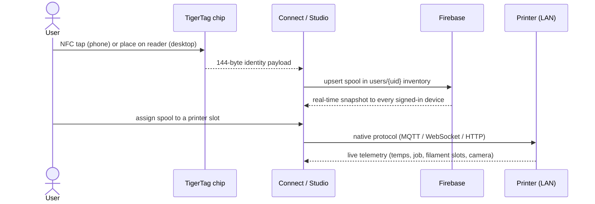
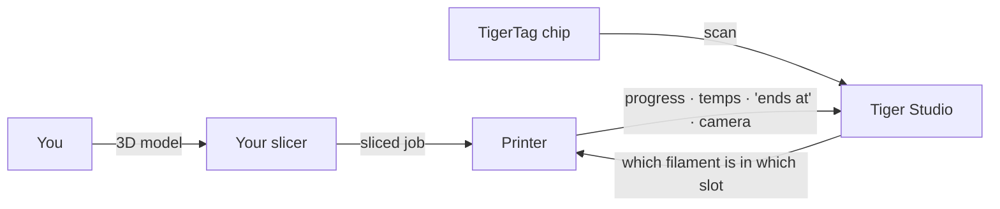

# Flusso dei dati

## Dal tocco alla stampa

Il percorso completo di una bobina nel sistema:

## Dove risiede ogni tipo di dato

| Dato | Risiede in | Note |
|---|---|---|
| Identità della bobina | Il chip + l'inventario cloud dell'utente | Il chip è l'autorità per l'uso offline |
| Database di riferimento (marche, materiali…) | `cdn.tigertag.io` (stesso progetto Firebase) | Incluso nelle app, aggiornato dalla CDN |
| Immagini delle bobine (comprese le foto prodotto TigerTag+) | `cdn.tigertag.io` (stesso progetto Firebase) | Servite a tutte le app |
| Inventario, rack, amici, preferenze | Firestore `users/{uid}/…` | Solo il proprietario per impostazione predefinita, regole applicate dal server |
| Codici di scoperta pubblici | Firestore `publicKeys/{code}` | Ricerca di un amico in O(1) |
| Credenziali e telemetria delle stampanti | **Solo in locale** (desktop) | Il traffico LAN non transita mai dal cloud |
| Peso in tempo reale (TigerScale) | Dispositivo → Firestore | Compare in tempo reale in tutti i client |

## Dove si colloca il tuo slicer

TigerSystem **non sostituisce il tuo slicer**: completa il quadro attorno a
esso:

- Esegui lo slicing e avvii i lavori esattamente come prima, con qualsiasi slicer.
- Tiger Studio comunica alla stampante **quale filamento si trova in quale slot**
 (AMS / CFS / Canvas / ACE / IFS), così le informazioni lato macchina
 corrispondono alla realtà.
- Qualunque cosa abbia avviato la stampa, il lavoro compare in tempo reale in Tiger Studio:
 avanzamento, temperature, ora di fine, telecamera.
- Il chip contiene le impostazioni di stampa consigliate per il filamento; **oggi non
 esiste l'importazione automatica dei profili dello slicer**: le riporti tu
 nel tuo profilo dello slicer.

## Due piani, volutamente separati

- **Piano cloud**: identità, inventario, condivisione. Internet, Firebase,
 regole applicate dal server.
- **Piano LAN**: controllo delle stampanti e telecamere. Solo rete locale, protocolli
 nativi dei produttori, nessuna dipendenza dal cloud (l'app desktop continua a funzionare con
 le stampanti anche offline).

> **Nota:** l'eccezione è la **modalità cloud** di Anycubic, in cui il collegamento
> con la stampante passa dal MQTT cloud del produttore. Vedi
> [la compatibilità Anycubic](../compatibility/anycubic.md).

---

**◀ Precedente:** [Panoramica dell'architettura](./overview.md) · **▲ [Indice della documentazione](../../README.md)** · **Successivo ▶** [Prodotti](../products/README.md)

**Vedi anche:** [Inventario e sincronizzazione cloud](../concepts/inventory-and-cloud-sync.md), [Compatibilità](../compatibility/README.md)
